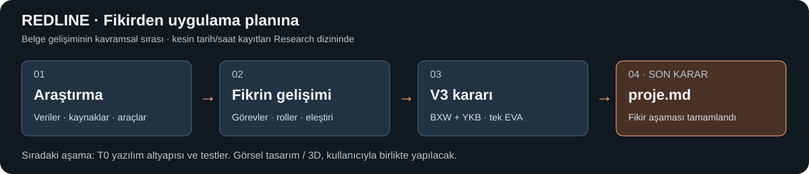

# REDLINE

REDLINE, Mars EVA planlaması için **Bilinen · Bilinmeyen · Kırmızı çizgi** yaklaşımını araştırır. Haritadaki belirsizlikler dönüş payına bağlanır; robot gözlemleri planı günceller, radyasyon olayı yeniden planlamayı tetikler.

**Fikir aşaması tamamlandı. Uygulamanın esası [proje.md](proje.md).** Fikirler, gelişimleri ve araştırmalar [research/](research/README.md) altında düzenlendi. Sıradaki iş T0 yazılım altyapısıdır; gerçek sonuçlar [doğrulama günlüğünde](docs/VERIFICATION_LOG.md) kayıtlıdır. Görsel tasarım ve 3D varlıklar kullanıcıyla birlikte yapılacak.

| Nereden başlamalı? | İçerik |
|---|---|
| [proje.md](proje.md) | Kullanıcının paylaştığı ayrıntılı uygulama planı |
| [V3 kılavuzu](research/proje-fikirleri/REDLINE_V3_KILAVUZU.md) | Amaç, sahalar, bilim ve insan/robot iş akışı |
| [V3 uygulama speki](research/proje-fikirleri/REDLINE_V3_UYGULAMA_SPEKI.md) | Sözleşmeler, testler ve T0–T14 sırası |
| [Research — tarih ve saat dizini](research/README.md) | Bütün araştırma dosyalarına bağlantılar ve zaman kayıtları |
| [Güncel araştırma tarih/hash envanteri](research/FILE_TIMESTAMPS.json) | Bugünkü belge konumları ve son yazma saatleri |
| [İlk yayının tarihsel envanteri](research/history/2026-11-14-first-publication-files.json) | İlk aktarımın değişmeden saklanan dosya/zaman kaydı |

`proje.md`, kullanıcının son paylaştığı uygulama planıdır. Düzenleme sırasında yalnız yerel belge bağlantıları yeni klasörlere yönlendirildi; uygulama kararları değiştirilmedi. Research altındaki spek aktarılmış nüshadır; kodlamada kökteki `proje.md` esas alınır. Güncel çerçeve: BXW ileri EVA, YKB kalibrasyon/tutarlılık ve tek EVA'nın beş evresi.

## Tarih ve saatler

İlk yayın envanteri **2026-11-14T12:22:19+03:00** tarihinde hazırlanmaya başladı. Research dizini her belgenin metnindeki tarih beyanını, yerel son yazma ve oluşma/aktarım zamanlarını gösterir. Saat dilimi **Europe/Istanbul (UTC+03:00)**; JSON'daki dosya zamanları UTC'dir.

Dosya sistemi zamanı araştırmanın ilk yazıldığı zamanı kanıtlamaz; arşivden gelen dosyalarda paketleme zamanını yansıtabilir. Saat belirtilmeyen belgeye saat eklenmez. Gerçek yayın/commit tarih ve saatleri [bu reponun commit geçmişinde](https://github.com/ahmetefesensoy/redline/commits/main/) izlenir.

## Kaynaklar ve durum

[Araştırma notları](research-notes/) ve [metadata not defteri](output/jupyter-notebook/nasa-metadata-coverage.ipynb) kaynak/karar kayıtlarıdır. Tarihsel [D]/[K]/[?] işaretleri kendi bağlamında okunur; yeni uygulamanın çalıştığı sonucu çıkarılmaz. `önceki deneme` klasörü kullanıcının yönlendirmesiyle güncel projeden çıkarıldı; eski commit'ler Git geçmişinde kalır.

- [İlerleme](docs/PROGRESS.md) ve [doğrulama](docs/VERIFICATION_LOG.md)
- [Önceden var olan çalışma](docs/PRE_EXISTING_WORK.md) ve [AI katkısı](docs/AI_DISCLOSURE.md)
- [Aktarım](research/handoff/YENI_DEPO_AKTARIMI.md) ve [skill kaynakları/lisansları](research/proje-fikirleri/SKILL_PLANI.md)

`.agents/skills` 18 proje skill'ini, `optional-user-skills` 26 ek skill'in referans kopyasını içerir. Bunlar geliştirme rehberleridir; kurulu motor, hesap veya çalışan uygulama sağlamaz.
