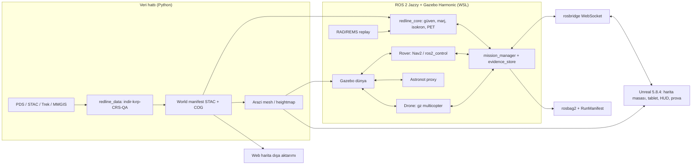

# REDLINE v3 — Proje kılavuzu

14 Kasım 2026 · NASA Space Apps 2026 · Challenge: [Interplanetary Survival Guide: Martian Map](https://www.spaceappschallenge.org/2026/challenges/interplanetary-survival-guide-martian-map/) (yerel kopya: [hackathlone](https://hackathlone.com/challenges/interplanetary-survival-guide-martian-map))

Bu belge güncel tasarım özetidir. Kaynağı 14 Kasım LLM konseyi (4 üye, anonim sıralama, karamsar tur) ve bu oturumdaki birincil kaynak kontrolleri. [PROJE_KILAVUZU.md](PROJE_KILAVUZU.md) sürüm 2 tasarımıdır; ayrıntı ve karar geçmişi için korunur. İkisi çelişirse bu belge esastır.

**Kodlama için:** [REDLINE_V3_UYGULAMA_SPEKI.md](REDLINE_V3_UYGULAMA_SPEKI.md) — depo yapısı, mesaj tanımları, düğümler, algoritmalar, Unreal sınıfları, bilim görevleri, testler ve sıralı kilometre taşları. Sıfırdan kodlayacak AI ajanı oradan başlar.

**Belge haritası:**
- §0–5: ürün, challenge, sahalar, veri, modeller, görevler
- §6–7: mimari ve Unreal bağlantısı
- §8–9: 3D varlıklar ve yazılım
- §10–14: ekip, teslim, ayrıntılar, gelişim, doğrulama
- §15: robot otonomisi (ROS → Unreal)
- §16: dünya üretimi
- §17: RViz, Open MCT ve ana ekran grafikleri
- §18: teorik modüller M1–M11
- §19: test, profiller, mekânlar, ses
- §20: önceki projeden ne var, ne yok

Etiketler: **[D]** bu oturumda birincil kaynaktan doğrulandı · **[K]** önceki araştırma notunda kayıtlı, bu turda yeniden denenmedi · **[?]** doğrulanmadı, kullanmadan önce kontrol et.

---

## 0. Tek sayfada REDLINE

**Problem.** Mars Trek ve USGS jeoloji haritaları bölgesel ölçekte çalışır. Astronotun adım attığı ölçekte haritanın neyi bilmediğini söylemezler. Challenge'ın Background bölümü bu boşluğu açıkça yazıyor.

**Tez.** REDLINE her bilinmeyeni dakika cinsinden güvenlik payına çevirir. Robotları en pahalı bilinmeyene gönderir. Yöntemini NASA'nın gerçek kararları ve gerçek ölçümleriyle sınar.

**Ekranda üç kelime:** Bilinen · Bilinmeyen · Kırmızı çizgi.

**Kahraman görsel.** Haritada nefes alan kırmızı çizgi. Çizgi, astronotların zamanında sığınağa dönebileceği alanın sınırıdır. İki şeyle canlı değişir:
- robot yeni bir bilinmeyeni çözünce genişler;
- Güneş fırtınası gelince daralır.

**İnsan hikâyesi (pitch cümlesi).** "İki astronot, birkaç saatlik oksijen, Güneş'ten gelen bir fırtına ve bilmediğini itiraf eden bir harita."

**Ürünün kimliği.** Ana ürün bir haritadır: habitat ekranı, tablet ve HUD görünümleri ile dışa aktarılan EVA planı. Unreal bu haritanın astronot gözünden prova görünümüdür. ROS 2 ve Gazebo robotların gerçek fizik ve kontrol otoritesidir. Sırayla sunulur: harita önce, simülasyon sonra.

---

## 1. Challenge uyum matrisi

Alıntılar yerel organizatör kopyasından alındı [D]. Resmî sayfa SSL hatası verdi; teslimden önce resmî metinle karşılaştır.

| Challenge isteği | REDLINE karşılığı | Veri |
|---|---|---|
| "layered, integrated view of a location or route", "multiple NASA science missions" | İki saha, 7+ katman. Her katmanın bir karar rolü var | MRO (HiRISE, CTX, CRISM), Odyssey (THEMIS), MSL (RAD, REMS, APXS, CheMin, Navcam, PLACES), MGS (MOLA, DEM içinde) |
| "map, tool, or interface a Mars astronaut could use" | Habitat ekranı, tablet, HUD + dışa aktarılan EVA kartı | — |
| Bilim hedefi ve konum; örnek "boxwork formations" | Boxwork-Batı ileri EVA sahası, bilim sorusu, istasyonlar | MMGIS, HiRISE DTM, ChemCam/DAN |
| "may consider including at least three kinds of data" (öneri, zorunlu değil [D]) | optik, termal, spektral, topografik, kimyasal, radyasyon, atmosferik | §3 |
| "astronaut safety", "might include space weather data" | Kırmızı çizgi ve SEP uçuş kuralı | RAD sol 242 ve sol 4190 [D] |
| Giysi hareket kısıtı, büyük kayalardan kaçan rota | Parametrik giysi modeli, eğim/pürüzlülük, tespit sınırı altı kaya riski | DEM, DTM σ, PLACES tilt |
| Habitat ekranı / tablet / HUD | Üç biçim = üç operasyonel rol | — |
| "static snapshot, interactive product, or a tool that generates maps" | Manifest + pipeline başka sahaya harita üretir | STAC |
| Diğer dünyaların haritalanması (Earth, Moon) | Apollo traverse ve BASALT analog mirası; Jezero (ve isteğe bağlı Ay) manifest testi | — |
| Zaman çerçevesi (geçmiş / tahmin / zamansız) | Katman başına açık seçim; tarihsel sol replay | REMS, RAD |
| Yüzey görevlerinin POV görüntüleri | "Varınca ne göreceksin": Navcam karesi ile Unreal render yan yana | Navcam RDR, Perseverance Raw |
| Robotlarla mürettebat ve alet taşıma, çift astronot | Rover alet arabası, iletişim rölesi, hareketli sığınak; EV1/EV2 | DEM viewshed |
| "updates on current conditions" | Güncel durum paneli: her kaynağın son kaydı ve yaşı | MMGIS, REMS özeti, PDS sürümü |
| Resources (5 kaynak) | Beşi de işlevsel kullanılıyor (§3.3) | — |

Jüri ölçütleri (2025 rehberi; 2026 metni okunmadı [?]): Impact, Creativity, Validity, Relevance, Presentation.

---

## 2. Sahalar

| Saha | Rol | Konum | Neden |
|---|---|---|---|
| **Yellowknife Bay (YKB)** | Kalibrasyon ve tutarlılık kontrolü | John Klein, lat −4,5895, lon 137,449 [K] | NASA burayı 2012'de yörünge katmanlarıyla seçip yerde doğruladı (Grotzinger+2014 [K]). Sol 242 SEP olayı burada ölçüldü [D] |
| **Boxwork-Batı (Mount Sharp)** | İleri EVA sahası, yeni bilim planı | Curiosity kampanyası sol 4534–4805: lat −4,798…−4,809, lon 137,379–137,386 [D] | Challenge'ın kendi örneği. Sol 4190 SEP olayı yaklaşık 1,5 km uzakta ölçüldü [D] |
| Eski 2×2 km AOI | İsteğe bağlı "az çalışılmış saha" | lat −4,825…−4,791, lon 137,428–137,462 [K] | Boxwork kampanyasının yaklaşık 2,5–5 km doğusunda; PLACES'ta rover örneği yok. Challenge "an area that hasn't been studied as closely" seçeneğine izin veriyor |
| Jezero | İsteğe bağlı manifest testi | Trek JEZ katmanları [K] | "Harita üreten sistem" kanıtı. Perseverance'ta RAD benzeri dozimetre yok; ekranda "ölçüm yok" yazar |

Eski AOI YKB'den yaklaşık 13 km güneyde [D]. Eski kırpım YKB için kullanılamaz. Yeni depoda iki saha da sıfırdan kırpılır.

Bilim sorusu (boxwork-Batı): "Doğu kenarında görülen sırtta kil / çukurda karbonat deseni batı uzantısında da geçerli mi?" REDLINE bir sonuç iddia etmez. Bir **EVA bilim planı** üretir: hipotez, istasyon, cihaz ve beklenen ölçüm.

---

## 3. Veri yığını

### 3.1 Katmanlar ve karar rolleri

| Tür | Ürün | Erişim | Statü | Karar rolü |
|---|---|---|---|---|
| Topografya | Trek `Gale_DEM_SMG_1m` (lon 137,12–137,73, lat −4,93…−4,25; iki sahayı da kapsar) [D, stage 2] | Mars Trek | ölçümden türetilmiş | eğim, viewshed, rota |
| Topografya σ | HiRISE DTM'ler: `DTEEC_010573_1755_010639_1755_U01` [D] + iki YKB DTM'i, iki boxwork DTM'i [K] | USGS STAC `mro_hirise_socet_dtms` (COG, Float32, CC0 [K]) | türetilmiş | DTM'ler arası ampirik uyuşmazlık |
| Topografya σ | CTX DTM `intersection_error` | STAC `mro_ctx_controlled_usgs_dtms` [K] | türetilmiş | stereo hata katmanı |
| Optik | HiRISE ortho 0,25 m; HiRISE zaman serisi (ESP_030313, ESP_032436 rover'ı yörüngeden gösterir [K]) | USGS / PDS | ölçüm | morfoloji, tespit sınırı |
| Termal | THEMIS TI 100 m (doğruluk ~%20 [K]) | USGS Astropedia, Trek | türetilmiş | kum / pekişmiş kayaç önseli |
| Spektral | CRISM MTRDR (gözlem ID'si [?]) | PDS Geosciences / ODE | türetilmiş | mineral önseli; "tespit yok ≠ yok" |
| Jeoloji | USGS SIM 3292 (YKB = AHi, tek poligon 87.031 km²; boxwork = Htu) [K] | USGS ArcGIS | yorum | ölçek merdiveni |
| Kimya | APXS supplement `ds01_2020je006536rr.csv`; CheMin RDR (John Klein "preliminary", kil 22±11) [K] | PDS Geosciences | ölçüm | istasyon kartı ve hata çubukları |
| Radyasyon | MSL RAD RDR `MSL-M-RAD-3-RDR-V1.0` [D] | PDS PPI | ölçüm | SEP alarmı |
| Atmosfer | REMS `MSL-M-REMS-5-MODRDR` | PDS Atmospheres | ölçüm | Go/No-Go penceresi, drone hava yoğunluğu |
| Yer gerçeği | PLACES `localized_interp.csv` (YKB'de 385 poz, tilt 0,08–17° [K]); Navcam/Mastcam RDR (CAHV) | JPL PDS, PDS Imaging, Analyst's Notebook | ölçüm | eğim RMSE, POV, alt-metre engel |
| Rota | MMGIS `MSL_waypoints.json` (1.389 nokta, son sol 5073 [D]); PIA23179 "Proposed Path" [K] | mars.nasa.gov | operasyonel | planlanan ve gerçekleşen rota sapması |
| Geometri | NAIF SPICE | NAIF | araç | güneş açısı, ışık süresi |
| Simüle | Gazebo rover/drone sensörleri | — | simüle | yeni deltalar (farklı renk) |

### 3.2 Gerçek olaylar (krizin çekirdeği)

**Sol 4190 — 20 Mayıs 2024 SEP (ana kriz)** [D]
- Dosya: `DATA/SOL_04134_04257/RAD_RDR_2024_140_18_30_4190_V00.TXT`
- E (doku eşdeğeri) dedektörü doz hızı yaklaşık 5,6'dan 351'e çıkar, yani kabaca 60 kat. Yükseliş 10 → 85 → 214 → 316 adımlarıyla olur.
- 93 doz bloğu var; kadans olay öncesi ~17 dk, olay sırasında ~9 dk. Bu, "uyarı süresi" gösterimi için yeterli.
- Arka plan ≈ 5,6 iken %25 alarmı ilk kez 20 Mayıs 2024 **05:21:50 UTC**'de tetiklenir (9,97). Tepe 351,4 **06:15:19 UTC**'de gelir. Gerçek uyarı penceresi ≈ **53 dakika** [D]. Löwe+2025'in "≥30 dk" bulgusuyla tutarlıdır. T_SEP,max = 20 dk varsayımı bu gerçek pencereyle sınanır.
- Rover o sol lat −4,7855, lon 137,409'daydı; boxwork kampanyası başlangıcına yaklaşık 1,5 km.
- NASA'nın verdiği toplam ~8.100 µGy değeri [K]. MAVEN'in aynı olayı gözlemi [?]. MAVEN 2025'te kaybedildi [K]; bu nedenle günümüz senaryosunda röle TGO/MRO/Odyssey olur.

**Sol 242 — 11 Nisan 2013, John Klein (destek sahnesi)** [D]
- B dedektörü: sol 241 ortalaması 9,163 (n=24), %25 eşik 11,454. Sol 242 zirvesi 12,13 (+%32,4).
- E dedektörü zirvesi +%24,1, yani eşiğin altında.
- 18 blok, kadans yaklaşık 1 saat.
- Bağlam: güneş kavuşumu. Dünya'dan komut gidemiyordu; tek uyarı yerel dozimetreydi. "Neden yerel otonom alarm?" sorusunun gerçek cevabı bu.
- Alarm kuralı: Löwe+2025 (arXiv 2502.02469): doz hızı ≥%25 artınca alarm, ≥30 dk uyarı [K, stage 2'de iki üye doğruladı].

**Dürüst çerçeve.** Çizgiyi daraltan doz değil, uçuş kuralıdır: "uyarı süresi ≥ sığınağa varış süresi". RAD soğurulmuş doz (Gy) ölçer, insan etkin dozu (Sv) değil. Ekranda bu yazar. Kariyer limitiyle kıyaslama yalnız açık uyarıyla yapılır (NASA 600 mSv [?]).

### 3.3 Challenge Resources: beşi de işlevsel

| Kaynak | İşlev |
|---|---|
| JPL Mars Trek | DEM, CTX, THEMIS altlıkları; WMTS; katman arama servisi |
| USGS-NASA PGM (sayfada "Non-NASA site") | SIM 3292 birim bağlamı, ölçek merdiveninin ilk basamağı |
| Curiosity's Proposed Path (rota görselleştirme örneği [D, stage 2]) | Rota haritasının tasarım dili + planlanan/gerçekleşen sapma |
| NASA Worldview (yalnız Dünya) | Swipe ve zaman çizelgesi etkileşimi ödünç alınır; isteğe bağlı Dünya analog paneli |
| Perseverance Raw Images | Jezero POV; API alanları `camera_model_component_list`, `mastAz/El` (CAHV) [K] |

### 3.4 Veri disiplini (AGENTS.md ile uyumlu)
- CRS her üründe metadata'dan okunur. Gale eqc R=3.396.190 m, lon_0=0. SIM 3292 Robinson / Mars 2000. Jezero CTX R=3.396.160 [K]. Bounding-box örtüşmesi hizalama kanıtı değildir.
- Numune kökeni ≠ analiz konumu. APXS tablosundaki koordinat rover gövdesinin pozu; John Klein satırı PLACES pozuyla 2 mm içinde eşleşiyor [K]. Haritada iki simge olur: "analiz sırasında rover burada" ve "numune burada".
- Dört statü: arşiv / türetilmiş / simüle / senaryo. Her hücrede ve her kartta görünür.
- Büyük ürünler (Trek DEM 5,78 GB) tam indirilmez. COG/VRT ile pencere okuması yapılır, kırpım provenance'a hash ile yazılır.

---

## 4. Çekirdek modeller

### 4.1 Güven katmanı → dakika cinsinden pay

Hücre şeması:

```
value, unit, product_id (LIDVID/STAC id), gsd_m, acq_time, processing_level,
sigma, sigma_source, state ∈ {detected | not_detected_limited | unobserved},
status ∈ {archive | derived | simulated | scenario}, decision_role
```

σ kaynakları:
- HiRISE DTM'ler arası fark. Bu "ampirik uyuşmazlık"tır, bağımsız hata değildir: ortak MOLA kontrolü var. Önce eşkayıt yapılır, sonuç tek σ değil dağılım olarak raporlanır.
- CTX `intersection_error`.
- DTM eğimi ile PLACES tilt farkı, rover tabanı ölçeğinde (~3 m).
- THEMIS ±%20.

Tespit sınırı: HiRISE 0,25 m/px'te "en az 3 piksel" kuralıyla yaklaşık 0,75–1 m altı kaya görünmez. Bu bir kural, ürün özelliği değil. Varsa HiRISE gölge tabanlı kaya bolluğu ürünü kullanılır (Golombek ve ark., MSL iniş elipsi [?]).

Marj zinciri: bilinmeyen hücre → yürüme hızı cezası ve süre belirsizlik bandı → dönüş süresi → kırmızı çizgi. Planlamacı "bu bilinmeyen bana kaç dakikaya mal oluyor?" sorusunun cevabını görür.

### 4.2 Kırmızı çizgi (operasyonel tanım)
- Çizgi EVA zaman çizelgesinden (PET) türetilir. Her zaman adımında erişilebilir bölge hesaplanır. İstasyonlar go/no-go karar noktalarıdır.
- Koşul: dönüş süresi × marj ≤ en kısıtlı sarfın kalanı. Sarflar: O₂, CO₂ tutma, soğutma suyu, batarya. Ekranda hangi sarfın sınırladığı yazar.
- İki çizgi: sarı = terminate (düzenli dönüşe başla), kırmızı = abort (hemen dön).
- EV1/EV2: çizgi durumu daha kötü olana göre çizilir. Biri yavaşlarsa (yaralanma veya giysi kaçağı) çizgi yeniden hesaplanır.
- Sığınak: habitat veya hareketli basınçlı rover. Rover yer değiştirdikçe isokron değişir.
- İletişim: DEM viewshed'den habitat/rover görüş hattı katmanı çıkar. Rover tepeye çıkınca gölgedeki istasyon iletişimli olur.

### 4.3 Giysi ve insan modeli (parametrik)
- Yapı SEXTANT (BASALT analog programı) planlayıcısına benzer: DEM + eğime bağlı metabolik maliyet + süre. Metabolik veri Apollo kökenlidir [K].
- BASALT bulgusu: gerçek traverse süresi tahminden uzun çıktı [K]. Bu, marj çarpanının kaynağıdır.
- Apollo verisi 1/6 g, Mars 3/8 g ve Mars giysisi için ölçüm yok. Hepsi kaydırıcı olur ve "Apollo/analog türevi varsayım" diye etiketlenir.
- **Duyarlılık grafiği (tornado):** "Kararı hangi varsayım değiştiriyor?" Jürinin "modeliniz uydurma mı" sorusunun cevabı budur.

### 4.4 SEP uçuş kuralı
- RAD replay düğümü doz hızını okur. Önceki pencereden arka plan hesaplanır; ≥%25 artışta alarm verilir.
- Alarm anında herkes için "sığınağa varış süresi" hesaplanır. Kuralı karşılamayan bölge kırmızıya döner ve EVA timeline'ı yeniden planlanır.
- Kümülatif doz çubuğu "rover konumunda ölçülen soğurulmuş doz" etiketini taşır. İnsan dozuna dönüşüm senaryo olarak etiketlenir.
- "Hangi dedektör, hangi eşik" ayarlanabilir parametredir (sol 242'de B alarm verir, E vermez).

### 4.5 Robot değeri (bilgi değeri)
- Aday gözlem: "bu hücreyi çözersem kırmızı çizgide kaç dakika pay kazanırım?"
- Drone ve rover "gözlenmedi / tespit sınırı altı" hücrelere gönderilir.
- Ölçüt: robot saati başına kazanılan pay dakikası.
- Bir kararı değiştirmeyen robot deltası ekranda öne çıkarılmaz, ama kayıtta durur.
- Drone uçuş zarfı REMS'ten türetilir: ρ = P / (R_CO₂·T), R_CO₂ ≈ 188,9 J/(kg·K). Örnek: 750 Pa ve 220 K için ρ ≈ 0,018 kg/m³. Sıcaklık ve basınç gerçek ölçüm, ρ türetilmiş. Gazebo'da itki katsayısı ρ ile ölçeklenir.

---

## 5. Görevler: tek EVA kampanyası, beş evre

Beş görev ayrı demolar değil, aynı EVA'nın evreleridir. Her evre aynı harita kaydını (`campaign_id`, `target_id`) okur ve ona delta yazar.

### Evre 1 — Brifing ve Go/No-Go (eski "eğitim/sınav")
- **Amaç:** EVA'nın yapılıp yapılmayacağına karar vermek ve ekibi brifing etmek.
- **Kullanıcı:** habitat ekranında sahayı açar ve EVA penceresini seçer: REMS sıcaklık/basınç/UV, SPICE güneş açısı, DEM gölgesi. Bilim hedefini ve istasyonları seçer.
- **Sistem:** ilk EVA planını (PET timeline), sarı/kırmızı çizgileri ve cuff checklist'i üretir. Duyarlılık grafiğini gösterir.
- **Gerçek veri:** REMS seçilmiş sol, SPICE, DEM, CTX/HiRISE, SIM 3292, THEMIS, CRISM.
- **Simüle/senaryo:** giysi parametreleri, ekip sayısı, sarf kapasiteleri.
- **Çıktı:** `EVAPlan v1` ve `DecisionRecord` (neden bu pencere ve bu istasyonlar).
- **Prova modu (eski eğitim/sınav):** kullanıcı Unreal'da planı astronot gözünden prova eder. Sınav modunda gizli senaryo olayları (SEP, giysi kaçağı) devreye girer ve debrief'te karar kalitesi gösterilir.
- **Kabul:** plan bir kaynağa tıklanınca ürün kimliğini açar; varsayım değişince plan yeniden hesaplanır.

### Evre 2 — Robot öncü keşif (EVA'dan sol'ler önce)
- **Amaç:** EVA'dan önce en pahalı bilinmeyenleri çözmek.
- **Sistem:** bilgi değeri sıralamasıyla hücre seçer (§4.5). Drone `SurveyArea` görevini, rover `InspectTarget` görevini alır.
- **Gazebo:** rover (Curiosity modeli) Nav2 ile sürer. Drone Mars yoğunluğunda uçar. LiDAR/kamera alt-metre engeli bulur. Senaryo kayaları açıkça "senaryo" etiketlidir.
- **Gerçek veri karşılığı:** Navcam stereo türevleriyle "yörünge vs yer" farkı gösterilir: aynı yamada HiRISE DTM ile Navcam yan yana.
- **Çıktı:** hücre durumları `unobserved → detected/not_detected` olur, `EVAPlan v2` çıkar. Kırmızı çizgi değişir (genişler veya bir koridor kapanır).
- **Kabul:** her delta için "hangi kararı değiştirdi" kaydı var; kazanılan pay dakikası hesaplanır.

### Evre 3 — Traverse (iki astronot)
- **Amaç:** EV1/EV2'nin istasyonlara güvenli gidişi.
- **Unreal:** astronot gözünden yürüyüş; HUD'da yalnız kalan pay, sonraki istasyon ve dönüş yönü. Habitat ekranında IV operatörü (yerel uçuş kontrolü) iki astronotu ve rover'ı izler.
- **Gazebo:** astronotun kinematik proxy'si rover algısına dinamik engel olarak girer. Rover alet arabası ve röle olarak eşlik eder.
- **POV:** istasyona yaklaşınca gerçek Navcam karesi ile aynı CAHV pozundan Unreal render yan yana swipe ile gösterilir.
- **Çıktı:** gerçekleşen süre ve plan farkı. Fark marj modeline geri beslenir.

### Evre 4 — İstasyon bilimi (eski "numune/laboratuvar" ve "sondaj")
- **Amaç:** bilim planını uygulamak ve numuneyi doğru kayıtla almak.
- **Akış:** istasyon kartı (gerçek APXS/CheMin karşılaştırması, hata çubuklu, "preliminary" işaretli) → bağlam fotoğrafı → numune alımı ya da sondaj (rover kolu veya astronot aleti) → kap ve `SampleRecord`.
- **Kayıt:** köken konumu ile analiz konumu ayrı alanlardır. "Analiz sırasında rover burada" ile "numune burada" iki ayrı simgedir.
- **Gerçek veri:** APXS, CheMin, ChemCam/DAN (boxwork için Release 42, sol 4843'e kadar [K]).
- **Simüle:** yeni numunenin analiz sonucu senaryo olarak etiketlenir. Gerçek NASA ölçümüyle aynı kartta ayrı satırda durur. pH/iletkenlik gibi Gale'de ölçülmemiş büyüklükler "model" etiketiyle ikincil kalır.
- **Kabul:** numune kaydı tam (köken, işlem, kap, zaman); sonuç sonraki istasyonu ya da bir sonraki EVA'yı değiştirebilir.

### Evre 5 — Dönüş ve acil durum (eski "vana/kaçak müdahalesi")
- **Kriz A: SEP.** Sol 4190 replay'i ile alarm gelir. Uçuş kuralı devreye girer ve kırmızı çizgi daralır. Rover sığınağa doğru yaklaşır, isokron yeniden hesaplanır.
- **Kriz B: giysi kaçağı.** Eski vana görevi buraya dönüşür. EV2'nin sarf tüketimi artar, sınırlayan sarf değişir ve çizgi EV2'ye göre daralır. Rover sarf takviye noktası olabilir (varsayım). Habitat tarafında vana/servis hattı müdahalesi isteğe bağlı alt görev olarak kalır: ArUco ile kimlik, kol ile müdahale.
- **Çıktı:** debrief'te zaman çizelgesi replay'i, karar noktaları ve "hangi veri hangi kararı değiştirdi" tablosu.

### Doğrulama hattı (görevlerle paralel)
- **V1 — YKB tutarlılık kontrolü.** Yalnız yörünge katmanlarıyla hedef ve rota önerilir. Sonuç Curiosity'nin gerçek izi ve bulgularıyla karşılaştırılır. Karne: termal atalet → pekişmiş kayaç: isabet; HiRISE → kırıklı açık tonlu birim: isabet; CRISM → kil: kaçırma (toz örtüsü; CheMin ~%20 smektit [K]). Sunumdaki cümle: "Haritamız kili göremezdi ve bunu biliyordu."
- **V2 — Boxwork zaman bölmeli test (asıl kanıt).** Karar kuralı ve maliyet fonksiyonu önceden commit'lenip dondurulur. Yalnız sol 4533 öncesi arşivle plan yapılır. Sonuç sol 4534–4805 gerçek bulgularıyla karşılaştırılır. Geriye bakış yanlılığına karşı en güçlü cevap budur.
- **V3 — Monte Carlo duyarlılık.** Simüle dünyalarda "yalnız yörünge" ile "yörünge + robot" karşılaştırılır. Metrikler: rotadaki bilinmeyen oranı, tespit edilen engel, süre, dönüş payı, sığınak süresi. Hepsi "simüle dünyalar" etiketiyle sunulur.

---

## 6. Yazılım mimarisi



### 6.1 Otorite ve sahiplik
- **Gazebo:** robot fiziği ve robot sensörleri. Unreal robotu yalnız ROS pozundan çizer.
- **Unreal:** astronot hareketi ve insan arayüzü. Astronotun Gazebo'daki proxy'si poz akışıyla beslenir.
- **redline_core:** güven katmanı, marj, isokron ve PET. Hesap tek yerde yapılır; Unreal ve web yalnız gösterir.
- **mission_manager:** görev durumu, komut sahipliği (manuel/otonom), iptal ve sonuç.
- **Saat:** Gazebo `/clock` deney zamanıdır. Ekranda ayrıca görev LMST'si ve replay edilen tarihsel UTC gösterilir.

### 6.2 Paketler (yeni depoda)

| Paket | İçerik |
|---|---|
| `redline_data` (Python) | ürün kataloğu, indirme/pencere okuma, CRS kontrolü, kırpma, eğim/σ/viewshed, STAC yazımı, mesh/heightmap üretimi |
| `redline_core` (Python, ROS'tan bağımsız kütüphane) | hücre modeli, maliyet, giysi modeli, isokron, PET, SEP kuralı, bilgi değeri; birim testleri |
| `redline_msgs` | `EvidenceRecord`, `SampleRecord`, `DecisionRecord`, `EVAPlan`, `CellState`; action'lar `SurveyArea`, `InspectTarget`, `CollectSample`, `ReturnToShelter` |
| `redline_mission` (rclpy) | görev evreleri, evidence store, komut sahipliği, watchdog |
| `redline_replay` (rclpy) | RAD/REMS tarihsel yayın; sol/LMST ↔ UTC ↔ sim saati |
| `redline_gazebo` | dünya, Mars yerçekimi (3,721 m/s²), arazi, rover/drone/proxy modelleri, senaryo kayaları |
| `redline_bridge_ue` (Unreal C++ plugin) | rosbridge istemcisi, eksen/birim dönüşümü, tazelik/kopma yönetimi |
| `redline_web` | statik harita görüntüleyici (OpenLayers + GeoTIFF), EVA kartı dışa aktarımı |
| `redline_safety` | uçuş kuralları (FRET → Ogma → Copilot izleyicileri), `safety_aggregator` (§18 M9) |
| `redline_comm` | `link_manager` (DEM görüş hattı, mesaj düşürme/geciktirme), isteğe bağlı DTN geçidi (§18 M10) |

ROS düğüm grafiği. v0.3 tasarımından ([REDLINE_RESEARCH.md §6.3](önceki%20deneme/docs/REDLINE_RESEARCH.md)) v3'e uyarlandı:

| Düğüm | Dil | Girdi → çıktı |
|---|---|---|
| `sim_clock`, `scenario_player` | Python | senaryo dosyası → `/clock`, 10 Hz tick, olaylar (SEP, giysi kaçağı, arıza) |
| `rad_replay`, `rems_replay`, `env_server` | Python | RAD/REMS dosyaları, SPICE → `/env/dose_rate`, `/env/sep_alert`, `/env/sun`, `/env/weather` |
| `ev_sim` ×2 | Python | rota, olaylar → EV2'nin (ve gerekirse EV1'in) konumu, biyomedikal ve sarf değerleri |
| `human_model`, `consumables_estimator` | Python | biyomedikal, konum → metabolik kestirim, sarf tahmini (§18 M1) |
| `cell_store` | Python/C++ | yörünge katmanları + robot deltaları → hücre durumu, `/redline/cells/delta` |
| `planner_server`, `walkback_field` | C++ veya Python | katmanlar, konum, tahminler → `PlanEva`, `Replan`, kırmızı/sarı çizgi, dakika payı (§18 M6) |
| `science_optimizer` | Python | posterior, alanlar → bilim durakları (§18 M5, M7) |
| `rover_placer` | Python/C++ | rota, alanlar → rover sığınak istasyon planı (§18 M8) |
| `voi_tasker` | Python | hücre σ, plan → drone/rover görev önerisi (bilgi değeri, §4.5) |
| `mission_manager`, `command_authority` | Python | görev evreleri, komut sahibi, watchdog |
| Nav2 yığını | C++ | istasyon planı, costmap → rover hız komutu |
| `scout_controller` | Python/C++ | `SurveyArea` → drone uçuşu, kalkış/iniş |
| `localization` | C++ | IMU, teker, UWB, ufuk, güneş → konum + kovaryans (§18 M11) |
| `copilot_monitor`, `safety_aggregator` | C99 / Python | kural girdileri → `/safety/violations` |
| `link_manager` | Python | konumlar, viewshed → `/comm/link/*` |
| `rosbridge_server`, `foxglove_bridge` | — | WebSocket (Unreal, Open MCT, Foxglove) |
| `tss_adapter` (isteğe bağlı) | Python | sarf, konum → NASA SUITS TSS tarzı telemetri |

### 6.3 Arayüz listesi (ilk sürüm)

| Konu / servis | Tip | Hız | Yön |
|---|---|---|---|
| `/rover_1/odom`, `/scout_1/odom` | `nav_msgs/Odometry` | 10–20 Hz | ROS → UE |
| `/tf` (yalnız seçili frame'ler) | `tf2_msgs/TFMessage` | 10 Hz | ROS → UE |
| `/astronaut_{1,2}/pose` | `geometry_msgs/PoseStamped` | 20 Hz | UE → ROS |
| `/redline/cells/delta` | `redline_msgs/CellState[]` | olay | ROS → UE |
| `/redline/isochrone` | `nav_msgs/Path` veya polygon | 1 Hz / olay | ROS → UE |
| `/redline/plan` | `redline_msgs/EVAPlan` | olay | ROS → UE |
| `/redline/alerts` | `redline_msgs/Alert` | olay | ROS → UE |
| `/redline/replay/rad` | doz hızı + zaman damgası | replay | ROS → UE |
| `/rover_1/camera/compressed` | `sensor_msgs/CompressedImage` | 2–5 Hz | ROS → UE |
| `/redline/command` (servis) | goal / iptal / mod değişimi | istek | UE → ROS |

Action'lar ROS tarafında bir adaptör düğümünde tutulur. Unreal'a topic/servis olarak açılır: rosbridge'in ROS 2 action desteği sürüme göre değişir [?].

### 6.4 Çerçeve, birim ve saat sözleşmesi
- **Harita frame'i:** ürün eqc (m) → yerel `map` ENU. Orijin = saha manifestindeki E/N/H; x=doğu, y=kuzey, z=yukarı, metre.
- **Unreal dönüşümü:** `UE.x = 100·x`, `UE.y = −100·y`, `UE.z = 100·z` (cm, sol el). Quaternion: `q_ue = (w, −x, y, −z)`; yaw işareti ters. Hepsi tek fonksiyonda yapılır ve test edilir: 1 m küp, 4 yön, ±90° dönüş.
- **Kamera optik frame'i** (z ileri) ayrı dönüşümdür.
- **Yükseklik:** ürün metadata'sındaki dikey datum korunur. Yerel z = H − H₀.
- **Saat:** sol = 24 sa 39 dk 35,244 s. LMST ve MSD hesabı Mars24 algoritmasıyla yapılır (Allison & McEwen 2000). Replay'de tarihsel UTC ile sim saati arasında sabit ofset ve hız çarpanı kayıtlıdır.
- **Tazelik:** her mesajda ölçüm zamanı ve alım zamanı ayrıdır. Unreal eski veriyi "güncel değil" olarak gösterir. Kopmada komutlar düşer; robot tanımlı duruşa geçer.

### 6.5 Tek dünya: aynı arazi iki motorda
1. `redline_data` DEM penceresini okur ve yerel ENU'ya çevirir.
2. Aynı ızgaradan Gazebo için mesh (veya GeoTIFF heightmap; Gazebo DEM desteği [?]) ve Unreal için 16 bit heightmap üretilir.
3. **Unreal Landscape Z ölçeği:** ölçek 100'de 16 bitlik aralık 512 m'yi kapsar. Gerekli ölçek = yükseklik aralığı(m) × 100 / 512. Boyut Landscape'in önerilen değerlerinden biri seçilir (ör. 1009, 2017, 4033 vertex).
4. Doku HiRISE ortho'dan gelir. Kaya ve dekor instancing ile eklenir. Görevi etkileyen her nesne manifestle Gazebo'ya da aktarılır.
5. **Sözleşme testi:** bilinen üç nokta iki motorda aynı yükseklikte mi (±10 cm)?

---

## 7. Unreal tarafı

### 7.1 ROS bağlantısı
- **Ana yol:** `rosbridge_suite` (Jazzy dalı mevcut [D]) + Unreal'ın yerleşik WebSockets modülüyle C++ istemci. Protokol JSON'dur, örneğin:
  `{"op":"subscribe","topic":"/rover_1/odom","type":"nav_msgs/msg/Odometry","throttle_rate":100}`
- **WSL ağı:** Windows'tan WSL'deki rosbridge'e `localhost:9090` genelde çalışır (WSL2 localhost yönlendirmesi). Çalışmazsa WSL IP'si veya mirrored networking. İlk saatte test et.
- **Görüntü:** düşük hızda `CompressedImage` base64 akışı. Daha yüksek hız gerekirse `web_video_server` ile ayrı MJPEG [?].
- **Alternatifler:** rclUE (README Windows'u desteklemiyor diyor [K]; ana yol yapılmaz); Zenoh (`rmw_zenoh` veya zenoh-c istemcisi [?]).
- **Replay modu:** rosbag2 kaydı aynı köprüden oynatılır. Video ve sunum deterministik olur; canlı sistem çökse de demo çalışır.

### 7.2 Unreal bileşenleri
| Bileşen | Teknik | İş |
|---|---|---|
| Harita masası (habitat) | UMG + render target, `WBP_MapTable` | katmanlar, hücre kartı, kırmızı/sarı çizgi, robot görevleri |
| Tablet | UMG, aynı veri modeli | brifing, istasyon kartı, PET timeline |
| HUD | minimal UMG | kalan pay, sonraki istasyon, dönüş yönü, alarm |
| Prova görünümü | Landscape/statik mesh + astronot karakteri | astronot gözünden traverse |
| POV swipe | iki render target | Navcam karesi ↔ Unreal render |
| Ölçek merdiveni | Sequencer veya etkileşimli zoom | SIM 3292 → CTX → HiRISE → hücre |
| Duyarlılık grafiği | UMG grafik | "kararı hangi varsayım değiştiriyor" |
| Güncel durum paneli | UMG | kaynakların son kaydı ve yaşı |
| Debrief | Sequencer + rosbag replay | karar noktaları |

- Mars yerçekimi: World Settings'te Z yerçekimi −372,1 cm/s². Astronot animasyonu buna göre ayarlanır.
- Alternatif arazi: Cesium for Unreal + Cesium Mars (Gale için ~1 m arazi ve 25 cm görüntü belirtiliyor [K]). Görsel bağlam için iyidir. Ama Gazebo ile aynı geometri ve çevrimdışı çalışma kontrol edilmeli; ana yol 6.5'tir.

---

## 8. 3D varlıklar

| ID | Varlık | Kaynak | Hak / durum | Yapılacak iş |
|---|---|---|---|---|
| M01 | Curiosity rover (görsel) | [NASA-3D-Resources](https://github.com/nasa/NASA-3D-Resources) "Curiosity Rover (MSL)" [D] | NASA kredisi; sayfa koşulu kontrol edilir | Unreal'a ölçülü import, tekerlek ve direk pivotları |
| M02 | Curiosity rover (fizik) | [space-ros/demos](https://github.com/space-ros/demos) `curiosity_description`, `curiosity_gazebo` [D] | Kök Apache-2.0; alt model hakları ayrı [K]; ROS sürüm uyumu [?] | Jazzy/Harmonic'e taşı, ros2_control, sensörler |
| M03 | Perseverance (alternatif rover / Jezero) | [science.nasa.gov 3D](https://science.nasa.gov/3d-resources/mars-2020-perseverance-rover/) [D] | NASA/JPL kredisi | yalnız görsel |
| M04 | Ingenuity (drone görseli) | [science.nasa.gov 3D](https://science.nasa.gov/3d-resources/ingenuity-mars-helicopter/) [D] | NASA kredisi | Gazebo'da basit gövde + 4 rotor eşdeğeri (koaksiyel model yerine) |
| M05 | Drone fizik | Gazebo `MulticopterMotorModel` / `MulticopterVelocityControl` sistemleri; PX4 gz modelleri referans [D: PX4-gazebo-models deposu] | Apache/BSD [?] | Mars ρ ve g ile itki ölçekleme |
| M06 | Basınçlı rover / hareketli sığınak | NASA-3D-Resources "Space Exploration Vehicle" [D] | NASA kredisi | Unreal görseli; Gazebo'da basit kutu collision |
| M07 | Habitat dış/iç | NASA-3D-Resources "Habitat Demonstration Unit" [D]; Kenney Space Kit (CC0) [K]; kendi Blender kitimiz | NASA kredisi / CC0 / özgün | modüler kit, harita masası odası |
| M08 | Astronot | NASA-3D-Resources "Astronaut" [D] (DigitalSpace kaynaklı; hak belirsiz [K]); alternatif: kendi Blender giysisi + UE Mannequin rig + IK Retargeting | belirsiz / Epic lisansı | rig, Mars yürüyüşü, iki farklı renk (EV1/EV2) |
| M09 | Kaya ve zemin | Poly Haven (CC0) [K]; Megascans/Fab (lisans kısıtlı [K]) | CC0 tercih | instancing; görevi etkileyen kayalar manifestte |
| M10 | Görev nesneleri | kendi üretimimiz | özgün | numune kabı, alet arabası, sondaj, röle direği, istasyon bayrağı, vana paneli |
| M11 | Arazi | DEM + HiRISE ortho | NASA/USGS kamu malı + kredi | §6.5 hattı |

Üretim kuralı: metre ölçüsü, doğru pivot, collision proxy, LOD. Unreal'da bilinen bir kenar cm olarak ölçülür ve Gazebo pozuyla eşleştirilir. Ad önekleri: `SM_`, `SK_`, `M_`, `T_`, `BP_`, `WBP_`, `UCX_`. NASA logosu ve marka öğesi üretilen içerikte kullanılmaz.

---

## 9. Kullanılabilecek ve değiştirilebilecek yazılım

| İş | Araç | Lisans / not |
|---|---|---|
| ROS–Unreal köprüsü | [rosbridge_suite](https://github.com/RobotWebTools/rosbridge_suite) (jazzy dalı [D]) | BSD-3 |
| Rover navigasyonu | [Nav2 Jazzy](https://github.com/ros-navigation/navigation2/tree/jazzy) | paket bazında lisans |
| Rover kontrolü | [gz_ros2_control](https://control.ros.org/jazzy/doc/gz_ros2_control/doc/index.html), ros2_control | Apache-2.0 |
| Kol (isteğe bağlı) | [MoveIt 2](https://github.com/moveit/moveit2) | BSD-3 |
| Curiosity referansı | [space-ros/demos](https://github.com/space-ros/demos) | Apache-2.0 |
| Rover mekaniği | [JPL Open Source Rover](https://github.com/nasa-jpl/open-source-rover) | ayrı haklar |
| Algı | OpenCV (ArUco), [grid_map](https://github.com/ANYbotics/grid_map) [?] | BSD |
| Kayıt / replay | [rosbag2](https://github.com/ros2/rosbag2), [PlotJuggler](https://github.com/PlotJuggler/PlotJuggler) | Apache / MPL |
| Mühendislik görünümü | RViz, [Foxglove bridge](https://github.com/foxglove/foxglove-sdk) | MIT |
| Telemetri (isteğe bağlı) | [Open MCT](https://github.com/nasa/openmct) | Apache-2.0 |
| Kural izleme (isteğe bağlı) | [NASA FRET](https://github.com/NASA-SW-VnV/fret), [Ogma](https://github.com/nasa/ogma) | NOSA / Apache |
| Raster ve CRS | GDAL, rasterio, pyproj, QGIS | MIT / GPL (QGIS) |
| STAC | pystac, pystac-client | Apache-2.0 |
| ISIS küpleri (THEMIS) | USGS ISIS3 veya GDAL ISIS3 sürücüsü | kamu malı / MIT |
| SPICE | SpiceyPy + NAIF kernel'ları | MIT |
| PDS etiketleri | pds4_tools, pvl | açık kaynak [?] |
| Web harita | OpenLayers (GeoTIFF/WebGL tile kaynağı) | BSD-2 |
| Tarihsel referans araçları | NASA SEXTANT, JSC DUST (UE5 simülatörü), SUITS telemetri şeması | yalnız referans [K] |

Kural: eski `önceki deneme/` kodu yeni depoya kopyalanmaz. Yeniden yazılır veya `PRE_EXISTING_WORK.md`'de beyan edilir.

---

## 10. Ekip akışı ve birleşme kapıları

**Süre notu:** hafıza kaydına göre hackathon 14 Kasım 09:00 – 15 Kasım 23:59 (Ankara), yani yaklaşık 39 saat [K]. Teslim saatini resmî sayfadan doğrula.

| Akış | Sahibi | İlk teslim |
|---|---|---|
| Veri hattı | veri/GIS | iki saha manifesti, DEM penceresi, σ katmanı, RAD/REMS replay dosyaları |
| Çekirdek model | algoritma | hücre modeli, isokron, PET, SEP kuralı, birim testleri |
| ROS/Gazebo | robotik | dünya, rover Nav2, drone, proxy, action'lar |
| Köprü | ROS + Unreal | rosbridge istemcisi, dönüşüm testi, replay |
| Unreal | UE | arazi, harita masası, HUD, astronot, POV swipe |
| Anlatı ve teslim | ürün | hikâye, çekim listesi, slaytlar, video, teslim dosyaları |

Birleşme kapıları (kapsam kesme değil, entegrasyon kontrolü):
1. **Ortak gerçeklik:** iki motorda aynı arazi, 1 m küp ve 90° testleri, 3 nokta yükseklik testi.
2. **İlk çizgi:** redline_core'un isokronu Unreal harita masasında görünüyor.
3. **Robot deltası:** bir rover gözlemi hücreyi değiştiriyor ve çizgi değişiyor.
4. **Kriz:** sol 4190 replay'i alarm veriyor, çizgi daralıyor, plan yeniden hesaplanıyor.
5. **Kanıt:** V1 karnesi ve V2 zaman bölmeli test tablosu hazır.
6. **Donma:** son saatler yalnız video, slayt ve teslim dosyaları.

---

## 11. Teslim, kurallar ve AI açıklaması

- **Biçim [K]:** 30 sn video veya en fazla 7 slayt, herkese açık bağlantılar, İngilizce, en az bir NASA kaynağı. Resmî sayfadan doğrula.
- **Önceden yapılan iş:** `PRE_EXISTING_WORK.md`. Önceki araştırma ve ROS demosu yarışma çıktısı gibi sunulmaz. GO Team araştırmayı serbest, proje geliştirmeyi diskalifiye riski sayıyor ([tartışma #1827](https://github.com/nasa/spaceapps/discussions/1827)).
- **Kaynaklar:** `DATA_SOURCES.md` (ürün ID, sürüm, erişim tarihi, statü, rol) ve `THIRD_PARTY_NOTICES.md`. DEM'de ESA HRSC girdisi de var; "tamamı NASA" denmez.
- **AI açıklaması — `AI_DISCLOSURE.md` ([GO Team #1849](https://github.com/nasa/spaceapps/discussions/1849)):**
  - AI ile üretilmiş görüntü ve videoda görünür "AI-generated" işareti olur.
  - AI yardımıyla yazılmış kod, veri işleme ve metinler belgede açıkça belirtilir; metadata'da da yer alır.
  - AI üretimi içerikte NASA logosu ve marka öğeleri kullanılmaz veya değiştirilmez.
  - Kaynaklı NASA arşiv görüntüsü ile AI üretimi görüntü ayrı içerik türüdür.
  - Bu projede örnek beyan: tasarım araştırması ve kod yardımı Claude ile yapıldı; bilim verileri NASA/USGS arşivlerinden alındı, AI tarafından üretilmedi.
- **Lisans:** özgün kod ve varlıklar için açık lisans. NASA ve üçüncü taraf malzemeler kendi haklarıyla. Fab/Megascans gibi kısıtlı varlıklar açık pakete konmaz.

### 11.1 30 saniyelik video (3 çekim)
1. **Ölçek merdiveni:** SIM 3292 poligonundan HiRISE hücresine zoom. "Bilinmeyen" hücreler gri.
2. **Robot keşfi ve kırmızı çizgi:** rover bir bilinmeyeni çözer, çizgi genişler.
3. **Gerçek fırtına:** 20 Mayıs 2024 RAD eğrisi yükselir, çizgi daralır. Astronot gözünden dönüş ve "Bilinen · Bilinmeyen · Kırmızı çizgi" kapanışı.

### 11.2 Yedi slayt
1. Kanca ve insan hikâyesi
2. Challenge kapsama matrisi
3. Katmanlar ve statü lejantı (arşiv / türetilmiş / simüle / senaryo)
4. Güven → pay → kırmızı çizgi
5. Gerçek kriz: sol 4190 ve sol 242
6. Kanıt: YKB karnesi ve boxwork zaman bölmeli test
7. Sınırlar, kaynaklar, önceden yapılan iş ve AI beyanı

---

## 12. Kolay unutulan ayrıntılar

- **Koordinat:** planetosentrik enlem, doğu pozitif boylam; ürünler arasında küre yarıçapı farkı (3.396.190 / 3.396.160). Metadata'dan oku, varsayma.
- **Dikey datum:** DEM yüksekliği hangi areoide göre? APXS yükseklikleri DEM ile tutarlı (−4520 m) [K]. Datum ürün etiketinden alınır.
- **Mars zamanı:** LMST ve sol numarası; Curiosity sol'ü ile Perseverance sol'ü farklı sayaçtır.
- **Işık süresi:** Dünya–Mars tek yön 4–24 dk. Seçilen tarihler için SPICE'tan hesaplanır ve "neden yerel otonomi" gerekçesine sayı olarak konur.
- **Güneş açısı ve gölge:** düşük güneşte uzun gölge, yüksek güneşte kontrast kaybı. EVA penceresine girer.
- **Toz ve görüş:** atmosferik opaklık (tau) kamera görünürlüğünü etkiler. 2018 küresel toz fırtınası bir "No-Go" örneği.
- **Röle:** MAVEN 2025'te kaybedildi [K]; günümüz senaryosunda röle TGO/MRO/Odyssey.
- **Veri hacmi:** COG pencere okuması. Ham büyük dosyalar depoya girmez, yalnız hash ve manifest girer.
- **Çevrimdışı paket:** demo internet API'sine bağlı olmaz; bütün katmanlar yerel paketlenir.
- **Determinizm:** senaryo tohumu ve RunManifest; aynı koşu tekrar oynatılabilir.
- **Erişilebilirlik:** renk tek bilgi taşıyıcısı değil. Sarı/kırmızı çizgi desenle de ayrılır; alarm metinle de gösterilir.
- **Dil:** teslim İngilizce; arayüz metinleri İngilizce tutulur.
- **Performans:** 30 FPS hedefi, kamera akışı düşük çözünürlükte. Kontrol döngüsü UI'a bağlı değil.
- **Güvenlik iddiası:** "güvenli rota" denmez, "model kısıtlarına uygun rota" denir.
- **CheMin "preliminary":** kesin mineral bileşimi gibi sunulmaz.

---

## 13. Proje nasıl gelişebilir (hackathon sonrası)

1. **Analog kullanıcı testi:** BASALT veya HI-SEAS tarzı analog araştırmacılarla planlama süresi ve hata ölçümü.
2. **Bayesçi güncelleme:** hücre σ'sının robot gözlemleriyle olasılıksal güncellenmesi; bilgi değerinin beklenen varyans azalmasıyla hesaplanması.
3. **Daha fazla saha ve gövde:** Jezero tam profil; Artemis için Ay güney kutbu (LRO verisi; Moon Trek [?]).
4. **Gerçek zamanlı uzay havası:** DONKI ve WSA-ENLIL tahminiyle "Dünya tahmini + yerel nowcast" birleşimi.
5. **Topografik radyasyon gölgelemesi:** krater duvarının gökyüzünü kısmen kapatmasından gelen doz farkı (önceki araştırmada Guo ve ark. [K]).
6. **Çoklu EVA kampanyası:** önceki EVA sonucu sonraki planı değiştirir; kalıcı sefer durumu.
7. **Open MCT entegrasyonu:** operasyon ekibi için telemetri görünümü.
8. **Runtime monitörler:** FRET/Ogma ile uçuş kurallarının (ör. "dönüş payı < X → alarm") biçimsel izlenmesi.
9. **Gerçek donanım:** JPL Open Source Rover ile saha testi.
10. **Açık veri ürünü:** REDLINE manifestinin STAC katalog olarak yayımlanması.

---

## 14. Doğrulama durumu

**Bu oturumda doğrulandı [D]:**
- RAD sol 242 ve sol 4190 dosyaları ve değerleri
- boxwork kampanyası ve sol 4190 rover konumları (MMGIS)
- HiRISE DTM kaydı (STAC)
- rosbridge jazzy dalı
- space-ros Curiosity paketleri
- NASA-3D-Resources'ta Curiosity, Astronaut, Habitat Demonstration Unit ve Space Exploration Vehicle
- Perseverance ve Ingenuity 3D sayfaları
- PX4 gazebo modelleri deposu
- "may consider" ifadesi (stage 2'de iki üye)

**Doğrulanmadı [?]:**
- resmî challenge sayfası ve 2026 jüri rehberi
- DONKI ve MAVEN Mayıs 2024 gözlemi
- Golombek kaya bolluğu ürünü
- CRISM gözlem ID'leri
- SEXTANT/BASALT sayıları
- NASA 600 mSv
- Gazebo DEM heightmap desteğinin Mars datumu
- rosbridge ROS 2 action desteği
- `web_video_server` Jazzy
- Space ROS'un Jazzy uyumu
- Cesium Mars'ın çevrimdışı kullanımı
- teslim saatinin kesin değeri

Konsey karar ve değerlendirme çıktılarının [kalıcı araştırma kopyası](research-notes/council-v3-source/README.md). Özgün oturumun TEMP yolu ve dosya hash'leri [kaynak kaydında](research-notes/council-v3-source/SOURCE.json) korunur; tekrarlanan uzun prompt kopyaları aktarılmadı.

---

## 15. Robot otonomisi: ROS'ta yazılır, Unreal'da görünür

### 15.1 Bu ayrım mantıklı mı?
Evet. Bu, robotik simülasyonda standart ve doğru ayrımdır:
- **Fizik ve sensörler tek yerde.** Teker teması, eğim, LiDAR ve IMU Gazebo'da hesaplanır. Unreal ikinci bir fizik çalıştırırsa iki dünya ayrışır.
- **Gerçek robot yazılımı.** Nav2, ros2_control ve robot_localization gerçek robotlarda kullanılan yığındır. Aynı otonomi kodu ileride `gz_ros2_control` yerine donanım sürücüsüyle küçük bir gerçek rover'da da (JPL Open Source Rover) çalışabilir.
- **Unreal'ın işi insan:** astronot hareketi, habitat ekranları ve prova görünümü. Robotu ROS pozundan çizer, komutu ROS'a yollar.
- **Kayıt ve tekrar:** rosbag2/MCAP ile her koşu tekrar oynatılır. Unreal aynı kaydı canlıymış gibi gösterir.

Riskler ve karşılıkları:

| Risk | Karşılık |
|---|---|
| İki motorda arazi farklı | §6.5 tek dünya hattı ve 3 nokta yükseklik testi |
| Eksen ve birim hatası | tek dönüşüm fonksiyonu; 1 m küp ve 90° testleri |
| Ağ gecikmesi / kopma | tazelik alanları, watchdog, "güncel değil" gösterimi |
| Görsel ile algı uyumsuzluğu | algı Gazebo kamerasından yapılır; Unreal güzel görüntüsüne algı kutusu konmaz |
| Görev sırasında ROS çökmesi | replay modu; video ve sunum kayıttan |

Tek istisna (isteğe bağlı): **astronotun kask kamerası Unreal'da render edilir** (SceneCapture2D → JPEG → `CompressedImage`, 2 Hz, 640×480) ve ufuk eşleştirmeli konum belirleme için ROS'a gider (§18 M11). Bu durumda Unreal bir sensör kaynağı olur ve kalibrasyonu ayrıca kayıtlanır.

### 15.2 Rover sürüş modları ve komut sahipliği
- **Modlar:**
  - **Manuel:** Unreal'dan klavye/gamepad.
  - **Destekli:** manuel komut + engel yavaşlatma/duruş.
  - **Otonom:** hedef veya koridor; Nav2 sürer.
- Her araçta tek komut sahibi olur. Komutlar aynı sürüş topic'inde yarışmaz: önce `command_authority`, sonra Nav2 Collision Monitor, sonra sürüş.
- **Geçiş sözleşmesi:** otonomi iptal → sıfır komut onayı → yeni sahip onayı. Otonomiye dönüşte güncel poz, hedef ve harita yeniden değerlendirilir. Kopan istemcinin eski komutu yeniden yürütülmez.
- E-stop ve sensör tazeliği denetimi moddan bağımsızdır.

### 15.3 Rover otonomi yığını

| Katman | Paket / yöntem | Not |
|---|---|---|
| Konum | `robot_localization` EKF (teker + IMU + görsel odometri isteğe bağlı) | Mars'ta GPS yok; `map → odom` hizası saha manifestinden |
| Yerel harita | LiDAR yükseklik ızgarası (`grid_map` [?] veya kendi mapper'ımız) | eğim, pürüzlülük, adım yüksekliği |
| Küresel maliyet | DEM eğimi + HiRISE kaya önseli + hücre σ | rover kısıtları insandan ayrıdır |
| Planlayıcı | Nav2 Smac Hybrid-A* veya Smac 2D; uzun rota için redline_core | 6 tekerli dönüş kısıtı |
| Kontrolcü | Nav2 MPPI veya Regulated Pure Pursuit | Mars hızı 0,1–0,5 m/s |
| Davranış | Nav2 Behavior Tree: yeniden plan, geri çekil, yardım iste | "yardım iste" UI'da görünür |
| Güvenlik | Collision Monitor, watchdog, eğim/devrilme sınırı | sertifikalı güvenlik değildir |
| Aktif algı | bilgi değeri (§4.5) ile gözlem noktası seçimi | "nereye bakmalıyım" |

Önceki demo ne öğretti (kod taşınmaz, yeniden yazılır):
- DEM eğimi 18° üzeri kapalı, 8 komşulu A* ve yönlü tırmanma maliyeti.
- LiDAR yakın yükselişte ileri hareketi kesme.
- Konum 1 s veya LiDAR 1,5 s eskirse sıfır komut; 15 s hareketsizlikte görev duraklatma.
- IMU yönüyle teker odometrisi.

Bunlar SLAM, EKF veya dinamik costmap değildi. v3'te Nav2 ve EKF ile değiştirilir.

### 15.4 Drone (scout)
- **Görev evreleri:** kalkış izni → koridor tarama → gözlem → dönüş → iniş. Kalkış ve iniş ayrı görevlerdir; harita üretildi diye uçuş başarılı sayılmaz.
- **Platform:** ilk sürümde duran rover yanındaki pad. Rover üstüne iniş gelecek tasarımıdır; Ingenuity'nin kanıtlanmış özelliği diye sunulmaz.
- **Fizik:** Gazebo multicopter sistemleri; Mars g = 3,721 m/s². İtki katsayısı REMS'ten türetilen ρ ile ölçeklenir (§4.5). Bu basitleştirilmiş modeldir; Mars rotor aerodinamiği doğrulaması iddia edilmez.
- **Konum:** IMU + kamera + altimetre; GPS yok.
- **İşler:** kör geçidi önden görme, yüzlek fotoğrafı, çelişkili hücreyi yeniden gözleme, dönüş koridorunu kontrol, geçici iletişim rölesi (gelecek tasarım).
- **Kural FR-14:** drone EV'lere 30 m'den yakın uçmaz ve her an rezervle iniş noktasına dönebilir [K].
- **Arşiv karşılığı:** Ingenuity'nin Jezero'da Perseverance için keşif uçuşları [K].

### 15.5 Kol ve numune durum makinesi (isteğe bağlı derinlik)
`hedef seçildi → erişim doğrulandı → ön konum → alıma hazır → alım denemesi → alım doğrulandı → kapta → kayıt tamamlandı`. Her aşamanın hata ve iptal sonucu vardır.
- MoveIt 2 erişim ve çarpışmasız yaklaşımı planlar. Temas ve kazma ayrı modeldir. İlk sürümde nesne tabanlıdır: doğru nesne + doğru kap.
- Aynı komut iki kez gelirse ikinci numune alınmaz; komut kimliği ve sonuç uzlaştırması yapılır.

### 15.6 Astronot proxy'si ve refakat
- Unreal astronot pozu `/astronaut_{1,2}/pose` olarak ROS'a gelir. Gazebo'da kinematik proxy olur ve rover sensörleri onu görür.
- Rover insanı kendi sensöründen veya belirsizlik taşıyan ekip konum bildiriminden izler; gizli ground truth kullanmaz.
- **Refakat kuralları:** takip mesafesi, görüş kaybında davranış, insanın yolunu kapatmama.
- **Hareketli sığınak:** basınçlı rover (SEV görseli) istasyon planını `rover_placer`'dan alır (§18 M8). HUD'da rover'ın gelecek konumları "hayalet" olarak görünür.

### 15.7 Unreal'a ne gider, Unreal'dan ne gelir

| ROS → Unreal | Unreal → ROS |
|---|---|
| rover/drone pozu, eklemler, kamera önizlemesi | astronot pozları |
| hücre deltaları, kırmızı/sarı çizgi, rota | manuel sürüş komutu (mod manuelken) |
| görev durumu, alarm, kural ihlali | hedef seçimi, görev isteği, iptal |
| RAD/REMS replay değerleri, güneş yönü | istasyon/numune notu, fotoğraf olayı |
| robot "yardım isteği" | (isteğe bağlı) kask kamerası karesi |

---

## 16. Dünya üretimi: kod ve veri setleri

### 16.1 Hat adımları (`redline_data`)

| Adım | Betik (öneri) | Girdi | Çıktı |
|---|---|---|---|
| 1. Katalog | `catalog.py` | ürün listesi (YAML) | ürün ID, URL, sürüm, lisans, hash |
| 2. Pencere okuma | `fetch_window.py` | COG/VRT, AOI poligonu | yerel GeoTIFF'ler (tam indirme yok) |
| 3. CRS kontrolü | `crs_check.py` | ürün etiketi/WKT | rapor: küre, lon_0, datum, nodata; uyumsuzlukta dur |
| 4. Yerel çerçeve | `to_local_enu.py` | eqc rasterlar, saha orijini | ENU ızgara (m), orijin manifestte |
| 5. Türetimler | `derive.py` | DEM, DTM'ler | çok tabanlı eğim (2–5 m), pürüzlülük, σ, viewshed |
| 6. Ufuk küpü | `horizon_cube.py` | DEM | her hücre ve azimut için ufuk yüksekliği; gölge, gökyüzü faktörü ve ufuk eşleştirme bunu kullanır |
| 7. Kaya önseli | `rocks.py` | HiRISE ortho, güneş geometrisi | gölge tabanlı kaya tespiti + Golombek–Rapp uydurması (§18 M2) |
| 8. Senaryo dünyası | `scenario_world.py` | kaya dağılımı, tohum | **gizli gerçek** kayalar (senaryo etiketli), Gazebo + Unreal manifesti |
| 9. Motor paketleri | `export_engines.py` | ENU ızgara, ortho | Gazebo mesh/heightmap + SDF, Unreal 16 bit heightmap + doku + Z ölçeği |
| 10. Ortam | `env_pack.py` | RAD, REMS, SPICE | sol bazlı zaman serileri, güneş az/el tablosu, ışık süresi |
| 11. STAC | `write_stac.py` | hepsi | STAC Collection/Item, statü ve hash |
| 12. QA | `qa_report.py` | hepsi | 3 nokta yükseklik testi, nodata oranı, CRS raporu, görsel kontrol PNG'leri |

Kütüphaneler: GDAL, rasterio, pyproj, numpy/scipy, pystac, SpiceyPy, pvl/pds4_tools. Ayrıca THEMIS `.cub` için ISIS3 veya GDAL ISIS3 sürücüsü.

### 16.2 Bilinen harita ile gizli gerçek ayrımı
- **Gizli gerçek:** dünya dosyasındaki bütün kayalar ve engeller. Gazebo ve Unreal'da ikisinde de aynı konumda durur.
- **Bilinen harita:** yalnız yörünge ürünleri ve sensörle gözlenen parçalar. Planlayıcı ve astronot ekranı yalnız bunu görür.
- Tespit sınırı altı kayalar Golombek–Rapp dağılımından tohumla üretilir ve "senaryo" etiketi taşır. Mars'ta o konumda gerçek kaya olduğu iddia edilmez.
- Dekor kayalar (yalnız görsel) ile navigasyonu etkileyen kayalar ayrı listelerde tutulur.

### 16.3 Gökyüzü, ışık, atmosfer
- Güneş yönü SPICE'tan gelir; Unreal Directional Light ROS'tan gelen az/el ile sürülür. Cesium kullanılırsa onun Dünya güneş bileşeni Mars için kullanılmaz [K].
- SkyAtmosphere Mars renklerine ayarlanır: gündüz karamel, gün batımında mavimsi.
- Toz ve opaklık (tau) seçilen sol için ayarlanır. İsteğe bağlı olarak NASA Ames MGCM çıktısı AmesCAP ile kullanılır [K].
- Gölge takvimi ufuk küpünden çıkar. Güneş 15°'nin altındayken HUD "düşük güneş" uyarısı verir.

### 16.4 Veri setleri özeti
§3.1'deki katmanlar artı şunlar:
- **AI4Mars:** Navcam arazi sınıflandırma etiketleri; rover algısı eğitimi ve karşılaştırması için isteğe bağlı.
- **Mars 2020 Sample Dossier:** Jezero numune kaydı tasarımı için referans.
- **Phoenix WCL:** laboratuvar pH prosedürü için referans; Gale ölçümü değildir.
- **NASA Sounds of Mars:** ambiyans referansı.

---

## 17. Ekranlar ve grafikler: RViz, Open MCT ve Unreal ana ekran

### 17.1 Kim neyi gösterir

| Araç | Kim için | Ne gösterir | Durum |
|---|---|---|---|
| **Unreal ana kontrol merkezi** | jüri, kullanıcı | harita masası, robot konsolu, bilim masası, görev duvarı | ana ürün |
| **NASA Open MCT** | operasyon/analiz | canlı ve geçmiş telemetri, zaman çizelgeleri, grafikler | gerçek NASA görev yazılımı; Mars 2020 dahil kullanıcıları var [K] |
| **RViz** | geliştirici | TF, LiDAR, costmap, Nav2 planı | geliştirme profili |
| **Foxglove / PlotJuggler** | geliştirici | MCAP kayıtları, zaman serileri, hata ayıklama panoları | geliştirme profili |
| **Web harita** | herkes | statik katmanlar, EVA kartı | dışa aktarım |

### 17.2 Open MCT'yi bağlamak
1. `telemetry_adapter` düğümü seçili topic'leri Open MCT telemetri nesnelerine çevirir: doz hızı, sarflar, pay dakikası, rover durumu, kural ihlalleri.
2. Geçmiş veri için küçük bir depo kullanılır: SQLite veya MCAP okuyucu.
3. Open MCT tarafında bir eklenti (JavaScript) roslibjs ile rosbridge'e veya foxglove_bridge'e bağlanır. Canlı veri `subscribe`, geçmiş veri `request` ile gelir.
4. Görünümler: Plot, Telemetry Table, Time Conductor (LMST ve UTC), Imagery (rover kamerası), Fault Management (kural ihlalleri).
5. **Unreal içine gömme:** Unreal'ın Web Browser eklentisi (CEF) ile Open MCT sayfası habitat ekranında bir widget olarak açılır. UE 5.8.4 paketlenmiş uygulamada çalıştığı test edilmeli [?]. Çalışmazsa grafikler UMG'de yerel olarak çizilir ve Open MCT ayrı monitörde açılır. Temel ekranlar gömmeye bağlı kalmaz.

### 17.3 Unreal ekranlarındaki grafikler

| Ekran | Grafikler |
|---|---|
| Harita masası | katman bindirme, hücre kartı, kırmızı/sarı çizgi, rover hayalet konumları, ölçek merdiveni |
| Görev duvarı | PET zaman çizelgesi, pay dakikası (EV1/EV2), sınırlayan sarf, kural durumu, veri yaşı |
| Uzay havası | RAD doz hızı (gerçek replay) + %25 eşik çizgisi + kümülatif doz, alarm anı |
| Robot konsolu | rover/drone kamera, mod, sağlık, görev kuyruğu, "yardım isteği" |
| Bilim masası | APXS/CheMin hata çubuklu karşılaştırma, istasyon posterior grafiği (§18 M5), numune kaydı |
| Duyarlılık | tornado grafiği ("kararı hangi varsayım değiştiriyor") |
| İletişim | görüş hattı haritası, bağlantı durumu, DTN kuyruğu ve ışık süresi bandı (isteğe bağlı) |
| Habitat sistemleri (isteğe bağlı) | servis hattı şeması, vana, basınç/akış (eski Görev 4) |

### 17.4 Unreal'da dört görünüm
1. **Astronot:** birinci şahıs, HUD/tablet, işaretleme, fotoğraf/not, robota görev verme.
2. **Rover operatörü:** kamera, harita, manuel/destekli/otonom mod, kol ve numune ekranı.
3. **Hava keşfi:** kamera önizlemesi, uçuş koridoru, gözlem kapsamı, dönüş/iniş.
4. **Görev masası:** NASA katmanları, ortak harita, görev bağımlılıkları, olay kaydı, replay.

İlk sürümde tek kullanıcı görünümler arasında geçer. Çok kullanıcılı roller (EV1 oyuncusu, IV operatörü) aynı görev otoritesine sonradan bağlanabilir.

### 17.5 Dünya konsolu ve bilim arka odası (isteğe bağlı, v0.3'ten)
- **MCC görünümü:** "son alınan durum" ile "tahmini şimdi" yan yana durur. Işık süresi bandı ve LMST/UTC saatleri gösterilir.
- **Bilim arka odası:** posterior grafiği, istasyon kartları, gecikmeli not gönderme.
- BASALT ve NASA Ames xGDS iş akışından esinlenmiştir [K].

---

## 18. Teorik modüller (v0.3'ten taşınan çekirdek)

Ayrıntılı formüller ve kaynaklar: [REDLINE_RESEARCH.md §5](önceki%20deneme/docs/REDLINE_RESEARCH.md). Fikirler araştırmadır; kod yeni depoda yazılır. Aşağıdaki sayılar v0.3 kaba hesaplarıdır [K].

| Modül | Ne yapar | Ana yöntem | v3'teki yeri |
|---|---|---|---|
| **M1 İnsan hareketi ve sarf** | eğim ve araziye göre hız, O₂, su, batarya | Tobler hız eğrisi × Froude çarpanı (Mars ≈ 0,615); Pandolf + Minetti yönlü maliyet; NASA EWT 3/8 g kalibrasyonu; O₂ ≈ 0,256 g/sa/W; HR tabanlı Kalman ile "mürettebatın dijital ikizi" | §4.3 giysi modeli |
| **M2 Arazi ve kaya tehlikesi** | eğim σ, sırt bariyerleri, kaya riski | HiRISE DTM hassasiyeti (Kirk 2008); 2–5 m çok tabanlı eğim; şans kısıtı; gölgeden kaya tespiti; **Golombek–Rapp** dağılımıyla çözünürlük altı kayalar; Poisson karşılaşma riski Dijkstra'ya toplanır | §4.1, §16.1 adım 7 |
| **M3 Radyasyon (GCR) ve SEP modu** | araziden gökyüzü kapanmasıyla doz haritası; sığınağa süre | görünür gökyüzü faktörü F_α (ufuk küpünden), RAD açı bağımlılığı (α ≈ 1,18); Murray Buttes kontrolü; **dürüst sonuç:** GCR koruması küçük (6 sa EVA'da ~8–24 µSv), asıl güvenlik etkeni SEP | §4.4, §3.2 |
| **M4 Işık, termal, atmosfer** | gölge takvimi, düşük güneş riski | SPICE + ufuk küpü; MGCM/AmesCAP | §16.3 |
| **M5 Bilim değeri (Bayesçi)** | istasyonların beklenen bilgi kazancı | EIG, submodüler seçim; ölçüm gelince posterior güncellemesi | §5 evre 4, bilim masası |
| **M6 Planlama çekirdeği** | walkback alanı, kırmızı çizgi, Pareto rotaları | yönlü 16 komşulu graf; ters graf çok kaynaklı Dijkstra; risk düzeltmeli walkback; pay = min_j m_j / tüketim hızı (dakika); hızlı/güvenli/bilim rotaları; D* Lite | §4.2 |
| **M7 Durak seçimi** | zaman pencereli stokastik orienteering | MILP (HiGHS/OR-Tools), CVaR; canlıda ≤1 s sezgisel | §5 evre 1 |
| **M8 Rover hareketli sığınak** | rover istasyonlarını en kötü kurtarma süresini azaltacak biçimde seçmek | darboğaz dinamik programlama O(K·C²); p-merkez ailesi | §15.6 |
| **M9 Uçuş kuralları (biçimsel)** | FR-01…FR-15 kuralları | NASA FRET → Ogma → Copilot C99 izleyicileri ROS'ta; GSN güvence argümanı; Ogma çalışmazsa elle C++ izleyici | `redline_safety` |
| **M10 İletişim ve DTN** | yerel ağ görüş hattı, Mars–Dünya gecikmesi | DEM viewshed + kırınım cezası; ION/HDTN, SPICE'tan kontak planı; röle TGO/MRO/Odyssey (MAVEN 2025'te kayıp [K]); kavuşum ≈ 2 hafta sessizlik | `redline_comm`, §17.5 |
| **M11 GPS'siz konum** | astronot konumu ve kovaryansı | EKF (IMU, adım, UWB); **ufuk çizgisi eşleştirme** (kask kamerası ↔ ufuk küpü); güneş pusulası | §15.1 istisna, FR-09 |

Seçilmiş uçuş kuralları:
- **FR-01:** kalan O₂ ≥ walkback O₂ + rezerv
- **FR-03:** her noktada sığınağa süre ≤ T_SEP,max = 20 dk (varsayım)
- **FR-04:** SEP alarmında 30 s içinde sığınak modu
- **FR-05:** EV1–EV2 mesafesi ≤ 100 m ve görüş hattı var
- **FR-06:** bağlantı 300 s kopuk kalırsa dönüş modu
- **FR-09:** konum σ > 20 m ise yeniden lokalizasyon
- **FR-12:** gün batımından önce dönüş
- **FR-13:** kurtarma süresi sınırı

Parametreler senaryo varsayımıdır [K].

---

## 19. Kalite, test ve çalışma profilleri

- **Analitik altın testler:**
  - düz düzlemde walkback = mesafe × birim maliyet
  - silindirik çukurda F = 1 − sin^(α+1) h
  - yokuş yukarı/aşağı walkback asimetrisi
  - Golombek integrali ile kapalı form karşılaştırması
- **Özellik tabanlı testler (Hypothesis):** W ≥ 0, üçgen eşitsizliği, küçük ızgarada Dijkstra = kaba kuvvet.
- **Entegrasyon (`launch_testing`):** nominal senaryoda hiçbir kural tetiklenmez. SEP senaryosunda FR-04 sağlanır.
- **Sözleşme testleri:** eksen/birim, 3 nokta yükseklik, saat dönüşümü, stale komut reddi.
- **Determinizm:** aynı senaryo ve tohum, aynı ihlal dizisini üretir. Her koşu MCAP ile kaydedilir.
- **CI:** Unreal olmadan, görsel arayüzsüz senaryo regresyonu.
- **Performans bütçeleri (v0.3 [K]):**
  - walkback alanı (2 m, 3×3 km) ≤ 1,5 s
  - D* Lite ≤ 0,5 s
  - Monte Carlo 1000 koşu ≤ 60 s
  - HUD 10 Hz
  - Unreal ≥ 30–45 FPS
- **Çalışma profilleri:**
  - **Geliştirme:** RViz + Foxglove + Gazebo GUI.
  - **Kullanıcı:** Gazebo başsız, Unreal + Open MCT.
  - **Kayıt inceleme / zayıf laptop:** yalnız replay; canlı fizik iddia edilmez.
  - **Çevrimdışı:** internet API'si gerekmez.
- **Tek başlatma betiği:** arka uç servislerini hazır olma sırasıyla açar, sonra Unreal'ı başlatır. Hazır olma kontrolü odometri, TF, LiDAR, kamera ve IMU'dur.

### 19.1 Habitat ve saha mekânları (v2'den)

| Kod | Mekân | İşlev |
|---|---|---|
| H01 | Ana kontrol merkezi | harita masası, robot konsolu, bilim masası, görev duvarı |
| H02 | Airlock / hazırlık | çıkış-dönüş önkoşulları, ekipman listesi |
| H03 | Rover garajı | servis, uç takımlar, kap rafı |
| H04 | Drone pad'i | kalkış/iniş |
| H05 | Numune laboratuvarı (isteğe bağlı) | kap kabulü, hazırlık, ölçüm (model etiketli) |
| H06 | Servis modülü (isteğe bağlı) | vana/hat senaryosu |
| S01–S05 | Saha noktaları | ön inceleme, alternatif koridorlar, regolit alanı, sondaj alanı, röle noktası |

### 19.2 Ses ve görsel yön
- **Ses:** NASA Sounds of Mars kaynaklı ambiyans. Fan, sondaj, vana ve UI sesleri kendi kaydımız veya açık lisanslı. MetaSounds ile yüke göre değişir. Alarm her zaman metin ve görsel karşılık da taşır.
- **Görsel:** sıcak toprak tonları, okunur katman ayrımı, kontrollü toz. Görev nesnesinin okunurluğu post-process efektlerinin önünde gelir.
- **Performans:** RTX 5080 / 16 GB VRAM, 30 FPS kararlı hedef [K]. Kamera akışları düşük çözünürlükte tutulur.

---

## 20. Önceki projeden ne var, ne yok (tam kapsam tablosu)

Durum: **Taşındı** = v3'te aynen var · **Dönüştü** = v3'te yeni biçimde var · **İsteğe bağlı** = tasarımda duruyor, demo omurgası değil · **Bırakıldı** = v3'te yok, gerekçesiyle.

| Önceki öğe | Kaynak | v3'te durum | Nerede |
|---|---|---|---|
| Rover manuel / destekli / otonom modları, komut sahipliği | PROJE_TANIMI, KILAVUZ §4.5 | Taşındı | §15.2 |
| Nav2, Collision Monitor, EKF, aktif algı | PROJE_TANIMI, GELISTIRME_STRATEJISI | Taşındı | §15.3 |
| Mevcut demonun A*, LiDAR duruşu, watchdog | ros2_ws README | Dönüştü (yeniden yazılır) | §15.3 |
| Drone: kalkış/iniş, rover pad, haritalama dışı işler | ASTRONOT_ROVER_DRONE, TASARIM | Taşındı | §15.4 |
| Kol, numune durum makinesi, MoveIt | ASTRONOT_ROVER_DRONE | İsteğe bağlı derinlik | §15.5, §5 evre 4 |
| Astronot proxy'si, refakat | KILAVUZ §13.1 | Taşındı | §15.6 |
| Hareketli sığınak (basınçlı rover) | REDLINE_RESEARCH M8 | Taşındı | §15.6, §18 |
| Beş görev | BES_ANA_GOREV, KILAVUZ §5–9 | Dönüştü (tek EVA'nın evreleri) | §5 |
| Eğitim/sınav, kalıcı durum, debrief | KILAVUZ §11, TASARIM | Dönüştü (prova/sınav modu, debrief) | §5 evre 1, 5 |
| Karar örnekleri A/B/C (kısa geçit, benzer vanalar, düşük kalite numune) | TASARIM | İsteğe bağlı (senaryo kataloğu) | §5, §17.3 |
| Vana/kaçak, ArUco, servis modülü | KILAVUZ §8 | Dönüştü (giysi kaçağı ana; habitat vanası isteğe bağlı) | §5 evre 5 |
| pH/iletkenlik laboratuvarı | KILAVUZ §6 | İsteğe bağlı ("model" etiketli) | §5 evre 4, H05 |
| Sondaj ekranı (derinlik/tork) | BES grafikleri | İsteğe bağlı | §17.3 |
| Habitat mekânları H01–H06, S01–S05 | KILAVUZ §3 | Taşındı | §19.1 |
| Unreal dört görünüm | ASTRONOT_ROVER_DRONE | Taşındı | §17.4 |
| Open MCT, RViz, PlotJuggler, Foxglove | BES, TASARIM | Taşındı + bağlantı yolu eklendi | §17 |
| Bilinmeyeni bilinmiyor tutmak (gizli gerçek ayrımı) | ASTRONOT_ROVER_DRONE | Taşındı | §16.2 |
| Ortak kayıt sözleşmeleri (EvidenceRecord, DecisionRecord, RunManifest…) | KILAVUZ §13.6 | Taşındı | §6.2 `redline_msgs` |
| Eksen/birim/saat sözleşmesi | KILAVUZ §13.5 | Taşındı + formül | §6.4 |
| Teorik modüller M1–M11 | REDLINE_RESEARCH | Taşındı (özet + referans) | §18 |
| Uçuş kuralları FRET → Ogma → Copilot | REDLINE_RESEARCH M9 | Taşındı | §18, `redline_safety` |
| DTN, ION/HDTN, Dünya konsolu | REDLINE_RESEARCH M10 | İsteğe bağlı | §17.5, §18 |
| GPS'siz konum, ufuk eşleştirme | REDLINE_RESEARCH M11 | İsteğe bağlı | §15.1, §18 |
| Topografik radyasyon (GCR) haritası | REDLINE_RESEARCH M3 | Taşındı (dürüst büyüklükle) | §18 |
| SUITS TSS adaptörü | REDLINE_RESEARCH §6.3 | İsteğe bağlı | §6.2 |
| Cesium Mars (Unreal/CesiumJS) | KATALOG D18, REDLINE_RESEARCH §6.6 | İsteğe bağlı (görsel bağlam) | §7.2 |
| Senaryo motoru, tohum, MCAP, determinizm | REDLINE_RESEARCH §6.8 | Taşındı | §19 |
| Test stratejisi, performans bütçeleri | REDLINE_RESEARCH §6.9–6.10 | Taşındı | §19 |
| Ses, görsel yön, performans hedefi | KILAVUZ §15, KATALOG §4 | Taşındı | §19.2 |
| 3D varlıklar ve lisanslar | KATALOG §2 | Taşındı + NASA-3D-Resources eklendi | §8 |
| Repo ve araçlar | KATALOG §5 | Taşındı | §9 |
| Project Chrono (zemin), ns-3 (ağ) | PROJE_TANIMI | İsteğe bağlı ayrı deney | §9 |
| Manuel / otonom / yalnız harita karşılaştırma deneyi | PROJE_TANIMI, KILAVUZ §16 | Taşındı | §20.1 |
| Bagnold/Gobabeb yedek kampanyası | GELISTIRME_STRATEJISI | Bırakıldı (boxwork ve YKB daha güçlü; HiRISE ürünü kapsamıyor [K]) | — |
| Üç başlangıç profili | KILAVUZ §2.3 | Dönüştü (prova/sınav senaryoları) | §5 evre 1 |
| Ay profili, Salda↔Jezero eklentisi (E-11) | REDLINE_RESEARCH §15 | İsteğe bağlı | §13 |
| NASA ACR 2024 referansı (2 kişilik ekip, basınçlı rover) | REDLINE_RESEARCH §2 | Taşındı (senaryo varsayımı) | §4.2, §15.6 |
| Moon to Mars hedefleri eşlemesi | REDLINE_RESEARCH §1.6 | İsteğe bağlı (slayt) | §11.2 |

### 20.1 İnsan-robot karşılaştırma deneyi (v2'den, korunur)
- Aynı görevin üç koşusu yapılır:
  1. yalnız harita;
  2. manuel rover keşfi;
  3. sistemin seçtiği otonom ön keşif.
- Başlangıç, kaynaklar ve gizli senaryo ortaktır.
- **Ölçümler:** tamamlanan bilim işi, yürünen mesafe, dönüş payı, robot maliyeti, müdahale sayısı, yanlış kabul/ret, karar süresi.
- Drone fayda sağlamıyorsa sistemin onu uçurmaması da geçerli bir sonuçtur.
- Küçük ekip içi deneme yalnız kullanılabilirlik bulgusudur; astronot performansına genellenmez.
