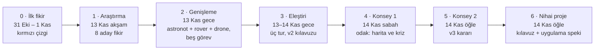

# 1 · Fikir aşamaları: REDLINE'a nasıl geldik?

> [← Araştırma ve proje fikri](README.md) · [2 · Nihai proje →](2-nihai-proje/README.md) · [3 · Araştırmalar](3-arastirma/README.md)

Bu belge fikrin geçtiği aşamaları anlatır. Her aşama için o anki soruyu, öğrendiklerimizi ve sonraki adımı değiştiren kararı verir. Köşeli parantezli numaralar ([01]…[16]) [araştırma kayıtlarının](3-arastirma/README.md) sıra numaralarıdır. Saatler belge dosyalarının oluşturulma saatidir (Türkiye saati).

## Kısaca

| Aşama | Ana soru | Çıkan karar | Kayıtlar |
|---|---|---|---|
| 0 · İlk fikir | "Bu bilim durağına gidip dönebilir miyim?" | Dönüş sınırı haritada kırmızı çizgi olsun: REDLINE | (bu depoda yok, aşağıya bakın) |
| 1 · Araştırma | Hangi fikir gerçek bir karar değişikliği üretir? | Robot nerede ölçmeli ve bu ölçüm astronotun kararını ne kadar değiştirir | [01] [02] [03] |
| 2 · Genişleme | Ürün kullanıcıya ne yaşatır? | Unreal'da insan gözünden prova; astronot, rover ve hava aracı; beş görev | [04]–[08] |
| 3 · Eleştiri | Bu hâliyle challenge'a ve jüriye uyuyor mu? | Gerçek saha (Yellowknife Bay), numune kökeni ile analiz yeri ayrı; v2 kılavuzu | [09]–[14] |
| 4 · Konsey 1 | Projeyi en çok ne güçlendirir? | Harita ve radyasyon krizi merkeze; kapsam kesilmez, fikir güçlendirilir | [15] |
| 5 · Konsey 2 | Gerçek NASA verisiyle en güçlü hâli ne? | İki saha, gerçek RAD güneş fırtınası, Bilinen · Bilinmeyen · Kırmızı çizgi, tek EVA'nın beş evresi | [16] |
| 6 · Nihai proje | Sıfırdan nasıl kodlanır? | v3 kılavuzu, ROS'ta otonomi ve bilim görevleri, uygulama speki, önce uçtan uca ince hat | [nihai proje](2-nihai-proje/README.md) |

---

## Aşama 0 — İlk fikir (31 Ekim – 1 Kasım 2026)

**Soru.** Bir astronot bilim durağına gittiğinde rovera veya sığınağa zamanında dönebilecek mi? Bu sınır haritada görünür olursa karar kolaylaşır. **REDLINE** adı buradan geldi: kalan kaynağa göre daralan dönüş sınırı.

**Yapılanlar.**
- Geniş bir tasarım belgesi yazıldı (v0.4). İçinde katmanlı harita, uçuş kuralları ve teorik modüller vardı: metabolik yürüme maliyeti, kaya modeli, gökyüzü görüş faktörü, bilgi değeri, ters yönlü dönüş alanı, durak seçimi, rover yerleşimi, gecikmeye dayanıklı iletişim, ufuk çizgisiyle konum bulma (M1–M11).
- 20 Mayıs 2024 güneş olayı anlatı olarak seçildi.
- Jüri gözüyle bir öz eleştiri yapıldı. Sonuç: tasarım çok genişti, kanıt azdı. Önerilen gösterim "bir harita, iki rota, bir alarm, bir sonuç" oldu.
- İki küçük deneme prototipi yapıldı: sentetik araziyle bir web demosu ve Gale DEM üzerinde bir ROS/Gazebo rover denemesi.

**Bu depoyla ilişkisi.** Bu belgeler ve prototipler bu depoda yok. Yeni uygulamaya kod kaynağı olarak alınmıyor. Taşınan yalnız fikir mirası:
- kırmızı çizgi kavramı;
- M1–M11 teorisi (nihai projede [03](2-nihai-proje/03-cekirdek-modeller-ve-teori.md), §18);
- güneş fırtınası anlatısı.

---

## Aşama 1 — Araştırma ve aday fikirler (13 Kasım, 21:10–22:08)

**Soru.** Hangi fikir, astronotun kararını gerçekten değiştiren bir ürün olur?

- **[01] İlk araştırma.** Dört aday karşılaştırıldı:
  - rover önce keşfetsin mi;
  - bilim ve dönüş payı;
  - iletişim koridoru;
  - konum güvenine göre hareket.

  Öncelik ön keşif ile bilim/dönüş kararının birleşimine verildi.
- **[02] Gale AOI kontrolü.** Eski 2 × 2 km çalışma alanında Curiosity'nin konum tablolarında (PLACES) hiç kayıt çıkmadı. Gerçek yer görüntüsü ve bilim durağı için saha değişmeliydi. Bu bulgu sonraki saha kararlarını başlattı.
- **[03] Kapsamlı araştırma.** Sekiz aday hipotez olarak yazıldı (A–H), kazanan Space Apps projeleri ve NASA veri ürünleri incelendi. İki aday sonradan nihai projenin çekirdeği oldu:
  - **A**, görev kararına göre ön keşif: robotun değeri.
  - **H**, haritanın neyi bilmediğini gösteren rota denetimi: güven katmanı.

**Karar.** Büyük sistem hedefi korunur. Ana soru şu olur: robot nerede ölçmeli ve bu ölçüm astronotun bilim ve dönüş kararını ne kadar değiştirir?

---

## Aşama 2 — Ürünün genişlemesi (13 Kasım, 22:22–23:14)

**Soru.** Kullanıcı ürünü nasıl yaşar ve robotlar neye yardım eder?

- **[04] Ürün tanımı.** Bilim yürüyüşü NASA haritalarında planlanır, Unreal'da insan gözünden prova edilir. Rover ve hava aracının keşfi planı günceller.
- **[05] Astronot, rover ve hava aracı.** Üç aracın rolleri belirlendi:
  - hava aracı koridoru gözler;
  - rover yakından inceler ve kolla numune alır;
  - astronot karar verir.
- **[06] Beş ana görev.** Görevler keşif, çok türlü numune ve laboratuvar, sondaj, habitat kaçak müdahalesi ve astronot bilim seferiydi. Eğitim/sınav profili eklendi. ROS–Python–Unreal–Open MCT bağlantısı da çizildi.
- **[07] Tasarım eleştirisi.** "Beş ayrı teknoloji demosu" riski görüldü. Çözüm: görevler tek bir bilim seferi olsun, kararlar görevden göreve taşınsın. Unreal içinde habitat kontrol merkezi tanımlandı.
- **[08] Derinleştirme stratejisi.** Astronot + rover + drone birleşimi tek başına özgün değil; NASA CHAPEA ve BASALT önceki çalışma olarak kabul edildi. Katkı üç noktaya yerleşti: görev için bilgi değeri, örnekleme kalitesi ve açıklanabilir karar.

---

## Aşama 3 — Eleştiri turları ve v2 kılavuzu (13 Kasım 23:24 – 14 Kasım 00:44)

**Soru.** Bu hâliyle challenge'a, NASA verisine ve jüriye uyuyor mu?

- **[09] Üç tur eleştiri.** Üç inceleme yapıldı: Space Apps amacı ve özgünlük, bilim ve otonomi, kullanıcı ve üretim. Her bulgu bir revizyon kararına bağlandı.
- **[10] Kaynak ve varlık kataloğu.** Gerçek NASA ürünleri, yazılımlar, 3D/ses varlıkları ve kullanım koşulları tek listede toplandı.
- **[11] Proje kılavuzu v2.** O ana kadarki bütün tasarım tek kılavuzda birleştirildi.
- **[12] Sert mapping incelemesi.** Hüküm: ürün kimliği harita ve karar aracından geniş bir robotik eğitim oyununa kaymıştı. Çoklu NASA veri entegrasyonu da henüz gösterilmemişti.
- **[13] Saha ve bilim istasyonu.** Ana saha olarak Yellowknife Bay (John Klein, Cumberland) seçildi. Numunenin alındığı yer ile analiz edildiği yer ayrı tutulacaktı. Arşivde ölçülmüş sonuç ile simülasyon sonucu ayrı veri türleri olacaktı.
- **[14] Görev değeri ve kanıt planı.** Büyük kapsam korunur. İlk birleşik gösterimde astronot ve rover aynı bilim alanına farklı yollardan gider.

---

## Aşama 4 — Konsey 1 ve resmî kaynak kontrolü (14 Kasım sabah)

**Soru.** Projeyi en çok ne güçlendirir?

Üç farklı modelden oluşan bir LLM konseyi v2 tasarımını geliştirme odaklı inceledi. Öne çıkan bulgular:
- Tasarım challenge'ın radyasyon, uzay havası ve giysi kısıtı maddelerinden uzaklaşmıştı.
- Hikâyenin kahramanı "haritanın bilmediği yer" olmalıydı: yörünge DEM'inin göremediği engeli rover görür, rota değişir.
- REDLINE adı ve kırmızı çizgi merkeze geri dönmeliydi. Curiosity RAD radyasyon verisi kriz olarak kullanılabilirdi.
- Saha Yellowknife'a taşınmalı, challenge Resources listesi kullanılmalı, önceden yapılmış iş açıkça beyan edilmeliydi.

Konsey kapsamı daraltmayı da önerdi: vana, sondaj, laboratuvar, eğitim/sınav ve drone çıkarılsın. **Takım bunu reddetti.** Ekip tamamen mühendis, sıfırdan başlıyor ve aralıksız çalışacak. Karar: kapsam kesilmez, fikrin kendisi güçlendirilir.

- **[15] Space Apps 2026 kaynakları.** Challenge Resources listesi organizatör kopyasından kontrol edildi; beş kaynak var. Resmî sayfa erişim hatası verdi. Space Apps'in ayrıca tek bir hazır Mars veri paketi yayımladığı doğrulanamadı.

Bu konseyin ham çıktıları özet biçiminde kaydedildiği için depoya alınmadı.

---

## Aşama 5 — Konsey 2: v3 kararı (14 Kasım öğle)

**Soru.** Challenge'ın gerçek istekleri ve gerçek NASA verisiyle fikrin en güçlü hâli ne?

**Süreç.**
1. Dört persona bağımsız öneri yazdı: veri bilimci, ürün/jüri, EVA uçuş operasyonu, red-team.
2. Öneriler anonim olarak sıralandı (4/4 oy).
3. Başkan bir taslak yazdı.
4. Taslağa karamsar bir tur uygulandı: şüpheci gezegen bilimci, yorgun hackathon jürisi, EVA uçuş direktörü. Kullanım limiti yüzünden bu tur bağımsız ajanlarla değil, aynı bağlamda yapıldı.

**Gerçek veriyle yapılan kontroller.**
- Curiosity RAD, sol 4190 (20 Mayıs 2024): E dedektöründe doz hızı yaklaşık 60 kat arttı (≈5,6 → 351). Rover o gün ileri sahaya yaklaşık 1,5 km uzaktaydı.
- Sol 242 (2013): güneş kavuşumu sırasında bir olay.
- Boxwork kampanyasının konumları (MMGIS) ve HiRISE DTM ürünleri.

**Kararlar.**

| Konu | Önce | Sonra (v3) |
|---|---|---|
| Saha | Tek Gale alanı | İki saha: Boxwork-Batı ileri EVA sahası ve Yellowknife Bay tutarlılık kontrolü |
| Doğrulama | Ünlü bir kararı yeniden üretmek (geriye bakış yanlılığı) | Zaman bölmeli doğrulama: Boxwork'te yalnız kampanya öncesi arşivle plan yapılır, sonra Curiosity'nin bulgularıyla karşılaştırılır; kural önceden dondurulur |
| Kriz | Varsayımsal güneş olayı | Gerçek RAD sol 4190 replay'i; sol 242 "Dünya kör, yerel dozimetre tek uyarı" desteği |
| Ekran dili | Çok kavram | Üç kelime: **Bilinen · Bilinmeyen · Kırmızı çizgi** |
| Ürün kimliği | Simülasyon/oyun gibi | Ana ürün harita; Unreal aynı haritanın prova görünümü |
| Görevler | Beş ayrı görev | Tek EVA'nın beş evresi: brifing ve Go/No-Go, robot öncü keşif, traverse, istasyon bilimi, dönüş ve acil durum |
| Kırmızı çizgi | Sürekli "dönülebilir alan" | Görev saatinden (PET) türetilir; istasyonlar go/no-go karar noktası |
| İnsan modeli | Sabit katsayılar | Parametrik giysi modeli ve "kararı hangi varsayım değiştiriyor" duyarlılık grafiği |
| Robot keşfi | EVA sırasında | EVA'dan sol'ler önce öncü keşif; EVA sırasında rover hareketli destek ve sığınak |
| İki motor | Ayrı dünyalar | Tek dünya manifesti: aynı DEM, aynı koordinat ve saat sözleşmesi |

Konsey sonucu: [16].

---

## Aşama 6 — Nihai proje ve uygulama spesifikasyonu (14 Kasım öğle)

**Soru.** Bu fikir sıfırdan, paralel çalışan bir ekiple nasıl kodlanır?

- **v3 kılavuzu yazıldı.** Sonra önceki çalışmalarla karşılaştırılıp eksikleri tamamlandı:
  - robot otonomisi ROS'ta yazılıp Unreal'da görünür;
  - NASA verisinden dünya üretimi;
  - RViz, Open MCT ve Unreal ana ekran grafikleri;
  - Aşama 0'daki M1–M11 teorik modülleri geri geldi;
  - önceki çalışmalarda ne var, ne yok tablosu.
- **Bilim görevleri ROS üzerinden.** On bilim işi tanımlandı (B1–B10):
  - **Ayrı ROS aksiyonu olanlar:** kol ile temas bilimi, uzaktan LIBS, multispektral görüntüleme, nötron taraması, sondaj, numune zinciri, çevre istasyonu kurulumu.
  - **ROS düğümleriyle çalışanlar:** bilim zamanlayıcısı, downlink önceliklendirme.
  - **Unreal etkileşimiyle beslenen:** astronot saha bilimi.
- **Uygulama spesifikasyonu.** Bir AI ajanının veya mühendisin sıfırdan kodlayabileceği ayrıntıda yazıldı: depo yapısı, ROS mesajları, düğümler, algoritmalar ve formüller, Unreal sınıfları, senaryolar, testler ve T0–T14 kilometre taşları.
- **Son mühendislik incelemesi.** Genel puan yaklaşık 7,5/10. Kodlamadan önce düzeltilenler:
  - iki ayrı saat: fizik saati ve hızlandırılabilir görev saati;
  - Unreal'a sayısal JSON yerine sıkıştırılmış PNG ızgara karoları (tek mesaj ≈20 MB yerine birkaç yüz KB);
  - 4 m planlama ızgarası;
  - dönüş alanı yalnız harita veya sığınak değişince yeniden hesaplanır;
  - Gazebo'da iki katmanlı arazi;
  - ROS çökerse Unreal'ın kayıt dosyasından beslenmesi;
  - önce uçtan uca ince bir hat ("çelik iplik"), ardından paralel iş akışları.

Sonuç: [2 · Nihai proje](2-nihai-proje/README.md).

---

## Baştan sona değişmeyenler

- **Kırmızı çizgi:** astronotun zamanında güvenli yere dönebileceği alanın sınırı. İlk günden beri merkezde.
- **Veri dürüstlüğü:** NASA arşiv ölçümleri, türetilmiş haritalar, simüle sensör okumaları ve senaryo varsayımları ayrı etiketlenir.
- **İş bölümü:** robot fiziği ve kontrolü ROS 2 / Gazebo'da, insan sunumu ve etkileşimi Unreal'da.
- **Challenge:** Interplanetary Survival Guide: Martian Map.

## Dönüştürülen ve bırakılan fikirler

Önceki fikirlerin çoğu çıkarılmadı; nihai projede bir evreye veya role dönüştü.

| İlk fikir | Nihai projedeki yeri |
|---|---|
| İletişim rölesi (aday B) | Rover'ın görüş hattı iletişim rölesi rolü |
| Konum güvenine göre yürüyüş (aday D) | M11 ufuk çizgisiyle konum bulma |
| Eğitim/sınav görevi | Evre 1: brifing ve Go/No-Go |
| Numune, laboratuvar ve sondaj görevleri | Evre 4: istasyon bilimi; numune kökeni ile analiz yeri ayrı |
| Habitat vana/kaçak müdahalesi | Evre 5: dönüş ve acil durum |
| Hava aracı (drone) | Evre 2: robot öncü keşif; ROS'ta keşif uçuşu aksiyonu |
| Bagnold/Gobabeb yedek sahası | Bırakıldı: Boxwork ve Yellowknife Bay daha güçlü, HiRISE ürünü bu sahayı kapsamıyor |
| Ay ve diğer dünyalar | Manifest testi ve hackathon sonrası gelişim |
