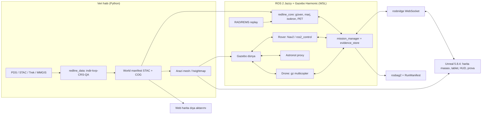

# 05 · Yazılım mimarisi ve kullanılacak yazılımlar

> REDLINE v3 nihai proje · Kılavuz bölümleri: §6, §9 · [← 04](04-gorevler-bes-evre.md) · [← Nihai proje](README.md) · [06 →](06-robot-otonomisi.md)
>
> Etiketler: **[D]** birincil kaynaktan doğrulandı · **[K]** önceki araştırma kaydı · **[?]** doğrulanmadı.

## 6. Yazılım mimarisi

### 6.1 Otorite ve sahiplik
- **Gazebo:** robot fiziği ve robot sensörleri. Unreal robotu yalnız ROS pozundan çizer.
- **Unreal:** astronot hareketi ve insan arayüzü. Astronotun Gazebo'daki proxy'si poz akışıyla beslenir.
- **redline_core:** güven katmanı, marj, isokron ve PET. Hesap tek yerde yapılır; Unreal ve web yalnız gösterir.
- **mission_manager:** görev durumu, komut sahipliği (manuel/otonom), iptal ve sonuç.
- **Saat:** Gazebo `/clock` deney zamanıdır. Ekranda ayrıca görev LMST'si ve replay edilen tarihsel UTC gösterilir.

### 6.2 Paketler (yeni depoda)

| Paket | İçerik |
|---|---|
| `redline_data` (Python) | ürün kataloğu, indirme/pencere okuma, CRS kontrolü, kırpma, eğim/σ/viewshed, STAC yazımı, mesh/heightmap üretimi |
| `redline_core` (Python, ROS'tan bağımsız kütüphane) | hücre modeli, maliyet, giysi modeli, isokron, PET, SEP kuralı, bilgi değeri; birim testleri |
| `redline_msgs` | `EvidenceRecord`, `SampleRecord`, `DecisionRecord`, `EVAPlan`, `CellState`; action'lar `SurveyArea`, `InspectTarget`, `CollectSample`, `ReturnToShelter` |
| `redline_mission` (rclpy) | görev evreleri, evidence store, komut sahipliği, watchdog |
| `redline_replay` (rclpy) | RAD/REMS tarihsel yayın; sol/LMST ↔ UTC ↔ sim saati |
| `redline_gazebo` | dünya, Mars yerçekimi (3,721 m/s²), arazi, rover/drone/proxy modelleri, senaryo kayaları |
| `redline_bridge_ue` (Unreal C++ plugin) | rosbridge istemcisi, eksen/birim dönüşümü, tazelik/kopma yönetimi |
| `redline_web` | statik harita görüntüleyici (OpenLayers + GeoTIFF), EVA kartı dışa aktarımı |
| `redline_safety` | uçuş kuralları (FRET → Ogma → Copilot izleyicileri), `safety_aggregator` (§18 M9) |
| `redline_comm` | `link_manager` (DEM görüş hattı, mesaj düşürme/geciktirme), isteğe bağlı DTN geçidi (§18 M10) |

ROS düğüm grafiği. v0.3 tasarımından (REDLINE_RESEARCH.md §6.3) v3'e uyarlandı:

| Düğüm | Dil | Girdi → çıktı |
|---|---|---|
| `sim_clock`, `scenario_player` | Python | senaryo dosyası → `/clock`, 10 Hz tick, olaylar (SEP, giysi kaçağı, arıza) |
| `rad_replay`, `rems_replay`, `env_server` | Python | RAD/REMS dosyaları, SPICE → `/env/dose_rate`, `/env/sep_alert`, `/env/sun`, `/env/weather` |
| `ev_sim` ×2 | Python | rota, olaylar → EV2'nin (ve gerekirse EV1'in) konumu, biyomedikal ve sarf değerleri |
| `human_model`, `consumables_estimator` | Python | biyomedikal, konum → metabolik kestirim, sarf tahmini (§18 M1) |
| `cell_store` | Python/C++ | yörünge katmanları + robot deltaları → hücre durumu, `/redline/cells/delta` |
| `planner_server`, `walkback_field` | C++ veya Python | katmanlar, konum, tahminler → `PlanEva`, `Replan`, kırmızı/sarı çizgi, dakika payı (§18 M6) |
| `science_optimizer` | Python | posterior, alanlar → bilim durakları (§18 M5, M7) |
| `rover_placer` | Python/C++ | rota, alanlar → rover sığınak istasyon planı (§18 M8) |
| `voi_tasker` | Python | hücre σ, plan → drone/rover görev önerisi (bilgi değeri, §4.5) |
| `mission_manager`, `command_authority` | Python | görev evreleri, komut sahibi, watchdog |
| Nav2 yığını | C++ | istasyon planı, costmap → rover hız komutu |
| `scout_controller` | Python/C++ | `SurveyArea` → drone uçuşu, kalkış/iniş |
| `localization` | C++ | IMU, teker, UWB, ufuk, güneş → konum + kovaryans (§18 M11) |
| `copilot_monitor`, `safety_aggregator` | C99 / Python | kural girdileri → `/safety/violations` |
| `link_manager` | Python | konumlar, viewshed → `/comm/link/*` |
| `rosbridge_server`, `foxglove_bridge` | — | WebSocket (Unreal, Open MCT, Foxglove) |
| `tss_adapter` (isteğe bağlı) | Python | sarf, konum → NASA SUITS TSS tarzı telemetri |

### 6.3 Arayüz listesi (ilk sürüm)

| Konu / servis | Tip | Hız | Yön |
|---|---|---|---|
| `/rover_1/odom`, `/scout_1/odom` | `nav_msgs/Odometry` | 10–20 Hz | ROS → UE |
| `/tf` (yalnız seçili frame'ler) | `tf2_msgs/TFMessage` | 10 Hz | ROS → UE |
| `/astronaut_{1,2}/pose` | `geometry_msgs/PoseStamped` | 20 Hz | UE → ROS |
| `/redline/cells/delta` | `redline_msgs/CellState[]` | olay | ROS → UE |
| `/redline/isochrone` | `nav_msgs/Path` veya polygon | 1 Hz / olay | ROS → UE |
| `/redline/plan` | `redline_msgs/EVAPlan` | olay | ROS → UE |
| `/redline/alerts` | `redline_msgs/Alert` | olay | ROS → UE |
| `/redline/replay/rad` | doz hızı + zaman damgası | replay | ROS → UE |
| `/rover_1/camera/compressed` | `sensor_msgs/CompressedImage` | 2–5 Hz | ROS → UE |
| `/redline/command` (servis) | goal / iptal / mod değişimi | istek | UE → ROS |

Action'lar ROS tarafında bir adaptör düğümünde tutulur. Unreal'a topic/servis olarak açılır: rosbridge'in ROS 2 action desteği sürüme göre değişir [?].

### 6.4 Çerçeve, birim ve saat sözleşmesi
- **Harita frame'i:** ürün eqc (m) → yerel `map` ENU. Orijin = saha manifestindeki E/N/H; x=doğu, y=kuzey, z=yukarı, metre.
- **Unreal dönüşümü:** `UE.x = 100·x`, `UE.y = −100·y`, `UE.z = 100·z` (cm, sol el). Quaternion: `q_ue = (w, −x, y, −z)`; yaw işareti ters. Hepsi tek fonksiyonda yapılır ve test edilir: 1 m küp, 4 yön, ±90° dönüş.
- **Kamera optik frame'i** (z ileri) ayrı dönüşümdür.
- **Yükseklik:** ürün metadata'sındaki dikey datum korunur. Yerel z = H − H₀.
- **Saat:** sol = 24 sa 39 dk 35,244 s. LMST ve MSD hesabı Mars24 algoritmasıyla yapılır (Allison & McEwen 2000). Replay'de tarihsel UTC ile sim saati arasında sabit ofset ve hız çarpanı kayıtlıdır.
- **Tazelik:** her mesajda ölçüm zamanı ve alım zamanı ayrıdır. Unreal eski veriyi "güncel değil" olarak gösterir. Kopmada komutlar düşer; robot tanımlı duruşa geçer.

### 6.5 Tek dünya: aynı arazi iki motorda
1. `redline_data` DEM penceresini okur ve yerel ENU'ya çevirir.
2. Aynı ızgaradan Gazebo için mesh (veya GeoTIFF heightmap; Gazebo DEM desteği [?]) ve Unreal için 16 bit heightmap üretilir.
3. **Unreal Landscape Z ölçeği:** ölçek 100'de 16 bitlik aralık 512 m'yi kapsar. Gerekli ölçek = yükseklik aralığı(m) × 100 / 512. Boyut Landscape'in önerilen değerlerinden biri seçilir (ör. 1009, 2017, 4033 vertex).
4. Doku HiRISE ortho'dan gelir. Kaya ve dekor instancing ile eklenir. Görevi etkileyen her nesne manifestle Gazebo'ya da aktarılır.
5. **Sözleşme testi:** bilinen üç nokta iki motorda aynı yükseklikte mi (±10 cm)?

---

## 9. Kullanılabilecek ve değiştirilebilecek yazılım

| İş | Araç | Lisans / not |
|---|---|---|
| ROS–Unreal köprüsü | [rosbridge_suite](https://github.com/RobotWebTools/rosbridge_suite) (jazzy dalı [D]) | BSD-3 |
| Rover navigasyonu | [Nav2 Jazzy](https://github.com/ros-navigation/navigation2/tree/jazzy) | paket bazında lisans |
| Rover kontrolü | [gz_ros2_control](https://control.ros.org/jazzy/doc/gz_ros2_control/doc/index.html), ros2_control | Apache-2.0 |
| Kol (isteğe bağlı) | [MoveIt 2](https://github.com/moveit/moveit2) | BSD-3 |
| Curiosity referansı | [space-ros/demos](https://github.com/space-ros/demos) | Apache-2.0 |
| Rover mekaniği | [JPL Open Source Rover](https://github.com/nasa-jpl/open-source-rover) | ayrı haklar |
| Algı | OpenCV (ArUco), [grid_map](https://github.com/ANYbotics/grid_map) [?] | BSD |
| Kayıt / replay | [rosbag2](https://github.com/ros2/rosbag2), [PlotJuggler](https://github.com/PlotJuggler/PlotJuggler) | Apache / MPL |
| Mühendislik görünümü | RViz, [Foxglove bridge](https://github.com/foxglove/foxglove-sdk) | MIT |
| Telemetri (isteğe bağlı) | [Open MCT](https://github.com/nasa/openmct) | Apache-2.0 |
| Kural izleme (isteğe bağlı) | [NASA FRET](https://github.com/NASA-SW-VnV/fret), [Ogma](https://github.com/nasa/ogma) | NOSA / Apache |
| Raster ve CRS | GDAL, rasterio, pyproj, QGIS | MIT / GPL (QGIS) |
| STAC | pystac, pystac-client | Apache-2.0 |
| ISIS küpleri (THEMIS) | USGS ISIS3 veya GDAL ISIS3 sürücüsü | kamu malı / MIT |
| SPICE | SpiceyPy + NAIF kernel'ları | MIT |
| PDS etiketleri | pds4_tools, pvl | açık kaynak [?] |
| Web harita | OpenLayers (GeoTIFF/WebGL tile kaynağı) | BSD-2 |
| Tarihsel referans araçları | NASA SEXTANT, JSC DUST (UE5 simülatörü), SUITS telemetri şeması | yalnız referans [K] |

Kural: eski `önceki deneme/` kodu yeni depoya kopyalanmaz. Yeniden yazılır veya `PRE_EXISTING_WORK.md`'de beyan edilir.
