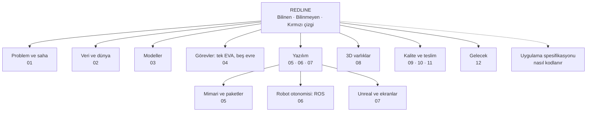

# 2 · Nihai proje: REDLINE v3

> [← 1 · Fikir aşamaları](../1-fikir-asamalari.md) · [Araştırma ve proje fikri](../README.md) · [3 · Araştırmalar →](../3-arastirma/README.md)

14 Kasım 2026 · NASA Space Apps 2026 · Challenge: [Interplanetary Survival Guide: Martian Map](https://www.spaceappschallenge.org/2026/challenges/interplanetary-survival-guide-martian-map/) (yerel kopya: [hackathlone](https://hackathlone.com/challenges/interplanetary-survival-guide-martian-map)) · Takım CRST

Bu klasör projenin nihai hâlidir:
- **v3 kılavuzu**, 12 alt kırılıma bölünmüş hâlde: ne yapılacak ve neden.
- **[Uygulama spesifikasyonu](uygulama-spesifikasyonu.md):** nasıl kodlanacak.

Kılavuzun içeriği değiştirilmedi; bölümleri konularına göre dosyalara ayrıldı. Metinlerdeki "§N" atıfları kılavuzun bölüm numaralarıdır. Hangi bölümün hangi dosyada olduğu aşağıdaki tablodadır.

---

## 0. Tek sayfada REDLINE

**Problem.** Mars Trek ve USGS jeoloji haritaları bölgesel ölçekte çalışır. Astronotun adım attığı ölçekte haritanın neyi bilmediğini söylemezler. Challenge'ın Background bölümü bu boşluğu açıkça yazıyor.

**Tez.** REDLINE her bilinmeyeni dakika cinsinden güvenlik payına çevirir. Robotları en pahalı bilinmeyene gönderir. Yöntemini NASA'nın gerçek kararları ve gerçek ölçümleriyle sınar.

**Ekranda üç kelime:** Bilinen · Bilinmeyen · Kırmızı çizgi.

**Kahraman görsel.** Haritada nefes alan kırmızı çizgi. Çizgi, astronotların zamanında sığınağa dönebileceği alanın sınırıdır. İki şeyle canlı değişir:
- robot yeni bir bilinmeyeni çözünce genişler;
- Güneş fırtınası gelince daralır.

**İnsan hikâyesi (pitch cümlesi).** "İki astronot, birkaç saatlik oksijen, Güneş'ten gelen bir fırtına ve bilmediğini itiraf eden bir harita."

**Ürünün kimliği.** Ana ürün bir haritadır: habitat ekranı, tablet ve HUD görünümleri ile dışa aktarılan EVA planı. Unreal bu haritanın astronot gözünden prova görünümüdür. ROS 2 ve Gazebo robotların gerçek fizik ve kontrol otoritesidir. Sırayla sunulur: harita önce, simülasyon sonra.

---

## Proje ağacı

## Alt kırılımlar

| # | Dosya | Kılavuz | İçinde ne var |
|---|---|---|---|
| 01 | [Challenge uyumu ve sahalar](01-challenge-ve-sahalar.md) | §1, §2 | Challenge isteği → REDLINE karşılığı matrisi; Boxwork-Batı ve Yellowknife Bay sahaları |
| 02 | [Veri yığını ve dünya üretimi](02-veri-ve-dunya-uretimi.md) | §3, §16 | Katmanlar ve karar rolleri; gerçek olaylar (RAD sol 4190 ve sol 242); beş Resources kaynağı; veri disiplini; veri hattı adımları; bilinen harita ve gizli gerçek ayrımı; gökyüzü ve ışık; veri setleri |
| 03 | [Çekirdek modeller ve teori](03-cekirdek-modeller-ve-teori.md) | §4, §18 | Güven katmanı → dakika cinsinden pay; kırmızı çizginin operasyonel tanımı; giysi ve insan modeli; SEP uçuş kuralı; robotun bilgi değeri; teorik modüller M1–M11 |
| 04 | [Görevler: tek EVA, beş evre](04-gorevler-bes-evre.md) | §5 | Brifing ve Go/No-Go; robot öncü keşif; traverse; istasyon bilimi; dönüş ve acil durum; doğrulama hattı |
| 05 | [Yazılım mimarisi](05-yazilim-mimarisi.md) | §6, §9 | Otorite ve sahiplik; paketler; arayüz listesi; çerçeve, birim ve saat sözleşmesi; tek dünya; kullanılacak yazılımlar |
| 06 | [Robot otonomisi](06-robot-otonomisi.md) | §15 | ROS–Unreal ayrımı; rover sürüş modları ve komut sahipliği; otonomi yığını; drone; kol ve numune durum makinesi; astronot proxy'si; Unreal'a giden ve gelen veriler |
| 07 | [Unreal ve ekranlar](07-unreal-ve-ekranlar.md) | §7, §17 | ROS bağlantısı; Unreal bileşenleri; RViz, Open MCT ve ana ekran grafikleri; dört görünüm; dünya konsolu |
| 08 | [3D varlıklar](08-3d-varliklar.md) | §8 | M01–M11 varlık listesi, kaynakları, hakları ve yapılacak işler |
| 09 | [Kalite, test ve doğrulama](09-kalite-test-ve-dogrulama.md) | §19, §14 | Testler ve çalışma profilleri; habitat ve saha mekânları; ses ve görsel yön; doğrulama durumu |
| 10 | [Ekip akışı ve teslim](10-ekip-akisi-ve-teslim.md) | §10, §11 | Birleşme kapıları; teslim kuralları ve AI açıklaması; 30 saniyelik video; yedi slayt |
| 11 | [Ayrıntılar ve kapsam](11-ayrintilar-ve-kapsam.md) | §12, §20 | Kolay unutulan ayrıntılar; önceki çalışmalarda ne var, ne yok; insan–robot karşılaştırma deneyi |
| 12 | [Gelecek](12-gelecek.md) | §13 | Hackathon sonrası gelişim |
| — | [Uygulama spesifikasyonu](uygulama-spesifikasyonu.md) | spek §0–21 | AI ajanı kuralları; sabit kararlar; ortam; depo yapısı; ortak sözleşmeler; `redline_msgs` mesaj/servis/aksiyon tanımları; veri hattı; `redline_core` algoritmaları; ROS düğümleri; bilim görevleri B1–B10; Gazebo; Nav2; uçuş kuralları; Unreal; Open MCT; web harita; senaryolar; testler; T0–T14 kilometre taşları; teslim şablonları; açık doğrulamalar |

## Okuma sırası

- **Hızlı bakış:**
  1. bu sayfa;
  2. [04 · Görevler](04-gorevler-bes-evre.md);
  3. [03 · Modeller](03-cekirdek-modeller-ve-teori.md);
  4. [01 · Challenge ve sahalar](01-challenge-ve-sahalar.md).
- **Kodlayacaklar:**
  1. [uygulama spesifikasyonu](uygulama-spesifikasyonu.md) §0–4 ve §18 (uygulama sırası);
  2. ilgili iş akışının kılavuz dosyası (05, 06 veya 07).

## Etiketler

- **[D]:** 14 Kasım'da birincil kaynaktan doğrulandı.
- **[K]:** önceki araştırma notunda kayıtlı, bu turda yeniden denenmedi.
- **[?]:** doğrulanmadı, kullanmadan önce kontrol et.

Kılavuzun çıkış noktası 14 Kasım'daki LLM konseyi ve o oturumdaki birincil kaynak kontrolleridir ([araştırma 16](../3-arastirma/16-konsey-v3-karari.md)). Önceki tasarım sürümü [proje kılavuzu v2](../3-arastirma/11-proje-kilavuzu-v2.md)dir. Çelişkide bu klasör esastır.
