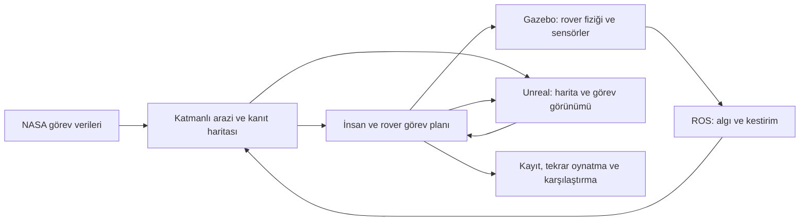

# REDLINE: Marswalk araştırması ve deney planı

> **Araştırma 01 / 16** · Aşama 1 — Araştırma ve aday fikirler · Dosya oluşturulma: 13 Kasım 2026 21:10 · [Dizin](README.md) · [02 →](02-gale-aoi-ve-places-kontrolu.md)
>
> Bu bir araştırma/fikir kaydıdır; güncel proje [nihai proje](../2-nihai-proje/README.md) bölümündedir.

13 Kasım 2026 · Araştırma sürümü · ROS 2 Jazzy / Gazebo Harmonic / Unreal Engine 5.8.4

**Önerilen büyük hedef: NASA görevlerinden gelen arazi bilgisini, keşif roverının yerel gözlemlerini ve astronotun görev kaynaklarını aynı haritada birleştirmek; yeni bilgi geldikçe bilim hedefini, yürüyüş rotasını ve dönüş kararını güncellemek.** Nihai fikri seçmeden önce aşağıdaki dört adayı karşılaştırmalı deneylerle sınayacağız. Bu belge mimari ve deney tasarımıdır; aşağıdaki yeni modüller henüz uygulanmış değildir.

Kapsam mühendislik ekibinin paralel çalışmasına göre geniş tutuldu. Mevcut küçük demo, daha büyük sistemin karşılaştırma başlangıcıdır. Önceki belgelerdeki 39 saatlik dar kapsam bu araştırmanın üst sınırı değildir. Yarışmada hangi parçaların gösterileceği, deney sonuçlarıyla ayrıca seçilir.

## 1. Hangi fikri araştırıyoruz?

| Aday | Kullanıcının kararı | Ayırt edici deney | Açık soru |
|---|---|---|---|
| **Rover önce keşfetsin mi?** | Kısa fakat belirsiz geçidi incelet, bilinen yoldan yürü veya hedefi değiştir | Aynı rover süresinde rastgele keşif, belirsizlik odaklı keşif ve görev kararına göre keşif | Alınan bilgi, robotun harcadığı zamana değiyor mu? |
| **Bilim ve dönüş payı** | Mevcut kaynaklarla hangi bilim duraklarına gidilip dönülebilir? | En kısa rota, rezerv kısıtlı rota ve bilim getirisine göre durak seçimi | Bir durak eklemek dönüş payını nerede tüketiyor? |
| **İletişim koridoru** | Rover keşfe mi devam etsin, sırt üzerinde röle mi olsun? | Sabit röle, rölesiz görev ve görevle birlikte seçilen röle noktası | Daha iyi bağlantı için vazgeçilen keşif ne kadar? |
| **Konum güvenine göre hareket** | İlerle, durup gözlem yap, yeniden konumlan veya geri dön | GNSS'siz kestirim; sabit aralıklı ve gerektiğinde yeniden gözlem | Nerede olduğumuzdan emin değilsek haritadaki dönüş payına ne kadar güvenebiliriz? |

**İlk araştırma önceliği:** Ön keşif ile bilim/dönüş kararının birleşimi. İletişim ve konumlama bunu genişleten bağımsız deneylerdir. Bu bir uzman değerlendirmesidir; henüz ölçülmüş kazanan yoktur.

Örnek gösterim: Bir bilim durağına iki yol var. Kısa yolun bir kesimi yörünge verisinden çözülemiyor. Robot incelemeye gidiyor. Yeni gözlem yolu kapatabiliyor veya kullanılabilir olduğunu destekleyebiliyor. Astronotun rotası, bilimde ayırabileceği süre ve dönüş payı değişiyor. Robot bazen hiçbir faydalı bilgi bulamıyor; bu sonuç da raporlanıyor.

Robotik ön keşif yeni bir araştırma alanı değildir. NASA'nın insan keşfi için robotik ön keşif çalışmaları ve scout–rover araştırmaları bunun dayanağıdır. Bizim aday katkımız, **gözlem seçimini insanın bilim ve geri dönüş kararına bağlayan, nedenini gösteren ve karşılaştırılabilen bir sistem** geliştirmektir. [NASA insan–robot keşfi](https://ntrs.nasa.gov/api/citations/20140008947/downloads/20140008947.pdf), [scout–rover çalışması](https://arxiv.org/abs/2602.18688).

Sadece topoğrafya + A* + metabolik maliyet birleşimini yeni buluş diye sunmayacağız. NASA'nın CSRM kapsamında böyle bir traverse modeli araştırması bulunuyor. Bu çalışma insan modelini incelemek için kaynak; yayımlanmış doğruluk sonuçları bizim modelimizin sonucu değildir. [NASA CSRM traverse çalışması](https://ntrs.nasa.gov/citations/20240013763).

## 2. Bugün gerçekten elimizde ne var?

### Space Apps denemesi

- `önceki deneme/ros2_ws`: Gerçek Gale arazisi, rover, sensör köprüsü, DEM üzerinde A*, odometriyle takip ve yakın LiDAR engelinde duruş var.
- `terrain_planner.py`: Eğim ve yönlü tırmanış maliyeti; kapalı köşe kesmeyi önleyen 8 komşulu arama. Bu bir öğrenilmiş planlayıcı değil.
- `mission.py`: Görev takibi ve veri tazeliği denetimi var. Dinamik yerel harita üzerinden engelin etrafından yeni rota üretmek henüz bu demoya bağlı değil.
- `redline-demo`: Ayrı, sentetik arazi üzerinde web EVA/O₂ denemesi var. Gerçek Gale ROS demosuyla birleşmiş bir EVA sistemi değildir.
- Mevcut 2 × 2 km sahada fizik ağı yaklaşık 4 m aralıklı. Teker/ayak boyundaki taşların gerçek konumunu bu yüzeyden çıkartamayız.
- Son canlı açılışta sensör/TF denetimi geçti; medyan gerçek zaman çarpanı yaklaşık 1,0. Önceki RViz gözlemi yaklaşık 19 FPS idi. Bunlar aynı ölçüm değildir ve bütün senaryolarda performans garantisi vermez.

Yerel kanıt: ROS açıklaması, canlı denetim, arazi manifesti.

### Tam rover deposu

Tam kaynak `C:/Users/USER/Desktop/roversim27` altında. Uzak `main` araştırma sırasında `344f46d`, yerel çalışma dalı `ahmetefesensoy` ve HEAD `27513b6` idi. Yerel ağaçta çok sayıda değiştirilmiş/yeni dosya var; aşağıdaki yerel özelliklerin tamamı bu GitHub commit'inde varmış gibi sunulamaz. Kaynak çalışma ağacı korunmalı; yeniden kullanımda commit ve yama kaydı birlikte tutulmalı.

| Mevcut yerel kod | Yeniden kullanma önerisi | Eksik bağ / sınır |
|---|---|---|
| `rover_navigation/src/terrain_mapper_node.cpp`, `rolling_terrain_grid.cpp` | LiDAR'dan yerel eğim, basamak, pürüzlülük ve gözlem yaşı | Yakın haritayı Gale ön bilgisine coğrafi ve zamansal olarak bağlamak gerekiyor |
| `rover_navigation/src/terrain_layer.cpp` | Arazi maliyetini Nav2'ye aktarmak | Rover footprint ve eşikleri insana kopyalanamaz |
| `rover_world_model/.../terrain_layers.hpp` ve `src/terrain_layers.cpp` | Geometri, semantik, kayma ve belirsizlik katkılarını ayrı göstermek | Confidence ve maliyetler kalibre edilmiş kaza olasılığı değildir |
| `rover_navigation/src/active_perception.cpp` | Gözlem adayı puanlamak; konum güveni düşünce tarama istemek | Beklenen kovaryans azalması dışarıdan verilen girdi; sahneden otomatik hesaplanmıyor |
| `rover_health/src/health_supervisor_node.cpp` | Veri/sistem sağlığı ile görev durumunu ilişkilendirmek | EVA kaynak kuralları ayrıca tanımlanmalı |
| `rover_controller_*`, `rover_controller_comparison` | PP/RPP/LQR/iLQR/MPC gibi kontrolcüleri aynı koşuda karşılaştırmak | Kodun bulunması, hepsinin bu Mars sahasında doğrulandığı anlamına gelmez |

Yerel semantik varsayılanı `BaselineColorTextureClassifier`: renk/parlaklık kurallarıdır. AI4Mars üzerinde eğitilmiş model değildir. GNSS/RTK içeren yerelleştirme seçenekleri de Mars senaryosunda devre dışı bırakılıp GNSS'siz çözümle sınanmalıdır. [Uzak başlangıç dalı](https://github.com/ahmetefesensoy/roversim27/tree/ahmetefesensoy).

## 3. Büyük sistemin mimarisi

**Görev planı üç ayrı karar verir:** Rover nerede bilgi toplayacak; astronot hangi bilim duraklarına gidecek; yeni bilgi veya arızada görev nasıl değişecek? Aynı kanıt haritasını paylaşırlar, ancak insanın ve robotun geçilebilirlik/enerji modelleri ayrıdır.

Unreal'da üç kullanım yüzeyi öneriliyor: görev öncesi katmanlı harita; yürüyüş sırasında yerel karar görünümü; görev sonrası değişikliklerin ve hataların tekrar oynatılması. Kontrolcünün bütün ROS ayrıntılarını ürün ekranına taşımak yerine kullanıcıya kararın gerekçesi gösterilir: “Yeni engel gözlemi nedeniyle doğu geçidi elendi” gibi.

### Fizik ve veri sahipliği

İlk birleşik düzende rover fiziği ve sensörler Gazebo'ya ait; Unreal roverı gösterir. Unreal'da aynı roverın bağımsız fizik simülasyonu kapalı tutulur. Böylece iki fizik motorundan gelen iki farklı rover gerçeği oluşmaz.

Unreal fotogerçekçi görüntü üretse bile ilk aşamadaki algı girdisi Gazebo sensörüdür. İleride UE kamerası veya LiDAR üreticisi denenecekse bu ayrı sensör deneyi olur; aynı konuyu iki üreticiyle karıştırmayız. Astronot avatarının yürüyüş animasyonu da insan biyomekaniğinin doğrulandığı anlamına gelmez.

Gerçek simülasyon pozu, kestirilen poz ve rota ayrı tutulur. Ground truth yalnız değerlendirme ve açıkça etiketli görünüm içindir; kontrolcüye gizli konum yardımı sağlamaz. Gazebo `/clock` otoritesidir. Simülasyon zamanı ve gerçek bilgisayar zamanı aynı zaman çizelgesi gibi çıkarılmaz.

### Unreal 5.8.4 bağlantısı

**Öncelikli uyumluluk deneyi:** WSL ROS içinde `rosbridge_suite`; Windows Unreal içinde WebSockets/JSON istemcisi. Bu henüz yapılmış bir bağlantı değildir. ROS bağımlılıklarını Unreal'ın içine taşımadan poz/rota/hedef alışverişini sınamaya uygundur. Jazzy için rosbridge'in `ros2` dalı belgelenmiştir. [rosbridge](https://github.com/RobotWebTools/rosbridge_suite), [Epic WebSockets API](https://dev.epicgames.com/documentation/unreal-engine/API/Runtime/WebSockets/FWebSocketsModule/Get?lang=en-US).

`rclUE` README'si Windows'u desteklemediğini söylüyor. Jazzy dalı deneysel ve UE5.1 testi bildiriyor. Windows UE5.8.4 desteği doğrulanmış değildir; bunu ayrı Linux/native entegrasyon araştırması olarak ele alacağız. [rclUE](https://github.com/rapyuta-robotics/rclUE).

Başlangıç veri sözleşmesi:

| Arayüz | Üretici → tüketici | İlk kullanım |
|---|---|---|
| `/odom` ve gerekli TF | ROS → Unreal | Kestirilen rover pozu; gösterim için yaklaşık 20 Hz hedefi |
| `/redline/path` | Planlayıcı → Unreal | Rota; yeni plan geldiğinde güncelleme |
| `/goal_pose` | Unreal → görev düğümü | Mevcut rover demo hedefi; ayrı EVA hedefi bununla karıştırılmaz |
| `/redline/mission/status` | ROS → Unreal | Mevcut görev durumu |
| Yeni görev/katman arayüzleri | Tanımlanacak | `frame_id`, zaman damgası, kaynak kimliği, çözünürlük ve geçerlilik |

Yoğun nokta bulutunu her kare JSON ile aktarmak başlangıç gereksinimi değil. ROS'ta işlenmiş hücreler, seyreltilmiş görünüm veya ayrı ikili aktarım ölçülerek seçilir. Köprü gecikirse sınırsız eski mesaj kuyruğu biriktirmek yerine en yeni durum ve veri yaşı korunur. Kopma sonrası hedef komutları kimlik/onay ile ele alınır; eski hedef kendiliğinden tekrar yürütülmez.

Koordinat sözleşmesi: ROS metre ve sağ elli, Unreal santimetre ve sol ellidir. Yerel harita ENU ise eksenler açıkça sabitlenir; konum, yönelim, hız ve kamera optik eksenleri tek adaptörde dönüştürülür. Sadece 100 ile çarpmak yeterli değildir. [ROS REP-103](https://www.ros.org/reps/rep-0103.html), [Epic koordinatlar](https://dev.epicgames.com/documentation/unreal-engine/coordinate-system-and-spaces-in-unreal-engine?lang=en-US).

## 4. Çoklu NASA görevlerini gerçekten birleştirmek

| Görev / veri | Karara katkısı | Doğrulama işi |
|---|---|---|
| MRO HiRISE/CTX ve Gale DEM/ortofoto ürünleri | Yörünge ön bilgisi, yükseklik ve eğim | Kaynak ürün manifestinden görev kökenini doğrula; DEM ve ortofotoyu iki ayrı görev sayma |
| MSL Curiosity PLACES + Navcam/Mastcam ve bilim kayıtları | Yer gözlemi, travers ve belgeli bilim durakları | Seçili AOI'de gerçek kesişim; görüntü konumu ve bakış alanı ayrımı |
| Mars Odyssey THEMIS | Bölgesel termal/yüzey bağlamı | Yerel kapsama ve ürün türü; IR yaklaşık 100 m/piksel, küçük kaya sınıfı değildir |
| MSL REMS/RAD tarihsel ürünleri, ileri deney | Zaman çizelgeli çevre senaryosu | Tarih ve ölçüm yeri; bütün sahada canlı koşulmuş gibi kullanılmaz |

PLACES arşivine erişim doğrulandı; mevcut 2 × 2 km kırpımın gerekli görüntü ve bilim hedefleriyle kesişimi henüz doğrulanmadı. Manifest projeksiyonundan AOI yaklaşık 137.427947–137.461688°E, −4.824993…−4.791252°. Gerekirse saha, veri kesişimine göre değiştirilir. Robotun mevcut dört demo durağı NASA bilim hedefleri değildir. [PLACES](https://planetarydata.jpl.nasa.gov/img/data/msl/msl_places/), [Odyssey enstrümanları](https://science.nasa.gov/mission/odyssey/science-instruments/).

Her katmanda ürün kimliği, görev, tarih, CRS, doğal/işlenmiş çözünürlük, no-data, kaynak ve dönüşüm tutulur. Coarse veriyi büyütmek yeni ayrıntı üretmez. Gezegen koordinatlarını varsayılan Dünya haritası gibi işlemeyiz. Yerel kaynak yolları ve hash'ler mevcut manifestten korunur; USGS katalog sayfası bu araştırmada 403 verdiği için uzaktaki ürün metadatası yeniden doğrulanmış sayılmadı.

Harita her öğeyi **gözlem**, **gözlemden türetilen hesap**, **model varsayımı** veya **senaryoya eklenen test öğesi** olarak ayırır. Kalıcı geometri ile canlı sağlık verisinin eskime modeli aynı olmaz. Eski bir yörünge görüntüsünü sırf eski diye boşaltmak da, yeni bir simüle gözlemi gerçek NASA ölçümü saymak da doğru değildir.

## 5. Araştırılacak otonomi ve görev modülleri

**Arazi ve belirsizlik:** DEM ön bilgisini yerel 2.5D geometriyle birleştir. Bilinmeyen hücreyi otomatik geçilebilir sayma. Geometrik belirsizlik, semantik sınıf güveni ve konum belirsizliği ayrı alanlardır; keyfî tek bir “güven yüzdesi”ne toplanmaz.

**Aktif algılama:** Mevcut aday puanlama kodu başlangıçtır. Görüş alanı, menzil, engellenme ve ölçüm gürültüsüyle adayın neyi görebileceği modellenir. Arazi haritasının belirsizliğindeki azalma ile konum kestiriminin kovaryans azalması farklı büyüklüklerdir. İlk yöntem görünür bilinmeyen hücreleri puanlar; ileri yöntem insan görevinde beklenen iyileşmeden keşif zaman/enerji maliyetini çıkarır. Gelecekte alınacak gerçek ölçümü önceden biliyormuş gibi seçim yapılmaz.

**İnsan kaynak ve bilim planı:** Başlangıçta süre ve tek sarf modelini açık parametrelerle kur; büyük sistemde su, batarya, termal sınır ve görev zaman pencereleri ekle. Tek seçilmiş gidiş/dönüş yolunun bütün etkin sınırları sağladığını denetle. Ayrı ayrı en iyi O₂ yolu ve en iyi süre yolunu tek bir uygulanabilir yolmuş gibi birleştirme. Çok kaynaklı etiket araması veya Pareto adayları araştırılabilir. Bilim durakları için ölçüm süresi ve kaynaklı bilim sorusu tutulur; “bilim değeri” puanı ekip varsayımı olarak görünür.

**İnsan–rover görev paylaşımı:** Robot gözlem yapabilir, taşıma veya röle görevi üstlenebilir. Aynı anda iki farklı yerde görev yapamaz. Buluşma noktası seçimi robot ve insan erişim sürelerini birlikte karşılaştırır. Bugünkü küçük rover basınçlı sığınak veya O₂ ikmal aracı değildir; bu roller için ayrı, varsayımsal ve kapasitesi tanımlı araç gerekir. Üs dönüşü bağımsız değerlendirilir.

**GNSS'siz konumlama:** Teker+IMU başlangıcı, LiDAR/görsel odometri veya haritaya eşleştirme adayıyla karşılaştırılır. Kayma ve zayıf geometrik özelliklerde sapma ölçülür. Konum belirsizliği yükselince yeniden gözlem veya yardım durumu seçilir; harita üzerinde doğruymuş gibi gösterilmez.

**Öğrenilmiş zemin algısı:** AI4Mars ile semantik pilot yapılabilir. Uzman etiketli değerlendirme ayrılır; aynı sol/sahnenin yakın görüntüleri eğitim ve test arasında sızdırılmaz. mIoU, sınıf bazlı sonuç, belirsiz örnek ve çıkarım süresi raporlanır. Semantik sınıf, teker çekişi veya insan basılabilirliğiyle aynı şey değildir. Gerçek rover görüntüsünde başarı, yörünge dokulu Unreal/Gazebo görüntüsünde başarıyı kanıtlamaz. [NASA veri kümesi](https://data.nasa.gov/dataset/ai4mars-a-dataset-for-terrain-aware-autonomous-driving-on-mars), [özgün AI4Mars çalışması](https://openaccess.thecvf.com/content/CVPR2021W/AI4Space/html/Swan_AI4MARS_A_Dataset_for_Terrain-Aware_Autonomous_Driving_on_Mars_CVPRW_2021_paper.html).

**Sağlık ve yeniden planlama:** Sensör kesilmesi, TF kaybı, düşük rezerv, fiziksel ilerleyememe ve iletişim kesintileri görev olayları üretir. Runtime monitor kuralı ihlalini saptar; recovery politikası hangi müdahalenin yapılacağını ayrıca belirler. Bilim görevi durdurma, robotu durdurma ve astronotu geri çağırma farklı eylemlerdir.

## 6. ROS ve Unreal dışında hangi mühendislik araçları?

| Araç | Büyük sistemde somut görevi | İlk bağımsız deney |
|---|---|---|
| **QGIS + GDAL** | NASA rasterlarını ve kapsama/no-data maskelerini aynı gezegen koordinatlarında incelemek | Ortak saha ve örnek kontrol noktaları; görüntü–DEM kaymasını ölç |
| **Project Chrono SCM** | Teker–zemin etkileşimi, kayma ve batma için ayrı fizik laboratuvarı | Tek teker veya kısa pist; varsayımsal toprak parametrelerini tara |
| **NASA/JPL SPICE** | Tarih/konum için Güneş ve ilgili cisim geometrisi | Güneş yönünü hesapla, DEM ufku ile yerel gölgeyi ayrıca sınama |
| **ns-3** | Yerel robot–astronot–üs ağında kayıp, gecikme ve röle davranışı | Sabit/dinamik röle; açık radyo varsayımlarıyla gecikme/kayıp ölç |
| **NASA FRET → Ogma/Copilot** | Yazılı görev kurallarından çalışma zamanı izleyicileri araştırmak | Üç basit kuralı elle yazılmış izleyiciyle aynı kayıtta karşılaştır |
| **MATLAB/Simulink + ROS Toolbox** | Ekip zaten kullanıyorsa kontrolcü/kestirim modeli ve ROS üzerinden karşılaştırma | Aynı Gazebo roverına iki kontrolcü; izleme hatası ve hesap süresi |
| **rosbag2 / MCAP + RViz** | Girdileri kaydetmek, tekrar oynatmak ve algoritmaları aynı veride ölçmek | Tek kaydı iki algoritmaya ver; farkın kaynağını belgelemek |

Bu araçlar tek bir dev kurulumun zorunlu bağımlılıkları değil; araştırma kollarıdır. Chrono ayrı teker deneyinden tablo/parametre aralığı üretir; bütün dünyada Gazebo ile aynı roverı eşzamanlı yönetmez. Mars zemin parametreleri kalibre edilmedikçe sonuç duyarlılık deneyidir. [Chrono arazi modelleri](https://api.projectchrono.org/vehicle_terrain.html).

SPICE gözlem geometrisi sağlar; hava tahmini veya kendi başına DEM üzerindeki yerel gölgeyi sağlamaz. [NAIF](https://naif.jpl.nasa.gov/). ns-3 gecikme ve yayılım modelleri sunar; Dünya hücresel kanal varsayımları Mars'a doğrudan kopyalanmaz. Görüş hattı tek başına RF kapsaması değildir. [ns-3 modelleri](https://www2.nsnam.org/docs/models/html/propagation.html).

FRET/Ogma bir uçuş sertifikası değildir; güncel Ogma dokümanı ROS uygulama üretimini ön çalışma olarak tanımlıyor, Jazzy uyumluluğu ayrı sınanır. [FRET akışı](https://github.com/NASA-SW-VnV/fret/blob/master/fret-electron/docs/_media/ExportingForAnalysis/copilot.md), [Ogma](https://github.com/nasa/ogma). Simulink seçeneği lisans ve sürüm gerektirir; yayımlanan uyumluluk tablosu R2025a–R2026b için Jazzy'yi listeler. Kurulu MATLAB/lisansı bu bilgisayarda doğrulanmadı. [ROS Toolbox](https://www.mathworks.com/help/ros/index.html), [sistem gereksinimleri](https://www.mathworks.com/help/ros/gs/ros-system-requirements.html).

Yeni Isaac Sim, büyük RL eğitimi veya farklı bir otonomi yığını da bağımsız araştırma adayı olabilir; mevcut 31 GB RAM/16 GB VRAM üzerinde Gazebo+Unreal+eğitim aynı anda çalışacak varsayımı kurulmaz. Önce CPU, RAM, VRAM, gerçek zaman çarpanı ve görüntü kare süreleri birlikte ölçülür. Yeni araç eklemenin gerekçesi, mevcut sistemin cevaplayamadığı somut soru olmalı.

## 7. Ölçülebilir deneyler

Aşağıdaki sayılar deney hedefi/başlangıç ayarıdır; elde edilmiş sonuç değildir. Karşılaştırmalarda aynı saha, kaynak bütçesi, gürültü ve senaryo tohumları kullanılır. Başarısız koşular ortalamadan çıkarılmaz. Eğitim ve yöntem seçimi için kullanılan senaryoların dışında bir değerlendirme kümesi tutulur.

| Deney | Karşılaştırma | Kaydedilecek ölçüm | Karar |
|---|---|---|---|
| **D1 Veri kesişimi** | Mevcut Gale AOI / alternatif kapsaması iyi AOI | Gerçek görev sayısı, boş alan, kaynak çözünürlüğü, bilim kanıtı | Sahaya karar ver; yalnız güzel arazi diye seçme |
| **D2 ROS–Unreal bağlantısı** | RViz+Gazebo / headless Gazebo+Unreal | Eksen/ölçek/yönelim hatası; poz mesaj yaşı; CPU/RAM/VRAM ve FPS | Köprüyü ve render düzenini seç |
| **D3 Ön keşfin değeri** | Keşifsiz kısa yol / temkinli yol / karar odaklı keşif | İnsan yürüyüşü, bilimde süre, rezerv ihlali, robot keşif maliyeti | Ana fikrin yararını veya faydasız koşullarını bul |
| **D4 Gözlem seçimi** | Rastgele / belirsizlik odaklı / görev değerine göre | Aynı bütçede faydalı karar değişimi, kalan belirsizlik, gereksiz keşif | Aktif algı hipotezini sınama |
| **D5 GNSS'siz konumlama** | Teker+IMU / seçilmiş LiDAR veya görsel aday | ATE/RPE, geçerli kestirim süresi, toparlama ve konum güveni | Kestirim ve yeniden gözlem politikası |
| **D6 Kontrolcü karşılaştırması** | Mevcut bir baseline / seçilmiş bir veya daha çok aday | Yol takip hatası, hedefe varış, engel ihlali, hesap p95 süresi | Bu sahada hangi kontrolcü gerekli? |
| **D7 İletişim görevi** | Rölesiz / sabit röle / hareketli röle | Bağlantısız süre, gecikme, bilim çıktısı, robot maliyeti | Röle kararının değeri |
| **D8 Sağlık ve arıza** | İzleyicisiz / izleyicili recovery | Sensör/TF/köprü kesintisini saptama süresi, doğru duruş, yanlış alarm | Sorun tespiti ve recovery doğruluğu |
| **D9 Zemin mekaniği** | Rijit zemin / Chrono parametre ailesi | Kayma, batma, çekiş ve rota tercihinin duyarlılığı | Zemin belirsizliği görevi gerçekten değiştiriyor mu? |
| **D10 Görsel algı** | Renk kuralı / eğitilmiş küçük model | Ayrı gerçek görüntülerde mIoU ve sınıf sonuçları; çıkarım süresi | ML katkısı maliyetine değiyor mu? |

D2 için başlangıç kabulü: 1 m ölçek, 10 m doğu/kuzey hareket ve 90° dönüş işaretleri doğru; eski/tekrarlanmış hedef yürütülmüyor; simülasyon duraklatılınca veri yaşı doğru gösteriliyor. Poz aktarımı için 20 Hz ve aynı kasadaki köprüde p95 100 ms altı başlangıç mühendislik hedefi olabilir. Ölçüm yöntemi ve saat hizası yazılmadan bu sayı raporlanmaz.

D3/D4 için başlangıç taraması düz açık arazi, iki geçit, gizli engel, yanlış başlangıç ön bilgisi ve boşa çıkan keşif durumlarını içerir. Her durumda önce 10 ortak tohumla pilot; değişkenlik ve çalışma maliyetine göre genişletme. Ortalama yanında dağılım ve tekil başarısızlıklar da gösterilir. Bu simülasyon dağılımındaki başarı, gerçek Mars görev olasılığı değildir.

D8'de ROS saati durması, duvar saati ilerlerken mesajın eskimesi, tekrar bağlantı ve eski TF ayrı sınanır. Sonuç yalnız “durdu” değil, hangi veriye dayanarak durduğu ve hangi koşulda tekrar başladığıdır.

## 8. Ekibin paralel çalışacağı alanlar

| İş alanı | İlk teslim | Diğer ekibe sunduğu sözleşme |
|---|---|---|
| NASA veri / GIS | AOI kapsama ve provenans raporu | Ortak yerel harita, kaynak manifesti, no-data |
| Rover algı ve kestirim | Yerel geometri ve güven alanları | Zaman/çerçeve tanımlı gözlem hücreleri ve poz |
| Görev optimizasyonu | İnsan–rover ayrı kaynak modeli ve rota karşılaştırması | Plan, kaynak payı, seçilme/elenme gerekçesi |
| Unreal / etkileşim | Katmanlı görünüm ve hedef seçimi | Aynı eksen/birim dönüşümü; sürümlü köprü mesajları |
| Fizik / iletişim araştırması | Chrono veya ns-3 bağımsız deney kartı | Parametre aralığı ve hangi kararı değiştirdiği |
| Deney / sistem sağlığı | Kayıt, tekrar oynatma, ortak senaryolar | Run kimliği, commit/yama kaydı, ölçüm tablosu |

Bunlar altı kişi varsayımı değil; takım büyüklüğüne göre paylaşılacak sorumluluklardır. İlk ortak kararlar saha, TF ağacı, saat otoritesi, fizik otoritesi ve veri sözleşmesidir. Bu kararlar alınmadan paralel ekiplerin farklı dünyalar kurması entegrasyonu zorlaştırır.

Önerilen sıra: D1 veri ve D2 köprü birbirine paralel; ardından D3 karar deneyi ve yerel arazi bağlama; D4–D10 araştırma kolları ortak senaryo/kayıt sistemi üzerinde ilerler. Büyük hedef korunur; her deneyin tek başına yeniden çalıştırılabilir çıktısı olur. Takvim ve gösterim kapsamı ölçülen hız ve ekip dağılımından sonra belirlenir.

## 9. İlk deneme sonunda seçilecekler

Ön keşif, röle veya konum odaklı fikri; kullanıcıya sağladığı karar farkı, NASA verisinin gerçek kullanımı, tekrar üretilebilir kanıtı, anlatılabilirliği ve ekip geliştirme maliyetiyle değerlendireceğiz. Ön keşif faydasız çıkarsa sonucu saklamak yerine bilim/dönüş veya iletişim adayına ağırlık veririz. Bir araç veya algoritmanın adı tek başına katkı ölçütü olmayacak.

Bu araştırma turunda yeni uygulama kodu, ROS–Unreal eklentisi, AI modeli veya yeni NASA raster işlemi üretilmedi. Önceden var olan çalıştırılabilir demolarla yeni tasarım ayrı tutuldu.

Resmî challenge bağlantısı [Interplanetary Survival Guide: Martian Map](https://www.spaceappschallenge.org/2026/challenges/interplanetary-survival-guide-martian-map/); sayfanın doğrudan içeriğine bu araştırmada güvenilir erişim sağlanamadı, problem kapsamı kullanıcı tarafından verilen challenge metnine dayanıyor. NASA GO Team araştırma/kaynak incelemesi ile yarışma çözümü geliştirmeyi ayırıyor; mevcut ön çalışma ile yarışma sırasında üretilen işin kaydı bu nedenle ayrı tutulmalı. [Resmî hazırlık açıklaması](https://github.com/nasa/spaceapps/discussions/1827).
