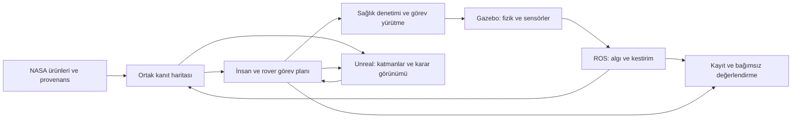

# Marswalk için fikir, veri ve mühendislik araştırması

> **Araştırma 03 / 16** · Aşama 1 — Araştırma ve aday fikirler · Dosya oluşturulma: 13 Kasım 2026 22:02 · [← 02](02-gale-aoi-ve-places-kontrolu.md) · [Dizin](README.md) · [04 →](04-urun-tanimi.md)
>
> Bu bir araştırma/fikir kaydıdır; güncel proje [nihai proje](../2-nihai-proje/README.md) bölümündedir.

13 Kasım 2026 · REDLINE araştırma turu 2 · Uygulama öncesi değerlendirme

**Ana öneri: Roverın nerede ölçüm yapacağına, bu ölçümün astronotun bilim görevini ve geri dönüş kararını ne kadar değiştireceğine göre karar veren bir Marswalk sistemi araştırmak.** Aynı sistemde arazi haritası, robot keşfi, insan kaynak bütçesi, bilim durakları ve görev değişikliğinin gerekçesi görünür olur. İki güçlü alternatif; göreve göre yer değiştiren iletişim rölesi ve konum güvenini dikkate alan yürüyüş planlamasıdır.

Bu öneri henüz bir deney sonucu veya yenilik önceliği kanıtı değildir. Sekiz aday aşağıda ayrı hipotezler olarak karşılaştırılıyor. Büyük sistem hedefi korunuyor; modüller bağımsız deneylerle değerlendirilip ortak veri sözleşmesi üzerinde birleştirilecek.

**Bu turdaki en önemli yeni bulgu saha seçimiyle ilgili:** Mevcut 2 × 2 km Gale alanında incelenen Curiosity PLACES konum tabloları bir rover konumu içermiyor. Yer görüntüsü ve gerçek bilim durağı kullanmak için, bu alanı otomatik olarak doğru saha kabul edemeyiz. Ayrıntılar veri bölümünde ve sorgu notunda bulunuyor.

## 1. Bulguların anlamı ve mevcut durum

Bu belgede **kod bulgusu** incelenen yerel uygulamayı; **kaynak bulgusu** bağlı yayın veya resmî dokümanı; **öneri** geliştirilecek tasarımı; **açık konu** ise henüz doğrulanmamış koşulu anlatır. Bir kaynakta bildirilen sonuç, bizim uygulamamızda elde edilmiş sayılmaz.

Kod bulguları:

- Space Apps deposu araştırma başlangıcında `4f15515` commit'indeydi. Mevcut kod `önceki deneme/` altında; yeni ana fikir henüz uygulama değil.
- `terrain_planner.py` DEM eğimi ve yönlü tırmanış maliyetli A* içeriyor. `mission.py` odometriyle yol takip ediyor ve yakın LiDAR engelinde duruyor; engelin etrafından dinamik haritayla yeniden planlayan birleşik sistem değil.
- `command_gate.py` sonlu ve sınırlanmış hız komutları ile 0,5 saniyelik monoton saat zaman aşımı içeriyor. Bu, görev kaynaklarının veya insan güvenliğinin doğrulandığı anlamına gelmez.
- `redline-demo/planner.js` ayrı ve sentetik bir EVA denemesi. Fizyoloji katsayıları dosyada açıkça sentetik olarak tanımlı; gerçek Gale ROS sahasına bağlanmış bir insan modeli değil.
- Yerel `Build.version`, Unreal **5.8.4** sürümünü doğruluyor. ROS/Gazebo ortamı WSL Ubuntu 24.04, Jazzy/Harmonic; donanım son ölçümde RTX 5080/16 GB VRAM ve yaklaşık 32 GB RAM.
- Tam rover çalışma ağacı `C:/Users/USER/Desktop/roversim27` altında. Oradaki kaydedilmemiş değişiklikler bu araştırmada korunuyor. Yerel özelliklerin tamamını GitHub'daki eski commit'e atfetmemek gerekiyor.

Yerel başlangıç kaynakları: ROS açıklaması, arazi manifesti, sentetik rota motoru, [önceki araştırma](01-ilk-arastirma-ve-deney-plani.md).

## 2. Sekiz farklı fikir adayı

Tablodaki değerlendirmeler kaynak ve mevcut koda dayalı mühendislik yargısıdır. Bir yarışma puanı veya ölçülmüş başarı tahmini değildir. Bütün adayların temel çıktısı challenge'ın istediği katmanlı konum/rota görünümünü korur.

| Aday | Kullanıcının farklı vereceği karar | Teknik araştırma çekirdeği | Başlıca başarısızlık ölçütü |
|---|---|---|---|
| A. Görev kararına göre ön keşif | Robotu incelemeye gönder, bekle, başka yoldan git veya bilim hedefini değiştir | Kısıtlı kaynak altında ölçümün beklenen karar değeri | Eşit bütçede keşif maliyeti kazancı siliyorsa |
| B. Keşif ve iletişim rölesini birlikte planlama | Rover araştırmaya mı devam etsin, bağlantı sağlayacak noktada mı dursun? | Arazi görünürlüğü, ağ kalitesi ve robot görev çizelgesinin ortak optimizasyonu | Rölenin bilim kazancı enerji/zaman maliyetini karşılamıyorsa |
| C. Arızaya dayanıklı dönüş koridoru | Tek dönüş yoluna bağımlı hedefi kabul etme; alternatif koridoru doğrulat | Kaynak kısıtlı geri erişim ve tanımlı arıza senaryolarına dayanıklılık | Yedek yol aynı dar geçitte kırılıyorsa veya aşırı muhafazakârlık görevi bitiriyorsa |
| D. Konum güvenine göre yürüyüş | Biraz uzun ama tanınabilir rotayı seç; durup yeniden gözlem yap | Yerelleştirme belirsizliğiyle rota ve gözlem seçimi | İyileşme yalnız simülatörün kusursuz pozuyla oluşuyorsa |
| E. Bilim sorusuna göre durak seçimi | Aynı kaya türüne tekrar gitmek yerine eksik bilim kanıtını tamamla | Bilim hedefleri, ölçüm süresi ve bilgi tekrarının birlikte planlanması | Kazanç yalnız keyfî bilim puanlarından kaynaklanıyorsa |
| F. Işık ve görünürlüğe göre zamanlı rota | Aynı geçidi farklı saatte kullan veya gözlem noktasını değiştir | Güneş geometrisi, yerel ufuk, algı başarısı ve zaman pencereleri | Güzel gölgeler rota/algı kararını değiştirmiyorsa |
| G. Gecikmeli bilim desteğiyle görev çizelgesi | Dünya yanıtını beklemek yerine faydalı işe devam et; geç gelen talebi değerlendir | Gecikmeli öneriler, veri önceliği ve yeniden sıralanan bilim işleri | Sistem yalnız beklemeyi başka bir maliyete taşıyorsa |
| H. Haritanın neyi bilmediğini gösteren rota denetimi | Kanıtı yetersiz kesimi geçilebilir sayma; hangi ölçümün gerektiğini seç | Çok çözünürlüklü veri kökeni, belirsizlik ve asgari doğrulama gözlemi | Kaynak kartları gerçek yanlış kararları azaltmıyorsa |

### A. Görev kararına göre ön keşif

**Sorun:** Yörüngeden görünen kısa koridor, insan yürüyüşü için yeterince bilinmiyor. Her bilinmeyen yeri robotla taramak da zaman ve enerji harcıyor. Kullanıcı, keşfin o görev için ne zaman değerli olduğunu görmek istiyor.

NASA verisi bölgesel geometriyi ve bilim bağlamını sağlar. Yerel robot gözlemi, yörünge verisinin çözmediği kesimi günceller. Robot ve insan aynı kanıtı kullanır; geçilebilirlik ve kaynak maliyetleri ayrıdır.

Yakın çalışmalar: NASA insan keşfi için robotik ön keşfi araştırmış durumda; *Traversing Mars* scout–follower bilgi toplama planlamasını, 2026 scout–rover çalışması ise zemin dayanımı gözlemini ele alıyor. Bunların varlığı nedeniyle “ön keşfi biz icat ettik” iddiası kurulamaz. [NASA robotik keşif](https://ntrs.nasa.gov/citations/20140008947), [Traversing Mars](https://arxiv.org/abs/2406.05313), [scout–rover zemin çalışması](https://arxiv.org/abs/2602.18688).

**Aday katkımız:** Bilgi toplama hedefini yalnız harita belirsizliğini azaltmaktan, astronotun uygulanabilir bilim/dönüş planını iyileştirmeye taşımak. Algoritmanın robotu hiç göndermemeyi seçebilmesi de gerekir. En zor konu, henüz alınmamış gözlemin görev sonucunu nasıl etkileyebileceğini dürüstçe tahmin etmek. Kör değerlendirmede aynı bütçeli rastgele ve belirsizlik odaklı keşiften iyi değilse hipotez desteklenmez.

### B. Keşif ve iletişim rölesini birlikte planlama

**Sorun:** Roverın daha iyi ölçüm alacağı nokta ile astronota bağlantı sağlayacağı nokta farklı olabilir. Bir robot iki görevi aynı anda farklı yerlerde yapamaz.

DEM/ortofoto görüş geometrisini kurar. Varsayımsal anten, güç ve kanal parametreleri açık tutulur; arazi görüş hattı gerçek radyo kapsaması sayılmaz. Yerel astronot–rover–üs hattı ile Mars–Dünya hattı ayrı modellenir.

Yakın çalışma olarak BASALT'ın gecikmeli bilim operasyonları ve telekomünikasyon araştırmaları incelenir. Bizim aday uzantımız, Mars arazi haritasında keşif/röle rollerini ve bunun insan bilim programına etkisini birlikte seçmek. [BASALT iletişim mimarisi](https://doi.org/10.1089/ast.2018.1906).

**Deney sorusu:** Hareketli röle, sabit röleye göre aynı görev bütçesinde daha fazla yararlı bilim işini tamamlatıyor mu? En zor bağ, hareket geometrisinden zamana bağlı bağlantı modeline ve görev çizelgesine geçiştir. Yalnız RSSI artışı yeterli değil; bağlantısız süre, veri teslim gecikmesi, robot enerjisi ve bilimde kullanılan süre birlikte ölçülür.

### C. Arızaya dayanıklı dönüş koridoru

**Sorun:** Bugünkü en iyi dönüş yolu yarıda kapanırsa astronotun kaynakları başka bir dönüşe yetmeyebilir. Haritada iki çizgi bulunması iki bağımsız dönüş seçeneği olduğu anlamına gelmez.

DEM koridor ağını, robot gözlemi kritik kesimlerin durumunu sağlar. Sistem bir kesim kaybı, belirli hız düşüşü veya tanımlı sensör arızası gibi sınırlı senaryolarda geri erişimi hesaplar. Ortak dar geçitler ve kaynak maliyeti gösterilir.

NASA'nın metabolik traverse çalışması ve NEREUS gibi adaptif EVA rota sistemleri yakın çalışmalardır. Bizim aday katkımız, tanımlı koridor arızaları altında dönüş planını ve gerekli ön keşfi birlikte değerlendirmek. Evrensel “güvenli dönüş garantisi” yerine hangi arıza kümesinin sınandığı açıklanır. [CSRM](https://ntrs.nasa.gov/citations/20240013763), [NEREUS](https://drops.dagstuhl.de/entities/document/10.4230/OASIcs.SpaceCHI.2025.25).

En zor konu çok kaynaklı yolların ve birbiriyle ilişkili tehlikelerin hesabıdır. Bütün hedefleri reddeden sistem başarılı sayılmaz: yanlış kabul ile gereksiz ret birlikte karşılaştırılır. Bu aday A'nın ileri aşamasına bağlanabilir, ancak ayrı deney olarak ölçülmelidir.

### D. Konum güvenine göre yürüyüş

**Sorun:** Kaynak göstergesi iyi görünürken konum kestirimi yanlışsa astronot yanlış geçide yönelebilir. Kısa ve görsel olarak tekdüze bir yol, uzun ve tanınabilir yoldan daha fazla yeniden konumlama gerektirebilir.

MRO haritaları ve uygun rover görüntüleri farklı bakış açılarına ait konum kanıtı sağlar. Rover veya astronotun simüle kamerası/IMU'su bunlarla karşılaştırılır. Görüş eşleştirme kalitesiyle kaynak maliyeti birlikte planlanır.

JPL, Perseverance'ın panoramik görüntüleri yörünge haritalarıyla eşleştiren Mars Global Localization yeteneğini 2026'da bildirdi. Dolayısıyla “Mars'ta GPS'siz konumlama” başlı başına yeni fikir değildir. Aday katkımız, konum güveninin yürüyüş yolu ve aktif gözlem kararına etkisini karşılaştırmaktır; JPL'nin doğruluk sonucunu bizim sonucumuz saymayız. [JPL konumlama](https://www.jpl.nasa.gov/news/nasas-perseverance-now-autonomously-pinpoints-its-location-on-mars/).

En zor konu yörünge ve yer görüntülerinin ölçek/bakış/ışık farkıdır. Başarı mutlak/göreli poz hatası, yanlış eşleşme, toparlanma ve görev kaybıyla ölçülür. Ground truth'u planlayıcıya vermek bu deneyi geçersiz kılar.

### E. Bilim sorusuna göre durak seçimi

**Sorun:** Çok sayıda renkli hedef noktası, iyi bir bilim programı oluşturmaz. Kısıtlı EVA süresinde benzer ölçümleri tekrarlamak yerine farklı bir jeolojik soruyu yanıtlayan kanıtı seçmek gerekebilir.

Gerçek bilim notları, uygun görüntüler ve kapsama varsa spektral ürünler hedef–kanıt ilişkisini kurar. “Su geçmişini araştır” gibi geniş amacın hangi gözlemle sınanacağı ve durakta ne yapılacağı yazılır. Mineral veya yaşam tespiti yalnız yüzey rengine dayandırılmaz.

AEGIS, roverlarda bilim ekibinin belirlediği özelliklere göre otonom hedef seçimini zaten yapıyor. Aday katkımız, belgeli bilim sorularını, tekrar eden ölçümlerin değerini ve insanın dönüş bütçesini birlikte değerlendirmek. [JPL AEGIS](https://superintelligence.jpl.nasa.gov/public/projects/aegis/).

En zor konu bilim değerinin ölçülmesidir. İlk puanlar uzman/ekip tercihidir; farklı ağırlıklar altında hedef seçimi değişiyorsa duyarlılık raporlanır. Geçerlilik, yalnız kendi ürettiğimiz puan sisteminde yüksek toplam almakla kanıtlanamaz.

### F. Işık ve görünürlüğe göre zamanlı rota

**Sorun:** Aynı arazi farklı saatte farklı görülebilir. Bir gözlem noktasında bilim görüntüsü alınamaması veya yerelleştirme başarısının düşmesi, rotanın zamanlamasını değiştirebilir.

SPICE Güneş geometrisini; DEM yerel ufuk/gölge hesabını destekler. Unreal bu koşulları gösterir ve ayrı bir algı deneyinde görüntü üreticisi olabilir. Aydınlatma ve EVA planlaması SEXTANT/PATH gibi araçları da kapsayan mevcut literatürde yer alıyor; bizim katkımız ölçülen algı/konumlama performansını zamanlı bilim rotasına bağlamak olabilir. [NASA EVA bilişim incelemesi](https://ntrs.nasa.gov/citations/20250011652), [NAIF SPICE](https://naif.jpl.nasa.gov/).

En zor konu fotogerçekçi görüntü ile gerçek kamera başarımı arasındaki farktır. Sabit rota/farklı saat ve farklı rota/aynı saat deneyleri ayrılır. Simülatörde güzel görünen ışık, ölçülmüş tehlike veya gerçek Mars kamera modeli sayılmaz.

### G. Gecikmeli bilim desteğiyle görev çizelgesi

**Sorun:** Dünya'daki bilim ekibinin önerisi geldiğinde astronot hedefi çoktan geçmiş olabilir. Sürekli yanıt beklemek ise kıymetli saha zamanını tüketir.

Gerçek NASA bilim hedefleri ve görüntü paketleri karar girdisidir. Yerel görev yazılımı, hangi gözlem paketinin ne zaman gönderileceğini, beklerken hangi işin yapılacağını ve geç gelen talebin maliyetini gösterir.

BASALT, 5 ve 15 dakikalık tek yön gecikme koşullarında bilim operasyonlarını, veri aktarımını ve ekip bekleme süresini araştırmış durumda. Aday katkımız bu operasyonel problemi hareketli robotun ön keşfi ve harita üzerindeki rota seçenekleriyle birleştirmek. Bu deneyde gecikme senaryo girdisidir; Parsec gecikmesi Mars–Dünya fiziği yerine kullanılmaz. [NASA BASALT kaydı](https://ntrs.nasa.gov/citations/20190001439).

En zor konu veri önceliği ile hareket çizelgesinin ortak planlanmasıdır. Kör değerlendirmede bekleme azalırken bilim hedefleri veya dönüş payı kötüleşiyorsa tek başına düşük bekleme süresi başarı değildir.

### H. Haritanın neyi bilmediğini gösteren rota denetimi

**Sorun:** Yüksek çözünürlüklü görünen haritanın bazı katmanları gerçekte çok daha kaba olabilir. Kullanıcı bir koridorun hangi ölçüme dayandığını ve hangi bölümünün varsayım olduğunu fark etmeyebilir.

Farklı görevlerin doğal çözünürlüğü, tarih, konum ve no-data bilgileri rota hücrelerinin kanıt kaydına bağlanır. Ölçülmemiş alanı renkle doldurmak yerine eksik ölçümün karara etkisi gösterilir.

Veri kökeni ve belirsizlik haritalaması genel olarak mevcut yöntemlerdir. Aday katkımız, rota kabul kararını belirli kanıt gereksinimlerine bağlamak ve hangi robot gözleminin eksikliği gidereceğini seçmek. Planetary veri birleştirmesinde mevcut Gale ürününün bile karma kaynaklı olması bu sorunun somut başlangıcıdır.

En zor konu farklı belirsizlikleri tek sahte “güven yüzdesi”ne indirmeden anlaşılır sunmaktır. Kullanıcının yanlış geçilebilirlik kararı ve gereksiz ölçüm sayısı azalmıyorsa sadece bilgi kartı eklenmiş olur. A'nın açıklanabilirlik ve veri temeli olarak da kullanılabilir.

## 3. Üç güçlü aday ve seçim gerekçesi

| Ölçüt | A: Görev değerine göre keşif | B: Keşif + röle | D: Konum güvenine göre rota |
|---|---|---|---|
| İnsan Marswalk kararına bağ | Doğrudan | Doğrudan | Doğrudan |
| Mevcut rover kodundan yararlanma | Yüksek | Orta | Orta–yüksek |
| NASA verisinin temel rolü | Arazi + bilim kanıtı | Arazi + bilim bağlamı | Harita + yer görüntüsü |
| Bağımsız fiziksel prototip olanağı | Mini rover + sensör | İki/üç radyo düğümü | Kamera/IMU ve referanslı küçük saha |
| En büyük araştırma riski | Bilgi değeri modelinin zayıf kalması | Gerçekçi radyo parametreleri | Yer–yörünge görüntü farkı |
| İlk tercihim | Ana sistem | Birinci alternatif | İkinci alternatif |

Bu seçim mevcut kod, açıklanabilir kullanıcı kararı ve deney kurulabilirliğine dayanıyor. A'nın kazanması ölçülmüş değil. C, E, F, G ve H; ana sisteme bağımsız sonuçlarıyla eklenebilen gelişmiş araştırma kollarıdır. Hepsinin aynı anda başarıyla çalışması ilk bilimsel hipotezin şartı yapılmaz.

### Ana önerinin uçtan uca akışı

1. Görev ekibi gerçek NASA katmanlarında bir bilim sorusu ve kaynakları tanımlı bir üs seçer. Küçük keşif roverı yaşam desteği sığınağı sayılmaz.
2. Sistem bilim durakları için insanın gidiş, duraklama ve dönüşünü hesaplar; hangi kesimin gözleme, hangisinin modele dayandığını gösterir.
3. Belirsiz bir koridor için robotun erişebileceği birkaç gözlem noktası üretilir. Her birinin muhtemel ölçüm sonucu altında insan planı yeniden değerlendirilir.
4. Robotun bilgi toplama maliyeti de hesaba katılarak gözlem veya doğrudan yürüyüş seçilir. Kullanıcı gerekçeyi görür ve görevi değiştirebilir.
5. Robot gözlemi geldiğinde harita, bilim programı ve dönüş payı güncellenir. Yeni gözlem daha kötü bir rota veya hedef reddi de üretebilir.
6. Tanımlı arıza senaryolarında C modülü dönüş koridorunu; B modülü röle görevini; D modülü konum güvenini değerlendirir.
7. Aynı koşunun keşifsiz/rastgele keşif/karar odaklı keşif sonuçları tekrar oynatılır. Kazanç kadar boşa çıkan keşif ve başarısızlık da görünür.

### Algoritmik araştırma

İlk aday seçim ölçüsü şu anlamı taşır:

`gözlemin değeri = gözlem sonrasında beklenen en iyi uygulanabilir insan planının değeri − mevcut planın değeri − robotun keşif maliyeti`

Buradaki beklenti, tanımlı gözlem/harita belirsizliği modeline bağlıdır. Gerçekleşecek ölçüm önceden bilinmez. İnsan planı kaynak sınırlarını sağlamıyorsa yüksek bilim puanı onu uygulanabilir yapmaz. Robotun kendi erişim, enerji ve geri dönüş koşulları ayrıca sağlanır. “Keşif yapma” geçerli bir eylemdir.

Artan karmaşıklıkla üç yöntem karşılaştırılabilir: görünür bilinmeyen hücre puanı; olası ölçüm sonuçlarını örnekleyerek görev değeri; sonlu ufuklu kısmi gözlenebilir planlama. POMDP gibi bir yöntem ancak daha basit yaklaşımın kaçırdığı kararı iyileştiriyorsa seçilir. Büyük algoritma adı tek başına katkı değildir.

Çok kaynaklı planlamada süre, O₂ ve robot enerjisinin ayrı ayrı en iyi yolları tek ortak yol varmış gibi birleştirilmez. Seçilen tam plan üzerinde bütün kısıtlar sınanır. İnsan tüketim modeli bu aşamada açık senaryo varsayımıdır; rover teker enerji modeli veya Apollo sonucu Mars insan yürüyüşü kalibrasyonu yerine geçmez.

## 4. Kazanan projelerden ne öğrenebiliriz?

Aşağıdaki altı örnek NASA'nın sonuç sayfalarında **global kazanan** olarak doğrulandı. Yerel ödül, global adaylık ve finalistlik bu tabloya kazanan diye eklenmedi. NASA özetleri proje ve ödülü açıklıyor; her satır için rakiplerden neden üstün görüldüğünü anlatan ayrıntılı jüri raporu bulunmadı.

| Yıl / proje | Global ödül | Doğrulanabilen çıktı ve veri kullanımı | Bizim çıkarımımız |
|---|---|---|---|
| 2023 · Aónikenk / Spacebee | Best Use of Technology | Apollo/ALSEP sismik verisinden katmanlı Ay görünümü. Ekip deposunda `moonquakes.json`, veri dönüştürme aracı ve Unity WebGL parçaları var; bu turda çalıştırılmadı. | Bilim verisinden anlaşılır, etkileşimli ürüne geçiş değerli bir karşılaştırma örneği. |
| 2023 · Lunar Trek / LunarTech Ensemble | Best Use of Science | Apollo sismik verisini web ve sürükleyici oyunla anlatıyor. NASA ürün türünü doğruluyor; UE5 ayrıntısı ekip beyanı, burada ayrıca doğrulanmış motor bağımlılığı sayılmadı. | Oyun/simülasyon görünümü zaten denenmiş; bizim farkımız karar mekanizması olmalı. |
| 2024 · 42 QuakeHeroes | Best Use of Technology | Gezegen sismik sinyallerinde olay seçimi için sinyal işleme/derin öğrenme yaklaşımı. İncelenen web deposu model başarısını yeniden üretmeye yetmiyor. | Teknik yöntem ile erişilebilir kanıt ayrı değerlendirilmeli. |
| 2024 · Landsat Connect / AsturExplorers | Best Mission Concept | Landsat gözlemini kullanıcının konumuna ve zamanına bağlıyor. Ekip sayfası bildirim, spektral grafik ve veri dışa aktarma akışını açıklıyor; canlı sorgu çalıştırılmadı. | NASA verisini “nerede/ne zaman ölçmeliyim?” kararına çevirmek güçlü ürün yaklaşımı. |
| 2025 · PureFlow | Best Mission Concept | Habitat tasarımı ve uzay havası stres senaryosunu birleştiren yaklaşım. DONKI bağlantısı ekip hakkında birincil MCTI açıklamasında var; gerçek doz koruması doğrulanmış değil. | Tasarımın davranışını sınayan deney, yalnız bir 3B modelden fazlasını anlatabilir. |
| 2025 · SkySense / Twisters | Best Use of Technology | NASA yer gözlemleri ve AI ile etkinlik koşulları/zamanı için karar desteği. Açılan NASA özeti bütün veri ürünlerini adlandırmıyor. | Kullanıcı ve karar açık; veri ürünlerini bizim ayrıca izlenebilir kılmamız gerekir. |

Ödül kanıtları: [NASA 2023 sonuçları](https://science.nasa.gov/directorates/smd/2023-nasa-international-space-apps-challenge-announces-10-global-winners/), [NASA 2024 sonuçları](https://www.nasa.gov/learning-resources/stem-engagement-at-nasa/nasa-international-space-apps-challenge-announces-2024-global-winners/), [NASA 2025 sonuçları](https://www.nasa.gov/learning-resources/stem-engagement-at-nasa/nasa-announces-2025-international-space-apps-challenge-global-winners/).

İncelenen birincil ekip çıktıları: [Spacebee deposu](https://github.com/spacebee-technologies/Moonquakes-SpaceApps2023), [42 QuakeHeroes deposu](https://github.com/gabrielchayb/42-quake-heroes), [Landsat Connect ürün açıklaması](https://www.asturexplorers.space/landsat-connect-app/), [PureFlow için Brezilya MCTI açıklaması](https://www.gov.br/mcti/pt-br/acompanhe-o-mcti/noticias/2026/01/projeto-de-equipe-brasileira-vence-como-melhor-conceito-de-missao-do-nasa-space-apps-2025/). Bazı Space Apps takım sayfaları bu araştırmada gizli/erişilemez veya 502 yanıtlıydı; erişilemeyen metinlerden performans sonucu çıkarılmadı.

Bu küçük seçkiden çıkardığımız yorum: veriyle desteklenen anlaşılır kullanıcı kararı, bilimsel sınırların açıklığı ve gösterilebilir çıktı önemli tasarım hedefleri. Yalnız kazananları incelediğimiz için bunun nedensel bir kazanma reçetesi veya kazanma olasılığı hesabı olduğu söylenemez.

### Jüri ölçütlerine nasıl hazırlanacağız?

Erişilebilen **2025** resmî kılavuzu Impact, Creativity, Validity, Relevance ve Presentation ölçütlerini listeliyor. 2026'nın genel kılavuzunu bu araştırmada doğrulayamadık; bu beşli geçmiş referanstır, 2026'nın kesin ağırlıkları değildir. [2025 resmî kılavuzu](https://spaceapps-v2-staging.s3.amazonaws.com/media/documents/Final_Space_Apps_2025_Judging_Guidelines_for_web.pdf).

Bizim önerdiğimiz hazırlık karşılığı: etki için değişen görev kararını; yaratıcılık için yakın çalışmaya göre katkıyı; geçerlilik için kontrollü deneyi; uygunluk için çoklu görev katmanlarını ve insan Marswalk kullanımını; sunum için bir olayın önce/sonra karşılaştırmasını göstermek. Bunlar bizim hazırlık ölçütlerimizdir.

## 5. NASA veri ürünleri ve saha kararı

### Mevcut Gale alanının kontrolü

Mevcut manifestin yaklaşık sınırı **137.427947–137.461688°E, −4.824993…−4.791252° planetocentric enlem**. JPL PLACES v42.0 için `localized_pos.csv` içindeki 1.470 satırın ROVER kayıtları ve `localized_interp.csv` içindeki 49.315 satır bu kutuyla sorgulandı: **iki tabloda da eşleşme sıfır**. Bu, bu tabloların kapsamındaki konum örnekleri için geçerlidir; uzaktan bu alana bakan fotoğraf olmadığı sonucunu vermez.

Etiketin zaman kapsamı Nisan 2026'da bitiyor. Daha sonraki/yayımlanmamış veri ve görüntü bakış alanı ayrıca değerlendirilir. Sorgu yöntemi, kaynak URL'leri, versiyon ve yakın konum örneği [AOI araştırma notunda](02-gale-aoi-ve-places-kontrolu.md) ve [JSON kaydında](ekler/Gale_PLACES_AOI_KONTROLU.json) bulunuyor.

**Önerim:** Gale'de kalıp belgeli bir Curiosity gözlemi çevresinde yeni küçük AOI seçmek ilk seçenek. Yakındaki bir PLACES konumu yalnız aday merkezdir, otomatik bilim durağı değil. İkinci seçenek Jezero'da HiRISE/CTX ve Perseverance gözlemlerini birleştirmek. Jezero ürünleri Gale sahasına katman olarak eklenemez; ayrı bölgedir.

### Somut ürün listesi

“Katalog kapsaması” alanın ürünün genel sınırı içinde olduğunu; “piksel teyidi” seçili sahada geçerli hücre bulunduğunu; “gözlem teyidi” belirli yer ölçümü/görüntüsünün sahaya bağlandığını anlatır. Bunlar birbirinin yerine kullanılmaz.

| Ürün / görev | Biçim, doğal ölçek ve zaman | Bu sahada teyit | Karara katkı ve işleme |
|---|---|---|---|
| Gale DEM v3 · `MSL_Gale_DEM_Mosaic_1m_v3.tif` | 32 bit GeoTIFF; 1 m grid; katalog 20 Ekim 2016 yayını | Yerel kırpım var. Katalog bbox mevcut AOI'yi kapsıyor | Eğim/görüş geometrisi; karma kaynak ve no-data korunmalı |
| Gale ortofoto v3 · `MSL_Gale_Orthophoto_Mosaic_25cm_v3.tif` | GeoTIFF; 25 cm grid; aynı katalog yayını | Ürün ailesi teyitli; yereldeki LRGB dosyasıyla aynı dosya olduğu varsayılamaz | Görsel bağlam ve hizalama; sınıf/çekiş ölçümü değil |
| Yerel Gale LRGB · `MSL_Gale_HiRISE-LRGB_78quads_sharp_cog.tif` | COG GeoTIFF kaynağı; yerelde işlenmiş RGB kırpım | Kırpım ve kaynak hash kayıtları var; özgün ürün tarih/çözünürlük metadatası tamamlanmalı | Unreal/Gazebo dokusu; ortofoto v3 etiketi körlemesine aktarılmaz |
| MSL PLACES · `localized_interp.csv` v42.0 | CSV/PDS4 XML; konum örnekleri, raster değil; etiket 2012-08-06–2026-04-17 | Mevcut AOI'de sorgulanan konum örneği yok | Travers, site/drive/pose ve zaman eşleme |
| MSL Navcam · `MSL-M-NAVCAM-5-RDR-V1.0` | Görüntü ve PDS etiketleri; m/piksel menzile bağlı; dosya tarihi seçilmeli | Arşiv var; AOI'ye bakan tekil görüntü seçilmedi | Kamera modeli/ayak izi, stereo veya yer bağlamı |
| MSL REMS · `MSL-M-REMS-5-MODRDR-V1.0` | Tablo/etiket, fiziksel çevre zaman serileri ve düzeltmeler | Ürün ailesi var; seçilecek sol, kalite ve yer eşlemesi açık | Tarihsel hava senaryosu; tüm AOI'ye canlı ölçüm diye yayılmaz |
| MSL RAD · `MSL-M-RAD-3-RDR-V1.0` | TXT/PDS alt ürünleri; dosimetry, counts ve histogramlar | Dizin erişildi; kullanılacak olay/alt ürün henüz seçilmedi | Tarihsel stres tekrarı; counts ile doz ve astronot maruziyeti ayrılır |
| Odyssey THEMIS Night IR v8.0 | PGM tile; yaklaşık 99,7 m, 592,75 ppd; yayın 23 Haziran 2010 | Global 60°S–60°N kutusunda AOI var; tile no-data okunmadı | Bölgesel gece IR bağlamı; DN doğrudan sıcaklık/termal atalet değildir |
| Odyssey THEMIS Day IR v11 | PGM tile; yaklaşık 99,7 m; yayın 23 Haziran 2010 | Genel kapsama var, sahadaki geçerli hücre teyitsiz | Gündüz IR bağlamı; farklı gözlem/işleme tarihleri korunur |
| MGS MOLA · `MGS-M-MOLA-5-MEGDR-L3-V1.0` | IMG ve etiket/HDR; 128 ppd ≈463 m ekvatorda; 1999–2001 girdi dönemi | Global kapsama; sahada çok az hücre | Bölgesel topoğrafya/kontrol; ayak veya teker ölçeğinde geçilebilirlik değil |
| Jezero CTX · `M20_JezeroCrater_CTXDEM_20m.tif` | 32 bit GeoTIFF, 20 m; eş ortofoto 5 m; yayın 14 Ekim 2021 | Gale ile kesişmez; Jezero küçük AOI seçimi açık | Jezero alternatifinde bölgesel ön harita |
| Jezero HiRISE TRN DTM · `JEZ_hirise_soc_006_DTM_MOLAtopography_DeltaGeoid_1m_Eqc_latTs0_lon0_blend40.tif` | GeoTIFF, 1 m post; eş ortofoto 25 cm; katalog kaynak aralığı 2006–2019 | Gale ile kesişmez; yeni AOI piksel kontrolü yapılmadı | Jezero ayrıntılı geometri; grid aralığı mutlak konum doğruluğu değildir |
| Mars 2020 PLACES / MEDA / Sample Dossier | CSV/XML ve kalibre zaman/örnek kayıtları; ürün türüne göre etiket | Jezero alternatifine ait; tekil hedef/ürün eşlemesi yapılmadı | Yerelleştirme, tarihsel çevre ve belgeli bilim hedefleri |

Ürün erişimleri: [Gale DEM](https://astrogeology.usgs.gov/search/map/mars_msl_gale_merged_dem_1m), [Gale ortofoto](https://astrogeology.usgs.gov/search/map/mars_msl_gale_merged_orthophoto_mosaic_25cm), [yereldeki LRGB kaynağı](https://asc-pds-services.s3.us-west-2.amazonaws.com/mosaic/Mars/MSL/MSL_Gale_HiRISE-LRGB_78quads_sharp_cog.tif), [MSL PLACES](https://planetarydata.jpl.nasa.gov/img/data/msl/msl_places/), [Navcam RDR](https://pds.nasa.gov/ds-view/pds/viewProfile.jsp?dsid=MSL-M-NAVCAM-5-RDR-V1.0), [REMS](https://pds.nasa.gov/ds-view/pds/viewProfile.jsp?dsid=MSL-M-REMS-5-MODRDR-V1.0), [RAD](https://pds-ppi.igpp.ucla.edu/data/MSL-M-RAD-3-RDR-V1.0/), [Night IR](https://mars.asu.edu/data/thm_nir_100m/), [Day IR](https://mars.asu.edu/data/thm_dir_100m/), [MOLA](https://pds-geosciences.wustl.edu/missions/mgs/megdr.html), [Jezero CTX](https://astrogeology.usgs.gov/search/map/mars_2020_science_investigation_ctx_dem_mosaic), [Jezero HiRISE](https://astrogeology.usgs.gov/search/map/mars_2020_terrain_relative_navigation_hirise_dtm_mosaic), [Mars 2020 arşivleri](https://pds-geosciences.wustl.edu/missions/mars2020/).

Üç önemli ürün ayrımı:

1. Gale DEM yalnız MRO HiRISE ürünü değildir: HiRISE/CTX, Mars Express HRSC ve MOLA kontrolü içeren karma üründür. Tek dosyanın içinde farklı görev kökenleri olmasıyla bağımsız görev katmanlarını gerçekten kullanmak aynı şey değildir.
2. Gale landing-site THEMIS sayfasındaki renkli TI görselinden dönüştürülmüş TIFF, nicel termal atalet rasterı gibi maliyete bağlanmamalı. 100 m, 32 bit ISIS3 nicel TI ürün ailesi ayrıdır; Gale'ye uygun güney tile'ı ve no-data bu turda doğrulanmadı. [Browse sayfası](https://themis.asu.edu/landingsites/mslsite_06).
3. Jezero CTX metadatasındaki 3.396.160 m küresel yarıçap, mevcut Gale manifestindeki 3.396.190 m ile kontrolsüz karıştırılmamalı. CRS adı benzer diye koordinatlar eşit kabul edilmez.

**Çoklu NASA görevleri için hedef veri birleşimi:** MRO tabanlı geometri + sahaya bağlanmış MSL yer gözlemi/bilim bağlamı + uygun Odyssey ürününden bölgesel yüzey bağlamı. MOLA ancak gerçekten bağımsız bir işlevi varsa ayrıca kullanılır. Layer sayısını artırmak için ayak ölçeğinde anlam taşımayan veriyi zorla eklemeyiz.

Her ürün için manifestte kimlik/DOI, kaynak bağlantısı, görev, zaman aralığı, doğal grid, işlenmiş grid, yatay/dikey referans, no-data ve kredi tutulur. NASA/JPL/USGS görüntüsü üzerindeki logo veya üçüncü taraf işaretler otomatik olarak ürün verisiyle aynı kullanım koşuluna sahip değildir. Ürün atfı ve lisans notu ayrı kaydedilir.

## 6. Kendimiz üretebileceğimiz katkılar

**Evet, NASA verisine ek kendi yöntemimizi, türetilmiş katmanımızı, simülasyon veri setimizi ve fiziksel deneyimizi üretebiliriz.** Global uygunluk için challenge Resources içinden en az bir NASA kaynağı kullanımı ve bütün kaynakların açıklanması ayrıca korunmalı. Kendi verimiz bu gereksinimi kendiliğinden karşılamaz. [GO Team kaynak açıklaması](https://github.com/nasa/spaceapps/discussions/1827).

| Üreteceğimiz çıktı | İçeriği | Destekleyebileceği iddia | Destekleyemeyeceği iddia |
|---|---|---|---|
| Görev kararına göre gözlem değeri haritası | Aday gözlemin hangi planı değiştirebileceği ve robot maliyeti | Tanımlı senaryolarda daha faydalı gözlem seçimi | Gerçek Mars'ta evrensel en iyi keşif |
| Kaynaklı rota kanıtı | Rota kesimi → gözlem/ürün/model ve elenme gerekçesi | Kararın izlenebilirliği ve veri eksikliği teşhisi | Görsel confidence değerinin gerçek kaza olasılığı olması |
| Senaryo ve kayıt veri seti | Gerçek arazi, açıkça eklenmiş test engelleri, sensör kayıtları, seed ve sürümler | Tekrar üretilebilir algoritma karşılaştırması | Enjekte edilen taşların Mars'taki gerçek konumu |
| Öğrenilmiş algı modeli | AI4Mars eğitim/değerlendirme ayrımı, model ve hata örnekleri | Ayrı gerçek görüntülerde ölçülen segmentasyon sonucu | Aynı başarının otomatik olarak Unreal'da veya gerçek robotta geçerli olması |
| Mini rover arazi deneyi | LiDAR/kamera/IMU/teker ve varsa akım kayıtları, referanslı kısa saha | Gözlem/planlama hattının fiziksel prototipte davranışı | Mars yerçekimi ve toprağının fiziksel doğruluğu |
| Röle deneyi | İki/üç düğüm, sabit parkur, paket sıra numarası ve konum kaydı | O düzende bağlantı ve görev maliyeti | Ölçeklenmemiş Dünya parkurunun gerçek Mars radyo kapsaması |
| Kullanıcı karar deneyi | Aynı olay için kaynak kartlı/kartsız veya farklı açıklamalı görünüm | Karar süresi ve yanlış plan kabulü karşılaştırması | Küçük mühendis örnekleminin astronot operasyon doğrulaması |

Fiziksel rover deneyinde yer gerçeği ayrı değerlendirme hattında tutulur: örneğin kalibre üst kamera, işaretli ölçüm alanı veya uygun referans sistemi. GNSS yalnız Dünya deneyi referansı olarak kullanılırsa Mars algoritmasına giriş olmadığı açıkça gösterilir. Teker akımı tek başına çekiş enerjisinin veya zemin dayanımının kusursuz ölçümü değildir.

AI4Mars pilotunda uzman değerlendirme kayıtları eğitimden ayrılır, yakın aynı-sahne görüntüleri test ve eğitime rastgele dağıtılmaz. Sınıf bazlı IoU, hatalı emin tahminler ve çalışma süresi raporlanır. Veri kümesinin dört sınıfı jeolojik bileşim veya insan basılabilirliği etiketi sayılmaz. [NASA AI4Mars](https://data.nasa.gov/dataset/ai4mars-a-dataset-for-terrain-aware-autonomous-driving-on-mars), [özgün yayın](https://openaccess.thecvf.com/content/CVPR2021W/AI4Space/html/Swan_AI4MARS_A_Dataset_for_Terrain-Aware_Autonomous_Driving_on_Mars_CVPRW_2021_paper.html).

### Güncel yarışma koşullarına ilişkin doğrulama

- GO Team, kaynak inceleme/araştırma/ekip hazırlığı ile yarışma çözümünü geliştirmeyi ayırıyor; başlangıç öncesi proje geliştirmemeyi belirtiyor. Mevcut genel rover altyapısının ve önceki challenge denemesinin teslimde nasıl kullanılacağı otomatik uygun sayılmadı; önceki çalışma açıkça kayıt altında tutulmalı. [5 Kasım 2026 yanıtı](https://github.com/nasa/spaceapps/discussions/1827).
- AI kullanımı izinli; nerede/nasıl kullanıldığı belirtilmeli. Görüntü/video için görünür AI işareti, kod/veri ve ses için açıklama/metadata isteniyor. Üretilen içerikte NASA marka öğelerine ayrıca sınırlama var. [6 Kasım 2026 GO Team yanıtı](https://github.com/nasa/spaceapps/discussions/1849).
- 2026 katılımcı şartlarının özgün içerik bölümünde serbest erişim veya OSI uyumlu açık lisans koşulu ve lisans belirtilmezse Apache 2.0 dağıtımı yer alıyor. Üçüncü taraf materyallerin erişim/lisans/atıf kaydı isteniyor. Bu, bütün bağımlılıkları Apache ile yeniden lisanslayabileceğimiz anlamına gelmez. Sayfaya doğrudan erişim sorunlu olduğundan güncel 2026 başlıklı arama indeksindeki tam metin denetlendi. [2026 şartları](https://www.spaceappschallenge.org/legal/).

Özel geliştirme deposunun görünürlüğü bu araştırmada değiştirilmedi. Teslim paketindeki özgün kaynaklar, üçüncü taraf içerikler ve lisanslı geliştirme araçları ayrı envanterlenmeli. Unreal veya MATLAB kullanmakla onların kapalı kaynak bileşenlerini teslim materyali olarak yeniden dağıtmak farklı işlerdir; teslim biçimine ilişkin araç/lisans uyumu açık kabul maddesidir.

## 7. ROS, Unreal ve ek mühendislik araçları

### Yeniden kullanılacak gerçek kod

Aşağıdaki dosya yolları `C:/Users/USER/Desktop/roversim27` köküne göredir. İnceleme sırasında çalışma ağacında başta ve sonda 139 değiştirilmiş/yeni dosya görüldü; bu turda değiştirilmedi.

| Kod kanıtı | Mevcut işlev | Yeni sistem için gereken bağ |
|---|---|---|
| `src/rover_navigation/src/terrain_mapper_node.cpp:39` | Nokta bulutundan yerel grid, world-model çıktısı ve diagnostics | Gale ön bilgisiyle ortak referans ve kaynak kaydı |
| `src/rover_navigation/src/rolling_terrain_grid.cpp:88` | Kayan pencere, ölçüm biriktirme/eskime, eğim/pürüzlülük | Poz ve ölçüm hatasıyla güven kalibrasyonu |
| `src/rover_navigation/src/terrain_layer.cpp:42` | Nav2'ye TF/timeout/fail-closed arazi katmanı | İnsan için ayrı maliyet; rover footprint/eşiklerini kopyalamama |
| `src/rover_world_model/src/terrain_layers.cpp:45` | Geometri, semantik, kayma ve belirsizlik katkıları | Görev kararının hangi kanıtla değiştiği |
| `src/rover_navigation/src/active_perception.cpp:30` | Aday puanlama ve konum güvenine göre tarama | Beklenen bilgi/kovaryans kazancını hesaplayan model |
| `src/rover_health/src/health_supervisor_node.cpp:46` | Diagnostics, timeout, e-stop ve sistem sağlığı | EVA/görev olayları ve yetkili recovery politikası |
| `src/rover_localization/launch/localization.launch.py:25` | FAST-LIO seçeneği, teker/IMU fallback ve GNSS yolları | GNSS'siz Mars profili ve ayrı kestirim değerlendirmesi |
| `src/rover_controller_comparison/launch/controller_tournament.launch.py:18` | Kontrolcü seçimi ve turnuva altyapısı | Aynı hız, footprint ve güvenlik zinciriyle güncel Mars koşuları |
| `src/rover_navigation/src/terrain_mapper_node.cpp:78` | İsteğe bağlı adaptif hesap, stride/deadline/p95 ölçümleri | Hesap tasarrufunun kaçırdığı tehlikelerle birlikte ölçümü |

Semantik varsayılanı `BaselineColorTextureClassifier`; AI4Mars eğitimi yapılmış sayılmaz. `active_perception` içindeki beklenen kovaryans azalması aday girdisidir; kendiliğinden hesaplanan bir keşif modeli değildir.

Eski runtime raporunun 11 Kasım ekleri tek seed'de sabit/hareketli kutu hedefleri için olumlu sonuçlar bildiriyor. Aynı rapor FAST-LIO'nun kapalı olduğunu ve başka bir çok hedef koşusunun başarısızlığını da kaydediyor. Bu turda yeniden test edilmedi; bütün haritalama/konumlama/kontrol yığınının birlikte doğrulandığı sonucu çıkarılmadı.

### Araç seçimi ve gerçek entegrasyon işi

| Araç | Çözeceği soru ve bağ | Platform/lisans bulgusu | Kabul deneyi |
|---|---|---|---|
| rosbridge + UE WebSockets | ROS poz/rota/durum → Unreal; hedef/karar → ROS | rosbridge Jazzy için `ros2` dalı, BSD-3-Clause. UE istemcisi henüz yok | UE5.8.4 derleme ve eksen/saat/kopma testi |
| rclUE | ROS'u doğrudan UE içine almak | Windows desteklenmiyor; Jazzy dalı deneysel/UE5.1 testi | Ayrı Linux/native uyumluluk kolu; mevcut Windows planının bağımlılığı değil |
| QGIS/GDAL | Veri kapsaması, CRS ve raster birleştirme | GDAL genel kaynak MIT; bağımlılıklar ayrıca incelenir | Kontrol noktası hizası, no-data ve kaynak ölçeği raporu |
| Project Chrono SCM | Teker–zemin kayma/batma hipotezini sınama | Windows/Linux, BSD-3 | Küçük teker deneyi → parametre aralığı → rota duyarlılığı |
| NASA SPICE | Güneş ve cisim geometrisi | Windows toolkit mevcut; ücretsiz kullanım, özel NAIF dağıtım koşulları | Tarih/yer doğrulaması + ayrı DEM ufuk hesabı |
| ns-3 | Paket kaybı/gecikme ve röle görevini sınama | GPLv2-only; WSL2 kurulum yolu var; WSL2 emulation doğrulanmış değil | İlk kol offline discrete-event; hazır gerçek ağ emülatörü sayılmaz |
| MATLAB/Simulink + ROS Toolbox | Yeni kontrolcü/kestirimi mevcut ROS deneyine bağlama | Ücretli; R2025a–R2026b Jazzy uyumluluk tablosu var | Lisans/kurulum kontrolü, mesaj turu ve ortak controller koşusu |
| FRET → Ogma/Copilot | Gereksinimleri çalışma zamanı denetimine bağlama | Güncel FRET3.0/Ogma Apache2.0; Ogma ROS üretimi preliminary | Jazzy'de üç kuralın el yazımı izleyiciyle aynı kayıt sonucu |
| rosbag2 / MCAP | Kayıt, algı karşılaştırması ve offline gösterim | rosbag2 Apache2.0; MCAP eklentisi mevcut | Aynı sensör girdisini tekrar oynatma; clock/TF korunması |

Birincil araç kaynakları: [rosbridge](https://github.com/RobotWebTools/rosbridge_suite), [rclUE](https://github.com/rapyuta-robotics/rclUE), [Epic WebSockets API](https://dev.epicgames.com/documentation/unreal-engine/API/Runtime/WebSockets/FWebSocketsModule/Get?lang=en-US), [GDAL PDS sürücüsü](https://gdal.org/en/stable/drivers/raster/pds.html), [Chrono FAQ](https://www.projectchrono.org/faq/), [Chrono arazi modelleri](https://api.projectchrono.org/vehicle_terrain.html), [SPICE Windows](https://naif.jpl.nasa.gov/naif/toolkit_C_PC_Windows_VisualC_64bit.html), [NAIF kuralları](https://naif.jpl.nasa.gov/naif/rules.html), [ns-3 kurulum](https://www2.nsnam.org/docs/installation/singlehtml/), [MathWorks gereksinimleri](https://www.mathworks.com/help/ros/gs/ros-system-requirements.html), [FRET](https://github.com/NASA-SW-VnV/fret), [Ogma](https://github.com/nasa/ogma), [rosbag2](https://github.com/ros2/rosbag2).

Bu araçların hepsi aynı anda ana sisteme gömülmez. Chrono ve ns-3 ilk aşamada ayrı deney üretip parametre/kayıt sağlar. Simulink ancak ekibin gerçek kullanım ihtiyacı ve lisansı varsa seçilir. SPICE atmosfer veya yerel gölgeyi tek başına üretmez. FRET/Ogma kullanımı uçuş sertifikası değildir.

## 8. Büyük sistemin veri akışı ve otoriteleri

**Fizik:** İlk birleşik düzende rover fiziği ve sensör üretimi Gazebo'ya ait. Unreal rover aktörü durumu izler; aynı rover için ikinci fizik otoritesi olmaz. Chrono fizik araştırması ayrı koşudur. UE kamerası bir gün algı girdisi olacaksa bu ayrı profil olarak tanımlanır; Gazebo ve UE aynı sensör topic'ini birlikte üretmez.

**Koordinat:** ROS metre/sağ elli, Unreal santimetre/sol elli. Dönüşüm tek adaptörde ve açık harita referansında tutulur; yalnız ölçek çarpanı yeterli değildir. Optik kamera eksenleri de ayrı ele alınır. `map → odom → robot` bağlantılarının tek yayıncısı olur. [REP-103](https://www.ros.org/reps/rep-0103.html), [REP-105](https://www.ros.org/reps/rep-0105.html), [Epic koordinatlar](https://dev.epicgames.com/documentation/unreal-engine/coordinate-system-and-spaces-in-unreal-engine?lang=en-US).

**Saat:** Gazebo `/clock` simülasyon otoritesi. Sim zamanı, mesajın kaynak zamanı, geliş zamanı ve monoton sağlık zaman aşımı ayrı alanlardır. Durdurulmuş simülasyonda eski veri yeni gözlem sayılmaz. Saat sıfırlama/replay sırasında önbellek ve görev durumu kontrollü sıfırlanır.

**Komut:** Unreal kullanıcı talebi gönderir; görev yürütücüsü geçerlilik ve onay üretir. UI doğrudan fizik durumunu değiştirerek planlayıcıya gizli kestirme sağlamaz. Yeniden bağlantıda eski hedef tekrarlanmaz; komut kimliği, kaynak ve kabul/ret durumu korunur.

**Yer gerçeği:** Kontrolcü kestirilen poz ve algıyı kullanır. Gerçek simülasyon pozu yalnız ayrı değerlendirici ve açık etiketli gerçek-durum görünümüne gider. Değerlendirici yer gerçeğinin planlayıcıya sızmadığını da denetler.

**Veri arayüzü:** Bugünkü `/odom`, `/redline/path`, `/goal_pose` ve `/redline/mission/status` ilk bağlantı için kullanılabilir. İnsan görevi, robot görevi ve bilim hedefi yeni sürümlü mesajlarla ayrılır. Arazi hücresi/katmanında kaynak kimliği, frame, zaman, doğal/işlenmiş çözünürlük, geçerlilik ve kanıt türü tutulur. Yoğun PointCloud2'yi her kare JSON ile göndermek başlangıç şartı değildir; ROS'ta özet katman üretimi veya ayrı ikili aktarım ölçülür.

**Büyük deney ortamı:** 32 GB RAM üzerinde Gazebo+UE+eğitim+Chrono'nun aynı anda akıcı olacağı varsayılmaz. Görsel ana koşu, headless toplu deney, model eğitimi ve fizik deneyleri ayrı profiller olur. Her profil için RAM/VRAM, CPU, gerçek zaman çarpanı ve görüntü kare süreleri ölçülür.

## 9. Karşılaştırmalı deney programı

Aşağıdaki sayılar hedef/deney ayarıdır; bu turda elde edilmiş sonuç değildir. Tek başarı videosu, çok koşullu doğrulama yerine geçmez.

| Deney | Baseline → aday / değişen unsur | Ölçüm | Kabul veya ret yaklaşımı |
|---|---|---|---|
| 1. Saha/veri kesişimi | Mevcut AOI → belgeli gözlem çevresi | Görev/ürün kapsaması, gerçek bilim bağlantısı, no-data, hizalama | En az gerekli NASA verisi aynı sahada geçerli; eksik katman bilinmiyor kalır |
| 2. ROS–UE sözleşmesi | Gazebo/RViz → headless Gazebo+UE | 1 m ölçek, 10 m doğu/kuzey, 90° dönüş; mesaj yaşı, FPS/RTF ve bellek | Eksen/yönelim doğru, tek otorite, eski komut tekrarı yok |
| 3. Keşfin görev değeri | Keşifsiz kısa/temkinli rota → görev odaklı keşif | Bilim işi, insan mesafesi, rezerv ihlali, robot zamanı/enerjisi | Keşif maliyeti dahil kazanım; boşa çıkan keşif koşulları raporda |
| 4. Gözlem seçimi | Rastgele → belirsizlik → görev değeri | Beklenen/gerçekleşen fayda, bütçe, gereksiz ölçüm | Görülmemiş koşullarda fayda sürüyor; gelecekteki ölçüm gizli |
| 5. Dönüş dayanıklılığı | Nominal rota → tanımlı koridor arızalarıyla rota | Yanlış kabul, gereksiz ret, kalan kaynak, ortak dar geçit | Raporlanan arıza kümesinde sonuç; evrensel garanti iddiası yok |
| 6. Röle görevi | Rölesiz/sabit röle → hareketli röle | Paket teslimi, gecikme, bağlantısız süre, bilim ve robot maliyeti | Daha iyi RSSI yanında gerçek görev kazancı da var |
| 7. Konum güveni | Teker+IMU → seçilmiş LiDAR/görsel aday | ATE/RPE, yanlış eşleşme, güven/hata tutarlılığı, recovery | GNSS ve truth kontrol girdisi değil; kendinden emin yanlışlar sayılır |
| 8. Kontrolcü | Mevcut baseline → seçilmiş adaylar | Hedef başarısı, takip hatası, temas/engel zarfı, hesap p95 | Aynı hız/footprint/safety chain; tuning/test senaryosu ayrı |
| 9. Zemin mekaniği | Rijit zemin → SCM parametre ailesi | Kayma, batma, çekiş ve rota tercihinin değişimi | Kalibrasyon yoksa yalnız parametre duyarlılığı iddiası |
| 10. Zemin algısı | Renk kuralı → eğitilmiş küçük model | Sınıf IoU, hatalı emin tahmin, çıkarım zamanı | Ayrı gerçek görüntü değerlendirmesi; sim/gerçek sonuç ayrılır |
| 11. Arıza ve hesap yükü | Sabit compute/timeout → health+adaptif compute | LiDAR/TF/köprü/clock kesintisi; duruş, recovery, yanlış alarm ve kaçırılan engel | Hesap tasarrufu algı kaybıyla birlikte değerlendirilir |
| 12. Gecikme/ışık/kullanıcı | Sabit çizelge/görünüm → seçilen yeni politika | Bekleme, tamamlanan bilim, tekrar yürüme, yanlış karar, algı başarısı | Her ek unsur ayrı deneyde açılır; hangi katkının yarar sağladığı ayrılır |

İlk pilot için aynı senaryo ailelerinde ortak 10–20 seed düşünülebilir: açık arazi, iki geçit, gizli test engeli, faydasız keşif, sensör kesilmesi ve kötü başlangıç ön bilgisi. Varyans ve çalışma maliyetine göre koşu sayısı artırılır. Nihai değerlendirme, ayar sırasında görülmeyen senaryolarda yapılır. Başarısız koşular ortalamadan çıkarılmaz; dağılım ve hata örnekleri gösterilir.

**Önemli ayrım:** Algı yöntemleri aynı sensör kaydında karşılaştırılabilir. Kapalı döngü kontrolcü ve aktif keşif politikası ise eylemleri gelecekteki sensör girdisini değiştirdiği için yalnız sabit bag dosyasında adil biçimde karşılaştırılamaz. Bunlar ortak başlangıç/seed ile yeniden simüle edilir.

İlk köprü için 20 Hz poz ve aynı kasadaki köprüde p95 100 ms altı mesaj yaşı başlangıç mühendislik hedefi olabilir; ölçülmüş sonuç değildir. Aktarım zamanını hesaplamak için saat eşlemesi yazılır. Uzak laptopta hissedilen Parsec gecikmesi bu köprü metriğinden ayrıdır.

## 10. Geliştirme sırası ve ekip işleri

Büyük kapsamı tek bir özellik listesi olarak değil, ortak altyapı üzerinde paralel araştırma alanları olarak kurmak öneriliyor.

| İş alanı | İlk somut teslim | Birleşme noktası |
|---|---|---|
| NASA/GIS | Veri kesişimi ve ürün manifesti | Ortak harita/CRS ve bilim kayıtları |
| Rover algı/kestirim | Yerel geometri, güven ve sensör kaydı | Kaynaklı gözlem katmanı ve kestirilen poz |
| İnsan/robot görev planı | Ayrı kaynak modelleri ve karşılaştırmalı rota | Planın tamamı, rezerv ve gerekçe |
| Unreal/etkileşim | Katman görünümü, hedef/karar ve replay | Sürümlü köprü; tek koordinat dönüşümü |
| Fizik/iletişim/ileri yöntem | Chrono, röle veya konumlama deneyi | Parametre aralığı veya ölçülmüş aday yöntem |
| Deney/sağlık | Senaryo, kayıt, referee ve arıza testleri | Ortak run kimliği ve sonuç tablosu |

Bunlar kişi sayısı değil, paylaştırılacak sorumluluklardır. İlk ortak kararlar saha, veri sözleşmesi, fizik/saat/TF/komut sahipliğidir. İşler bu sözleşmelerle paralelleşir.

Önerilen aşamalar:

1. **Kanıt ve uyumluluk:** Saha kesişimi, mevcut kod snapshot'ı, lisans/provenans envanteri ve küçük ROS–UE turu. Çıktı yeni NASA verisi bulundu iddiası değil, doğrulanmış girişlerdir.
2. **Birleşik görev döngüsü:** Ortak harita üzerinde ayrı insan/rover planları; Unreal'da başlangıç/güncelleme/ret gerekçesi ve kayıt. Sonraki modüllerin bağlanacağı çalışan sözleşme.
3. **Ana araştırma:** A için rastgele/belirsizlik/görev değeri karşılaştırması. Kazanç görülmezse modelin, senaryonun veya fikrin hangi varsayımda kırıldığı kaydedilir.
4. **Geniş araştırma kolları:** B/D alternatifleri, C dönüş dayanıklılığı, E/G bilim çizelgesi, F ışık, Chrono ve ML. Ortak deneyler üzerinde her katkı ayrı açılıp kapanır.
5. **Fiziksel ve kullanıcı karşılaştırması:** Seçilen hipotez için küçük ölçüm düzeneği veya kullanıcı karar deneyi. Simülasyonun dışındaki ilk kanıt.
6. **Tekrar üretim ve gösterim:** Soğuk açılış, offline paket, ortak seed, veri/sonuç manifesti, başarısız senaryo ve aynı arayüzde kayıtlı tekrar.

Takvim tahmini için takımın uzmanlık dağılımı, gerçek müsaitliği ve ilk entegrasyon ölçümü gerekli. Büyük sistem hedefinden yarışma teslimine seçilecek kesit, bu aşamaların sonuçlarıyla belirlenir; bütün ileri araçların aynı hafta sonu hazır olacağı vaat edilmez.

### İnternet belirsizliğine göre gösterim

Geliştirme ve ağır deneyler evdeki kasada kalabilir. Canlı Parsec, erişim seçeneklerinden biridir; ROS düğümlerini kafe/hackathon interneti üzerinden dağıtmak zorunlu değil. Laptopta kullanılacak kayıtlı tekrar modu, senaryo girdileri ve hafif karar görünümü internetten bağımsız hazırlanabilir. Kayıtlı mod kendini canlı diye tanıtmaz.

Önbellekte gerekli NASA kırpımları, kaynak etiketleri ve örnek görev kayıtları bulunmalı; demo sırasında bütün gezegen verisi yeniden indirilmemeli. Bağlantı kesilince deney durumu ve son geçerli plan yerel olarak korunur. Uzak erişim sağlık paneli geliştirme desteğidir; Mars iletişim modülüyle aynı fiziksel sistem değildir.

## 11. Hangi açık konular kararımızı değiştirebilir?

1. Challenge'ın güncel Resources listesinde hangi somut NASA ürünü var? Genel arşiv erişimiyle bu zorunluluk aynı şey değil; seçilen ürünün oradaki kaydı eşlenmeli.
2. Yeni Gale AOI için bilim kaydı, görüntü bakış alanı ve geçerli rasterlar gerçekten kesişiyor mu? Yoksa Jezero'ya geçişin maliyeti karşılanıyor mu?
3. İlk gözlem modelinin tahmin ettiği görev faydası gerçek simülasyon ölçümüne ne kadar uyuyor? En büyük bilinmeyen ana fikir burada.
4. İnsan kaynak modelinin hangi parametreleri yalnız senaryo, hangileri kaynaklı? Hassasiyet değişince bütün sonuç tersine dönüyor mu?
5. Native Windows/UE5.8.4 derlemesinde WebSockets istemcisi ve gerekli C++ araçları hazır mı? Henüz derlenmiş köprü yok.
6. Yerelleştirme veya röle hangi koşulda ana keşif fikrinden daha güçlü sonuç üretiyor? İlk sıralama bu nedenle değişebilir.
7. Tam rover çalışma ağacındaki hangi yerel yamalar yeniden kullanılacak, hangi doğrulama bunları kapsıyor? Eski rapor tek başına tam birleşim kanıtı değil.
8. Üçüncü taraf mesh/kod/veri ve ücretli araçların teslim biçimi/lisansları uygun mu? Kaynağı `TODO` olan varlık için kullanım hakkı otomatik varsayılmaz.
9. Güncel 2026 genel jüri/teslim rehberi ve yerel etkinlik biçimi ne? 2025 rubriğinden kesin video süresi veya ağırlık çıkarılmaz.

Bu turda yeni uygulama kodu, Unreal eklentisi, eğitim veya simülasyon deneyi yapılmadı. Yerel kod ve yayınlar incelendi; küçük PLACES metadata tabloları sorgulandı; bu rapor ile sorgu kanıtı üretildi. Ana önerinin yararı, yukarıdaki deneyler yapılınca değerlendirilebilir.
