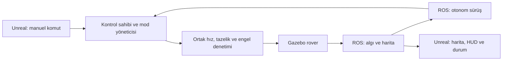

# REDLINE — Marswalk görev planlama ve prova sistemi

> **Araştırma 04 / 16** · Aşama 2 — Ürünün genişlemesi · Dosya oluşturulma: 13 Kasım 2026 22:22 · [← 03](03-kapsamli-arastirma-sekiz-aday.md) · [Dizin](README.md) · [05 →](05-astronot-rover-drone.md)
>
> Bu bir araştırma/fikir kaydıdır; güncel proje [nihai proje](../2-nihai-proje/README.md) bölümündedir.

**Güncel ana tanım:** [Proje kılavuzu](11-proje-kilavuzu-v2.md). Bu belge ürün yönünün önceki kaydıdır; bütün görev/mekân/otonomi ve teknik sınırlar ana kılavuzda birleştirildi.

13 Kasım 2026 · Ürün yönü · Planlanan davranışlar ile mevcut prototip ayrı gösterilir

**REDLINE, bir Mars bilim yürüyüşünü NASA haritalarında planlatan, Unreal'da insan gözünden prova ettiren ve yardımcı rover ile hava aracının manuel/otonom keşfiyle planı güncelleyen bir görev simülasyonu prototipidir.** Temel soru: Robotların önceden topladığı bilgi, insanın hangi bilim hedefine hangi kaynak payıyla gidip dönebileceğini nasıl değiştirir?

Genişletilmiş görev tasarımı [ASTRONOT_ROVER_DRONE.md](05-astronot-rover-drone.md) içinde: roverdan konuşlanan hava aracı, ortak gözlem haritası, robot koluyla numune alma, astronot etkileşimi ve canlı veri ekranları. Bunlar yeni tasarım kapsamıdır; mevcut demoda henüz uygulanmadı.

İlk görev paketi [BES_ANA_GOREV_VE_MIMARI.md](06-bes-ana-gorev-ve-mimari.md) içinde beş ana göreve ayrılır; bilim verisi, sondaj, habitat müdahalesi, eğitim/sınav ve ROS–Python–Unreal–Open MCT bağlantısı burada ayrıntılandırılır.

Astronotun ana kontrol merkezi Unreal habitatındadır; görev için gerekli harita, kamera/algı ve bilim grafikleri bu merkezde görünür. Eksik veri, başlangıç senaryoları ve görevler arasında korunan karar sonuçları [tasarım revizyonunda](07-tasarim-gozden-gecirme.md) tanımlanır.

## Challenge ve ürünün amacı

Depoda seçilmiş konu **Interplanetary Survival Guide: Martian Map**. Bu bir takım hesabı kayıt kontrolü değildir; mevcut belgeler ve kullanıcının verdiği challenge metnindeki seçimdir. [Resmî challenge](https://www.spaceappschallenge.org/2026/challenges/interplanetary-survival-guide-martian-map/) bu incelemede 502 verdi. Ayrıntılar [yerel organizatörün yayımladığı kopyayla](https://hackathlone.com/challenges/interplanetary-survival-guide-martian-map) karşılaştırıldı.

Çekirdek gereksinim, belirli Mars konumu/rotası üzerinde birden fazla NASA görevinin verilerini katmanlı bir görünümde birleştirip insanın bilimsel yürüyüşünü planlamasına ve yürütmesine yardımcı olmak. Rover, HUD ve sürükleyici görünüm olası desteklerdir; Unreal veya ROS kullanımı zorunlu değildir. “Üç veri türü” önerisini ayrı bir zorunluluk gibi sunmayacağız.

Bu projede katmanlı harita, görev simülasyonunun karar merkezidir. Bilim hedefi, rotanın dayandığı kanıt, gözlenmemiş alan ve dönüş kaynakları burada görünür. Simülasyon bu haritayla verilen kararları sınar. Tamamlanan bilim işleri ve karar gerekçeleri görev sonucuna bağlanır.

İlk kullanıcılar mühendislik ekibi, görev tasarımını deneyen araştırmacılar ve eğitim amaçlı kullanıcılar olabilir. Astronot kullanımına dönük arayüz/prova araştırması yapılabilir; doğrulanmış veya sertifikalı astronot eğitimi iddiası kurulmaz.

## Unreal neden var?

Unreal'ın projedeki işi, kullanıcının planı **insan ölçeğinde deneyebilmesi** ve robotla farklı işbirliği stratejilerini aynı senaryoda karşılaştırabilmesidir:

- Haritada kolay görünen geçidi astronot gözünden görmek; yerel görüş engellerini ve yol işaretlerini değerlendirmek.
- Kask/tablet görünümündeki rota, bilim hedefi ve uyarıların doğru zamanda işe yarayıp yaramadığını sınamak.
- Klavye/gamepad ile roverı sürmek, görevi otonomiye devretmek veya insan yardımı gerektiren durumda kontrolü almak.
- Bir engel, iletişim sorunu veya sensör arızasının insan ve robot planını nasıl değiştirdiğini görmek.
- Aynı görevi kaydedip farklı stratejilerle yeniden çalıştırmak; sonuçları karşılaştırmak.

Bu davranışların hangisinin kullanıcı kararını iyileştirdiği ayrıca ölçülür. Görsel kalite veya VR gözlüğü tek başına görev başarımı kanıtı değildir. Başlangıç masaüstü kullanım olabilir; VR ayrı bir etkileşim profili olarak eklenebilir.

NASA SUITS/HUD çalışmaları görev görünümü için araştırma referansıdır; katıldığımız Space Apps challenge'ı SUITS değildir. [NASA HUD örneği](https://www.nasa.gov/stem-content/spacesuits-heads-up-display-activity/).

## Kullanıcının yapacağı işler

| İşlev | Kullanıcı ne yapar? | Sistem ne üretir? |
|---|---|---|
| Görevi planla | Bilim hedefini, üs konumunu, kaynak varsayımlarını ve katmanları seçer | Gidiş/dönüş planı, belirsiz kesimler ve hedefin kabul/ret gerekçesi |
| Astronot olarak prova et | Birinci şahıs bakışla rotayı yürür, tablet/HUD'a bakar, bilim durağına gider | Yol ve görev süresi, model kaynak kullanımı, kaçırılan/bitirilen işler |
| Roverı manuel kullan | Kameradan veya dış görünümden keşif robotunu sürer | Gerçek simülasyon hareketi, sensör gözlemi ve güncellenen yerel harita |
| Destekli kullan | Sürüş komutunu verir; engel yakınlığında yavaşlatma/duruş desteği alır | İnsan müdahalesi ve sistem müdahalesinin ayrı kaydı |
| Otonom görev ver | Nokta/koridor keşfi veya gözlem hedefi seçer | ROS'un ürettiği rota, takip, duruş ve gerekirse yardım isteği |
| Havadan keşif ve numune iste | Drone alan taraması veya rover koluyla örnek alma hedefi seçer | Kaynaklı yeni harita gözlemi veya kimlikli numune işlem kaydı; dönüş ve hata durumları |
| Görevi değerlendir | Aynı senaryonun farklı koşularını karşılaştırır | İnsan ve robot maliyeti, bilim çıktısı, plan değişikliği ve hata nedenleri |

Kullanıcının yürüdüğü astronot ile keşif roverı iki ayrı varlıktır. Bugünkü küçük rover insan taşıyan araç veya yaşam desteği sığınağı değildir. İleride insan taşıyan rover tasarlanırsa kapasitesi ve hareket modeli ayrı olur.

## Manuel ve otonom kontrol nasıl birlikte çalışacak?

ROS tarafında küçük bir görev/kontrol yöneticisi tek komut sahibini seçer. Manuel ve otonom düğümler aynı sürüş topic'inde birbirleriyle yarışmaz.

Geçiş sözleşmesi: aktif otonom görev iptal/duraklatma onayı verir; komut sıfırlanır; yeni komut sahibi onaylanır. Otonomiye dönüşte güncel poz/hedef/harita değerlendirilir. Kopmuş istemcinin eski komutu yeniden yürütülmez. E-stop ve sensör tazeliği denetimi seçili sürüş modundan bağımsızdır. Bunlar uygulanacak ve test edilecek davranışlardır.

Mevcut demoda otomatik görevi duraklatma servisi ve hız zaman aşımı var; bütün bu mod yöneticisi henüz yok. Nav2 Collision Monitor ortak komut zincirinin sonunda manuel/otonom komutları filtreleme adayıdır. Bu yazılım filtresi tek başına fiziksel güvenlik sertifikası değildir. [Jazzy Collision Monitor](https://docs.nav2.org/jazzy/tutorials/general_tutorials/using_collision_monitor/using_collision_monitor/).

## Programlar nasıl bağlanacak?

- **NASA PDS / Mars Trek → GDAL veya QGIS:** ürünleri indirip ortak koordinata getirme, çözünürlük ve veri kaynağını kaydetme. Aynı saha geometrisinden Gazebo collision ve Unreal görünümü hazırlanır.
- **Gazebo Harmonic:** roverın hareketi, tekerlek temasları ve ilk sürümde simüle kamera/LiDAR/IMU için fizik otoritesi.
- **ROS 2 Jazzy:** algı, yerelleştirme, harita, rota, sürüş modu ve görev kuralları. Yerel `roversim27` içindeki terrain mapper, health ve yerelleştirme parçaları yeniden kullanım adayıdır; çalışan Mars demosuna entegrasyonları henüz yapılmış değildir.
- **ROS–Unreal adaptörü:** poz, eklem durumu, rota, harita ve görev olaylarını taşır; Unreal'dan hedef ve manuel komut alır. Seçilecek taşıma/plugin, Unreal 5.8 ile küçük bir bağlantı deneyi üzerinden doğrulanır.
- **Unreal 5.8:** astronotun bakışı/hareketi, HUD/tablet, rover operatör ekranı ve prova etkileşimi. Rover fiziğini ikinci kez hesaplamaz. Astronot hareketi ayrı, açıkça tanımlı bir modeldir.
- **rosbag2 + görev raporu:** ROS olaylarını kaydeder; Unreal etkileşimleri aynı simülasyon zamanına bağlanır. Robot davranışı ile insanın karar anları birlikte incelenir.

İnsan kararını inceleyen deneylerde orbital görüntüde bulunmayan taşları gözlenmiş veri gibi göstermeyiz. Senaryo için üretilen engellerin kaynağı açık olur; navigasyonu etkileyen engeller iki ortamda da aynı yerde bulunur.

## Bir görevin baştan sona örneği

1. Kullanıcı katmanlı haritada kaynaklı bir bilim durağı seçer. Bir geçit daha kısa, diğeri daha iyi gözlenmiştir.
2. Sistemin önerdiği robot gözlem noktasını kabul eder veya roverı kendisi sürerek geçidi inceler.
3. LiDAR/kamera kanıtı yerel haritayı değiştirir. Test engeli varsa hem Gazebo fiziğinde/sensörlerinde hem Unreal görünümünde aynı konumdadır.
4. İnsan yürüyüşü ve bilim durağında kalınabilecek süre tekrar değerlendirilir. Yeni bilgi hedef reddi de üretebilir.
5. Kullanıcı astronot gözünden yürüyüşü prova eder; rota/tablet/HUD bilgisiyle bilim işini tamamlar.
6. Bir senaryo olayı uygulanır: sensör kesintisi, tanımlı zemin değişikliği veya iletişim kaybı. Robot ve insan görevlerine farklı tepkiler verilir.
7. Sonuç ekranı manuel, destekli ve otonom keşif koşularını karşılaştırır. Karşılaştırmada robotun harcadığı süre ve enerji de sayılır.

Eğitim/oyun profilinde görev hedefleri ve geri bildirim bulunabilir. Puanın kaynağı bilim işi, kaynak sınırı ve açık ihlallerdir; gözlenen başarıyı değiştirmeyen dekoratif puanlar ana katkı sayılmaz.

## Amacı olan mühendislik eklentileri

Buradaki “eklenti”lerin bazıları ROS paketi, bazıları ayrı simülatör veya arayüzdür. Hepsi Unreal eklentisi olarak kurulmaz.

| Modül / araç | Ürün içinde amacı | Somut kullanıcı olayı | Entegrasyon durumu |
|---|---|---|---|
| Mevcut yerel mapper + Nav2 görev davranışları | Keşif, yeniden planlama, geri dönüş ve yardım isteme | Robot geçitte yeni engel bulur | Kod parçaları mevcut; birleşik görev davranışı geliştirilecek |
| Nav2 Collision Monitor + komut yöneticisi | Manuel/destekli/otonom sürüşü aynı denetimden geçirmek | Kullanıcı engele yaklaşır veya kontrolü otonomiden alır | Jazzy paketi aday; komut geçişini bizim tanımlamamız gerekiyor |
| JPL Open Source Rover model/kinematik referansı | Altı tekerlekli, eklemli keşif robotunun mekanik davranışını kurmak | Engebede rocker-bogie hareketi ve direksiyon komutları birlikte izlenir | Hazır Jazzy/UE eklentisi değil; model ve kinematik uyarlanır |
| Project Chrono SCM | Zemin varsayımı değişince robotun ilerleyişini sınamak | Robot gevşek zeminde fazla kayar; başka geçit seçilir | Ayrı fizik deneyi; Gazebo ile aynı roverın ikinci fizik otoritesi olmaz |
| MoveIt 2 | Rover kolu varsa hedefe uzanma ve örnekleme hareketini planlamak | Bilim durağında kolun hedefe erişip erişemediği hesaplanır | Kol modeli/eklem sınırları/denetleyici eklenmeden hazır özellik değil |
| ns-3 / bağlantı modeli | Röle konumu ve iletişim maliyetinin görevi değiştirmesi | Rover keşif yerine sırt üzerinde röle olur | Ayrı ağ deneyi; görüş hattı gerçek RF kapsaması sayılmaz |
| NASA SPICE + DEM görüş hesabı | Saat ve yerin gözlem/görünürlüğe etkisini sınamak | Hedefin gölgede kaldığı saatte görev sırası değişir | Geometri ve yerel gölge ayrı hesaplanacak |
| Space ROS / Ogma örnekleri | Görev kurallarını ayrı izleyiciyle sınamak | Veri eskir veya tanımlı sınır aşılır; açık olay kaydı oluşur | Mevcut Jazzy kurulumuna hazır ikili uyum varsayılmıyor |
| ros2_control + gz_ros2_control / donanım adaptörü | Üst görev yazılımını kontrollü fiziksel rover deneyine taşıma | Aynı görev arayüzü gerçek küçük robotta denenir | Jazzy/Harmonic paketi var; mevcut demo native drive kullanıyor, donanım sürücüsü ayrı iş |

MoveIt dokümanı Ubuntu 24.04/Jazzy yolunu öneriyor; bu, bizim rover kolumuzun hazır olduğu anlamına gelmez. Space ROS uzay robotik yazılımı için ROS 2 türevi bir çerçevedir; adını kullanmak ürüne kendi başına bir yetenek veya ödül avantajı eklemez. [MoveIt başlangıç](https://moveit.picknik.ai/main/doc/tutorials/getting_started/getting_started.html), [Space ROS açıklaması](https://space-ros.github.io/docs/rolling/Introduction.html), [Chrono](https://api.projectchrono.org/vehicle_terrain.html).

Rovera özgü kaynaklar: [JPL Open Source Rover](https://github.com/nasa-jpl/open-source-rover), [ROS kodu ve eski sürüm uyumluluğu](https://github.com/nasa-jpl/osr-rover-code), [Jazzy/Harmonic gz_ros2_control](https://control.ros.org/jazzy/doc/gz_ros2_control/doc/index.html), [Space ROS Curiosity/Ogma runtime monitor örneği](https://github.com/space-ros/demos/blob/main/curiosity_rover_ogma/README.md). JPL kodunun Foxy/Gazebo Classic geçmişi var; doğrudan Jazzy/Harmonic uyumluluğu varsayılmaz. Ogma örneği çalışma sırasında kural ihlali izlemeye referans olabilir; ana sisteme sürüm uyumu ayrıca denenir.

## NASA katmanlarının simülasyonda görevi

- Yükseklik ve görüntü, saha geometrisi ve bağlamını verir.
- Sahaya eşlenmiş gerçek rover görüntüsü/bilim kaydı, hedefte ne görüleceğini ve neden gidildiğini açıklar.
- Uygun Odyssey ürünü bölgesel yüzey bağlamını sağlar; ayak boyundaki taşın kesin konumunu vermez.
- Simüle sensörler yeni senaryo gözlemi üretir; NASA'nın Mars'ta ölçtüğü veri diye etiketlenmez.
- Kaynak modeli, iletişim ve zemin deneyleri açık varsayımlar taşır. Tarihsel hava/radyasyon kaydı bütün sahada canlı koşul sayılmaz.

Mevcut Gale AOI'si için konum tablosu kesişim sorunu sürüyor; belgeye uygun gerçek bilim/görüntü bağlantısı kurulmadan nihai görev sahası seçilmez. [Saha kontrolü](02-gale-aoi-ve-places-kontrolu.md).

## Başarıyı nasıl göstereceğiz?

En güçlü gösterim aynı görevin üç koşusudur: insanın yalnız haritayla kararı; insanın manuel rover keşfiyle kararı; sistemin seçtiği otonom ön keşifle karar. Başlangıç, kaynaklar ve gizli senaryo koşulları ortak olur; etkileşim farkları açıkça kaydedilir.

Ölçümler: tamamlanan bilim işi, insanın yürüdüğü mesafe, model dönüş payı, robot keşif maliyeti, müdahale sayısı, yanlış hedef kabulü, gereksiz ret ve karar süresi. Kullanıcı arayüzü deneyi için aynı bilgiyi farklı görünümde sunup yanlış karar ve okuma süresi karşılaştırılabilir. Gerçek astronot performansına genelleme ayrıca doğrulama ister.

## Geliştirme sırası ve mevcut durum

1. Veri kesişimi ve tek saha; ortak zaman, koordinat ve senaryo kimliği.
2. ROS–Unreal köprüsü; aynı rover pozu, rota ve harita görünümü.
3. Manuel/otonom kontrol sahipliği; ortak denetim ve geçiş testleri.
4. Astronot bakışı + tablet/HUD + bilim hedefi ve kaynak planı.
5. Karar odaklı keşif; üç stratejinin karşılaştırılması ve replay.
6. Kol, zemin, röle, ışık ve runtime izleme araştırmalarının ayrı kabul deneyleriyle bağlanması.

Bugün çalışan temel Gazebo/ROS rover ve arazi demosu. Yukarıdaki Unreal görev provası, çok modlu kontrol ve ileri modüller **planlanan ürün**; tamamlanmış özellikler değil. Ayrıntılı veri/deney araştırması [kapsamlı raporda](03-kapsamli-arastirma-sekiz-aday.md) bulunuyor.
