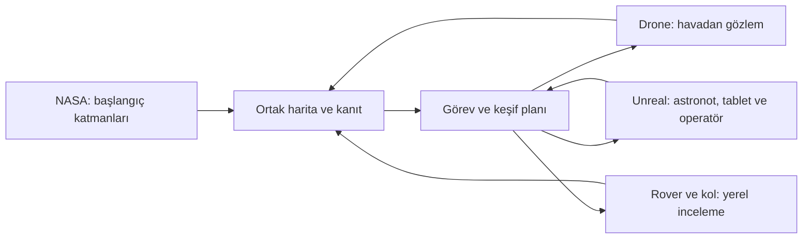

# REDLINE — Astronot, rover ve hava aracı görev tasarımı

> **Araştırma 05 / 16** · Aşama 2 — Ürünün genişlemesi · Dosya oluşturulma: 13 Kasım 2026 22:37 · [← 04](04-urun-tanimi.md) · [Dizin](README.md) · [06 →](06-bes-ana-gorev-ve-mimari.md)
>
> Bu bir araştırma/fikir kaydıdır; güncel proje [nihai proje](../2-nihai-proje/README.md) bölümündedir.

**Güncel ana tanım:** [Proje kılavuzu](11-proje-kilavuzu-v2.md). Bu belge önceki çok araçlı tasarımın ayrıntılarını korur; görevler, otonomi ve kampanya sınırlarında ana kılavuz esas alınır.

13 Kasım 2026 · Tasarım önerisi · Bu belgede tarif edilen yeni modüller henüz uygulanmadı.

**REDLINE, NASA haritasındaki bir bilim hedefi için havadan keşif, yerden inceleme, robot koluyla numune alma ve astronot yürüyüşünü birlikte planlayan bir Mars görev provasıdır.** Kullanıcı Unreal'da astronotu yönetir; rover ve hava aracına görev verir, kameralarını izler ve gerektiğinde manuel kontrole geçer. Yeni gözlemler ortak haritayı ve insanın görev planını değiştirir.

Bilim hedefi örneği, belgelenmiş iki farklı yüzey birimini karşılaştırmak için fotoğraf ve numune toplamaktır. Son saha ve hedefler, NASA ürünlerinin gerçek örtüşmesi doğrulanınca seçilir. İnsan taşıyan rover bu tasarımın parçası değildir; mevcut rover yardımcı keşif ve bilim robotudur.

Görev paketi [BES_ANA_GOREV_VE_MIMARI.md](06-bes-ana-gorev-ve-mimari.md) içinde beş ana göreve ayrılır: keşif, farklı numuneler/laboratuvar, sondaj, habitat hattına müdahale ve astronot bilim seferi. Bilim veri kataloğu, eğitim/sınav ve Open MCT görev merkezi bu pakette tanımlanır.

## Üç aracın birbirini tamamlayan görevi

| Varlık | Kullanıcı ne ister? | Ürettiği çıktı | Göreve katkısı |
|---|---|---|---|
| Hava aracı / scout | Bir koridoru veya yüzleği gözle; dönüş yap | Görüntüler, poz tahmini, gözlem kapsamı; yöntem uygunsa yüzey modeli | Roverın giremediği kesimleri görür, yakın inceleme adaylarını bulur |
| Rover | Koridoru incele; bilim hedefine git | LiDAR/kamera gözlemi, yerel yüzey haritası, eğim/pürüzlülük, kayma göstergesi | Yer seviyesindeki geçiş kanıtını ve robotun hareket sınırlarını değerlendirir |
| Robot kolu | Hedefi yakından incele; örnek al; kaba bırak | Yakın görüntü, eklem ve modellenmiş temas bilgisi, örnek alma sonucu | Seçilmiş bilim hedefini kayıtlı bir işleme dönüştürür |
| Astronot | Bilim işini tamamla; hedefi onayla veya değiştir | Fotoğraf, not, hedef işareti, işlem kaydı, model kaynak kullanımı | İnsan gözlemini ve kararını görev planına katar |

Hava gözlemi, yer seviyesinde geçilebilirliği tek başına doğrulamaz. Roverın geçiş sınırı astronotun geçiş sınırıyla aynı değildir. Harita bu iki kullanıcı için ayrı maliyet ve kısıtlar üretir.

## Tek görevde baştan sona akış

1. Görev masasında bilim sorusu, aday hedefler ve dönüş koşulları seçilir. Başlangıç haritasında gözlenmemiş alanlar görünür.
2. Görev yöneticisi, hangi drone gözleminin insanın rota veya hedef kararını değiştirebileceğini seçer. Kullanıcı öneriyi değiştirebilir.
3. Rover durur; kalkış alanı ve drone dönüş payı denetlenir. Hava aracı tanımlı koridoru tarar.
4. Gözlemler ölçüm zamanındaki pozla haritaya eklenir. Kamera önizlemesi hemen, daha yoğun yüzey rekonstrüksiyonu işlem tamamlandıkça görünür.
5. Rover aday geçidi yakından inceler. Hava haritasıyla uyuşmayan gözlem varsa iki kaynağın belirsizliği ve zamanı birlikte değerlendirilir.
6. Astronot bilim hedefini onaylar. Rover uygun duruşa gelir; kol erişim ve çarpışma kontrolünden sonra örnek alma görevine geçer.
7. Alım sonucu doğrulanır, örnek bir kap kimliğiyle kaydedilir. Kullanıcı fotoğraf, konum ve işlem geçmişini görür.
8. Astronot güncel rotayı Unreal'da yürür, bilim durağında görevini tamamlar. Robotların keşif ve dönüş görevleri ayrıca izlenir.
9. Görev sonunda, hava keşfinin insanın yürüyüşünü ve bilim çıktısını nasıl değiştirdiği karşılaştırılır.

Droneun iniş/dönüşü bağımsız bir görevdir; harita üretildi diye uçuş başarılı sayılmaz. Roverın numune görevini bitirmesi de insan görevinin tamamlandığı anlamına gelmez.

## Toplanabilecek veriler

| Veri | İlk kaynak / sensör | Ürün | Sınır veya doğrulama ihtiyacı |
|---|---|---|---|
| Havadan görüntü | Drone RGB / navigasyon kamerası | Kamera akışı, görüntü ayak izi, yüzlek/engel adayları | Görüş dışı ve örtülü alanlar bilinmiyor kalır |
| Havadan geometri | Görüntüler + poz/ölçek tahmini; ileride seçilirse stereo | Nokta bulutu, yerel yüzey modeli, görüntü mozaiği | Tek fotoğraf yeterli değil; rekonstrüksiyonun gecikmesi ve konum hatası gösterilir |
| Drone hareketi | IMU, kamera ve altimetre modeli | Poz, hız, yükseklik, belirsizlik | Mars GNSS/GPS hizmeti varsayılmaz; ortak haritaya bağlama ayrıca çözülür |
| Yerel yüzey | Rover LiDAR/kamera | Engel, eğim, pürüzlülük ve gözlem kapsamı | Hava haritasından farklı çözünürlük ve görüş açısı taşır |
| Sürüş davranışı | Tekerlek hızı + gövde hareket tahmini; varsa actuator modeli | Kayma ve zorlanma göstergeleri | Doğrulanmamış bir toprak dayanımı ölçümü gibi sunulmaz |
| Yakın bilim gözlemi | Kol uç kamerası | Hedefin yakın fotoğrafı ve işlem öncesi/sonrası karşılaştırma | Görüntüden kimyasal bileşim ölçüldüğü iddia edilmez |
| Numune işlemi | Eklem, uç takım, temas/nesne durumu | Alım başarısı, kap ID'si, işlem geçmişi | Fiziksel alım doğrulanır; yalnız kol animasyonu yeterli değildir |
| İnsan gözlemi | Astronot fotoğraf/not/işaret arayüzü | Konumlu bilim notları ve yeni inceleme talebi | Simülasyon gözlemi, gerçek Mars ölçümü diye etiketlenmez |
| Çevre ve cihaz genişletmeleri | Ayrı termal, spektral, meteoroloji veya radyasyon modeli/verisi | Yeni bilim katmanı ve ölçüm kaydı | Sensör, kalibrasyon ve gerçek/sentetik veri kaynağı her modül için tanımlanır |
| Sistem sağlığı | Enerji ve bağlantı modelleri, ROS diagnostics | Kalan görev payı, veri yaşı, hata ve bağlantı olayları | Batarya/enerji modeli ilk aşamada açık varsayımlar içerir |

NASA'nın Perseverance araçları yakın görüntü, element/mineral incelemesi ve çevre gözlemi için referans sağlar. PIXL, SHERLOC ve SuperCam farklı cihazlardır; RGB görüntü bu ölçümlerin yerine geçmez. [NASA bilim cihazları](https://science.nasa.gov/mission/mars-2020-perseverance/science-instruments/).

## Bilinmeyen alanı gerçekten bilinmiyor tutmak

Simülasyon sahasıyla planlayıcının bildiği harita ayrı tutulur. Dünya dosyasında bulunan bir taş veya örnek, sensörle gözlenmeden operatörün ortak haritasına eklenmez. Operatörün üçüncü şahıs/debug görünümü ile astronotun erişebildiği bilgi ayrı deney profilleridir.

Her gözlem/harita parçası şu bilgileri taşır: kaynak araç ve sensör, ölçüm zamanı, alım zamanı, koordinat çerçevesi, konum belirsizliği, çözünürlük, gözlem kapsamı ve veri kökeni. Kaynaklar `NASA archive`, `simulated sensor`, `scenario asset` ve `derived estimate` gibi açık türlerle ayrılır. Kaynaklı veriden türetilen sonuçlarda girdilere bağlantı korunur.

NASA arazi ürünlerinin çözünürlüğü dışındaki küçük taşlar ve numuneler açık senaryo varlıklarıdır. Bunların üretilmesi, Mars'ta gerçekten o konumda bulunduklarına kanıt sayılmaz. Birleştirme sırasında farklı çözünürlükteki katmanları aynı kesinlikte göstermeyiz; çelişkiyi tek değere sessizce ezmeyiz.

## Droneun Mars rolü ve rover üzerindeki platform

Ingenuity havadan keşif yaparak roverın ulaşamadığı araziyi inceleme ve rota/bilim hedefi seçimine gerçek bir örnek oluşturdu. Kameralarla çalışıyordu; bilim cihazı taşımıyordu. [JPL keşif örneği](https://www.jpl.nasa.gov/news/nasas-mars-helicopter-reveals-intriguing-terrain-for-rover-team/), [JPL donanım ve iletişim açıklaması](https://www.jpl.nasa.gov/news/press_kits/ingenuity/landing/mission/spacecraft/).

Rover üzerinde tekrar kullanılabilir kalkış/iniş platformu bu projenin geleceğe yönelik tasarımıdır. İlk deney rover dururken kalkış ve rover yakınındaki tanımlı iniş alanına dönüş olur. Sonra durağan rover üzerindeki pade göreli iniş denenir. Şarj/mekanik tutucu ve hareketli platforma iniş ayrı mühendislik işleridir.

İlk uçuş modeli işlev geliştirmek için basitleştirilmiş olabilir. Mars aerodinamiği doğrulanana kadar bu durum arayüz ve deney raporunda açık olur. Yalnız yerçekimini düşürmek veya standart Dünya multicopter modelini kullanmak Mars uçuş fiziğini doğrulamaz; rotor, atmosfer, kütle ve denetim modeli birlikte ele alınır. Bu bir mühendislik gereğidir. [NASA/JPL Mars uçuş denetimi çalışması](https://rotorcraft.arc.nasa.gov/Publications/files/GripAIAA.6.2019-1289.pdf).

## Numune alma bir görev durum makinesi olacak

`hedef seçildi → erişim doğrulandı → ön konum → alıma hazır → alım denemesi → alım doğrulandı → kapta → kayıt tamamlandı`

Her aşamada hata ve iptal sonucu bulunur. İlk uç takım tercihi küçük taş tutucu veya yüzey malzemesi kepçesi olabilir; kaya karotu delme ayrı bir modüldür. MoveIt erişim ve çarpışmasız yaklaşımı planlamak için kullanılabilir; temas, kazma ve malzeme koparma davranışı ayrıca modellenir.

Numune kaydı: örnek ID'si, bilim amacı, hedef fotoğrafı, konum/çerçeve ve belirsizlik, ölçüm zamanı, araç/uç takım, işlem sonucu, kap ID'si, saklama durumu ve sonraki teslim olayı. Başarı kontrolü ilk nesne tabanlı simülasyonda temas + doğru nesnenin alınması + doğru kaba bırakılması üzerinden yapılabilir. Regolitin fiziksel kazılması daha ileri model gerektirir.

## Unreal'da dört görünüm

1. **Astronot:** birinci şahıs yürüyüş, HUD/tablet, hedef işaretleme, fotoğraf/not, rover/dronea görev verme.
2. **Rover operatörü:** kamera, LiDAR/harita, manuel-destekli-otonom mod, kol ve numune ekranı.
3. **Hava keşfi:** kamera önizlemesi, uçuş koridoru, gözlem kapsamı, poz belirsizliği, dönüş/iniş görevi.
4. **Görev masası:** NASA katmanları, ortak gözlem haritası, görev bağımlılıkları, kaynaklar, olay kaydı ve tekrar oynatma.

İlk sürüm tek kullanıcının bu görünümler arasında geçişiyle çalışır. Çok kullanıcılı astronot/operatör rolleri daha sonra aynı görev otoritesine bağlanabilir.

Canlı panelde araç pozu ve belirsizliği, aktif görev, harita güncellemeleri, kamera, son veri zamanı, iletişim ve kaynak durumu görünür. Büyük 3B rekonstrüksiyon tamamlanana kadar sistem işlem sürüyor bilgisini gösterir; kamera önizlemesiyle harita üretim gecikmesi birbirine karıştırılmaz.

Veri kesilince son görüntü ve konumun yaşı görünür; bağlantı geri geldiğinde eski komutlar yeniden oynatılmaz. Komutlar kimlikli, süreli ve onaylıdır. Video yenileme/kalitesi ağ durumuna göre azaltılabilir; görev olayları ve komut onayları önceliklidir.

Astronot, rover ve drone arasındaki yerel saha bağlantısı ile Dünya bağlantısı farklı profillerdir. Dünya ekranı gecikmeli görev kontrolü olarak modellenir; yerel astronot ekranı güncel veriyi bağlantı koşulları izin verdikçe alır. Mars-Dünya sinyal gecikmesi uzaklığa bağlı olarak dakikalar mertebesindedir. [NASA iletişim açıklaması](https://www.nasa.gov/missions/tech-demonstration/space-communications-7-things-you-need-to-know/).

## ROS, Gazebo ve Unreal arasında görev paylaşımı

- **Gazebo:** rover, kol ve ilk hava aracı modelinin fizik/sensör otoritesi. Aynı araç için Unreal'da ikinci fizik simülasyonu çalıştırılmaz.
- **ROS 2:** haritalama, yerelleştirme, görev atama, sürüş/uçuş/kol komutları, kaynak ve veri tazeliği denetimi. Görevlerin iptal ve hata sonuçları da buradadır.
- **Unreal:** astronot hareketi ve etkileşim, araçların poz/eklem gösterimi, canlı ekranlar ve prova. Astronotun hareket modeli rover modelinden ayrıdır; sahadaki engellerin konumu iki ortamda eşleşir.
- **Kayıt:** rosbag2 ve zamanlı Unreal olayları; bir görev koşusunun kararları, numuneleri ve sensörleri aynı koşu kimliğiyle ilişkilendirilir.

Önerilen namespace'ler `/rover_1`, `/scout_1`, `/astronaut_1` ve `/mission`. Bunlar mevcut demoda uygulanmış isimler değildir. Ortak yerel `map` altında her aracın tekil `odom`, `base_link` ve sensör frame'leri olur; namespace tek başına TF frame adlarını benzersiz yapmaz. Her dönüşümün tek yayıncısı vardır. Ortak haritaya bağlama, tahmin edilen poz ve belirsizliğiyle yapılır.

Gazebo `/clock` simülasyon zamanı olur. Komut bağlantısının watchdog'u monoton duvar saati kullanır; simülasyon durunca eski komutun geçerliliği sonsuza uzamaz. ROS metre/sağ el eksenleriyle Unreal santimetre/sol el eksenleri arasındaki dönüşüm tek adaptörde tanımlanır. Görüntüleme/değerlendirme için ground truth kullanılabilir; otonomi ve haritalama tahmini yalnız seçilen sensör hattını alır.

Önerilen görev arayüzleri: `SurveyArea`, `InspectTarget`, `CollectSample`, `ReturnToPad`. Bunlar tasarım isimleridir; action mesajları henüz yazılmadı. Genel görev yöneticisi alan taramayı araca atar; aracın kendi denetleyicisi hareketi yürütür. Manuel/otonom geçişte her araçta tek komut sahibi korunur.

## Özgün deney: hangi keşif, hangi bilim görevini mümkün kılıyor?

Üç koşu karşılaştırılır: başlangıç haritasıyla insan planı; rover keşfiyle plan; drone + rover keşfiyle plan. İnsan için aynı başlangıç, hedefler ve kaynak varsayımları kullanılır. Öğrenme etkisini azaltmak için görev sırası ve eşdeğer senaryolar planlanır.

Ölçümler: erişilebilen ve tamamlanan bilim hedefi, tamamlanan numune kaydı, insanın yürüdüğü mesafe, robotların keşif süresi/enerji modeli, geri dönüş payı, yanlış hedef kabulü, gereksiz ret, veri gecikmesi, konum hatası ve insan müdahalesi. Drone fayda sağlamazsa görev yöneticisinin onu uçurmamayı seçmesi de geçerli bir sonuçtur.

## Birleştirme sırası

1. Ortak saha/zaman/koordinat; Unreal–ROS köprüsü ve rover operatör görünümü.
2. Duran roverdan drone kalkış/dönüş deneyi, kamera ve araç durumu.
3. Drone ve rover gözlemlerinin kaynak/zaman/belirsizlik taşıyan ortak haritası.
4. Kolun erişimi, nesne tabanlı numune alma ve numune kayıt sistemi.
5. Bilim hedefi, keşif ataması, astronot HUD/yürüyüş ve görevin baştan sona yürütülmesi.
6. İletişim/algı arızaları, keşif stratejisi karşılaştırmaları ve görev tekrarı.

Bugün mevcut ROS/Gazebo rover demosu çalışıyor. Drone, kol, çok araçlı harita, görev yöneticisi ve Unreal canlı görev ekranları bu belgedeki tasarımdır. Genel ürün tanımı [PROJE_TANIMI.md](04-urun-tanimi.md), veri ve fikir araştırması [SPACE_APPS_KAPSAMLI_ARASTIRMA.md](03-kapsamli-arastirma-sekiz-aday.md) içinde bulunur.
