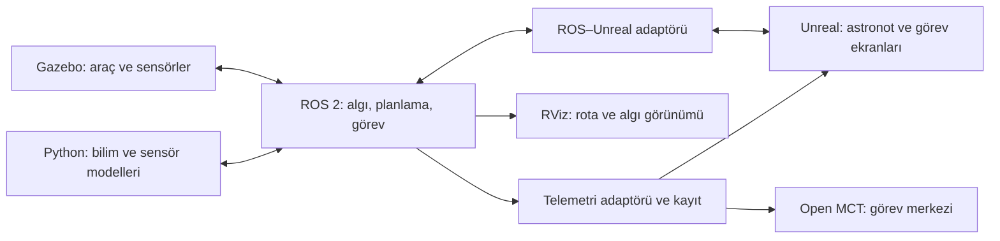

# REDLINE — Beş ana görev, bilim verisi ve çalışma mimarisi

> **Araştırma 06 / 16** · Aşama 2 — Ürünün genişlemesi · Dosya oluşturulma: 13 Kasım 2026 22:47 · [← 05](05-astronot-rover-drone.md) · [Dizin](README.md) · [07 →](07-tasarim-gozden-gecirme.md)
>
> Bu bir araştırma/fikir kaydıdır; güncel proje [nihai proje](../2-nihai-proje/README.md) bölümündedir.

**Güncel ana tanım:** [Proje kılavuzu](11-proje-kilavuzu-v2.md). Buradaki taslak görevler, mekânlar ve otonom robot yardımıyla birlikte kılavuzda ayrıntılandırıldı; farklılıkta ana kılavuz esas alınır.

13 Kasım 2026 · Genişletilmiş ürün planı · Yeni görevler ve bağlantılar henüz uygulanmadı.

**REDLINE'ın ilk görev paketi; keşif, çok tür numune, sondaj, habitat müdahalesi ve astronot bilim seferinden oluşur.** Her görev eğitim ve sınav profiliyle aynı ROS/Gazebo dünyasında çalışır. Unreal kullanıcı etkileşimini, ROS görev ve robot kararlarını, Python bilim/veri modellerini, görev merkezi ise canlı ve geçmiş sonuçları sunar.

Ana kontrol merkezi Unreal habitatının içindedir: harita, kamera/algı, rota, bilim grafikleri ve karar ekranları orada kullanılabilir. Kalıcı karar sonuçları ve tasarım eleştirisi [TASARIM_GOZDEN_GECIRME.md](07-tasarim-gozden-gecirme.md) içinde ayrıntılandırılır.

Space Apps çekirdeği, NASA verilerini insanın Mars bilim yürüyüşüne bağlayan ortak haritadır. Bakım/kaçak görevi bu yürüyüşün destek altyapısı ve eğitim senaryosudur. Bilim hedefi, NASA katmanları ve insanın kararları ürünün merkezinde kalır.

## Beş ana görev

| Görev | Astronot ve robotların işi | Veri / ürün | Başarı veya gerekçeli iptal |
|---|---|---|---|
| 1. Keşif ve rota değerlendirme | Astronot hedef seçer; drone koridoru gözler; rover geçidi yakından inceler. Manuel, destekli ve otonom sürüş kullanılır. | Görüntü, LiDAR, gözlem kapsamı, eğim/pürüzlülük, poz belirsizliği, rota ve müdahale kaydı | Hedefe ilişkin yeterli kanıt, gerekçeli rota kararı ve drone dönüş/inişinin tamamlanması |
| 2. Karşılaştırmalı yüzey bilimi | Taş ve gevşek regolit farklı kaplara alınır. Atmosfer örneği ayrı gaz kabına alınabilir. Numuneler uygun istasyon işlemine teslim edilir. | Örnek/kap kimliği, yakın fotoğraf, konum, alım sonucu; seçilen cihaz profiliyle pH, iletkenlik veya bileşim kaydı | Doğru hedef/kap, eksiksiz işlem geçmişi ve bilim sorusuna dayanan karşılaştırma |
| 3. Sondaj ve derinlik profili | Astronot hedefi onaylar; rover duruşunu ayarlar, kol/drill adımlı işlem yürütür. Kullanıcı devam, durdurma veya alternatif hedef kararı verir. | Derinlik, ilerleme, modellenmiş kuvvet/tork/sıcaklık; derinlikle ilişkili örnekler | Tanımlı mekanik sınırlar içinde işlem veya gerekçeli iptal; örneğin derinlik ilişkisi korunur |
| 4. Habitat hattında kaçak ve müdahale | Alarm sonrası rover engellerden kaçınarak inceleme alanına gider, arızalı hattı araştırır. Astronot müdahaleyi onaylar; kol vanayı kapatır, yeniden ölçer. | Seçilmiş gaz modeli, hat basıncı/akışı, vana durumu, robot/kol durumu ve öncesi/sonrası eğrileri | Doğru hattın bulunması, doğru vanaya müdahale ve etkinin ölçümle doğrulanması |
| 5. Astronot refakati ve birleşik bilim seferi | Astronot bilim yürüyüşünü yürütür; rover refakat/araç/numune desteği sağlar. Gerektiğinde drone yeni alanı gözler. Bir veri veya iletişim sorunu sonrası görev/dönüş kararı verilir. | Bilim çıktıları, insan–robot ayrılığı, kaynak modeli, veri yaşı, müdahale ve dönüş kayıtları | Bilim hedefleri ile insan/robot dönüş koşullarının birlikte değerlendirilmesi ve kararın kanıtla açıklanması |

Her görevde hedef, önkoşul, tamamlanma kanıtı, iptal koşulu ve geri dönüş davranışı bulunur. Görevler tek tek oynanabilir; beşinci görev önceki becerileri birleştirir. Rastgeleleştirme yalnız sınırları tanımlı senaryo değişkenlerine uygulanır ve koşu tohumu kaydedilir.

## Eğitim ve sınav

Eğitim profilinde işlem sırası, rota önerisi, açıklamalı hata ve yeniden deneme vardır. Sınav profilinde aynı görev tanımının farklı bir varyantı çalışır; kullanıcı yalnız kendi sensör ve gözlemlerine erişir. Gizli arıza konumu, doğru örnek kimliği veya gerçek zemin alanı öğretmen/değerlendirme tarafında kalır.

Puan bileşenleri görev özelinde tanımlanır: bilim hedefinin karşılanması, numune/kap doğruluğu, kayıt tamlığı, işlem sırası, kaynak koşulları ve müdahaleler. Hız tek başına başarı sayılmaz. Uygun koşullarda bir hedefi reddetme veya işlemi durdurma da başarılı karar olabilir. Ağırlıklar ve eşikler öğretim amacıyla seçilecek; bilimsel olarak doğrulanmış astronot yeterlilik ölçütleri gibi sunulmayacak.

Sınav sırasında RViz ve Unreal debug görünümlerindeki ground truth katmanları öğrenciye açılmaz. Öğretmen senaryoyu izleyebilir, kayıtları görevin ardından tekrar oynatabilir. İnsan karşılaştırmaları için öğrenme etkisi, görev sırası ve eşdeğer senaryolar ayrıca tasarlanır.

## Numune ve ölçüm çeşitleri

- **Taş/kaya karotu:** tutucu veya drill ile farklı işlem; hedef fotoğrafı ve kaynak konumu korunur.
- **Gevşek regolit:** kepçe/uygun uç takım; örnek kabına aktarım doğrulanır.
- **Atmosfer/gaz örneği:** tanımlı bir örnekleme kabı ve gaz cihazı işlemi; katı örnekle aynı alım davranışı kullanılmaz.
- **Kontrol/tanık kabı:** kontaminasyon ve işlem kalitesini değerlendirmek için ayrı kayıt; doğal yüzey örneği türü değildir.

NASA'nın Perseverance numune deposunda kaya, regolit, atmosfer ve tanık tüp ayrımı bulunur. [NASA örnek türleri](https://www.nasa.gov/missions/mars-2020-perseverance/perseverance-rover/nasas-perseverance-rover-shows-off-collection-of-mars-samples/).

**pH görevi:** regolit al → laboratuvar hücresine teslim et → tanımlı su/numune hazırlığı → ölçüm/kalibrasyon → sonucun kaydı. Phoenix MECA/WCL böyle bir ıslak kimya işlemi için gerçek referanstır. Kuru zeminin her konumunda doğrudan pH veren bir sensör varsayılmaz. Phoenix sonucunu başka Mars sahasının gerçek pH'ı diye konumlandırmayız. [JPL WCL işlemi](https://www.jpl.nasa.gov/images/pia10915-phoenixs-wet-chemistry-lab/), [PDS MECA arşivi](https://pds-geosciences.wustl.edu/missions/phoenix/meca.htm).

**Kol ve drill:** MoveIt erişim ve yaklaşma hareketlerini planlayabilir. Delme, örnek koparma, kavrama ve vana çevirme için temas, kuvvet/tork ve mekanik sınır modelleri gerekir. İlk işlev prototipinde açıkça basitleştirilmiş nesne/eklem etkileşimi kullanılabilir. Bir animasyonun bitmesi görevin başarı kanıtı değildir; örnek veya vana sonrası fiziksel/model durumu doğrulanır.

## NASA veri kataloğu

Amaç, farklı görevlerin yararlanacağı genişleyebilir bir ürün kataloğu kurmaktır. Her üründe görev/cihaz, PDS kimliği veya DOI, sürüm, kaynak URL'si, yer-zaman kapsamı, birim, kalite ve kalibrasyon bilgisi tutulur. İndirilecek dosyalar ayrıca seçilir; aşağıdaki liste bütün arşivlerin indirildiği anlamına gelmez.

| Veri ailesi | Kaynak | Kullanım ve yer sınırı |
|---|---|---|
| Topoğrafya ve görüntü | MRO HiRISE/CTX ve mevcut NASA/USGS ürünleri | Ortak saha geometrisi; ürün çözünürlüğü korunur. Mevcut Gale mozaiğinin çok görevli kökeni kendi provenance dosyasında kalır. |
| Isıl/bölgesel yüzey bağlamı | Mars Odyssey THEMIS | Uygun nicel ürün ve örtüşme seçilir; browse görüntüsü nicel ölçüm yerine geçmez. |
| pH, çözünmüş iyonlar, iletkenlik | Phoenix MECA/WCL | Cihaz/prosedür eğitimi ve kaynaklı arşiv tekrarı; Phoenix konumu başka sahaya ölçüm olarak taşınmaz. |
| Element bileşimi | Curiosity APXS | Belirli hedefin spektrum/türetilmiş ürünleri ve kalite bilgisi. [PDS APXS](https://pds-geosciences.wustl.edu/missions/msl/apxs.htm) |
| Mineral bileşimi | Curiosity CheMin | Tanımlı numunenin XRD ve türetilmiş ürünleri. [PDS cihaz/işlem](https://pds-geosciences.wustl.edu/msl/msl-m-chemin-4-rdr-v1/mslcmn_1xxx/document/chemin_basics.htm) |
| Gaz/uçucular | Curiosity SAM | Atmosfer analizi ve ısıtılan katı numune analizi ayrı işlemler. [Curiosity cihazları](https://science.nasa.gov/mission/msl-curiosity/science-instruments/) |
| Gale çevre serisi | Curiosity REMS | Tarihsel sıcaklık, basınç, nem, rüzgâr ve UV ürünleri; kalite bayrakları korunur. [PDS REMS](https://pds-atmospheres.nmsu.edu/data_and_services/atmospheres_data/MARS/curiosity/rems.html) |
| Jezero çevre serisi | Perseverance MEDA | Kalibre çevre ürünleri; Gale'deki gerçek eşzamanlı hava diye gösterilmez. [PDS MEDA](https://pds.nasa.gov/ds-view/pds/viewCollection.jsp?identifier=urn%3Anasa%3Apds%3Amars2020_meda%3Adata_calibrated_env) |
| İyonlaştırıcı radyasyon | Curiosity RAD | Doz/detektör ürünleri, ilgili tanım ve zaman aralığıyla. MEDA solar/IR ışınımıyla aynı ölçüm değildir. [RAD ürün tanımı](https://pds-ppi.igpp.ucla.edu/volume/MSLRAD_1002/DOCUMENT/RAD_RDR_SIS.PDF) |

İki veri profili açık tutulur:

1. `archive_replay`: gerçek arşiv ölçümü, kendi yeri/zamanı/birimi/kalitesiyle oynatılır. Zaten ölçüm hatası taşıyan kayda rastgele yeniden hata eklenmez.
2. `simulated_measurement`: tanımlı senaryo alanı bir cihaz modeliyle ölçülür. Tepki süresi, örnek hazırlığı, ölçüm süresi, bias/kalibrasyon, çözünürlük ve geçersiz okuma davranışı kayıtlıdır. Arşivden alınan referanslar yeni üretilmiş ölçümü gerçek NASA gözlemi yapmaz.

Ekranda gerçek arşiv, türetilmiş tahmin ve simülasyon sonucu ayırt edilir. Noktasal bir kimya ölçümü bütün haritaya kesin bir alan olarak yayılmaz. Çevre zaman serisinin tekrar oynatılması da doğrulanmış hava tahmin modeli değildir.

## Habitat kaçağının modeli

Kaçak, insan yapımı bir hat/servis modülünün üretilmiş arıza senaryosudur. Gaz türü, kaynak akışı, boru/rezervuar durumu, vana etkisi, ortam basıncı ve sensör tepki modeli belirlenir. İlk modül, sınırları tanımlı basınçlı bir servis alanı olabilir. Mars dış ortamındaki seyrek gaz yayılımı ayrıca modellenir; Dünya'daki genel bir yayılım denklemi doğrudan doğrulanmış Mars modeli sayılmaz.

Başlangıçta görünür bir gaz bulutu çizmek yerine gaz sensörü ve hat basıncı/akışından inceleme yapılabilir. Öğrencinin erişemediği arıza alanı değerlendirme için tutulur. Akış azalmadan yalnız vananın döndüğünü görmek görevi tamamlamaz. Kontrol kapanış sonrası sabit bir değerlendirme aralığındaki basınç/akış ve sensör değişimine bakar.

## Python, ROS ve Unreal nasıl çalışacak?

Python bilim hesaplarını ve uygun ROS 2 düğümlerini dış süreçte çalıştırır. Unreal istemcisi C++/Blueprint ile görev, harita, grafik ve araç durumunu sunar. Epic'in resmî Python desteği Editor otomasyonu içindir; çalışan oyunun paketlenmiş görev mantığını bu eklentiye bağlamayız. [Epic Python açıklaması](https://dev.epicgames.com/documentation/en-us/unreal-engine/scripting-the-unreal-editor-using-python).

Mevcut Windows Unreal 5.8.4 + WSL Jazzy düzeninde ilk aday, `rosbridge_suite` ve Unreal WebSockets/JSON istemcisidir. Poz, rota, görev durumu ve hedef/komut alışverişi küçük bir uyumluluk deneyiyle doğrulanacak. Bu köprü henüz derlenmedi. [rosbridge](https://github.com/RobotWebTools/rosbridge_suite), [Epic WebSockets API](https://dev.epicgames.com/documentation/unreal-engine/API/Runtime/WebSockets/FWebSocketsModule/Get?lang=en-US).

Yüksek hacimli kamera/nokta bulutu için sıkıştırma, seyrekleştirme veya ayrı akış gerekebilir; bütün sensörleri JSON üzerinden tam hız taşımayı başarı ölçütü yapmayız. Kontrol döngüsü ROS/Gazebo tarafında kalır, görüntüleme yenileme hızına bağlanmaz. Güncel olmayan komut ve görüntü davranışları ortak bağlantı sözleşmesinde tanımlanır.

RViz TF, sensör, harita/costmap ve planlanan rotayı gösterir; kararları görev yöneticisi, planlayıcı ve denetleyiciler verir. Kullanıcının RViz'de verdiği hedef ROS'a gider. Unreal aynı durum/rota mesajını kendi görünümünde çizer; RViz penceresinin görüntüsünü kopyalamak zorunlu değildir.

Geliştirme profili RViz'i açar. Kullanıcı profili Unreal ve görev merkeziyle çalışabilir; Gazebo başsız çalıştırılabilir. Hedef tek başlatma betiğidir: arka uç servislerini hazır olma sırasıyla açıp ardından Unreal'ı başlatır. Bu betik henüz yazılmadı; mevcut `Open-Mars.ps1` yalnız bugünkü rover demosunu açar.

## Görev merkezindeki grafikler

**Open MCT**, NASA'nın açık kaynak görev operasyonları görselleştirme altyapısıdır; canlı ve geçmiş veri, görüntü ve zaman çizelgelerini sunabilir. NASA'nın kullanım listesinde Mars 2020 de bulunur. ROS verisi için kendi telemetri adaptörü, geçmiş veri deposu ve Open MCT provider'ı gerekir. [Resmî proje](https://nasa.github.io/openmct/), [NASA kullanımları](https://nasa.github.io/openmct/whos-using-open-mct/).

- Bilim masası: numuneye bağlı pH/iletkenlik, mineral/element sonuçları, örnek konumu ve kalite bilgisi.
- Sondaj ekranı: derinlik–zaman, tork/kuvvet–derinlik, sıcaklık ve işlem aşaması.
- Bakım ekranı: vana komutuyla işaretlenmiş basınç/akış/gaz eğrileri; önce/sonra karşılaştırma.
- Keşif ekranı: gözlenen alan, harita güncellemesi, poz belirsizliği ve plan değişikliği olayları.
- Görev ekranı: tamamlanan bilim işi, robot/insan kaynakları, veri yaşı, müdahaleler ve görev zaman çizelgesi.

Python/SciPy hesap, filtreleme ve analiz için kullanılabilir; operasyon ekranı Open MCT olur. ROS mühendislik incelemesinde PlotJuggler canlı zaman serilerini ve kayıtları karşılaştırma adayıdır. [SciPy](https://docs.scipy.org/doc/scipy/tutorial/), [PlotJuggler](https://github.com/PlotJuggler/PlotJuggler).

Unreal habitatındaki ana kontrol merkezi bütün görev açısından gerekli sayısal sonuçları, haritaları, kamera/algı görüntülerini ve grafikleri sunar; tablet/HUD ilgili veriyi sahaya taşır. UMG/world-space widget ve veriyle çizilen grafikler temel uygulama adayıdır. Open MCT web görünümünün gömülmesi UE 5.8 paketlenmiş uygulamada ayrıca denenir; bu deney temel kontrol merkezinin çalışmasının önkoşulu değildir. Ayrı tarayıcı geliştirmede kullanılabilir; ürünün tamamlanmış kontrol merkezi sayılmaz. Ekran yenilemesi robot denetimini yavaşlatmamalıdır.

## İlk uygulanacak akış

Önce Görev 1'in tamamı bağlanır: görev seç → roverı manuel sür → otonom hedef ver → rota hem RViz hem Unreal'da görünsün → gözlem ve görev olayları kaydedilsin → görev merkezi sonuçları göstersin. Drone bu keşif akışına eklenir. Sonra ortak numune/cihaz arayüzüyle Görev 2; temas ve mekanik işlemlerle Görev 3/4; eğitim/sınav değerlendirmesiyle Görev 5 tamamlanır.

Görev/ölçüm arayüzlerinde koşu ID'si, görev ID'si, örnek ID'si, araç/sensör, ölçüm zamanı, alım zamanı, konum/çerçeve, birim, kalite, veri profili ve kaynak bağlantısı taşınır. Eğitim ekranı, Open MCT ve son rapor aynı kayıttan beslenir.

Mevcut çalışan temel ROS/Gazebo rover demosudur. Beş görev paketi, bilim modelleri, Open MCT adaptörü, drone, kol ve Unreal görev sistemi plan aşamasındadır. Genel ürün [PROJE_TANIMI.md](04-urun-tanimi.md), çok araçlı mimari [ASTRONOT_ROVER_DRONE.md](05-astronot-rover-drone.md) içindedir.
