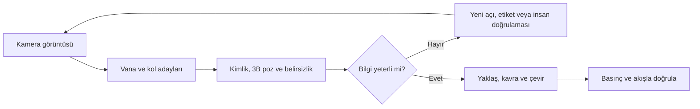

# REDLINE — Tasarım eleştirisi, kontrol merkezi ve karar sonuçları

> **Araştırma 07 / 16** · Aşama 2 — Ürünün genişlemesi · Dosya oluşturulma: 13 Kasım 2026 22:58 · [← 06](06-bes-ana-gorev-ve-mimari.md) · [Dizin](README.md) · [08 →](08-gelistirme-stratejisi.md)
>
> Bu bir araştırma/fikir kaydıdır; güncel proje [nihai proje](../2-nihai-proje/README.md) bölümündedir.

13 Kasım 2026 · Tasarım revizyonu · Buradaki yeni davranışlar henüz uygulanmadı.

**Ana kullanıcı ürünü, Unreal içindeki Mars habitatı kontrol merkezinden başlayıp yüzeyde devam eden bir bilim seferidir.** Harita, araç kameraları, görüntü işleme sonuçları, rota, numune kayıtları ve bilim grafikleri habitat ekranlarında kullanılabilir. Astronot sahada aynı görev kaydının ilgili bölümünü tablet/HUD üzerinde görür. RViz, Open MCT ve analiz araçları aynı veri modeline bağlanır; RViz ek mühendislik görünümüdür.

Ana ortam Mars'tır. Bu belgedeki yürüyüş, Mars yüzey yürüyüşüdür. Nihai saha ve gerçek bilim hedefleri NASA ürünlerinin konum/ölçüm örtüşmesi doğrulanınca seçilecek. Önerilen görev hikâyesi ve habitat, NASA'nın gerçekleşmiş insanlı Mars görevi olarak sunulmaz.

## Zayıf taraflar ve somut düzeltmeler

| Zayıflık | Üründeki sonucu | Düzeltme | Nasıl değerlendirilecek? |
|---|---|---|---|
| Beş ayrı teknoloji demosu | Kullanıcı görevler arasında bir neden görmez | Tek bilim seferi; numune, harita, kaynak ve arıza durumu görevler arasında korunur | Önceki kararın sonraki hedef/ekipman/ölçüm planını değiştirdiği uçtan uca koşu |
| NASA haritası dekor olur | Bakım ve nesne toplama Mars bilimiyle ilişkisizleşir | İki yüzey birimini karşılaştıran kaynaklı bilim amacı; keşif ve bakım bu amacın uygulanabilirliğini etkiler | Her bilim durağının veri ürünü, gözlem ve araştırma gerekçesi gösterilir |
| Kontrol merkezi ayrı uygulamalara bölünür | Astronot Unreal dışına çıkmadan görevi değerlendiremez | Bütün görev açısından gerekli görünümler habitatta; aynı kayıt tablet, Open MCT ve RViz'e beslenir | Kullanıcı beş görevin kararlarını dış pencereye geçmeden verebilir |
| Bilinmeyen alan gerçekte planlayıcıya açıktır | Keşif robotunun kazandırdığı bilgi ölçülemez | Dünya gerçeği, gözlemler ve tahmini harita ayrı tutulur | Gözlenmemiş bir engel senaryo nesne listesinden planlayıcıya sızmaz |
| Bilim sonuçları rastgele sayıdır | Ölçüm yapmak anlamsız bir ödüle dönüşür | Bilim sorusu, örnekleme, cihaz işlemi, kalite ve yorum zinciri | Hatalı hazırlığın geçersiz/kalitesiz sonuç üretmesi; kaynaklı gerçek kayıt ayrımı |
| Vana algısı hareketi çözmüş gibi gösterilir | Doğru kutu çizilirken yanlış hatta müdahale edilebilir | Algı, kimlik, 3B poz, erişim, temas ve sonuç ayrı aşamalar | Yanlış vana seçimi, poz hatası ve ölçümle doğrulanmış kapanış ayrı raporlanır |
| Drone her sorunu çözer | Rover ve insanın karar alanı daralır | Keşif, yakın görüntü, röle ve dönüş gözlemi farklı maliyetli işlerdir | Keşif maliyeti ve bilim faydası; droneu kullanmamanın da geçerli olduğu koşu |
| Hikâye seçime rastgele ceza verir | Kullanıcı sistemin neden sonuç ürettiğini öğrenemez | Karar sonucu fizik/cihaz/görev durumundan türetilir ve olay kaydında açıklanır | Sonuç için önceki durum ve eylem zinciri izlenebilir |
| Astronot yalnız robotları izler | İnsan için etkileşim ve bilim rolü zayıf kalır | Hedef/ölçüm seçimi, kalite inceleme, saha fotoğrafı/notu, müdahale ve durdurma kararları | İnsan kararının rota, numune veya ölçüm işini değiştirmesi |
| Çok sayıda canlı ekran maliyeti | Görüntüleme kontrol döngüsünü veya akıcılığı zorlar | Veriyle çizilen UI, paylaşılan görüntü dokuları, görünürlük ve akış bütçeleri | Kare süresi, aktarım gecikmesi, veri yaşı ve kontrol yanıtı ölçülür |

## Kontrol merkezi Unreal'ın içinde olacak

Astronot habitatta bir harita masasına ve işlevlerine göre gruplanmış ekranlara gider. Bu ekranlar dekoratif video değildir; bağlı görev verisini gösterir ve komut alır. Aynı görev görünümünün odaklanmış, okunabilir 2B erişimi de bulunur; kullanıcı küçük bir 3B ekranda yazı aramak zorunda kalmaz.

| İstasyon | Ekrandaki içerik | Kullanıcının kararı |
|---|---|---|
| Harita masası | NASA katmanları, gözlem kapsamı, rota, geçitler, bilim hedefleri ve kaynaklar | Hedef, rota ve keşif isteği |
| Robot konsolu | Rover/drone/kol kameraları; algılanan nesne ve poz işaretleri; araç durumu | Manuel/otonom mod, inceleme, yeniden görüntü ve müdahale |
| Bilim masası | Örnek fotoğrafı, konumu, kap ve işlem geçmişi; pH/bileşim/derinlik grafikleri | Geçerli ölçüm, yeniden ölçüm, yeni numune ve sondaj hedefi |
| Habitat paneli | Hat şeması, vana kimliği, basınç/akış/gaz ve olaylar | Hangi hattın inceleneceği ve hangi müdahalenin onaylanacağı |
| Görev duvarı | Aktif işler, araç görevleri, kalan model kaynakları ve karar zaman çizelgesi | Öncelik, erteleme, alternatif görev ve dönüş |

Grafikte bir ölçüm seçilince haritada yeri ve örnek kaydı açılır. Bir rota kesimi seçilince hangi veriyle önerildiği, gözlem zamanı ve eksik kanıt görünür. Kullanıcı görüntü işleme kutusuna bakarken ham görüntüyü de açabilir. Sayısal değerler birim, veri yaşı ve kalite bilgisi taşır.

Teknik uygulama adayı UMG + world-space Widget Component ve kamera görüntüleri için ortak dinamik doku hattıdır. Unreal dünya içine etkileşimli widget yerleştirmeyi destekler. [Epic Widget Components](https://dev.epicgames.com/documentation/unreal-engine/widget-components-in-unreal-engine?lang=en-US).

Başlangıçta görev algısının kamera kaynağı Gazebo olabilir; ekrandaki algı işaretleri o görüntü ve zaman damgasıyla eşleşir. Unreal'ın başka açıdaki güzel görüntüsüne ilgisiz algı kutuları yerleştirilmez. İleride algı kamerası Unreal'da üretilirse kamera geometrisi, zaman, kalibrasyon ve sahadaki karşılıkları yeni sensör hattı olarak doğrulanır.

Open MCT canlı/geçmiş telemetri ve analiz için aynı veri kaydına bağlanır. Uygun web görünümünün habitat ekranına gömülmesi ayrıca denenebilir; görev açısından gerekli harita ve grafiklerin Unreal içinde çalışması bu deneye bağlı bırakılmaz. Ayrı tarayıcı/RViz penceresi geliştirmede kullanılabilir; ürünün kontrol merkezi tamamlandı demek için yeterli değildir.

## Tek bilim seferi: İki Yüzlek, Bir Sol

Önerilen bilim sorusu: iki farklı yüzey biriminin görüntü ve uygun numune analizleri hangi benzerlik ve farkları gösteriyor? Kullanıcı fotoğraf, yerel bağlam, örnekleme ve cihaz sonuçlarını birlikte değerlendirir. Bilim hedefi gerçek saha verisiyle kesinleştirilir; mevcut arazi dosyasında rastgele taş bulmak bu sorunun yanıtı sayılmaz.

Beş ana görev bu seferin beceri alanlarıdır: keşif, yüzey numunesi/laboratuvar, sondaj, habitat müdahalesi ve birleşik yürüyüş. Her koşuda aynı sıranın zorunlu olması gerekmez. Önceki sonuç bir görevi açabilir, alternatif oluşturabilir veya görev için yeni önkoşul üretebilir. Laboratuvar arızalıysa örnekler saklanıp analiz ertelenebilir.

### Aynı Mars sahasında üç başlangıç önerisi

| Başlangıç | Elde olan bilgi | İlk anlamlı karar |
|---|---|---|
| Planlı bilim seferi | Habitat ve araçlar hazır; kısa koridorun yerel verisi eksik | Drone keşfi, rover incelemesi veya daha iyi gözlenmiş uzun rota |
| Yarıda kalan sefer | Önceki harita ve araçlardan birinin telemetrisi eski; bazı örnekler zaten kayıtlı | Önce veri/araç durumunu doğrulamak veya mevcut bilgilerle yeniden planlamak |
| Çelişkili bilim bulgusu | Görüntü ve numune yorumu uyuşmuyor; bir kayıtta kalite sorunu işareti var | Kontrol örneği, yeniden ölçüm veya alternatif hedef |

Başlangıçlar aynı sistemin farklı durumlarıdır; üç ayrı dünya/model üretmek zorunda değildir. Önceki durumun var olduğu bir senaryoda numuneler, kullanılan kaplar ve harita kaydı gerçekten yüklenir.

## Eksik veri, oyunun ve otonominin karar girdisi

Dört durum haritada ve görev kayıtlarında ayrı görünür:

- **Gözlenmemiş:** uygun cihazın görüş/ölçüm alanına henüz girmedi.
- **Eski:** gözlem mevcut ama senaryoda geçerliliği etkilenmiş olabilir.
- **Belirsiz:** konum, geometri veya cihaz kalitesi karar için yetersiz.
- **Çelişkili:** farklı gözlemler aynı yorumu desteklemiyor.

Bunlara bilgi toplama eylemleri karşılık gelir: farklı açıdan fotoğraf, roverın yakın incelemesi, kalibrasyon, daha uzun ölçüm, kontrol örneği veya yeni drone gözlemi. Her eylemin süre, enerji veya sarf maliyeti vardır. “Daha fazla veri” her durumda en iyi karar olmayabilir.

NASA arşivi başlangıç kanıtıdır. Senaryonun gerçek engel/arıza/malzeme alanı yalnız fizik ve değerlendirmede tutulur. Algı çıktısı ve astronot gözlemleri tahmini haritaya gider. Dedektör skorları kalibre olasılık, renkli geçiş maliyetleri kesin risk yüzdesi gibi gösterilmez.

Robot düşük veri kalitesinde durabilir, yeni gözlem planlayabilir veya astronottan yardım isteyebilir. Sınavda kullanıcıya geçersiz veri saklanıp sonuçtan sonra keyfî ceza verilmez; karar anında erişilebilir kalite işaretleri ve uyarılar kaydedilir.

## Vana kapatma: görüntüden fiziksel sonuca

İlk kontrollü altyapı profilinde ArUco/AprilTag gibi bir işaret kullanılabilir. Kamera kalibrasyonu ve bilinen işaret geometrisiyle poz hesaplanır; işaret pikselden okunur. Sonraki araştırma profili etiketsiz vanada segmentasyon/anahtar nokta/geometri kullanabilir. Bunlar ayrı algı zorluklarıdır. [OpenCV ArUco/poz açıklaması](https://docs.opencv.org/4.x/d5/dae/tutorial_aruco_detection.html).

Vana kimliği, arızalı hat kimliği, vana gövde pozu ve hareketli kol/çark durumu farklı bilgilerdir. Sabit gövde işareti kol açısını doğrudan vermez; çok turlu bir çarkın tek görüntüsü açık/kapalı durumunu kesinleştirmeyebilir. Hat şeması ve basınç/akış ölçümü bu yüzden gereklidir.

Yaklaşmada MoveIt planlama ve görsel hata üzerinden düzeltme yapan Servo adaydır; Jazzy sürüm/config uyumu ayrıca doğrulanır. Temas, kavrama/kayma, tork ve son konum ayrı mekanik/denetim modelidir. Kontrollü temas çiftleri özel tanımlanır; tüm çarpışma denetimi kapatılmaz. [MoveIt Servo](https://moveit.picknik.ai/main/doc/examples/realtime_servo/realtime_servo_tutorial.html), [Planning Scene](https://moveit.picknik.ai/main/doc/examples/planning_scene/planning_scene_tutorial.html).

Zorluklar: benzer iki vana, kısmi örtülme, değişen ışık, okunamayan etiket, erişilemeyen tutuş ve sıkışmış vana. İptal/yeniden inceleme görev akışının parçasıdır. Otonomi gerçek nesne adını veya öğretmen tarafındaki doğru pozu okuyamaz; bu bilgiler yalnız eğitim etiketi/değerlendirme gerçeği olarak tutulur. Eğitim/sınav yerleşimleri ve görsel koşulları ayrılır.

Başarı; doğru hatta işlem, mekanik sonucun doğrulanması ve ilgili basınç/akışın modelde beklenen yönde değişmesidir. Ölçümler: yanlış vana seçimi, poz hatası, algı kaçırma, tekrar gözlem, temas hatası ve doğrulanmış müdahale oranı.

## Droneun haritalama dışındaki işleri

| İş | Astronota katkısı | Karşılığındaki maliyet / sınır |
|---|---|---|
| Kör geçidi önden gözleme | Yürüyüşte karşılaşılacak görünür engelleri erken görme | Yere yakın geçiş koşullarını tek başına doğrulamaz |
| Yüzlek fotoğraflama | Farklı açıdan kaya katmanı ve bilim hedefi bağlamı | Kamera görüşü; kimya veya yeraltı ölçümü yerine geçmez |
| Çelişkili haritayı yeniden gözleme | Hangi eski kaydın doğrulanması gerektiğine yeni kanıt | Başka keşif veya röle işi gecikebilir |
| Yerelleştirmeye ek gözlem | Uygun işaret/yer şekliyle konum tahminini destekleme | Kendi poz hatası ve ortak harita hizalaması hesaba katılır |
| Geçici iletişim rölesi | Tanımlı yükle görüş engeli arkasındaki yerel bağlantıya destek | Gelecek tasarımı; uçuş/konum/enerji ve RF modeli gerekir |
| Dönüş koridorunu inceleme | Planlanan dönüş yolundaki yeni görünür koşulları değerlendirme | Kalan uçuş payı ve droneun kendi dönüşü korunur |

Droneun astronotu sürekli izleyip havada kalması zorunlu değildir; görev atamasıyla kısa ve amaçlı uçuşlar yapabilir. Rover refakatinde takip mesafesi, görüş kaybında davranış ve insanın yolunu kapatmama tanımlanır. Havadan kimlik/konum gözlemi de her koşulda başarılı varsayılmaz.

NASA/JPL havadan keşfin gerçek bilim ve rota katkısını gösterdi. Az özellikli yüzeyin görüntü tabanlı navigasyonu zorlaştırması da iyi bir algı senaryosudur. [JPL keşif örneği](https://www.jpl.nasa.gov/news/nasas-mars-helicopter-reveals-intriguing-terrain-for-rover-team/), [NASA navigasyon/iniş araştırması](https://www.nasa.gov/solar-system/planets/mars/nasa-tests-drones-in-death-valley-preps-for-martian-sands-and-skies/).

## Kararlar sonraki görevlere nasıl taşınacak?

Kalıcı görev durumu şu grupları taşır:

| Durum | Ne değiştirir? |
|---|---|
| Görev zamanı ve kaynak modeli | Uygulanabilecek rota, ölçüm ve dönüş planı |
| Rover/drone enerjisi ve araç sağlığı | Hangi robotun hangi işi yapabildiği |
| Harita kanıtları, veri yaşı ve poz belirsizliği | Rota/inceleme kararı ve yeniden gözlem ihtiyacı |
| Numune, kap ve kalite kayıtları | Hangi bilim sorusunun cevaplanabildiği, yeniden örnekleme ihtiyacı |
| Uç takım ve drill durumu | Yapılabilecek alım/sondaj/onarım işlemleri |
| Vana, hat ve laboratuvar durumu | İstasyonun analiz yapabilmesi ve bakım seçenekleri |
| Tamamlanan işler ve erişilebilir gözlemler | Sonraki hedefler, kullanıcı açıklamaları ve sınav değerlendirmesi |

**Karar örneği A — Kısa geçit:** Drone gözlemi görünür geometriyi iyileştirir ama uçuş/süre maliyeti getirir. Rover incelemesi yakın kanıt üretir ve sürüş maliyeti getirir. Daha iyi gözlenmiş uzun rotayı seçmek insanın yürüyüş süresini artırabilir. İkinci bilim durağındaki ölçüm süresi, bu koşulda kalan zaman ve dönüş hesabından türetilir; seçenek adına bağlı hazır bir ödül verilmez.

**Karar örneği B — Benzer vanalar:** Ek görüntü ve hat ölçümü istemek süre tüketir ve kimlik belirsizliğini azaltabilir. Erken onayda robot mekanik olarak başarılı olup yanlış hattı kapatabilir. Laboratuvar kullanılamazken kaçak sürebilir. Astronot yeniden inceleme ve düzeltme yapabilir veya örnekleri saklayıp analizi erteleyebilir. Sonraki görev bu gerçek durumdan devam eder.

**Karar örneği C — Kalitesi düşük numune:** Kullanıcı hazırlık/kap kaydındaki sorunu fark ederse kontrol örneği ya da tekrar alım seçer. Bu sarf ve zaman tüketir; karşılığında bilim yorumu için daha iyi kanıt elde edilebilir. Sorunu yok saymak otomatik kötü son üretmez; raporun kanıt kalitesi ve sonraki sondaj kararının dayanağı değişir.

Görev motoru önkoşullar ve ROS action sonuçlarıyla işler açar/kapatır. Hikâye mesajları oluşan durumu açıklar. Elle sürüş gibi sürekli eylemler de süre, konum ve araç durumunu değiştirerek sonuç üretir; yalnız diyalog menüsü karar sayılmaz. Farklı yollar aynı göreve birleştiğinde önceki numune ve arıza durumu korunur.

## Değerlendirme ve uygulama sırası

Öğrenci, karar anında erişebildiği bilgiye göre değerlendirilir. Gizli gerçeği tesadüfen tahmin etmek ile gerekçeli karar ayrı raporlanır. Görev sonunda zaman çizelgesi açılır: o anda hangi veri vardı, hangi karar alındı ve sonraki durum nasıl değişti? Alternatif karar karşılaştırması, aynı başlangıç snapshot'ı ve kayıtlı senaryoyla yeniden çalıştırılır; yalnız rosbag oynatmak yeni fiziksel sonucu hesaplamaz. Simülasyon tekrarlarının bit düzeyinde aynı olduğu varsayılmaz.

Karşılaştırmalar: NASA başlangıç haritası; rover destekli keşif; drone + rover destekli keşif. Bilim çıktısı, keşif maliyeti, yanlış hedef/vanaya müdahale, insan müdahalesi, veri eksikliğini fark etme ve görev kurtarma sonuçları izlenir. Kaynak varsayımları değiştirilince önerilerin ne kadar değiştiği de incelenir.

İlk tamamlanacak dikey akış: Unreal kontrol merkezi → eksik verili hedef → rover/drone incelemesi → harita ve rota güncellemesi → astronot kararı → aynı merkezde sonuç. Sonra çok tür numune ve sondaj; ardından görüntüyle vana müdahalesi ve kalıcı görev sonuçları. Beş görev aynı veri/komut/kayıt sözleşmesini kullanır.

Yeni modüllerin kabulü için asgari ürün kanıtı: dış uygulamaya geçmeden görev kararının verilmesi; bilinmeyen alanın sensörle açılması; bir kararın sonraki işi değiştirmesi; fiziksel/ölçümsel sonucun doğrulanması; gerekçeli debrief. Bütün bu davranışlar plan aşamasındadır. Görev listesi ve bilim kataloğu [BES_ANA_GOREV_VE_MIMARI.md](06-bes-ana-gorev-ve-mimari.md) içindedir.
