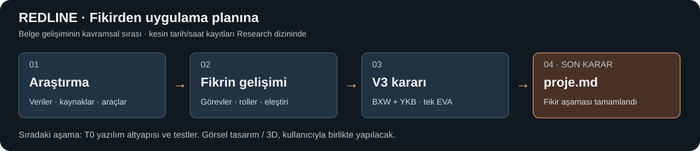

# Proje fikir aşamaları ve araştırmalar / Research

**Fikir aşaması tamamlandı. Son uygulama belgesi [docs/proje.md](../docs/proje.md).** Aşağıdaki notlar fikrin araştırılmasını ve gelişimini anlatır; tamamlanmış uygulama sayılmaz.

Şema belgelerin kavramsal gelişim sırasıdır. Kesin yazılma saati bilinmeyen araştırmalara saat atanmaz. Dosya son yazma zamanları aşağıda, gerçek yayın tarih/saatleri [Git geçmişinde](https://github.com/ahmetefesensoy/redline/commits/main/) görülür.

## Nasıl ilerledik?

| Aşama | Belgeler | Sonraki karara katkı |
|---|---|---|
| 01 — Araştırma | [İlk araştırma](proje-fikirleri/SPACE_APPS_ARASTIRMA.md), [kapsamlı araştırma](proje-fikirleri/SPACE_APPS_KAPSAMLI_ARASTIRMA.md), [kaynak/varlık kataloğu](proje-fikirleri/KAYNAK_VE_VARLIK_KATALOGU.md) | Veri, kaynak ve araç seçenekleri |
| 02 — Fikrin gelişimi | [Ürün tanımı](proje-fikirleri/PROJE_TANIMI.md), [astronot/rover/drone](proje-fikirleri/ASTRONOT_ROVER_DRONE.md), [görevler](proje-fikirleri/BES_ANA_GOREV_VE_MIMARI.md), [strateji](proje-fikirleri/GELISTIRME_STRATEJISI.md), [tasarım incelemesi](proje-fikirleri/TASARIM_GOZDEN_GECIRME.md), [v2 kılavuzu](proje-fikirleri/PROJE_KILAVUZU.md) | Görevler, roller ve alternatiflerin incelenmesi |
| 03 — V3 kararı | [V3 kılavuzu](proje-fikirleri/REDLINE_V3_KILAVUZU.md), [konsey kayıtları](notes/council-v3-source/README.md) | BXW ileri EVA, YKB kalibrasyon; tek EVA'nın beş evresi |
| 04 — Fikir aşaması bitti | [docs/proje.md](../docs/proje.md), [aktarılmış spek nüshası](proje-fikirleri/REDLINE_V3_UYGULAMA_SPEKI.md) | Kodlamanın esas belgesi ve T0–T14 kabul ölçütleri |

## Kayıtların anlamı

**Envanter:** 2026-11-14T12:54:16+03:00 · Europe/Istanbul (UTC+03:00). Aşağıdaki saatler mevcut dosya sisteminin son yazma zamanıdır; aktarma, paketleme veya bağlantı düzenlemesini yansıtabilir. İlk araştırmanın yapıldığı anı kanıtlamaz. İlk yayın envanteri [history/](history/) altında tarihsel haliyle korunur; orada eski yolların bulunması dosyaların hâlâ projede bulunduğu anlamına gelmez.

Kullanıcının son yönlendirmesiyle `önceki deneme` klasörü güncel çalışma ağacından çıkarıldı. Görsel tasarım ve 3D varlık üretimi kullanıcıyla birlikte yapılacak; bu görsel yalnız belge gelişimini anlatır.

## Dosyalar ve son yazma zamanları

| Belge / kayıt | Son yazma (UTC+03:00) |
|---|---|
| [docs/proje.md](../docs/proje.md) | 2026-11-14T12:53:02+03:00 |
| [research/handoff/HANDOFF_MANIFEST.json](../research/handoff/HANDOFF_MANIFEST.json) | 2026-11-14T12:49:05+03:00 |
| [research/handoff/YENI_DEPO_AKTARIMI.md](../research/handoff/YENI_DEPO_AKTARIMI.md) | 2026-11-14T12:34:26+03:00 |
| [research/notebook/nasa-metadata-coverage.ipynb](../research/notebook/nasa-metadata-coverage.ipynb) | 2026-11-14T12:48:58+03:00 |
| [research/notebook/nasa-metadata-coverage.validation.json](../research/notebook/nasa-metadata-coverage.validation.json) | 2026-11-14T12:48:58+03:00 |
| [research/notes/APXS_HEDEF_ON_KONTROL.json](../research/notes/APXS_HEDEF_ON_KONTROL.json) | 2026-11-14T12:00:06+03:00 |
| [research/notes/council-v3-source/aggregate.json](../research/notes/council-v3-source/aggregate.json) | 2026-11-14T12:00:06+03:00 |
| [research/notes/council-v3-source/draft_v1.md](../research/notes/council-v3-source/draft_v1.md) | 2026-11-14T12:00:06+03:00 |
| [research/notes/council-v3-source/final.md](../research/notes/council-v3-source/final.md) | 2026-11-14T12:00:06+03:00 |
| [research/notes/council-v3-source/question.md](../research/notes/council-v3-source/question.md) | 2026-11-14T12:00:06+03:00 |
| [research/notes/council-v3-source/README.md](../research/notes/council-v3-source/README.md) | 2026-11-14T12:00:06+03:00 |
| [research/notes/council-v3-source/SOURCE.json](../research/notes/council-v3-source/SOURCE.json) | 2026-11-14T12:00:06+03:00 |
| [research/notes/council-v3-source/stage1/fable.md](../research/notes/council-v3-source/stage1/fable.md) | 2026-11-14T12:00:06+03:00 |
| [research/notes/council-v3-source/stage1/haiku.md](../research/notes/council-v3-source/stage1/haiku.md) | 2026-11-14T12:00:06+03:00 |
| [research/notes/council-v3-source/stage1/opus.md](../research/notes/council-v3-source/stage1/opus.md) | 2026-11-14T12:00:06+03:00 |
| [research/notes/council-v3-source/stage1/sonnet.md](../research/notes/council-v3-source/stage1/sonnet.md) | 2026-11-14T12:00:06+03:00 |
| [research/notes/council-v3-source/stage2/fable.md](../research/notes/council-v3-source/stage2/fable.md) | 2026-11-14T12:00:06+03:00 |
| [research/notes/council-v3-source/stage2/haiku.md](../research/notes/council-v3-source/stage2/haiku.md) | 2026-11-14T12:00:06+03:00 |
| [research/notes/council-v3-source/stage2/opus.md](../research/notes/council-v3-source/stage2/opus.md) | 2026-11-14T12:00:06+03:00 |
| [research/notes/council-v3-source/stage2/sonnet.md](../research/notes/council-v3-source/stage2/sonnet.md) | 2026-11-14T12:00:06+03:00 |
| [research/notes/council-v3-source/stage2_prompts/labels.json](../research/notes/council-v3-source/stage2_prompts/labels.json) | 2026-11-14T12:00:06+03:00 |
| [research/notes/council-v3-source/stage3_pessimist_brief.md](../research/notes/council-v3-source/stage3_pessimist_brief.md) | 2026-11-14T12:00:06+03:00 |
| [research/notes/CUMBERLAND_CHEMIN_URUN_KONTROLU.json](../research/notes/CUMBERLAND_CHEMIN_URUN_KONTROLU.json) | 2026-11-14T12:00:06+03:00 |
| [research/notes/Gale_PLACES_AOI_KONTROLU.json](../research/notes/Gale_PLACES_AOI_KONTROLU.json) | 2026-11-14T12:00:06+03:00 |
| [research/notes/Gale_PLACES_AOI_KONTROLU.md](../research/notes/Gale_PLACES_AOI_KONTROLU.md) | 2026-11-14T12:00:06+03:00 |
| [research/notes/GOREV_DEGERI_VE_KANIT_PLANI.md](../research/notes/GOREV_DEGERI_VE_KANIT_PLANI.md) | 2026-11-14T12:34:26+03:00 |
| [research/notes/HIRISE_YELLOWKNIFE_METADATA_KONTROLU.json](../research/notes/HIRISE_YELLOWKNIFE_METADATA_KONTROLU.json) | 2026-11-14T12:00:06+03:00 |
| [research/notes/karar_degeri_ornek_hesap.json](../research/notes/karar_degeri_ornek_hesap.json) | 2026-11-14T12:00:06+03:00 |
| [research/notes/SAHA_OLCUM_METADATA_KONTROLU.json](../research/notes/SAHA_OLCUM_METADATA_KONTROLU.json) | 2026-11-14T12:00:06+03:00 |
| [research/notes/SAHA_VE_BILIM_ISTASYONU.md](../research/notes/SAHA_VE_BILIM_ISTASYONU.md) | 2026-11-14T12:00:06+03:00 |
| [research/notes/SKILL_ILK_UYGULAMA.md](../research/notes/SKILL_ILK_UYGULAMA.md) | 2026-11-14T12:49:05+03:00 |
| [research/notes/SPACE_APPS_2026_VERI_KAYNAKLARI.md](../research/notes/SPACE_APPS_2026_VERI_KAYNAKLARI.md) | 2026-11-14T12:00:06+03:00 |
| [research/notes/SPACE_APPS_MAPPING_JURI_INCELEMESI.md](../research/notes/SPACE_APPS_MAPPING_JURI_INCELEMESI.md) | 2026-11-14T12:34:26+03:00 |
| [research/notes/UC_TUR_TASARIM_INCELEMESI.md](../research/notes/UC_TUR_TASARIM_INCELEMESI.md) | 2026-11-14T12:34:26+03:00 |
| [research/proje-fikirleri/ASTRONOT_ROVER_DRONE.md](../research/proje-fikirleri/ASTRONOT_ROVER_DRONE.md) | 2026-11-14T12:00:06+03:00 |
| [research/proje-fikirleri/BES_ANA_GOREV_VE_MIMARI.md](../research/proje-fikirleri/BES_ANA_GOREV_VE_MIMARI.md) | 2026-11-14T12:00:06+03:00 |
| [research/proje-fikirleri/GELISTIRME_STRATEJISI.md](../research/proje-fikirleri/GELISTIRME_STRATEJISI.md) | 2026-11-14T12:48:58+03:00 |
| [research/proje-fikirleri/KAYNAK_VE_VARLIK_KATALOGU.md](../research/proje-fikirleri/KAYNAK_VE_VARLIK_KATALOGU.md) | 2026-11-14T12:48:58+03:00 |
| [research/proje-fikirleri/PROJE_KILAVUZU.md](../research/proje-fikirleri/PROJE_KILAVUZU.md) | 2026-11-14T12:48:58+03:00 |
| [research/proje-fikirleri/PROJE_TANIMI.md](../research/proje-fikirleri/PROJE_TANIMI.md) | 2026-11-14T12:48:58+03:00 |
| [research/proje-fikirleri/REDLINE_V3_KILAVUZU.md](../research/proje-fikirleri/REDLINE_V3_KILAVUZU.md) | 2026-11-14T12:48:58+03:00 |
| [research/proje-fikirleri/REDLINE_V3_UYGULAMA_SPEKI.md](../research/proje-fikirleri/REDLINE_V3_UYGULAMA_SPEKI.md) | 2026-11-14T12:00:06+03:00 |
| [research/proje-fikirleri/SKILL_PLANI.md](../research/proje-fikirleri/SKILL_PLANI.md) | 2026-11-14T12:48:58+03:00 |
| [research/proje-fikirleri/SPACE_APPS_ARASTIRMA.md](../research/proje-fikirleri/SPACE_APPS_ARASTIRMA.md) | 2026-11-14T12:34:26+03:00 |
| [research/proje-fikirleri/SPACE_APPS_KAPSAMLI_ARASTIRMA.md](../research/proje-fikirleri/SPACE_APPS_KAPSAMLI_ARASTIRMA.md) | 2026-11-14T12:48:58+03:00 |
| [research/proje-fikirleri/TASARIM_GOZDEN_GECIRME.md](../research/proje-fikirleri/TASARIM_GOZDEN_GECIRME.md) | 2026-11-14T12:00:06+03:00 |

[Makinece okunabilir tarih/hash kaydı](FILE_TIMESTAMPS.json) · [Uygulama ilerlemesi](../journal/PROGRESS.md) · [Gerçek test kayıtları](../docs/VERIFICATION_LOG.md).
