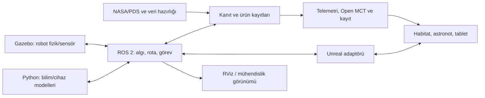

# REDLINE — Mars yüzey yürüyüşü için insan–robot bilim ve karar simülasyonu

**Proje ve geliştirme kılavuzu · 14 Kasım 2026 · Tasarım sürümü 3**

REDLINE, bir astronotun NASA verileriyle bilim yürüyüşü planladığı, rover ve hava aracına keşif/örnekleme görevleri verdiği, gelen kanıtla planını güncellediği bir Mars görev simülasyonu tasarımıdır. Astronot Unreal içindeki habitat kontrol merkezinden çalışır, yüzeye çıkar ve bilim işlerini yürütür. Robotlar haritalama, hareket ve bilim işlemlerinde otonom veya manuel kullanılabilir. Harita, görev ve ölçüm ekranları karar için gerekli veriyi gösterir.

**Temel soru:** NASA verileri ve robotların yerel gözlemleri birlikte insanın rota seçimini, yüzeyde görev yürütmesini ve bilim hedeflerini nasıl destekler? Robot yardımının etkisi harita kalitesi, insanın iş yükü, bilim çıktısı ve görev maliyetiyle ayrı değerlendirilir.

**Öncelikli gösterim:** Aynı bilim alanına giden iki yaklaşım koridoru, farklı insan/rover erişimi ve bir buluşma noktası. Astronot gerekli gözlemi seçer, sahada kendi bağlam kaydını üretir ve robot yardımıyla gerekçeli bir örnek toplar. Habitatta örneğin kökeni, analizi ve sonraki bilim kararı aynı haritadan izlenir. Drone, sondaj ve bakımın her koşuda kullanılması gerekmez.

Bu kılavuz önceki fikirleri birleştiren ana ürün tanımıdır. Kapsam büyük tutulur; özelliklerin mevcut, önerilen ve doğrulanmayı bekleyen durumları ayrıdır. Bu belge uygulama tamamlandığı veya gerçek astronot eğitimi için doğrulandığı anlamına gelmez.

## Okuma haritası

1. [Amaç, challenge ve mevcut durum](#amac)
2. [Dünya, kampanyalar ve hikâye](#dunya)
3. [Mekânlar ve varlıklar](#mekan)
4. [Roller ve robot yetenekleri](#roller)
5. [Görev 1: keşif ve rota](#g1)
6. [Görev 2: numuneler ve laboratuvar](#g2)
7. [Görev 3: sondaj](#g3)
8. [Görev 4: bilim kapasitesini geri kazanma](#g4)
9. [Görev 5: birleşik yürüyüş](#g5)
10. [Harita, otonomi ve bilim kararları](#kararlar)
11. [Kalıcı sonuçlar ve eğitim/sınav](#sonuclar)
12. [Veri ve bilim modelleri](#veri)
13. [ROS–Python–Gazebo–Unreal mimarisi](#mimari)
14. [Kontrol merkezi ve grafikler](#arayuz)
15. [Görsel/ses üretimi ve performans](#uretim)
16. [Deneyler ve kabul ölçütleri](#deney)
17. [Ekip işleri ve geliştirme kapıları](#gelistirme)
18. [Space Apps teslimi ve kaynak hakları](#kurallar)
19. [Gösterim, çevrimdışı kullanım ve açık sorular](#gosterim)

Ekler: [veri/varlık/repo/ses kataloğu](KAYNAK_VE_VARLIK_KATALOGU.md), [üç tur eleştiri ve revizyon](../notes/UC_TUR_TASARIM_INCELEMESI.md), [derinleştirme araştırması](GELISTIRME_STRATEJISI.md).

14 Kasım saha geliştirmesi: [gerçek hedef/ürün eşleştirmesi ve bilim istasyonu](../notes/SAHA_VE_BILIM_ISTASYONU.md). Öncelikli çalışma kampanyası Yellowknife Bay/Sheepbed, yedek Gobabeb; pH simülasyonu numune kökeni ve laboratuvar işlemiyle ilişkilendirilir.

Görevlerin neden bu biçimde kurulduğu ve faydasının nasıl sınanacağı: [görev değeri ve kanıt planı](../notes/GOREV_DEGERI_VE_KANIT_PLANI.md). Bu sürüm görev tasarımını geliştirir; yeni uygulama özelliği tamamlandığı anlamına gelmez.

## 1. Amaç, challenge ve mevcut durum

### 1.1 Ürünün sözü

Astronot haritada bir hedef gördüğünde sistem yalnız bir çizgi üretmez. O hedefe neden gidildiğini, hangi kanıtın bulunduğunu, nerede bilgi eksik olduğunu, hangi robotun bu eksikliği giderebileceğini ve plan değişirse bilim işinin nasıl etkilendiğini gösterir. Astronot karar verir; robotlar tanımlı görevleri otonom veya insan yardımıyla yürütür.

Otonom robot yardımı challenge'a uygundur: önden keşif haritayı tamamlayabilir, yerel obstacle avoidance görevin yürütülmesini destekleyebilir, kol/cihaz bilim durağındaki işi yapabilir. Her bilim ölçümünün rotayı değiştirmesi gerekmez; hedefin seçimini, örnek bağlamını, ölçüm planını veya bilim yorumunu desteklemesi de anlamlıdır. Ürünün bütününde belirli konuma/rotaya bağlı çoklu NASA verisi ve insan yürüyüşü ilişkisi gösterilir.

Unreal'ın işlevi insan ölçeğinde prova, fiziksel ortam içindeki veri arayüzleri, elle araç kullanımı ve karar sonucu deneyimidir. ROS planlama/algı/görev tarafını yürütür; RViz aynı verinin mühendislik görünümüdür. Python bilim ve veri modellerine hizmet eder.

Seçilen konu **Interplanetary Survival Guide: Martian Map**. Kullanıcının verdiği challenge metni, Mars konumu/rotasını çoklu NASA görev verisiyle katmanlı sunarak insanın bilim yürüyüşünü desteklemeyi istiyor. Rover, HUD ve sürükleyici görünüm bu amacın araçlarıdır. [Resmî challenge](https://www.spaceappschallenge.org/2026/challenges/interplanetary-survival-guide-martian-map/) bu incelemede 502 verdi; ayrıntılar [organizatör kopyasıyla](https://hackathlone.com/challenges/interplanetary-survival-guide-martian-map) karşılaştırıldı. Takım hesabında hangi challenge'a kayıt olunduğu bu çalışma içinde doğrulanmadı.

### 1.2 Özgün katkı adayı

Robotlu Mars eğitimi tek başına yeni değildir. [NASA CHAPEA](https://www.nasa.gov/missions/analog-field-testing/chapea/yearlong-mars-analog-crew-to-conduct-simulated-traverses-robotics-operations/) ve [BASALT](https://ntrs.nasa.gov/citations/20190026720) insan, bilim ve robot/iletişim iş akışları için önceki çalışmalardır. REDLINE'ın sınanacak katkısı görev için yararlı gözlemi seçme, çok ölçekli haritaya kaynağıyla ekleme, konumlu bilim işlerini yönetme ve insan–robot görevini Unreal içinde birlikte yürütmedir. “Dünyada ilk”, “NASA onaylı” veya “gerçek göreve hazır” iddiası kurulmaz.

Ayırt edici ürün önerisi, haritada bir hedef seçildiğinde birlikte açılan dört sorudur: **Burada ne biliyoruz? İnsan ve robot hangi yoldan erişebilir? Hangi bilim işi yapılabilir? Sonuç ve dönüş için ne gerekiyor?** Yeni gözlem bu sorulardan ilgili olanı günceller; örnek sonucu aynı hedefteki bilim kaydını geliştirir. Teknik bileşenlerin tek tek biliniyor olması bu birleşimi değersiz yapmaz; birleşimin kullanıcıya yararı ayrıca gösterilmelidir.

### 1.3 Durum tablosu

| Parça | Şu an bilinen durum |
|---|---|
| Windows + WSL Ubuntu 24.04, ROS 2 Jazzy, Gazebo Harmonic | Önceki oturumlarda kurulmuş ve rover demosunda kullanılmış ortam |
| Unreal Engine | Yerel kurulumda 5.8.4; mevcut proje henüz Mars görev sistemi değil |
| Mars arazisi ve küçük rover | Yerel ROS/Gazebo demosunda mevcut; gerçek Gale DEM/LRGB kırpımı, kamera/LiDAR/IMU ve temel DEM rota takibi var |
| Yerel tam rover deposu | `C:\Users\USER\Desktop\roversim27`; haritalama/sağlık/aktif algı temelleri bulunuyor, Mars demosuna birleşmiş sayılmıyor |
| ROS–Unreal köprüsü | Tasarım ve uyumluluk deneyi adayı; henüz çalışır köprü yok |
| Drone, kol, drill, vana, bilim cihazları | Yeni geliştirilecek modüller |
| Habitat ekranları, görev motoru ve sınav | Bu kılavuzdaki tasarım; henüz uygulama değil |
| Bilim sahası | Yellowknife öncelikli; seçili APXS/CheMin kayıtları ve HiRISE metadata adayı var, kesin hedef pozu ve fiziksel AOI açık |

Mevcut demoyu açan komut depo kökünde `& '.\önceki deneme\ros2_ws\Open-Mars.ps1'`. Bu, yeni görev sistemini veya yeni bilgisayarda bütün kurulumu otomatik tamamlayan bir komut değildir.

13 Kasım bu belge incelemesinde kaynak HEAD'i `4f15515f2a7609970742b2c3103bbed19230240a`; yeni tasarım dosyaları çalışma ağacındadır. Arazi için provenance (bu depoya dahil edilmedi), önceki demo doğrulamaları için arayüz kaydı (bu depoya dahil edilmedi), kısa görev kaydı (bu depoya dahil edilmedi) ve tur kaydı (bu depoya dahil edilmedi) kullanılabilir. Bunlar mevcut kayıtların yeridir; bu araştırma turunda canlı ROS testi yeniden çalıştırılmadı. Unreal 5.8.4 bilgisi yerel `Engine/Build/Build.version` dosyasından tekrar okundu.

## 2. Dünya, kampanyalar ve hikâye

### 2.1 Ana ortam

Ana dünya Mars'tır. Habitat, garaj, laboratuvar ve kalkış platformu gelecekteki insanlı seferin konsept tasarımlarıdır. Başlangıç arazi/geometri/görüntüsü NASA/USGS ürünlerine dayanır. Yerel küçük taşlar, vana istasyonu ve numune hedeflerinin senaryo olarak eklenen bölümü ayrıca işaretlenir.

Ay profili ileride ayrı veri/çevre/araç tanımı olabilir; bu sürümün görevi Marswalk'tır. Mars rotorcraft'ı Ay'a aynen taşınmaz. Atmosfer, yerçekimi, ışık ve hareket modelleri dünya profiline aittir.

### 2.2 Bilim kampanyaları

**Yedek profil — Bagnold/Namib–Gobabeb:** Regolitin görünümü, tane özellikleri ve örnek hazırlığının mineral/kimya karşılaştırmasına etkisi. Drone yüzey bağlamını, rover yakın dokuyu, laboratuvar örnek sonucunu sağlar. [NASA kampanya özeti](https://science.nasa.gov/blog/recap-of-the-bagnold-dune-investigation/).

**Öncelikli profil — Yellowknife Bay/Sheepbed:** Sondaj örneklerini görüntü/yerel bağlam ve mineral analiziyle yorumlama. John Klein ve Cumberland aynı Sheepbed birimindeki yakın hedeflerdir; iki ayrı birim gibi sunulmaz. [NASA hedef haritası](https://science.nasa.gov/resource/cumberland-selected-as-curiositys-second-drilling-target/).

Beş ana görev, ortak motorun görev türleridir; hepsi her kampanyada veya aynı yürüyüşte zorunlu değildir. Bagnold ve Yellowknife Bay yan yana iki durakmış gibi yerleştirilmez. Sondaj hedefi uygun değilse görev başka kampanya/öğretim profiline yüklenir. Uzun sefer modu yalnız sahada gerçekten bağlanan hedefleri birleştirir. Eğitim kampanyasında farklı sahalar ayrı bölüm olarak açılabilir; aralarındaki geçiş gerçek yürüme mesafesi diye gösterilmez.

### 2.3 Üç başlangıç profili

| Profil | Açılış | Kullanıcının ilk işi | Devam eden durum |
|---|---|---|---|
| Planlı sefer | Astronot habitatta yeni bilim hedeflerini inceler | Eksik geçit verisi için keşif planı | Temiz kaplar, hazır araçlar, başlangıç NASA katmanları |
| Yarıda kalan sefer | Önceki ekip kayıtları ve son robot telemetrisi eski | Kayıtları/araç durumunu doğrula, planı toparla | Gerçekten yüklenen önceki örnekler, harita ve kullanılmış sarflar |
| Çelişkili bulgu | Görüntü ile örnek yorumu arasında uyuşmazlık | Kontrol örneği, yeniden ölçüm veya yeni açı seç | Numune kalitesi ve kaynak sürümleri araştırılabilir |

Açılış kısa bir çevre tanıtımıyla habitat masasına gelir. Uzun, geçilemeyen sinematik zorunlu değildir. Kullanıcı baştan erişilebilir bilgiyi ve bilim sorusunu görür. Harita/cihaz verileri ile varsa görev uzmanının gecikmeli mesajı ayrı kaynaklar olarak sunulur.

### 2.4 Hikâye nasıl ilerler?

Sefer durumu değiştikçe yeni işler açılır. Yanlış örnek, kayıp zaman, kapanan servis hattı veya yeni görülen bir geçit sonraki hedefleri değiştirir. Başarısızlık her zaman yeniden başlatma değildir: örneği saklama, başka cihaz, daha yakın hedef, ek inceleme veya dönüş seçenekleri vardır.

Öğretmen senaryo parametrelerini başlangıçta seçer; kayıtlı tetikleyici dışında keyfî olayla kullanıcı cezalandırılmaz. Zorluk; veri kalitesi, erişim, işlem sırası ve görev önceliklerinden gelir. Saklı gerçek, yalnız fizik ve değerlendirme tarafında tutulur.

### 2.5 Beş görevin kampanyadaki işi

| Görev | Çözdüğü farklı soru | Sonraki işe bıraktığı durum |
|---|---|---|
| 1 — Geçiş ve buluşma | Hangi koridor, hangi araç için yeterince gözlenmiş? | Kanıtlı erişim katmanları, insan/rover rotaları, buluşma ve açık gözlem ihtiyaçları |
| 2 — Gerekçeli numune çifti | Hangi örnekler karşılaştırılabilir; bağlam ve işlem yeterli mi? | Kökeni ve kalitesi izlenen örnekler, analiz ve tekrar ölçüm ihtiyacı |
| 3 — Gerekçeli sondaj | Daha derin örnek gerçekten gerekli ve uygulanabilir mi? | Derinlik/işlem kaydı, örnek veya durdurma nedeni, bit/kap durumu |
| 4 — Bilim kapasitesi | Arızalı istasyonda neyi onarmak, saklamak veya ertelemek gerekir? | Kullanılabilir cihazlar, korunmuş örnekler ve ertelenen işler |
| 5 — Birleşik Marswalk | Bu kanıt ve kaynaklarla hangi bilim programı tamamlanabilir? | Gerçekleşen sefer, dönüşler, bilim kayıtları ve sonraki plan |

Görev 5 diğer dört görevin hepsini zorunlu sırayla oynatmaz. Kısa imza yürüyüşü, Görev 1 ve 2'nin becerilerini tek koşuda birleştirir. Sondaj uygun saha/soru varsa, servis arızası ise ayrı destek profili seçilmişse devreye girer. Böylece her sefer aynı arıza ve aynı dönüş kararıyla tekrarlanmaz.

Yellowknife'daki iki tarihsel deliğin yaklaşık 2,75 m yakınlığı geniş bir yürüyüş rotası çeşitliliği olarak kullanılmaz. Yaklaşım koridorları doğrulanacak daha geniş araziye aittir; habitat ve yerel engeller konsept/senaryo varlıklarıdır. AOI kapanmadan koridor uzunluğu, yürüyüş süresi veya kesin hedef collider'ı uydurulmaz.

## 3. Mekânlar ve varlıklar

Mekân adları görev tasarımı etiketleridir; NASA'nın gerçek habitat/istasyon adları veya doğrulanmış koordinatları değildir. Kapı, tezgâh ve geçiş ölçüleri nihai robot/karakter boyutuyla kontrol edilecek. Gereksiz geniş bir şehir yerine birbiriyle işlevsel bağlantılı bir üs ve veriyle seçilmiş saha parçaları hazırlanır.

| Kod | Mekân | Görünen/etkileşimli içerik | Teknik işlev |
|---|---|---|---|
| H01 | Ana kontrol merkezi | Harita masası, robot ekranları, bilim paneli, görev duvarı, veri kalite/kaynak görünümü, yerel/gecikmeli mesaj ayrımı | Planla, karşılaştır, görev ver, kanıt aç |
| H02 | Airlock ve hazırlık alanı | Kapı durumları, ekipman listesi, tablet, takım/cihaz hazır göstergeleri | Yüzeye çıkış ve dönüş önkoşulları; gerçek basınç prosedürü eğitim sertifikası değil |
| H03 | Rover garajı | Şarj/servis alanı, kol uç takımları, kap rafı, teker/cihaz inceleme noktaları | Donanım profili, sarf, görev yükü ve sağlık |
| H04 | Drone pad'i | Durağan kalkış alanı, işaret, platform durumu, iniş yaklaşımı | İlk sürüm duran rover/yer pad'i; hareketli rovera iniş ayrı deney |
| H05 | Numune laboratuvarı | Glovebox temsili, kap okuyucu, hazırlık hücresi, cihaz/kalite ekranı, saklama rafı | Örnek kabulü, hazırlık, ölçüm ve karşılaştırma |
| H06 | Servis modülü | Boru ağı, etiketli/benzer vanalar, basınç/akış noktaları, erişim engelleri | Kontrollü kaçak ve bakım senaryosu; ilk model tanımlı basınçlı servis alanı |
| S01 | Ön inceleme noktası | Uzak yüzlek görünümü, görüşü kesen geometri, robot bekleme alanı | Drone/rover gözlem seçimi |
| S02 | Alternatif koridorlar | Daha kısa ama eksik gözlenmiş geçit, daha iyi gözlenmiş alternatif | Rota ve bilgi değeri karşılaştırması |
| S03 | Regolit inceleme alanı | Kampanyaya uygun yüzey, yakın görüntü hedefleri, kontrollü örnekleme noktaları | Tane/tekstür/numune bağlamı |
| S04 | Kaya/sondaj alanı | Erişilebilir hedef yüzeyi, temas alanı ve drill duruş seçenekleri | Yalnız uygun kampanyada sondaj |
| S05 | Ara durak/röle noktası | Görüş hattı ve yerel bağlantı bakımından farklı konumlar | Drone/rover iş paylaşımı ve dönüş gözlemi |

Habitat içinde kontrol merkezi, hazırlık, garaj ve laboratuvar arasında anlaşılır dolaşım bulunur. Yüzeyde habitatın konumu görsel yön bulma işareti olur. Haritada seçilen hedef, dünya görünümüyle aynı kimliği taşır. Yol işareti veya pusula hatalı konum tahminini gizlemez; konum belirsizliği ayrıca gösterilir.

### 3.1 Taşlar ve görev nesneleri

Dört varlık rolü ayrılır: arşiv tabanlı saha geometrisi; navigasyonu etkileyen senaryo engeli; yalnız dekor; örneklenebilir/hedef nesne. Her taş örneklenebilir değildir. Her süslü kaya maliyet haritasına ölçülmüş engel diye eklenmez. Navigasyonu etkileyen nesnenin Gazebo collision/sensör ve Unreal görünümü aynı manifestten konumlanır.

Örneklenebilir nesne kimlik, boyut/rol, alım yöntemi, referans profil, kap uyumu ve işlem geçmişi taşır. Gerçek NASA hedef adı kullanılıyorsa kaynak/konum bağı korunur. Senaryo nesnesi kendi ID'sini kullanır; NASA'nın gerçek numune ID'si kopyalanmaz.

### 3.2 Gerekli görev prop'ları

Vana gövdesi/kolu/çarkı, hat etiketi, kamera işareti, drill/bit, tutucu/kepçe, numune tüpü/kabı, gaz kabı, tanık kap, pad, tezgâh, ekran ve tablet ilk işlevsel settir. Her hareketli nesnede pivot/eklem/sınır vardır. Dekoratif kablolar, raflar, yaşam alanı ve arka plan eşyaları temel döngüden sonra eklenir.

## 4. Roller ve robot yetenekleri

### 4.1 Astronot ve diğer karakterler

Ana oynanabilir rol saha astronotudur: plan yapar, yüzeye çıkar, not/fotoğraf/işaret üretir, robotları görevlendirir, bilim ve müdahale kararlarını verir. İlk sürüm bir oyuncunun kontrol merkezi, saha ve operatör görünümüne geçişini destekler.

İkinci insan rolü görev/bilim uzmanı olabilir. Önce senaryo mesajları veya öğretmen paneliyle temsil edilir; çok oyuncu zorunlu değildir. Dünya'dan mesaj varsa gecikmeli kaynaktır. Gerçek astronot adı/sesi taklit etmek gerekmiyor. İnsan ve robotlar aynı görev/harita kayıtları üzerinden koordinasyon kurar.

### 4.2 Rover

Manuel sürüş, engel desteği ve hedefe otonom sürüş modları vardır. Keşif, yakın gözlem, seçilmiş ekipman/örnek desteği ve tanımlı refakat görevleri alır. LiDAR/kamera/IMU/odometriyle tahmini durum üretir. Mevcut küçük demo roverı insan taşıyan araç değildir; yaşam desteği veya basınçlı sığınak rolü verilmez.

Roverın ve insanın geçiş maliyetleri ayrıdır. Yük, eğim, basamak, temas geometrisi ve dönüş koşulları profille tanımlanır. Roverın geçmesi insan için otomatik geçiş onayı değildir.

### 4.3 Scout hava aracı

Kamera ve IMU/altimetre temelli yerelleştirme adayı; GPS hizmeti varsayılmaz. Koridor gözlemi, yüzlek fotoğrafı, çelişkili haritayı yeniden gözleme, uygun yer işaretinden konum desteği ve isteğe bağlı iletişim rölesi işleri alabilir. Her iş uçuş/dönüş maliyeti taşır; sürekli astronot üzerinde uçması beklenmez.

İlk uçuş modeli işlev geliştirmek için basitleştirilmiş olabilir. Mars rotor/atmosfer/uçuş doğrulaması ayrı iştir. Rover üstüne yeniden iniş/şarj gelecekteki tasarımımızdır; Ingenuity'nin kanıtlanmış özelliği diye sunulmaz. [JPL Ingenuity donanım referansı](https://www.jpl.nasa.gov/news/press_kits/ingenuity/landing/mission/spacecraft/).

### 4.4 Kol ve uç takımlar

Kol için ortak eklem/planlama arayüzü; tutucu/kepçe, drill ve vana tutuş aparatı için farklı yetenek/temas profili olur. Bütün işleri tek animasyonla çözmeyiz. Araç duruşu, erişim, tutuş/temas ve işlem sonrası doğrulama ayrı aşamalardır. Uç takım değişimi bir görev/sarf durumu olarak izlenir.

### 4.5 Manuel–otonom geçiş

Her araçta tek aktif komut sahibi vardır. Otonom işi durdur/iptal et → onay ve sıfır komut → manuel yetki → güncel hedef/haritayla tekrar otonomi. Eski joystick veya göreli hareket komutu yeniden bağlanınca yürütülmez. Destekli sürüşte ortak hız/engel denetimi bulunur. Bu davranışlar tam mod yöneticisiyle henüz uygulanmadı; mevcut demoda yalnız temel duraklatma ve komut timeout'u bulunuyor.

## 5. Görev 1 — Geçişi değerlendir, buluşmayı planla

**İnsan ihtiyacı:** Astronot, bilim hedefine kendisinin ve destek roverının nasıl erişeceğini birlikte planlar. **Mekân:** H01/H03/H04, S01 ve S02. **Ana çıktı:** Ayrı insan/rover rotaları, buluşma noktası ve kanıtlı rota kabulü, reddi veya yeni gözlem isteği.

### 5.1 Başlangıç ve içerik

Başlangıç haritasında gerçek topografya/görüntü ve veri kapsaması vardır. Yerel geçitte senaryo engelleri veya örtülü alanlar bulunabilir; bunlar dünya dosyasında var diye planlayıcıya önceden verilmez. Bilim hedefinin neden seçildiği kaynak kartında görünür. Kullanıcı kısa koridorun hangi bölümünün eksik olduğunu açabilir.

İlk senaryo ailesinde S02 iki yaklaşım içerir. C01 daha kısa fakat bir bölümü görüşle örtülüdür; C02 daha iyi gözlenmiştir ve farklı yürüyüş/sürüş maliyeti taşır. Geometrinin uygun olduğu varyantta astronot dar geçişi kullanabilirken rover dönüş alanı veya genişlik nedeniyle alternatif yoldan gider. İnsan için de geçiş uygun değilse bu seçenek açılmaz. Sonuç önceden seçilmiş “kısa yol doğrudur” kuralından çıkmaz.

Drone üstten görülebilen geometriyi tamamlar; kaya altı/örtülü yüzey veya zeminin taşıma davranışını otomatik çözmez. Rover yakın engel, yüzey görüntüsü ve geçiş ölçüsü üretir; roverın gözlemi de doğrulanmamış bir zemin dayanımı ölçümü sayılmaz. Veri yetmiyorsa ikinci gözlem, başka koridor veya yürüyüşü erteleme seçenekleri kalır. Keşif için bütün haritayı taramak yerine kararın eksik girdisi seçilir.

### 5.2 Kullanıcı ve robot akışı

1. Habitat haritasında bilim hedefini, insan/rover profillerini ve alternatif rotaları aç.
2. Alternatiflerin hangi veri, kısıt ve modele dayandığını incele.
3. Drone gözlemi, rover yakın incelemesi veya daha iyi gözlenmiş rota seç.
4. İstersen roverı manuel sür; istersen hedef/inceleme alanı ver.
5. Drone uçacaksa duran platform, dönüş payı ve görev koridoru doğrulansın.
6. Robot sensörleri gözlem üretsin; poz ve ölçüm zamanıyla ortak haritaya işlensin.
7. İnsan rotası, roverın ekipman/örnek teslim rotası ve ortak buluşma zamanı yeniden değerlendirilsin.
8. Astronot planı onaylasın/değiştirsin; droneun iniş/dönüşü ve bilim durağında kalan model süre ayrıca izlensin.

Otonomi: görev atama → erişim/gözlem planı → hareket → sensör/kalite denetimi → harita güncellemesi → devam/yeniden gözlem/yardım. Kamera önizlemesiyle yoğun yüzey rekonstrüksiyonunun tamamlanması aynı anda varsayılmaz.

### 5.3 Rota ve keşif kararları

| Karar | Beklenen etkisi | Yeni soru |
|---|---|---|
| Drone ile bak | Görünür geometri/kapsam artar, uçuş zamanı gider | Yerden hâlâ neyi bilmiyoruz? |
| Roverla incele | Yakın kanıt artar, sürüş maliyeti gider | Robotun gözlemi insan geçişini destekliyor mu? |
| Uzun rotayı seç | Keşif ihtiyacı azalabilir, yürüyüş maliyeti artabilir | İkinci bilim durağına zaman kalıyor mu? |
| Yeni veri istemeden devam | Zaman kazanılabilir; belirsizlik sürer | Mevcut kanıt karar için yeterli mi? |
| İnsan ve roverı ayrı yoldan gönder | Araç kısıtlarına uygun erişim sağlanabilir | Ekipman/numune hangi noktada, ne zaman devredilebilir? |

Rota karşılaştırması eksik yer gözlemini ve model sınırlarını gösterir. Eğitim/sınavda drone görüntüsündeki örtülü alan veya düşük çözünürlük karar problemi oluşturabilir; kullanıcı yakın inceleme, alternatif geçit veya devam seçer. Dünya/sensör belirsizliği korunur; yazılım bilerek yanlış tavsiye üretmez.

### 5.4 Veri ve kabul

Katalog D01–D04; anlamlıysa D10/D11 bağlamı. Üretilenler sensör kapsamı, tahmini yerel harita, rota, karar ve kaynak değişimidir. Kabul: bir sensör gözlemi haritayı günceller; kararın hangi girdiden değiştiği gösterilir; insan/rover maliyeti ayrıdır; görev reddi de gerekçeyle geçerli sonuç olabilir. Ölçümler gözlem maliyeti, plan değişimi, rota hatası ve yardım sayısıdır.

İnsan/rover geçiş durumu haritada yan yana açılır; aynı koridor iki profil için farklı sonuç üretebilir. Buluşma kaydı konum, zaman aralığı, taşınan ekipman ve kabul edilen poz belirsizliğini taşır. Rover ulaşamadığında henüz teslim edilmemiş drill veya kap astronotun envanterine eklenmez. İyi gözlenmiş kolay varyantta drone kullanmamak da düşük maliyetli doğru sonuç olabilir. “Model kısıtlarına uygun” etiketi gerçek giysi/insan güvenliği sertifikası değildir.

Buluşma gecikirse beklemenin insan/robot kaynak maliyeti işler. Kullanıcı bütçe içinde bekleyebilir, iki tarafın erişebildiği başka noktayı seçebilir veya teslimi iptal ederek elindeki ekipmanla yapılabilen işi seçebilir. Yeni yer/zaman, astronot ile rover görev yürütücüsünün kabulünden sonra etkinleşir; ağ onayı fiziksel devir sayılmaz. Örnek/kap/uç takım sahipliği ancak doğrulanmış teslimle değişir. Geciken teslim dönüş koşullarını bozacaksa planın o dalı kapatılır veya yeni plan gerekir.

## 6. Görev 2 — Gerekçeli numune çifti ve laboratuvar

**İnsan ihtiyacı:** Bilim sorusunu cevaplayacak uygun örnekleri seçmek ve sonuçların geçerli olup olmadığını değerlendirmek. **Mekân:** S03, uygun kaya noktaları ve H05. **Ana çıktı:** Konumlu, izlenebilir ve uygun işlemden geçmiş numune kayıtları.

### 6.1 Numune türleri

Taş/kaya parçası, gevşek regolit ve atmosfer örneği farklı alım/kap profilleri kullanır. Kaya karotu Görev 3 ile ilişkilidir. Tanık/kontrol kabı doğal yüzey türü değil, işlem kalitesini değerlendiren ayrı kayıttır. İleride farklı tane fraksiyonları veya derinlik örnekleri eklenebilir; her birine bilimsel neden verilir.

İlk yürüyüşte iki gerekçeli malzeme örneği ve gerekiyorsa kontrol kaydı yeterlidir. Örneğin senaryo içindeki yüzey örtüsü ile yakınındaki farklı dokulu malzeme karşılaştırılabilir. Bu adayların kesin konumu saha QA'sından sonra belirlenir; gerçek bir NASA hedefi olmayan nesne senaryo ID'si taşır. Atmosfer örneklemesi ayrı bir gaz sorusu/cihaz profili olduğunda açılır; her koşunun zorunlu üçüncü koleksiyon nesnesi değildir.

Laboratuvar prop'ları kap okuyucu, numune rafı, uygun hücre/hazırlık arayüzü ve ölçüm ekranıdır. Bilim hedefi kaynaklı gerçek gözlem olabilir; eklenmiş numune ise referans profilli senaryo nesnesidir. Oyuncu örnek sonucunu toplamadan önce gizli kayıt alanından okuyamaz.

### 6.2 İşlem akışı

1. Bilim sorusunu ve hangi örneklerin neden karşılaştırılacağını seç; beklenen gözlemi ve yorumu sınırlayacak eksikleri yaz.
2. Astronot bağlam fotoğrafı, doku/yüzey örtüsü notu ve alım sınırı üretsin; uygun uç takım/kap hazırla.
3. Rover uygun duruşa gelsin; kol erişim ve yaklaşmayı planlasın.
4. Temas/alım doğrulansın; gripper kapanması tek başına yeterli sayılmasın.
5. Örnek doğru kaba bırakılıp kimliğiyle eşleşsin.
6. Habitatta kap/işlem kaydı kontrol edilsin; saklama veya ölçüm seçilsin.
7. Uygun hazırlık ve kalibrasyon adımları yürütülsün.
8. Sonuç kalite bilgisi ve kaynak/profil türüyle grafiğe gelsin.
9. Astronot karşılaştırmayı yorumlasın; bulgunun yalnız ölçülen örnekler için ne söylediğini ve yeni örnek/ölçüm gerekip gerekmediğini kaydetsin.

Örnek durumları: hedef → erişim → alıma hazır → deneme → alım doğrulandı → kapta → teslim → hazırlık → ölçüm → geçerli/geçersiz → saklama/rapor. Her aşamada iptal/hata/toparlanma sonucu vardır.

### 6.3 pH ve diğer ölçümler

pH, Phoenix WCL yaklaşımına referansla numune–su hazırlığı ve laboratuvar hücresinde işlem olarak ele alınır. Gale'deki bütün zemine pH değeri boyanmaz. Element/mineral/gaz ölçümleri için APXS/CheMin/SAM ayrı cihaz/prosedür profilleridir. Bunları tek bir evrensel sensöre dönüştürmeyiz.

İlk sürümde yanlış hazırlık sonucu geçersiz yapabilir; gerçek arşiv sayısına rastgele çarpan eklenmez. Sayısal kirlenme/karışım/tepki modeli ayrı araştırma modülüdür. Hazırlık ve ölçüm süresi, kaynak kullanımını ve sonraki iş için zamanı değiştirir.

Varsayılan pH akışı: sahadan numune al → köken/derinlik ve kap ID'sini kaydet → H05'e taşı → cihaz/hazırlık/kalibrasyon → açıkça simüle analiz sonucu → numune noktasına bağlı harita kaydı. Laboratuvar kendi cihaz konumunu taşır; numunenin kökenini değiştirmez. Gerçek Phoenix WCL kaydı farklı yer/zamandan referans olarak ayrı açılır. Sayısal pH modeli henüz geliştirilmedi; görüntü veya mineral tablosundan pH uydurulmaz. Mobil ölçüm cihazı eklenirse onun konumu/prosedürü ayrı kaydedilir. Bütün haritaya sürekli pH alanı çizilmez.

### 6.4 Bilim kararları

İlk imza koşusunun somut sorusu: **İnce yüzey örtüsünden ve yakınındaki daha iri taneli senaryo malzemesinden alınan iki örneğin, aynı hazırlık ve sıcaklık profilindeki sulu ekstrakt iletkenliği ölçümleri ayırt edilebilir mi?** Birincil değişken iletkenliktir (µS/cm); pH aynı örneklerin ayrı analizidir. Malzeme sınıfı, köken ve hazırlık kaydedilir. Bu iki yüzey türünün seçilen gerçek mikro-sahada bulunduğu henüz doğrulanmadığından yeni örnekler senaryo ID/profili taşır. Arşiv APXS/CheMin sonucu bu örneklerin gerçek iletkenlik/pH ölçümü yerine konmaz.

Üç analiz sonucu ayrılır: geçerli ölçümlerde tanımlı model aralıkları ayrılıyorsa **bu örnekler ve prosedür için ayırt edilebilir fark**; aralıklar örtüşüyorsa **mevcut ölçümle ayırt edilemedi**; hazırlık/kalibrasyon/kimlik geçersizse **yorumlanamaz işlem**. Aralıkların örtüşmesi eşitliği kanıtlamaz. İlk sayısal prototipin açık ölçüm/tekrar modeli ayrıca geliştirilecek; gerçek regolit çözünme kimyası veya doğrulanmış istatistiksel test var sayılmaz. Teknik tekrar, iki örneğin ölçümünü sınar; bütün yüzeyin temsil edildiğini göstermez.

İki örneğin farklı sonucu tek başına iyon türünü, farklı jeolojik kökeni veya bütün bölgenin özelliğini kanıtlamaz. Aynı Sheepbed birimindeki tarihsel hedefler iki farklı jeolojik birim gibi sunulmaz. Kaynaklı gerçek mineral/element kayıtları bağlam ve ayrı karşılaştırma amacıyla açılır; arşiv incelemesi ile yeni simülasyon sonucu aynı bilim iddiası değildir.

Astronot örnek sayısını artırmak yerine doğru karşılaştırmayı kurar. Örnek A'nın hazırlığı geçersizse önce A yeniden hazırlanabilir; yeterli örnek kalmadıysa tekrar alım gerekir. A/B farkı iki geçerli ölçümde sürüyorsa yakın yüzey bağlamı veya ek örnek istenebilir. Sonuçlar ayırt edilemiyorsa daha iddialı bilim sonucu yazılmaz; mevcut sınır raporlanır. Fiziksel kimya/istatistik modeli henüz yokken bu durumlar açık senaryo/kalite profilleriyle uygulanır, gerçek keşif sonucu gibi sunulmaz.

Bilim ekranı amaç, örnek, cihaz ve sonuç ilişkisini gösterir. Kullanıcı kaynak yeri, cihaz işlemi ve kap geçmişini açabilir. Gerçek kayıt konumu veya prosedürü yazılım tarafından kasıtlı yanlış açıklanmaz. Tarihsel John Klein/Cumberland analizleri baştan erişilebilir referanstır; arşiv sonucu yeni sondajın gizli ödülü yapılmaz. Yeni senaryo örneğinin sonucu ayrı karttır.

Karar yerleri: hangi yüzeyden örnek; kontrol kaydı; ölçüm mü saklama mı; tekrar hazırlık mı tekrar alım mı; başka cihazla karşılaştırma; yeni bir yüzeyin incelenmesi. Her seçenek kap/cihaz/zaman ve kalan malzemeyi etkiler. Astronotun bağlam fotoğrafı/notu gerçek bir kanıt girdisidir; yalnız robot ekranını onaylayan kişi olmaz.

### 6.5 Kabul

Katalog D05–D07/D12/D14 ve gerçek görüntü bağlamı. Her örnekte ID, kap, konum/çerçeve/belirsizlik, fotoğraf, işlem zamanı, uç takım, prosedür, veri profili, kalite ve sonuç bulunur. Kabul: yanlış kap veya eksik işlem izlenebilir; doğrulanmış alım ve kayıt vardır; grafik numuneye bağlanır; arşiv ile simülasyon sonucu ayrıdır.

İşlem geçerliliği ile jeolojik temsil gücü ayrı alanlardır. Tam ve doğru kaydedilmiş tek bir örnek bütün yüzleği temsil etmiş sayılmaz. Geçersiz ölçümü fark etmek kalite başarısıdır; henüz geçerli bilim sonucu elde edildiği anlamına gelmez. Sonraki işte kontrol/yeniden hazırlık/ek gözlem tercihi, gerekli ekipman ve harita hedefiyle birlikte kaydedilir.

## 7. Görev 3 — Sondaj yerini ve durma kararını savun

**İnsan ihtiyacı:** Bilimsel olarak gerekçeli, erişilebilir bir hedefte kontrollü örnekleme yapmak ve ne zaman duracağını bilmek. **Mekân:** Uygun kampanyadaki S04, H03/H05. **Ana çıktı:** Hedef, derinlik ve işlem geçmişiyle bağlı örnek.

### 7.1 Başlangıç

Görev, “drill var, delik aç” komutuyla başlamaz. Önce yüzey örneğiyle cevaplanamayan soru ve ek örneğin neyi değiştirebileceği gösterilir. İki adaydan biri bilim bağlamı bakımından daha ilgili, diğeri kol erişimi/duruş bakımından daha kolay olabilir. Mevcut örnekler soruya yeterliyse sondajı ertelemek de seçenek olarak kalır; gerçekleşmeyen bilim işi ayrıca belirtilir.

Drill, bit, kol bağlantısı ve hedef yüzeyinin fizik/temas modeli tanımlanır. İlk işlev prototipi basitleştirilmiş ilerleme/direnç modeli kullanabilir; yüksek ayrıntılı malzeme kırılması gösterilmedikçe var sayılmaz. Gerçek kaya özelliklerinin bilinmediği yerde senaryo parametreleri açık tutulur.

Gerçek kampanya bağlamı için Yellowknife Bay önceliklidir. Drill deliğinin yeni sonucu gerçek NASA ölçümü değildir; karşılaştırma arşiv profiline dayanabilir. Bagnold regolit sahasına bilimsel neden olmadan aynı görevi yerleştirmeyiz. Doğrulanan CheMin ürünleri belirli drill örneklerine aittir; yeni deliğin her santimetresine gerçek mineral eğrisi sağlamaz. Simüle derinlik profili ayrıca tanımlanır.

### 7.2 Akış

1. Önceki görüntü/numune bilgisiyle hedef gerekçesini kur.
2. Uç takım, bit ve kap/örnek hattını kontrol et.
3. Rover duruşu ve kolun erişim/temas yönü değerlendirilsin.
4. Ön konum planlansın; hedef ve temas doğrulansın.
5. Tanımlı adımlarla drill ilerlesin; derinlik, ilerleme ve model yükü kaydedilsin.
6. Anomali olursa durdur/yeniden konumla/alternatif hedef seç.
7. Örnek elde edilirse aktarımı doğrula; derinlik ve kapla ilişkilendir.
8. Laboratuvar işlemi ve önceki kanıtla karşılaştır; sonraki hedefi güncelle.

MoveIt erişim/yaklaşmayı planlayabilir. Temas, kuvvet/tork denetimi, delme, malzeme koparma ve örnek taşıma ayrı modeldir. Robotun konum planını başarıyla bitirmesi bilim örneğinin elde edildiğini göstermez.

### 7.3 İşlem kararları

Kullanıcı daha değerli ama zor hedef ile daha erişilebilir hedefi karşılaştırır; sürdürme, kısa ara, bit/konum değişimi ve iptal seçeneklerini kullanır. İşlem aşaması, hedef bağlamı, uç takım durumu ve ilerleme anomalileri ilgili sağlık/grafik ekranlarında görünür. Görev yöneticisi tanımlı limitte durur veya müdahale ister.

Anomali varyantında aynı ilerleme için model yükü artar. Kullanıcı görüntü, ilerleme ve yük kaydını birlikte açar; otomatik olarak “daha sert, dolayısıyla daha değerli mineral” sonucu çıkarılmaz. Yeniden konumlama zaman ve bit ömrü harcar; alternatif hedef farklı bağlam sağlar. Örnekleme hedefi değiştiğinde eski hedefin gerekçesi ve yeni hedefin ID'si korunur. Henüz ulaşılmayan derinlik için örnek kaydı veya cihaz sonucu oluşmaz.

Kritik limitler kullanıcı komutuyla da aşılmaz. Doğru durdurma kararı görev başarısı olarak değerlendirilebilir. Çıkmayan örnek için gizlice başarılı numune kaydı oluşturulmaz.

### 7.4 Grafikler ve kabul

Derinlik–zaman, ilerleme–zaman, tork/kuvvet–derinlik, seçilmiş sıcaklık ve işlem aşaması ortak zaman eksenine bağlanır. Bir nokta seçilince komut/olay ve örnek kaydı açılır. Kabul: sınır aşımı/duruş, geçerli örnek derinliği ve fiziksel/model sonucuyla doğrulama vardır; kullanılan modelin basitleştirmeleri raporlanır.

Durdurma kararının uygunluğu, korunmuş donanım ve gerçekleşen bilim ayrı raporlanır. Her iptal tam görev başarısı sayılmaz; gerekçeli duruş ile eksik planlama yüzünden hiç başlanamaması aynı sonuç değildir. Kalibrasyonu olmayan modelden gerçek Mars kayası dayanımı veya mineral tanısı iddia edilmez.

## 8. Görev 4 — Bilim kapasitesini geri kazan

**İnsan ihtiyacı:** Arızalı bilim istasyonunda hangi analizin yapılabileceğini, hangi örneğin korunacağını ve robotla müdahaleye değip değmediğini seçmek. **Mekân:** H01, H05 ve H06. **Ana çıktı:** Doğrulanmış hat/cihaz durumu, korunmuş örnekler ve güncellenmiş analiz planı.

### 8.1 Fiziksel senaryo

İlk kaçak modülü sınırları tanımlı basınçlı servis alanında çalışabilir. Gaz türü, kaynak, basınç/akış, vana etkisi ve sensör tepki süresi tanımlanır. Gerçek NASA Mars kaçak sahası yokmuş gibi bir veri üretilmez. Mars dış ortamında seyrek gaz yayılımı ayrı model gerektirir; genel Dünya modeli doğrulanmış kabul edilmez.

Bu, seçilebilir destek görevidir; her yürüyüşte alarm çalmaz. İlk profil laboratuvarın belirli bir analiz hazırlama modülüne hizmet eden konsept servis hattıdır. Giysi oksijeni veya habitatın tüm yaşam desteği bu basit modele bağlanmaz. Hangi hat izolasyonunun hangi cihazı durdurduğu bağlantı şemasında tanımlıdır; basınç/akış tepkisi basitleştirilmiş modeldir, doğrulanmış CFD değildir.

Odada/koridorda roverın erişimine uygun engeller, iki veya daha fazla benzer vana, etiketler ve ölçüm noktaları bulunur. Kapı açıklığı ve dönme alanı gerçek robot modeline göre hazırlanır. Drone dış/üst yüzeyi gözleyebilir; küçük kapalı alan içinde uçuş zorunlu değildir.

### 8.2 Akış

1. Alarm habitat ekranında kaynak ve veri yaşıyla görünür.
2. Kullanıcı bekleyen örnekleri, saklama koşullarını ve etkilenen cihazı görür; robot görevi, insan incelemesi, alternatif analiz veya erteleme seçer.
3. Rover gözlenen harita üzerinden planlar; yeni engelde durur/yeniden planlar/yardım ister.
4. Kamera vana/kol/etiket adaylarını bulur; seçilen gaz/hat ölçümleri alınır.
5. Kimlik, 3B poz ve doğru hat ilişkisi kurulur; bilgi yetmezse yeni açı/etiket/güncel şema istenir.
6. Astronot müdahale teklifini ve etkilenebilecek sistemleri inceler.
7. Kol erişim ve yaklaşma planından kontrollü temas/çevirme aşamasına geçer.
8. Vana/mekanik son konum ve ilgili basınç/akış değişimi birlikte değerlendirilir.
9. Başarısızsa yeniden teşhis, alternatif izolasyon veya laboratuvarı erteleme akışı açılır.

### 8.3 Görüntü işleme profilleri

İşaretli altyapıda kalibre kamera ve bilinen ArUco/AprilTag geometrisi ilk poz hesabına yardım eder. Marker ID görüntüden okunur. Etiketsiz profilde segmentasyon/anahtar nokta/geometri yöntemi ayrı geliştirilir. İşaret, hangi hattın kaçırdığını söylemez; sabit gövde işareti hareketli kol açısını veya çok turlu çarkın tüm durumunu doğrudan vermez. [OpenCV ArUco](https://docs.opencv.org/4.x/d5/dae/tutorial_aruco_detection.html).

Algı pozu tahmin/belirsizlik taşır. Yakın görüntüyle düzeltme/visual servo adayı vardır. Tutuş, kayma, tork, sıkışma ve mekanik sınır ayrıca modellenir. Temas için gereken çiftler dar kapsamda tanımlanır; bütün çarpışma kontrolü kapatılmaz.

### 8.4 Teşhis ve sonuçlar

Vana adayları, hat ölçümleri ve şema birlikte incelenir. Görsel benzerlik, eksik etiket veya eski şema gerçek bir teşhis belirsizliği oluşturabilir. Astronot ham görüntü, etiket ve şema sürümüne bakar; müdahale öncesinde ek ölçüm isteyebilir. Algının yanlış eşleşmesi ölçülen bir hata olabilir; kasıtlı yanlış danışman yanıtı değildir.

Yanlış vana kapanırsa ilgili hat gerçekten değişir; kaçak devam ederken laboratuvar kapanabilir. Kullanıcı düzeltme yapabilir veya örnekleri saklayıp analizi erteleyebilir. Doğru vananın hareketi ama akışın azalmaması da mekanik/teşhis başarısızlığıdır. Sonraki bilim işi bu durumdan devam eder.

Örneğin pH hazırlama modülü kapalıyken arşiv inceleme, örnek kaydı ve koşulları uygun örnek saklama devam edebilir; başka cihazın çalışması kendi önkoşullarına bağlıdır. Kullanıcı uzun tamir yerine örnekleri koruyup analizi ertesi göreve bırakabilir. “Vana kapandı” animasyonu cihazı otomatik hazır yapmaz; model hat durumu ve cihazın hazır olma denetimi doğrulanır. Örneklerin bozulma süresi kullanılacaksa madde/kap/saklama profiline yazılır; keyfî geri sayım eklenmez.

### 8.5 Kabul

Ölçümler yanlış vana seçimi, poz hatası, tekrar gözlem, erişim/temas başarımı, doğrulanmış kapanış ve toparlanma süresidir. Kamera kutuları yalnız aynı kare/zamandaki tahminlere çizilir. Gizli gerçek vana ID/pozu kontrolcüye verilmez. Hattın kaynak verileri senaryo modelidir; gerçek çevre arşiviyle karıştırılmaz.

Kampanya kabulü ayrıca hangi analizlerin yeniden açıldığını, hangi örneklerin korunup hangi işlerin ertelendiğini gösterir. Onarımın başarısı ile o gün elde edilen bilim sonucu ayrı tutulur. Ana Marswalk gösterimi bu görev tamamlanmadan da anlamlı çalışabilmelidir.

## 9. Görev 5 — İki rota, bir bilim yürüyüşü

**İnsan ihtiyacı:** Bilim hedefleri, robot yardımı, eksik veri ve dönüş koşullarını birlikte yönetmek. **Mekân:** H01/H02 ve kampanyaya uygun S01–S05. **Ana çıktı:** Bilim ve dönüş kararlarını açıklayabilen tamamlanmış, değiştirilmiş veya doğru zamanda sonlandırılmış sefer.

### 9.1 Başlangıç

Önceki işlerden kalan harita, numune, araç/cihaz ve laboratuvar durumu yüklenir. Kullanıcı görev hedeflerini ve kaynak modelinin varsayımlarını görür. Astronotun hareket/kaynak modeli insan biyomekaniği veya gerçek giysi doğrulaması diye sunulmaz.

Bu, öncelikli imza görevdir. Aynı kampanya içindeki yaklaşım, hedef bölgesi ve buluşma noktası kullanılır. Birincil hedef gerekçeli örnek/bağlam kaydı; ikincil iş ek örnek, kontrol, yakın inceleme veya uygun profilde sondajdır. İkinci işin yapılması kaynak ve kanıta bağlıdır. John Klein ile Cumberland arasındaki küçük mesafe, habitat yaklaşımının yerine geçirilmez.

Ana ürün başarısı, NASA kaynaklı konum/rota bağlamının yeni robot gözlemleriyle birlikte astronotun erişimini, bilim durağını ve dönüşünü desteklemesidir. İletkenlik/pH karşılaştırması bu yürüyüşte yapılan somut bilim işidir. Gösterimin başarısı iki simüle sayının farklı çıkmasına bağlı değildir; kaynaklı planla erişilen, kökeni ve işlemi doğrulanmış örnekler ve sonuçla gerekçelendirilen sonraki iş gösterilir. Bilim sahası kabulü en az bir yaklaşım/hedef bölgesini gerçek ürünlerle aynı koordinat bağlamında açmayı gerektirir; metadata tablosu tek başına bu kabulü karşılamaz.

### 9.2 Akış

1. Habitatta bilim sorusu, gerçek yörünge/yer arşivi, iki yaklaşım ve açık bilgi ihtiyaçları görülsün. Tarihsel analizler erişilebilir referanstır.
2. Astronot hangi robot gözleminin gerekli olduğuna karar versin. Görev 1 akışıyla insan/rover rotası, buluşma ve teslim edilecek ekipman oluşsun.
3. Hazırlık/cihaz ve robot durumu kontrol edilsin. Astronot birinci şahıs veya erişilebilir alternatif kamerayla yüzeye çıksın; yerel kaydı ve tablet haritası aynı ID'leri kullansın.
4. Astronot ve rover kendi yollarından ilerlesin. Rover refakat, inceleme veya taşıma işini açıkça alsın; insanın yolunu kapatmasın. Ayrı yol seçildiyse buluşma/teslim doğrulansın. Gecikme veya erişim sorunu varsa bütçe içinde bekleme, karşılıklı kabul edilmiş yeni nokta veya teslimi iptal/eldeki ekipmanla iş değişikliği seçilsin.
5. Astronot hedefte genel bağlam ve yakın fotoğraf, yüzey notu ve örnek sınırı üretsin. Gözlediği yüzey seçilen örnekle uyuşmuyorsa başka nokta veya ek inceleme seçsin.
6. Roverın erişebildiği yerde kol alım yapsın. Erişemediği yerde uygun insan alımı profili varsa astronot örneği alsın; yöntem/kap geçmişi değişsin. Böyle bir profil yoksa sahte başarılı alım yerine alternatif hedef seçilsin.
7. Gerçekleşen süre, robot enerjisi, örnek/cihaz durumu ve dönüş rotalarıyla ikinci bilim işi yeniden değerlendirilsin. Ek gözlem, kontrol örneği, alternatif hedef veya dönüş seçilsin. Her varyantta arıza yaşanması zorunlu değildir.
8. Drone gerekiyorsa yalnız seçilen görünür alanı gözlesin ve tanımlı pad'e dönsün. İlk sürümde aynı uçuşla haritalama, röle ve örnek taşımayı birlikte üstlenmez; dönüş rezervi kendi modelinden izlenir.
9. İnsan ve robotların dönüşleri bağımsız doğrulansın; alınan örnekler laboratuvarda kabul/hazırlık/ölçümden geçsin. pH sonucu üretildiyse simülasyon etiketi ve örnek kökeniyle açılsın.
10. Sonuç, yeni bir gezi noktası veya işlem ihtiyacı oluştursun: tekrar hazırlık, kontrol örneği, farklı yüzey incelemesi ya da mevcut sınırla rapor. Debrief başlangıç planı, gözlem, karar, gerçekleşen bilim ve dönüşleri aynı olay zincirinde göstersin.

### 9.3 Kullanıcının karar alanları

İkinci hedefe devam, yakın alternatif, daha uzun ölçüm, kontrol örneği, roverı önden gönderme, droneu röleye ayırma, ekipman/numuneyi erteleme ve dönüş seçenekleri bulunur. Hedefin reddi uygun kanıt ve koşulla başarılı karar olabilir.

Burada çok araçlı görev planı ve insanın öncelik kararı sınanır. Rover keşfi/taşıması, seçilen drone işi, insanın bilim çalışması ve dönüş ihtiyacı aynı kaynak çizelgesinde görünür. Kullanıcı bir işi başka bir iş lehine erteleyebilir. Algı/iletişim eksiği planın yeniden değerlendirilmesini gerektirebilir; görev yöneticisi bu durumu açık bir sonuçla bildirir.

İş paylaşımı somuttur: astronot bağlamı yorumlar ve hedef seçer; rover yakın algı/ekipman/kol işini yürütür; drone görüş açısını genişletir. Bu roller bütün kararları insandan almak için kurulmaz. Roverın numuneyle üsse dönmesi astronotun döndüğü anlamına gelmez. İnsan döndü diye dışarıda kalmış drone da başarılı dönüş kaydı almaz. Kaynak tahminlerinin belirsizliği görünürdür; bilinmeyen enerji/süre bedelsiz sayılmaz.

### 9.4 Kabul

İnsan ve rover için ayrı rota/kaynak modeli; eksik veride gerekçeli karar; görev durumunun devamlılığı; insan fotoğraf/notunun kanıt kaydı ve bütün araçların dönüş sonucu gerekir. Eğitimde ipucu açıktır; sınavda gizli dünya durumu gösterilmez. Bu görev önceki becerileri birleştirir; bütün alt modüller her koşuda zorunlu değildir.

Ana kanıt zinciri **NASA hedef bağlamı → seçilen yerel gözlem → güncellenen insan/robot planı → doğrulanmış örnek ve işlem → sonraki bilim kararı**dır. Bir gözlemin mevcut planı doğrulaması da sonuçtur; her koşuda plan değişmesi zorlanmaz. Yalnız haritada çizgi çizmek veya yalnız roverı sürmek bu birleşik kabulü karşılamaz.

## 10. Harita, otonomi ve bilim kararları

### 10.1 Kullanıcının karar alanı

Astronot hedef/ölçüm seçer, rota alternatiflerini karşılaştırır, robot gözlemi ister, görevi manuel veya otonom yürütür ve gerekirse planı değiştirir. Habitat, tablet ve operatör ekranları aynı görev/harita/ölçüm kaydını sunar. Sohbet veya sesli danışman katmanı kapsamda değildir.

### 10.2 Plan karşılaştırması

Rota ve görev seçenekleri veri kaynaklarını, kısıtları, eksik girdileri, model varsayımlarını ve beklenen zaman/enerji/bilim etkisini taşır. Bilginin yetmediği durumda “yerel inceleme gerekli” veya “ölçüm geçersiz” gibi açık durum üretilebilir. Kalibre yöntem yoksa yüzdelik güven gösterilmez; kalite, konum belirsizliği ve veri yaşı ayrı sunulur.

Kullanıcı aynı ekrandan kaynağı açar, hedefi/parametreyi değiştirir veya yeni bir robot işi başlatır. Bunlar doğrudan görev yönetimi arayüzleridir. Otonomi, tanımlı hedefi yürütür; hedef/rota seçimi ve işlem sonuçları kayıtlıdır.

### 10.3 Bilim sonucu neden haritada?

Numune veya ölçümün konumu, örnekleme koşulu ve hedefi birlikte saklanır. pH, mineral veya gaz sonucu her seferinde rotayı değiştirmek zorunda değildir; araştırma sorusunu cevaplama, tekrar ölçüm, alternatif hedef veya gelecekteki görev planı için kullanılabilir. Bilim durağının haritadaki kaydıyla ilişkisiz bir sayı paneli yeterli değildir.

### 10.4 Eğitimde karar problemi

Eğitim/sınav zorluğu gözlenmeyen alan, sensör kalitesi, iletişim kesintisi, numune hazırlığı ve ekipman durumundan gelir. Kullanıcıya gerçek kayıt kasıtlı yanlış açıklanmaz. Yetersiz kanıtta durdurma, ek inceleme veya alternatif hedef seçme geçerli kararlardır. Komut sahibi, sensör tazeliği ve mekanik limitler bütün modlarda korunur.

## 11. Kalıcı durum, eğitim ve sınav

### 11.1 Durum grupları

Görev zamanı; insan hareket/kaynak modeli; rover/drone enerjisi ve sağlığı; harita kanıtları ve poz belirsizliği; örnek/kap/kalite; uç takım/bit; vana/hat/laboratuvar durumu; tamamlanan işler; öneriler ve erişilebilir kanıt sürümleri birlikte saklanır.

Her değişikliğin sebebi olay kaydındadır. Aynı görev düğümüne farklı yollardan gelince önceki durum kaybolmaz. Komutun yinelenmesi ikinci alım veya ikinci vana turu üretmemelidir. Sonucu belirsiz fiziksel işlem tekrar edilmeden önce mevcut durumla uzlaştırılır.

### 11.2 Nedensel dallanma örneği

Keşfe ayrılan zaman ikinci durağın ölçüm süresini etkiler. Kalitesiz örneği fark etmek yeniden alım gerektirir. Yanlış hattın kapanması laboratuvarı etkiler. Kullanıcı örneği saklayıp yürüyüş hedefini değiştirebilir. Sonuçlar durum/modelden türetilir; “A seçeneği iyi son” biçiminde sabitlenmez.

### 11.3 Eğitim ve sınav ayrımı

Eğitimde adım açıklaması, örnek gerekçe, yeniden deneme ve öğretmen görünümü olabilir. Sınavda aynı görevin farklı yerleşim/arıza/veri varyantı çalışır. Öğrenci yalnız erişebildiği sensör ve kayıtları görür. Gizli sahne/numune/arıza ve doğru cevap öğretmen tarafındadır.

Değerlendirme; bilim hedefi, geçerli prosedür, örnek/kap ve kayıt doğruluğu, veri eksiğini fark etme, kaynak koşulları ve sonuç doğrulamasından oluşur. Hız tek başına puan değildir. Sonuç doğruluğu, karar anındaki erişilebilir kanıt ve kullanıcının gerekçesi ayrı eksenlerdir. Yetersiz kanıtta işlemi erteleme veya ek gözlem isteme hata sayılmaz; gizli cevap anahtarı tek başına ölçüt olmaz. Ağırlık/eşikler öğretim amacına göre önceden tanımlanır; gerçek astronot yeterliliği standardı gibi sunulmaz.

Debrief'te karar anındaki ekran/kanıt/plan sürümü açılır. Kullanıcının bilmediği gizli gerçeğe göre keyfî ceza verilmez. Alternatif karar deneyi kayıt replay'inden farklıdır. İlk hedef, sürümlü koşu başlangıcından yeni politika/kararla yeniden çalıştırmadır; rasgele bir karar anına tam restore vaat edilmez. Başlangıç paketi araç/eklem/astronot poz-hızlarını, görev/örnek/hat durumunu, model/parametre ve rastgele süreç tohumlarını içerir; bekleyen komutlar temiz/iptal edilmiş başlangıçtan başlatılır. ROS düğüm iç durumları ve simülasyon motoru geri yüklemesi tasarlanmadan karar anından birebir dal çıkarılamaz. Rosbag oynatmak tek başına yeni fiziksel sonucu hesaplamaz; farklı tekrarların bit düzeyinde aynı olduğu varsayılmaz.

## 12. Gerçek veri, türetilmiş ürün ve senaryo modelleri

### 12.1 Dört veri türü

| Tür | Örnek | Nasıl gösterilir? |
|---|---|---|
| NASA arşiv ölçümü | Belirli hedefe ait görüntü/spektrum/çevre kaydı | Ürün, konum, zaman, birim ve kaliteyle |
| Türetilmiş tahmin | DEM eğimi, algı pozu, birleşik harita | Girdi referansları ve yöntem sürümüyle |
| Simüle sensör | Gazebo LiDAR/kamera veya cihaz modeli | Simülasyon kaynağı ve zamanıyla |
| Senaryo varsayımı/varlığı | Habitat kaçağı, küçük test taşı, numune profili | Varsayım/konsept olarak |

Arşiv tekrarı kendi yeri/zamanıyla çalışır. Referans profilli senaryo bir örnek davranışı için kaynak kullanır ama yeni gerçek Mars ölçümü olmaz. Sayısal cihaz modeli ayrı kalibrasyon ve bağımsız değerlendirme ister. Zaten ölçüm hatası taşıyan arşive gelişigüzel ikinci hata eklenmez.

### 12.2 İlk veri planı

MRO tabanlı yörünge geometri/görüntü + MSL yer gözlemi/bilim bağlamı + uygun Odyssey bağlamı hedef birleşimdir. Karma DEM'in çok görevli girdileri de geçerli veri kökenidir; hangi NASA görevlerinin nasıl katkı verdiği belgelenir. Her görev için bağımsız aç/kapat katmanı veya her katmanın rota değişikliği üretmesi zorunlu değildir. Bağımsız yer gözlemi/bilim ürünü, birleşimin faydasını ayrıca göstermeye yardım eder. Katalog D01–D16 her ürünün nerede kullanılacağını belirtir.

Mevcut Gale AOI'sindeki PLACES kesişim sorunu çözülmeden nihai bilim hedefleri sabitlenmez. [AOI kontrolü](../notes/Gale_PLACES_AOI_KONTROLU.md). Önce gerçek hedef/sol/ürün seçilir, sonra DEM/ortho ve yer gözlemlerinin gerçek örtüşmesi doğrulanır. Enlem türü, boylam yönü, küre yarıçapı, yatay/dikey datum ve no-data korunur.

14 Kasım araştırmasında iki Yellowknife APXS hedef satırı ve John Klein/Cumberland CheMin ürünleri somutlaştırıldı. HiRISE `PSP_010573_1755_RED` label'ı bu iki APXS satırını sayısal sınır kutusunda kapsıyor; bu henüz piksel/no-data veya kesin hedef pozu doğrulaması değildir. APXS hedef/site konumu delik collider'ı gibi kullanılmayacak; örnek kökeni, analiz konumu ve görüntü hedefi ayrı doğrulanacak. Ana saha önceliği bu kayıtlarla Yellowknife Bay; mevcut 2×2 km arazi mühendislik test sahası olarak kalır. [Ürünler ve QA kaydı](../notes/SAHA_VE_BILIM_ISTASYONU.md).

### 12.3 Bilinmeyen alan ve birleştirme

Dünya gerçeği, sensör gözlemi ve kullanıcının/planlayıcının tahmini bilgisi ayrıdır. Harita gözlenmemiş/eski/belirsiz/çelişkili durumu taşır. Bir görüntü ve ondan türetilen nokta bulutu bağımsız iki kanıt sayılmaz. Jeoloji verisinin yaşı ile anlık vana/gaz verisinin yaşı aynı geçerlilik kuralına bağlanmaz.

Yörünge görüntüsünü büyütmek küçük taş/ayak ölçeği ölçüm üretmez. Haritaya sentetik engel eklenirse robot onu sensörle görür; planlayıcı nesne listesinden öğrenmez. Dekor ve collision eşleşmezse deney geçersiz sayılabilir.

### 12.4 Görev için bilgi değeri

Görev yöneticisi aday gözlemin sonraki kararları nasıl etkileyebileceğini tahmin eder. Başlangıçta açık görüş/algı/maliyet modeliyle kısa ufuklu karşılaştırma yapılabilir. Adaylar erişim/yetenek/kritik kısıtlardan geçer; sonra bilim, zaman, enerji ve sarf etkileri karşılaştırılır. Birimler tanımlanmadan tek fayda puanı çıkarılmaz.

İlk baseline'lar yeni keşif yok, en yakın bilinmeyen alan ve görev odaklı keşiftir. Gerçek fayda ölçülmeden vaat edilmez. Mevcut aday puanlayıcıda beklenen bilgi girdisini üreten model eksiktir; bu ana araştırma işidir. Ayrıntılı örnek ve hesap [strateji raporunda](GELISTIRME_STRATEJISI.md).

## 13. ROS–Python–Gazebo–Unreal mimarisi

### 13.1 Otoriteler

Gazebo rover/kol/ilk drone fiziğinin ve seçilmiş robot sensörlerinin otoritesidir. Unreal bu robotları ROS poz/eklemlerinden gösterir; aynı robotu ikinci fizik yığını sürmez. Astronot hareketi Unreal'da ayrı modeldir. Refakat, robot algısı ve insanın yolunu kapatmama için astronotun Gazebo tarafında zamanlı bir kinematik proxy'si veya eşdeğer algılanabilir dinamik engel karşılığı zorunludur. Fizik proxy'si gerçek sahne pozunu kullanabilir; bu hat planlayıcıya gizli konum bilgisi vermez. Robot insanı kendi sensöründen veya açıkça tanımlı, belirsizlik taşıyan ekip konum bildiriminden izler. İnsan konum tahmini ile karakterin dünya pozu ayrı kayıtlardır. Proxy/sensör eşleşmesi eskirse refakat deneyi sürdürülmez; tanımlı duruş/yardım davranışı uygulanır.

ROS görev yönetimi, algı, yerelleştirme, harita ve robot denetimini yürütür. Python rclpy düğümleri veya ayrı servisler bilim/cihaz ve veri işlemlerini yapabilir; yoğun işler uygun C++/ayrı hesap modülüne taşınır. Unreal içindeki Python Editor Script Plugin gameplay bağımlılığı değildir. [Epic Python açıklaması](https://dev.epicgames.com/documentation/en-us/unreal-engine/scripting-the-unreal-editor-using-python).

### 13.2 Önerilen modüller

| Modül | Sorumluluk | Girdi → çıktı |
|---|---|---|
| `data_catalog` / `world_manifest` | Ürün ve aynı sahne tanımı | Kaynak/CRS/varlık → sürümlü paket |
| `evidence_store` | Gözlem, türetim ve erişilebilir bilgi | Ölçüm/model → kanıt ID ve sorgu |
| `mission_manager` | Önkoşul, görev dağıtımı ve sonuç | Kullanıcı/öneri → action ve durum |
| `science_workflow` | Numune, prosedür, kalite ve cihaz sonucu | Örnek/işlem → geçerli/geçersiz ölçüm |
| `rover_navigation` | Yer haritası ve sürüş | Sensör/hedef → rota/hareket/yardım |
| `scout_mission` | Gözlem/kalkış/dönüş | Alan/hedef → gözlem ve araç sonucu |
| `manipulation_tasks` | Kol, numune/drill/vana | Poz/iş → hareket/temas/sonuç |
| `command_authority` / `health` | Komut sahibi, tazelik ve sınırlar | Tüm mod komutları → izinli komut/duruş |
| `telemetry_adapter` / `run_recorder` | Grafik, olay ve tekrar | ROS/Unreal olayları → ortak kayıt |
| `instructor` | Senaryo ve değerlendirme | Gizli gerçek/erişilebilir bilgi → sınav kaydı |

İsimler öneridir; paketler şu anda oluşturulmuş değildir. İlk action adayları `SurveyArea`, `InspectTarget`, `CollectSample`, `DrillSample`, `CloseValve`, `ReturnToPad`, `EscortAstronaut`. Görev kimliği ve iptal/sonuç sözleşmesi ortak olur.

İlk arayüz teslimi için `SurveyArea` goal alanları: `request_id`, `run_id`, `task_id`, zaman/frame taşıyan alan poligonu, gözlem amacı/modalite, geçerlilik/deadline ve kaynak kısıtları. Feedback: aşama, gözlenen kapsam, yeni evidence ID'leri ve işlem durumu. Result: başarı/kısmi/iptal/hata sonucu, kanıt listesi, gerçekleşen maliyet ve gerekçe. `InspectTarget` alan poligonu yerine hedef ID'si ile tahmini poz/belirsizlik veya arama bölgesi alır; cihaz/ölçüm beklentisini taşır.

İki action da geçersiz çerçeve/alan, yetersiz yetenek, eski girdi, erişilememe ve ölçüm kalitesi yetersizliğini ayırt eder. İptal kabulü ile aracın güvenli duruş/sonlandırma sonucu ayrı bildirilir. Aynı `request_id` ikinci fiziksel iş başlatmaz; önceki sonuç veya devam eden iş döner. Deadline deney zamanına bağlıyken bağlantı watchdog'u ayrıca çalışır. Kesin ROS IDL alan tipleri/sürümlü şema, örnek mesaj ve stub bu ilk geliştirme tesliminin parçasıdır; bu paragraf derlenmiş bir paket değildir.

### 13.3 Mevcut ve önerilen arayüzler

Mevcut demoda `/odom`, `/wheel/odom`, `/joint_states`, `/tf`, `/tf_static`, `/redline/path`, `/goal_pose`, `/redline/mission/status`, `/lidar/points`, `/camera/image_raw`, `/imu` ve `/clock` bulunuyor. `/redline/mission/enable` temel duraklatma/enable servisi; hız geçidi `/redline/drive/cmd_vel` çıkışı kullanıyor. Yeni namespace düzeni henüz bu adların yerine uygulanmadı.

Önerilen namespace'ler `/rover_1`, `/scout_1`, `/astronaut_1`, `/mission`, `/science`. Namespace TF frame adlarını kendiliğinden benzersiz yapmaz. Ortak yerel `map` ve araç başına tekil `odom → base_link → sensor` zincirleri tanımlanır; her dönüşümün tek yayıncısı olur.

`ground_truth` yalnız görünüm/değerlendirmede açık ayrı hattır. Kontrol/haritalama ve görev kararlarının girdileri seçilen sensör/tahmin hattından gelir. Basitleştirilmiş ground-truth kontrollü bir bağlantı testi yapılırsa deneyde açıkça işaretlenir ve bilimsel algoritma başarımı sayılmaz.

### 13.4 Köprü ve veri yükü

Mevcut Windows UE 5.8.4 + WSL Jazzy düzeninde ilk aday rosbridge + C++ WebSockets/JSON istemcisidir. Poz/rota/durum/hedef küçük bağlantı deneyiyle doğrulanacak; hazır UE istemcisi var sayılmıyor. rclUE Windows ana yoluna bağımlılık yapılmaz. Katalog repo bölümü ayrıntıları içerir.

Video ve yoğun nokta bulutu için sıkıştırma, azaltılmış hız/çözünürlük veya ayrı akış gerekebilir. JSON üzerinde bütün sensörleri tam hız taşımak hedef değildir. Kontrol döngüsü UI ağ yenilemesine bağlanmaz. Ham görüntü, işaretler ve poz aynı ölçüm zamanı/kalibrasyona ait olmalıdır.

### 13.5 Birim ve zaman

ROS metre ve sağ el, Unreal santimetre ve sol el düzenindedir. Yerel dünya x=doğu, y=kuzey, z=yukarı seçilirse UE eşlemesi örneğin x=doğu, y=güney, z=yukarı olabilir; dönüşüm tek adaptörde ve bütün pose/joint/camera tanımlarında tutarlı uygulanır. Yalnız yaw işaretini değiştirip diğer eksenleri bırakmak yeterli genel çözüm değildir. Kamera optik frame'i ayrıca ele alınır. Bir metre küp, dört yön ve bilinen dönüşlerle doğrulanır.

Gazebo `/clock` deney zamanı; cihaz/görev/Unreal olayları bu zamana bağlanır. Komut watchdog'u monoton duvar saatiyle gerçek bağlantı kopmasını izleyebilir; sim durunca komut sonsuza kadar geçerli kalmaz. Ölçüm zamanı ile alım zamanı farklı alanlardır. Duraklatma/hızlandırma bütün modüller tarafından bilinmelidir.

### 13.6 Ortak kayıt sözleşmeleri

`EvidenceRecord`: ürün/sensör, iki zaman, yer/frame, kalite/belirsizlik, çözünürlük, kaynak türü, girdi referansları. `SampleRecord`: kap/örnek/işlem ve bilim bağlamı. `TaskSpec/Outcome`: önkoşul, yetenek, maliyet, sonuç/iptal kanıtı. `DecisionRecord`: erişilebilir kanıt, adaylar, seçilen ve ret gerekçeleri, varsayımlar/sürüm. `PlanComparison`: rota/görev alternatifleri, kısıtlar ve maliyetleri. `RunManifest`: dünya, veri, kod, modeller, başlangıç ve senaryo tohumu.

Görevler aynı `campaign_id`, `science_question_id` ve `target_id` bağlarını kullanır. Hedef kaydı tarihsel NASA hedefi ile yeni senaryo nesnesini ayırır. İş ataması gereken araç/yetenek, eksik kanıt, ekipman/kap önkoşulu, iptal/toparlanma ve doğrulanacak sonucu taşır. Buluşma kaydı insan/rover, konum/zaman aralığı ve teslim edilecek öğeleri bağlar. Numune kaydında köken ile analiz konumu, işlem geçerliliği ile temsil gücü ayrı alanlardır. Alanların kesin ROS/JSON şeması uygulama sırasında sürümlenecek; bu paragraf hazır bir mesaj paketi değildir.

Mesajlar yetkisiz gizli gerçek alanı taşımaz. Büyük dosya yerine kimlik/URI/hash kullanılabilir. Komut onayı ve sonucunun ayrı olması gerekir; ağ tekrarında çift fiziksel işlem engellenir. Bu sözleşmeler implementasyon görevleridir.

## 14. Unreal kontrol merkezi ve grafikler

Ana ürün ekranları Unreal içindedir. UMG/world-space widget, paylaşılan kamera dokuları ve veriyle çizilen grafikler temel adaydır. Ekran odaklandığında okunabilir 2B panel açılabilir. Klavye/gamepad/mouse ile işlevler erişilebilir; renk tek bilgi taşıyıcısı değildir.

Harita–örnek–ölçüm seçimi senkronize olur. Bir grafikte nokta seçince örnek fotoğrafı, yer ve işlem aşaması açılır. Alarmın nedeni, veri yaşı ve yapılabilecek inceleme görünür. Rota veya ölçüm ayrıntısı incelenirken kaynak ve zaman/kalite bilgisi erişilebilir kalır.

İlk odak ekranında seçilen hedef için dört bölüm bulunur: **bilinenler ve eksikler**, **insan/rover erişimi ve buluşma**, **yapılacak bilim işi**, **gerçekleşen sonuç ve sonraki iş**. Robot kamerası ilgili kanıta açılır; RViz benzeri bütün mühendislik katmanlarını aynı anda görmek zorunlu değildir. Kullanıcı görev ve kaynak ayrıntısına ihtiyaç duyduğunda açar. Bilim sonucunu üreten yeni sanal ölçüm ile tarihsel NASA referansı aynı karttan ayrı kayıtlara gider.

| Görünüm | Veriler | Etkileşim |
|---|---|---|
| Rota ve kaynak | Katman, profil, gözlem kapsamı, alternatif rota ve model süre | Hedef seç, açıklama aç, keşif iste |
| Algı | Ham kamera, vana/nesne kutusu, poz ve kalite | Yeni açı, hedef/kimlik inceleme |
| Bilim | Numune/birim/kalite, pH/iletkenlik veya seçili spektrum/mineral kaydı | Karşılaştır, prosedür aç, yeniden ölç |
| Drill | Derinlik/yük/ilerleme ve olay işaretleri | Duraklat, incele, yeniden konumlama iste |
| Servis hattı | Şema, vana, basınç/akış/gaz ve işlem anı | Etkiyi kontrol et, alternatif öner |
| Görev | İnsan/robot işleri, kaynak varsayımları, veri/bağlantı | Öncelik değiştir, ertele, dönüş |

Open MCT aynı canlı/geçmiş veri için operasyon/analiz katmanıdır; ROS provider ve Unreal bağlantısı özel iştir. Web görünümü gömülebilirse kullanılabilir; temel ekranların çalışması buna bağlı bırakılmaz. Ayrı tarayıcı/RViz geliştirmede yardımcıdır; tamamlanmış habitat merkezi yerine geçmez. [Open MCT](https://nasa.github.io/openmct/).

Akış kesilince son görüntü/konum yaşı ve “güncel değil” durumu görünür. Yeni veri gelmiş gibi animasyonla güven üretilmez. Komut ve olay düşük öncelikli videodan ayrılır. Çok sayıda ekranda aynı kamera yeniden render edilmez; ortak doku/veri paylaşılır.

## 15. Görsel, ses ve performans üretimi

### 15.1 Görsel yön

Mars atmosferine uygun sıcak toprak tonları, okunabilir yüzey/katman ayrımı ve kontrollü toz hedeflenir. NASA görüntü renkleri evrensel mineral etiketi sayılmaz. Habitat işlevsel ve modülerdir; bilim cihazı ve servis hatları anlaşılır biçimde yerleşir. Görev nesnesi okunurluğu ağır post-process'ten önce gelir.

Hazır NASA rover/drone modelleri ve uygun açık kaya/malzeme setleri görünüm için adaydır. Astronot modelinin hak/rig durumu ayrıca kontrol edilir. CC0/özgün habitat ve görev prop'ları temel açık paket için tercih edilir. Kaynakları, lisansları ve hazır olmayan işleri [katalog](KAYNAK_VE_VARLIK_KATALOGU.md) belirtir.

### 15.2 Üretim hattı

Kaynak/izin → ölçü ve rol → blockout → pivot/eklem → materyal/UV → geometri/LOD → collision/inertial counterpart → export → Unreal ölçü/görünüm → Gazebo eşleşmesi → görev kabulü. Görsel GLB'nin hazır robot description veya animasyon rig'i olduğu varsayılmaz. Kendi habitat/vanalar/kaplar/drill açık dağıtılabilir üretim hedefidir.

UMG ekran, Enhanced Input kontrol profili, Anim Blueprint/IK astronot hareketi, PCG/instancing dekor, Niagara sınırlı toz, MetaSounds veri güdümlü ses, Sequencer kısa anlatım için kullanılabilir. Statik ağ/Landscape ve Nanite/LOD seçimi sahneye göre doğrulanır. Kaynak dokümanın son sürüm özelliği otomatik UE 5.8.4 uyumu sayılmaz.

### 15.3 Ses

NASA Mars kayıtları kaynaklı arşiv dinleme ve ambiyans referansıdır. Habitat fanı, drill, vana ve UI sesleri kendi/açık lisanslı ses tasarımıdır; gerçek Mars kaydı diye etiketlenmez. Hareket/yükle ses değişebilir. Görev durumu ve alarmın metin/görsel karşılığı da bulunur; ses tek bilgi kanalı değildir.

### 15.4 Başlangıç performans hedefleri

Geliştirme makinesi RTX 5080/16 GB VRAM ve yaklaşık 32 GB RAM sınıfındadır. İlk kabul hedefi masaüstünde kararlı 30 FPS ve yaklaşık gerçek zamanlı robot simülasyonudur; henüz ölçülmüş birleşik sistem sonucu değildir. Sensör gecikmesi ve kontrol yanıtı FPS'den ayrı ölçülür.

Mevcut küçük demoda kamera 320×240/10 Hz, LiDAR 256×16/5 Hz ve IMU 50 Hz temeli var. Bunlar göreve yetip yetmediğine göre artırılır; bütün yeni kameralar aynı anda yüksek çözünürlükte açılmaz. Harita/telemetri grafiklerinin daha düşük yenilemesi mümkün; robot denetimi bağımsızdır. Collision sadeleştirme teker/kol temasını bozmayacak biçimde değerlendirilir.

## 16. Deneyler ve kabul ölçütleri

### 16.1 Ana karşılaştırmalar

| Deney | Baseline / değiştirilen unsur | Ölçüm |
|---|---|---|
| Keşif değeri | Keşifsiz; en yakın bilinmeyen; görev odaklı | Geçerli bilim işi, keşif zamanı/enerji, hedef kabul/ret |
| Robot katkısı | Rover; drone+rover; drone kullanmama seçeneği | Bilgi/karar değişimi, maliyet ve yardım |
| Otonom yardım | Manuel/uzaktan yönetim; aynı görevde otonom yürütme | İnsan müdahalesi, operatör süresi, görev başarımı, veri/numune çıktısı ve robot maliyeti |
| Veri sunumu | Aynı veri, farklı açıklama/kalite görünümü | Eski/çelişkili bilgiyi fark etme ve yanlış karar |
| Bilim prosedürü | Uygun/eksik hazırlık ve kayıt varyantları | Geçerli sonuç, kayıt tamlığı, tekrar alım/ölçüm |
| Vana | İşaretli/etiketsiz, farklı ışık/örtülme/yerleşim | Yanlış kimlik, poz/temas, doğrulanmış hat değişimi |
| Dayanıklılık | Gecikme, kesinti, duraklatma ve saat olayı | Eski komut, durum uzlaştırma ve veri yaşının doğru gösterimi |

### 16.2 Adil değerlendirme

Başlangıç bilgisi, dünya ve sensör/kaynak bütçesi eşleştirilir. Daha fazla bilgi alan yöntem farkı açık raporlanır. Gizli gerçeği bilen oracle yalnız iyimser üst sınır olabilir. Eğitim/kalibrasyon yerleşimleri nihai testten ayrılır; son testte parametre ayarlanmaz.

Bilim çıktısı önceden tanımlı hedef–işlem çiftlerinden geçerli kayıtla tamamlananların sayısı olabilir. Duplike örnek yeni hedef sayılmaz. Kayıt tamlığı ve geçerli prosedür oranı ayrı verilir. Yeni gözlem planı değiştirmedi diye otomatik gereksiz sayılmaz; önceden tanımlı bilgi ihtiyacını karşılayıp karşılamadığı incelenir.

İlk ekip içi kullanıcı denemesi kullanılabilirlik bulgusu üretir. Küçük örnekten sertifikalı eğitim etkisi veya gerçek astronot performansı sonucu çıkarılmaz. Öğrenme etkisi için görev sırası/eşdeğer varyantlar planlanır. Kaynak bütçesi ve model varsayımı değişince sonuçların ne kadar değiştiği gösterilir.

### 16.3 Tam görev sistemi için birleşik kabul

Bir kullanıcı habitat içinde görevi seçebilmeli; robotu manuel ve otonom kullanabilmeli; gözlemle harita güncellenmeli; rota/ölçüm kaynağı açılmalı; numune veya müdahale sonucu doğrulanmalı; karar sonraki işi etkilemeli; olaylar aynı koşuda tekrar incelenebilmelidir. Her ölçümün rotayı değiştirmesi beklenmez. Sadece sinematik video bu davranışların canlı uygulandığını kanıtlamaz.

### 16.4 Öncelikli kanıt ve olumsuz sonuçlar

Önce aynı bilgiyi ayrı ekranlarda kullanmak ile ortak hedef/harita bağlantısıyla kullanmak karşılaştırılır. Sonra aynı başlangıç ve kaynaklarla keşif stratejisi, ardından manuel/otonom yardım ayrı denenir. Böylece daha çok sensör verisi, daha iyi arayüz ve otonomi aynı etkide karışmaz. Deney tanımı ve varyantlar [kanıt planında](../notes/GOREV_DEGERI_VE_KANIT_PLANI.md).

Kolay sahada ek drone uçuşu gereksiz maliyet çıkarabilmeli; verisi yetersiz sahada sistem görevi reddedebilmeli; geçersiz hazırlıkta analiz grafiği başarılı bilim sayılmamalı. Gerekçeli durdurma, donanımın korunması, geçerli bilim ve bütün araçların dönüşü ayrı sonuçlardır. Tamamlanan bilim işi olmadan yalnız doğru iptal puanıyla en iyi koşu üretilmez. Ortak arayüz veya otonomi yarar göstermiyorsa bu da raporlanır.

## 17. Ekip işleri ve geliştirme kapıları

### 17.1 Paralel çalışma alanları

| Alan | Somut teslim |
|---|---|
| Veri/bilim | Kampanya/ürün seçimi, AOI, izlenebilirlik ve cihaz prosedürleri |
| Unreal dünya/arayüz | Habitat blockout, ekranlar, astronot ve kaynaklı sahne |
| Rover otonomisi | Harita/yerelleştirme, rota, manuel–otonom ve sağlık |
| Drone | Kalkış–gözlem–dönüş ve ortak harita hizalaması |
| Manipülasyon | Numune/drill/vana hareket ve sonuç modelleri |
| Görev planlama | Önkoşul/sonuç, gözlem değeri, çok araçlı iş paylaşımı ve plan karşılaştırması |
| Telemetri/deney | Kayıt, grafik, öğretmen görünümü, metrik ve tekrar |

Bu tablo kişi sayısı zorunluluğu değildir. Her alan diğerinin tüm uygulamasını beklemeden sürümlü arayüz/stub ile çalışır. Dünya gerçeği ve veri erişim yetkileri ilk sözleşmede belirlenir.

### 17.2 Birleşme kapıları

1. **Ortak gerçeklik:** Aynı sahne/orijin, araç boyutu, birim/eksen, TF ve zaman. Bir metre/90° testleri.
2. **İnsan–rover bağlantısı:** Unreal habitatından hedef, manuel sürüş ve güncel rota/durum. Kopma davranışı.
3. **Kanıtlı keşif:** Bir sensör gözlemiyle bilinmeyen alan açılması ve karar kaydı. Drone aynı sözleşmeye katılır.
4. **Bilim zinciri:** Örnek→kap→işlem→sonuç→grafik ve yorum. Kol fiziksel/model sonucuyla doğrulanır.
5. **Birleşik görev planı:** Rota, robot işi, bilim çıktısı ve insan/robot kaynaklarının aynı kayıtta karşılaştırılması.
6. **Mekanik görev:** Drill/vana için erişim, temas ve işlem sonrası doğrulama.
7. **Kalıcı sefer:** Önceki sonucun sonraki hedef/ekipman/laboratuvarı değiştirmesi; eğitim/sınav/debrief.
8. **Karşılaştırma ve teslim:** Ayrılmış senaryolar, kaynak/AI/önceden çalışma kayıtları, çevrimdışı paket ve gösterim.

Teslim düzeyleri ayrıdır: **bağlantı deneyi** yalnız ortak sahne/poz/komut ve kopma sözleşmesini; **ilk oynanabilir karar akışı** iki aday hedef, bir eksik gözlem ve Unreal merkezinde kayıtlı karar değişikliğini; **tam görev sistemi** §16.3'teki numune/müdahale, kalıcı sonuç ve debrief kabulünü karşılar. Bunlar kapsamı küçültme gerekçesi değil, birleşme kapılarıdır. Veri ekibi bilim sahasını doğrularken köprü ekibi mevcut Gale deneme sahasını kullanabilir; ikisi bilim sahasında birleşir.

### 17.3 Mevcut kodun yeniden kullanımı

`terrain_mapper_node.cpp`, `rolling_terrain_grid.cpp`, arazi fusion, sağlık/komut bütünlüğü ve `DecisionRecord` temel adaylardır. Aktif algı aday seçicisi beklenen kovaryans azaltımı girdisi kullanıyor; bu girdiyi üreten gözlem modeli eksik. İncelenen node'da konum/yaw kovaryansını aynı ham ölçekle birleştirme gibi yeniden kullanım riskleri var. Ayrıntılar [strateji raporunda](GELISTIRME_STRATEJISI.md).

`roversim27` kirli çalışma ağacı korunur; bu kılavuz onu değiştirmedi. Parça taşımadan önce kaynak/commit/lisans ve yerel değişiklik kaydı gerekir. Var olan test raporları bütün yeni Mars sisteminin test edilmiş olduğu anlamına gelmez.

### 17.4 Geliştiricinin ilk oturumu

Önce depo kökünde `git status --short` ile yerel değişiklikleri gör; `README.md` ve mevcut ROS demo açıklamasını oku. `wsl --list --verbose` ile gerçek dağıtım adını doğrula. Mevcut başlatıcı `Ubuntu-24.04`, WSL çalışma alanı `/home/ahmetefesensoy/redline_ws` ve oradaki `install/setup.bash` dosyasını bekliyor; yeni bilgisayarda bunlar hazır varsayılmaz. Windows kaynak kökü bu depodaki `önceki deneme/ros2_ws`; WSL `src` bağlantısı bunun `src` dizinine işaret etmelidir.

Bu makine için mevcut demo komutları depo kökünden `& '.\önceki deneme\ros2_ws\Open-Mars.ps1'`; yeniden derleme gerekiyorsa `& '.\önceki deneme\ros2_ws\Start-Mars.ps1' -Build -Rviz`. Başarılı GUI başlatıcısı `REDLINE ready: odometry, TF, LiDAR, camera and IMU verified.` mesajı bekler. Log `~/redline_ws/log/interactive.log` altındadır. Mevcut Unreal template yolu `C:\Users\USER\Documents\Unreal Projects\MyProject\MyProject.uproject`; bu Mars entegrasyonu değildir. Bu komutlar bu araştırma turunda yürütülmedi; paket kurulumu ve yeni makineye taşıma ayrı iş paketidir.

Unreal için mevcut template proje ile gelecekteki REDLINE proje/paket dizini aynı şey değildir. Henüz bütün yeni modülleri açan tek komut, container paketi veya Unreal build'i yoktur. İlk entegrasyon teslimi sürüm sabitleme, kurulum adımları, gerekli ortam değişkenleri, hazır olma kontrolleri ve tek başlatma/kapama betiğini de içermelidir. İnternet anahtarları/hesap bilgileri bu paketlere yazılmaz. Kampanya verisi ve bridge bağlantı deneyi tamamlanınca robot/insan proxy'si ve iki aday hedefli akışla birleşik kabul yapılır.

## 18. Space Apps teslimi ve kaynak hakları

13 Kasım 2026 incelemesinde GO Team başlangıç öncesi araştırmayı izinli, proje geliştirmeyi diskalifiye riski olarak ayırıyor. Global uygunluk için challenge Resources içinden en az bir NASA veri kaynağı ve tüm kaynakların açıklanması isteniyor. Önceden var olan rover/kod ve bu araştırma, yarışma sırasında üretilmiş gibi sunulmamalı. Eski altyapının teslimde kullanımı otomatik uygun ilan edilmiyor. [GO Team açıklaması](https://github.com/nasa/spaceapps/discussions/1827).

7 Ağustos 2026 güncel katılımcı koşulları özgün çözüm içeriği ve üçüncü taraf malzemelerin açık/kamusal erişim, lisans ve haklarını düzenliyor. Kaynak kodu, lisans ve gerekli izinler teslimde erişilebilir olmalı; üçüncü taraf hakları tek proje lisansıyla değiştirilemez. Unreal engine/runtime ve Fab gibi kısıtlı malzemeler için uygunluk ayrıca değerlendirilir. CC0/özgün görseller daha açık dağıtım yolu sağlar, ancak bütün çözümün uyumunu tek başına garanti etmez. [Güncel resmî koşullar](https://www.spaceappschallenge.org/legal/). Doğrudan sayfa 502 verdi; güncel metin resmî alan adı arama indeksinden okunabildi.

AI kullanımı açıklanır: üretilmiş görüntü/video görünür AI işareti; ses/kod/veri açıklama ve metadata. Üretilmiş içerikte NASA marka öğeleri kullanılmaması/değiştirilmemesi yönündeki GO Team şartı izlenir. [AI açıklaması](https://github.com/nasa/spaceapps/discussions/1849). Kaynaklı NASA arşiv görüntüsüyle AI üretilmiş görüntü aynı tür içerik değildir.

Planlanan teslim dosyaları: `PRE_EXISTING_WORK.md`, `DATA_SOURCES.md`, `THIRD_PARTY_NOTICES.md`, `AI_DISCLOSURE.md`, uygun `LICENSE`, çalışma/kurulum yönergesi, veri/varlık manifesti, deney sonuçları ve sınırlar. Bu adların hepsi şu anda oluşturulmuş dosya değildir. Yarışma zamanı üretimi commit'lerle ayrılır.

Mevcut GitHub repo özel olarak kalır; bu araştırma görünürlüğünü değiştirmez. Public teslimin hangi kaynak/malzemelerle yapılacağı ayrıca hazırlanır. Yerel etkinlik kuralları, başlangıç/deadline, takım kaydı ve resmî Resources listesi erişim açıldığında son kez kontrol edilir. 2026 jüri ağırlıkları doğrulanmadığı için önceki yılın ölçütleri güncel kural diye sunulmaz.

## 19. Gösterim, çevrimdışı kullanım ve açık sorular

### 19.1 Gösterim akışı

Öncelikli gösterim Görev 5'in kısa profilidir: habitatta NASA hedef bağlamı ve bilgi eksiği → seçilmiş rover/drone gözlemi → ayrı insan/rover erişimi ve buluşma → astronotun bağlam/örnek kararı → doğrulanmış alım ve kap → laboratuvarda kaynak türü açık sonuç → sonraki bilim işi ve debrief. Kamera/harita/örnek kaydı aynı hedef ID'sinden açılır. Sondaj ve istasyon onarımı uygun profillerin ayrı koşularında gösterilebilir; beş görevi tek sunuma sığdırmak zorunlu değildir.

Hakemin sorabileceği temel soru “hangi insan kararını değiştirdiniz?”dir. Bunun yanıtı ürün/kanıt/görev kaydıyla gösterilir. Teknik araç sayısı veya kullanılan NASA yazılımı ödül garantisi değildir.

### 19.2 Uzak erişim ve ağsız profil

Tam sistem hedefi evdeki güçlü makinede ROS/Gazebo/Unreal'ı birlikte çalıştırmaktır; bugün bu birleşik sistem henüz yok. Yerel robot kontrolü o makinede kalır, uzak istemci görüntü ve komut taşır. Ağ kesilince stale komut düşürülür. Veriler, varlıklar ve görev tanımları yerel paketlenir; internet API'si temel görevin önkoşulu olmaz.

Zayıf laptop için ayrı kayıt inceleme/debrief profili hazırlanabilir: zamanlı kamera, harita, olay ve karar kartı. Bunun canlı ROS fiziği çalıştırdığı iddia edilmez. Canlı deney, etkileşimli kayıt ve kısa video farklı gösterim araçlarıdır. API anahtarları veya kişisel bilgiler teslim paketine girmez.

### 19.3 Açık sorular ve çözme kapısı

| Açık konu | Ne yapılmalı? |
|---|---|
| Nihai kampanya ve AOI | Tekil gerçek hedef/ürün örtüşmesini doğrula, ardından sahayı üret |
| Challenge Resources ve yerel ayrıntılar | Resmî erişim/kayıt üzerinden son kontrol |
| Unreal ve varlık dağıtımı | Özgün açık çözüm, engine bağımlılığı ve varlık haklarını teslim özelinde değerlendir |
| Windows UE köprüsü | Küçük derleme/poz/rota/hedef ve kopma testi |
| Drone/temas/cihaz modelleri | İşlev prototipi sınırını yaz, ayrı kabul deneyi kur |
| İnsan kaynak/puanlama modeli | Varsayımları açıkla, duyarlılık ve kullanılabilirlik deneyi |
| Otonom yardımın faydası | Aynı işte manuel/otonom karşılaştırma; insan müdahalesi, bilim/harita çıktısı ve maliyet |

### 19.4 Kaynak ve belge dizini

Bu belge ana proje tanımıdır. [Görev değeri ve kanıt planı](../notes/GOREV_DEGERI_VE_KANIT_PLANI.md) sürüm 3 görevlerinin gerekçesini ve ilk karşılaştırmayı; [saha notu](../notes/SAHA_VE_BILIM_ISTASYONU.md) gerçek hedef/ürün bağlarını; [kaynak ve varlık kataloğu](KAYNAK_VE_VARLIK_KATALOGU.md) edinme/uyumluluk kararlarını içerir. [Üç tur kayıt](../notes/UC_TUR_TASARIM_INCELEMESI.md), [ilk ürün tanımı](PROJE_TANIMI.md), [çok araç tasarımı](ASTRONOT_ROVER_DRONE.md), [beş görev taslağı](BES_ANA_GOREV_VE_MIMARI.md), [tasarım revizyonu](TASARIM_GOZDEN_GECIRME.md) ve [strateji raporu](GELISTIRME_STRATEJISI.md) karar geçmişi/ayrıntı olarak korunur. Farklılık varsa bu kılavuzdaki açık durum ve sınırlar esas alınır.
