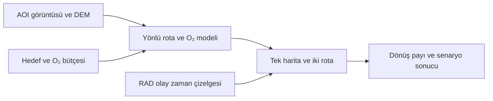

# REDLINE

**Tek saha üzerinde Mars EVA rotası, O₂ bütçesi ve geri dönüş sınırı.**

| | |
|---|---|
| Takım | CRST |
| Hedef | NASA Space Apps · Interplanetary Survival Guide: Martian Map |
| Sürüm | 0.1 · çalışan yerel prototip |
| Geliştirme kaydı | 31 Ekim 2026 |
| Demo | http://localhost:4173 |
| Kod | [redline-demo](redline-demo/README.md) |

## Ürünün tek sorusu

**Bu bilim durağına gidip rovera döndüğümde O₂ rezervim korunuyor mu?**

Kullanıcı haritada bir hedef seçer. REDLINE gidiş ve dönüş yolunu, tahmini süreyi ve O₂ tüketimini hesaplar. Kaynak bütçesine sığan alanın sınırını kırmızı çizer. En kısa rota ile tüketimi azaltan rota aynı girdilerle karşılaştırılır. SEP senaryosunda bilim durağı iptal edilir ve sabit rovera en hızlı dönüş hesaplanır.

## Şimdi açıp deneyebilirsin

```powershell
cd "C:\Users\USER\Desktop\space apps\redline-demo"
npm.cmd start
```

Tarayıcıda **http://localhost:4173** adresini aç. Node.js dışında kurulum ve API anahtarı gerekmez. Sunucu başka bir terminalde zaten çalışıyorsa aynı adresi kullan.

- İki bilim durağı veya haritaya tıklayarak özel hedef seçimi.
- Başlangıç O₂, korunan rezerv ve skafander kütlesi ayarları.
- Yönlü Dijkstra ile gerçek rota hesabı; 28° üzerindeki temsili hücrelerden kaçınma.
- Aynı dönüş yolunun O₂ maliyeti ve bütçeye sığan gidiş–dönüş alanı.
- Arazi, eğim ve dönüş alanı katmanları; yakınlaştırma ve kaydırma.
- 120× hızda yürüyüş, duraklatma, bilim durağı ve rovera dönüş.
- Yürüyüş ortasında SEP senaryosu ve sığınak erişim süresi.
- Kaynak/model açıklaması ve indirilebilir senaryo JSON'u.

## Hangi kısım gerçek, hangi kısım temsili?

| Bileşen | v0.1 durumu |
|---|---|
| Rota algoritması | Çalışıyor; gidiş ve dönüş yönlü maliyetlerle ayrı hesaplanıyor. |
| Eğim ve harita | Tek sentetik yükseklik ızgarasından hesaplanıyor. Gerçek Gale koordinatı yok. |
| Bilim durakları | Etkileşimi denemek için yerleştirildi. Gerçek hedef koordinatı yok. |
| O₂ tüketimi | Temsili eğim, zemin ve kütle katsayıları. %15 ek pay bir güven düzeyi değil. |
| SEP | Temsili erişim senaryosu. 20 dk eşik varsayım; RAD zaman dizisi ve doz hesabı henüz yok. |
| Kontrol | Rota motorunun 7 testi geçti; HTTP ve JavaScript sözdizimi kontrol edildi. Tarayıcı görsel kontrolü tamamlanamadı. |

Varsayılan örnekte 425 g başlangıç O₂ ve 70 g rezerv var. REDLINE yaklaşık 320 g, en kısa rota yaklaşık 357 g kullanıyor. REDLINE yaklaşık 35 g pay bırakırken kısa rota rezervi yaklaşık 2 g aşıyor. Bu sayılar sentetik senaryonun hesap çıktılarıdır.

## 39 saatte bitecek yarışma kapsamı

**Bir web uygulaması, bir AOI, sabit rover, tek astronot profili ve tek sarf kısıtı: O₂.** İki bilim durağı aynı sahanın içinde yer alır. Arazi görüntüsü, yükseklik/eğim ve radyasyon olayının zaman çizelgesi kaynakları ayrı belirtilir.



| Saat | Teslim edilecek çıktı | Karar |
|---|---|---|
| 0–4 | Küçük AOI için MRO görüntüsü ve DEM'in gerçek ortak kapsaması; kaynak, projeksiyon, çözünürlük kaydı | Boxwork kapsamı bulunamazsa verisi doğrulanmış başka bir Gale sahası seçilir. Tek AOI korunur. |
| 4–10 | Gerçek görüntü haritaya, gerçek DEM rota motoruna bağlanır; no-data hücreleri engellenir | Görüntü ve yükseklik hizası kontrol edilmeden gerçek rota iddiası kurulmaz. |
| 10–16 | İki bilim durağı kaynaklı görüntü/notla işaretlenir; O₂ katsayıları ve varsayımları sabitlenir | Yeni hareket modeli eklenmez; parametre duyarlılığı gösterilir. |
| 16–23 | En kısa rota/REDLINE karşılaştırması, ortak dönüş yolu ve O₂ payı; üç bütçeyle aynı senaryo | Süre, mesafe, tüketim ve en düşük pay aynı tabloya çıkarılır. |
| 23–28 | Erişilebilen Curiosity RAD zaman dizisi ve olay zaman çizelgesi | Veri alınamazsa SEP temsili kalır ve bu durum görünür yazılır. |
| 28–33 | Tekrarlanabilir senaryo, kaynak kartları, hata durumları ve dar ekran kontrolü | Özellik dondurma. |
| 33–37 | 30 saniyelik video, kısa proje açıklaması, çalıştırma adımları ve açık varsayımlar | Yalnızca gösterilebilen sonuçlar kullanılır. |
| 37–39 | Baştan sona tekrar çalıştırma, bağlantı ve teslim kontrolü | Son iki saat tampon. |

Veri, rota motoru ve arayüz üç ayrı iş akışı olarak ilerler. Gerçek veri edinimi ve hizalama en yüksek önceliktedir; çalışan sentetik çekirdek bu işin yerini tutmaz. 39 saatlik kapsamda UE5, ROS 2, hareketli rover ve eklenti geliştirmesi bulunmaz.

## Jüriye gösterilecek kanıt

1. Kullanıcı aynı sahada bütçeyi değiştirince dönüş alanı gerçekten değişir.
2. En kısa rota ile REDLINE aynı başlangıç, hedef ve rezervle karşılaştırılır.
3. Her gösterilen NASA veri setinin görevi, ürünü, tarihi ve çözünürlüğü görülebilir.
4. Ölçülen tarihsel olay ile varsayımsal insan EVA'sı ayrı anlatılır.
5. Başarısız plan rezervi aşar ve uygunmuş gibi oynatılamaz.

Kırmızı çizgi, model ve verinin varsayımları altındaki planlama alanıdır. Gerçek insanlı görev güvenliği garantisi verilmez. 20 Mayıs 2024 olayını boxwork sahasına uygulamak karşı-olgusal bir senaryodur; Curiosity'nin o gün orada ölçüm yaptığı iddia edilmez.

## Araştırma ve kayıt

Önceki geniş tasarım [araştırma arşivine](docs/REDLINE_RESEARCH.md) alındı. Eleştirel gerekçeler [jüri değerlendirmesinde](JURI_DEGERLENDIRME.md) yer alıyor. Kodun 31 Ekim 2026'da başlamış olması bu belgede açıkça kaydedilmiştir; önceki belgedeki “H0 öncesinde kod yok” beyanı artık güncel durumu anlatmaz. Yarışmaya sunulacak işin başlangıç kuralları için [Space Apps etkinlik açıklamasını](https://www.spaceappschallenge.org/2026/local-events/santiago-dominican-republic/) esas alın.
